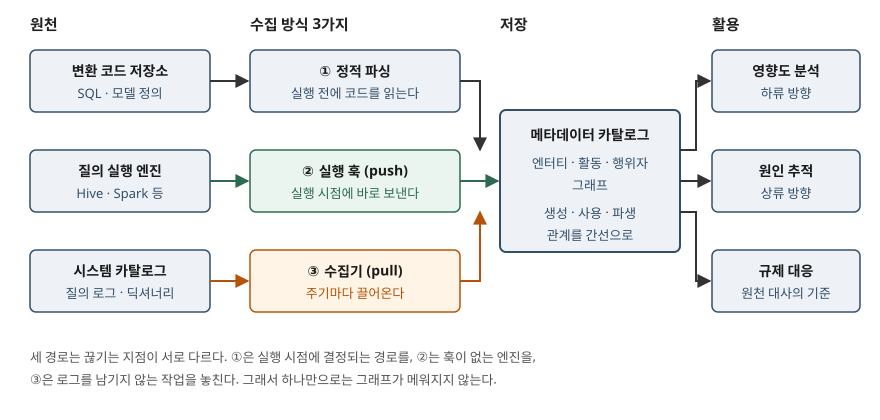

> **실행 검증 없음.** 이 글은 W3C 권고안·ISO 표준·바젤위원회 문서·오픈소스 공식 문서의 정의와
> 구성을 정리한 개념 글이다. 실행 예제가 없고, 도입 효과나 성능 수치는 싣지 않았다.
> 메타데이터 3분류의 근거인 DAMA-DMBOK2는 유료 간행물이라 본문을 직접 열지 못했고,
> 그 사실을 해당 절에 적었다.

## 들어가며

월간 매출 지표가 전월 대비 갑자기 꺾였다는 연락을 받으면, 가장 먼저 할 일은 그 숫자가
어느 테이블에서 나왔는지 찾는 일이다. 대시보드는 집계 테이블을 보고, 집계 테이블은 중간
테이블 몇 개를 조인하며, 그 중간 테이블은 다시 적재 작업 여러 개가 채운다. 이 경로가 어디에도
기록돼 있지 않으면 사람이 SQL을 하나씩 열어 거슬러 올라가야 하고, 그러는 동안 하루가 간다.
시험이 묻는 것은 이 경로를 **자동으로 기록하는 방법**이므로, 답안에는 계보의 정의와 수집
방식, 카탈로그가 맡는 역할을 개수와 함께 써야 한다.

## 정의

**데이터 계보**는 W3C의 출처 표현 표준인 PROV-DM이 정의한 **프로비넌스(provenance)** 를
데이터에 한정한 것이다. PROV-DM은 프로비넌스를 **어떤 데이터나 사물을 생산하고, 그것에
영향을 주고, 전달하는 데 관여한 사람·기관·엔터티·활동을 기술한 기록**으로 정의한다.
답안 첫 줄은 이렇게 쓴다 — **데이터 계보란 데이터가 어느 원천에서 생성되어 어떤 처리를
거쳐 현재 형태에 이르렀는지를, 엔터티·활동·행위자의 관계로 기록한 것이다.**

**메타데이터**는 ISO/IEC 11179-1:2023이 범위를 좁혀 쓴다. 이 표준의 모든 부에서 메타데이터는
**데이터에 대한 기술(description of data)** 만을 가리키며, 메타데이터 일반을 다루지 않는다고
명시한다. 계보는 그 기술 가운데 **관계**를 다루는 부분이다.

**메타데이터 카탈로그**는 W3C DCAT 3이 카탈로그를 **자원에 대한 메타데이터를 선별해 모아 둔
집합**으로 정의한 것을 그대로 쓰면 된다. 셋을 한 줄로 이으면, 카탈로그는 메타데이터를 담는
그릇이고 계보는 그 안에 담기는 관계 정보다.

## 등장 배경

데이터 파이프라인은 처음부터 여러 조각으로 나뉘어 자란다. 적재는 스케줄러가, 변환은 SQL이,
집계는 BI 도구가 맡고, 각자 자기 안에서만 의존 관계를 안다. 이 구조에서 세 가지가 답이 없는
질문으로 남는다.

- **영향도** — 원천 테이블의 컬럼 하나를 바꾸면 무엇이 깨지는지, 바꾸기 전에 알 방법이 없다
- **원인 추적** — 값이 틀렸을 때 어느 단계에서 틀어졌는지 역순으로 찾을 길이 없다
- **규제 대응** — 감독기관은 숫자의 근거를 요구하는데, 근거는 사람의 기억에만 있다

규제 요구는 실제 조문으로 확인된다. 바젤은행감독위원회의 리스크 데이터 집계 원칙(BCBS 239)은
**14개 원칙**을 거버넌스·인프라, 집계 역량, 보고 실무, 감독 검토의 **4개 묶음**으로 나누는데,
집계 역량에 속한 정확성·무결성 원칙은 **리스크 데이터를 회계 데이터를 포함한 자행의 원천과
대사(reconcile)해야 한다**고 적는다. 경로가 기록돼 있지 않으면 대사 자체가 수작업이 된다.

## 구성요소

### 계보를 표현하는 3요소와 7가지 관계

PROV-DM은 **6개 구성요소(component)** 로 나뉘고 그중 앞의 세 개가 핵심 구조를 담는다.
핵심 타입은 **3가지**다.

| 타입 | 정의 | 데이터 파이프라인에서 |
|---|---|---|
| 엔터티(Entity) | 고정된 측면을 가진 물리적·디지털·개념적 사물 | 테이블, 파일, 컬럼, 모델 산출물 |
| 활동(Activity) | 일정 기간에 걸쳐 일어나며 엔터티에 작용하는 것 | 질의 실행, 적재 작업, 학습 작업 |
| 행위자(Agent) | 활동이 일어나는 데 책임을 지는 주체 | 사람, 조직, 서비스 계정, 실행 엔진 |

이 셋을 잇는 **핵심 관계는 7가지**이며 모두 이항 관계다.

| 관계 | 묻는 것 |
|---|---|
| ① wasGeneratedBy (생성) | 이 엔터티는 어느 활동이 만들었는가 |
| ② used (사용) | 이 활동은 어느 엔터티를 입력으로 썼는가 |
| ③ wasInformedBy (전달) | 이 활동은 어느 활동으로부터 이어졌는가 |
| ④ wasDerivedFrom (파생) | 이 엔터티는 어느 엔터티에서 나왔는가 |
| ⑤ wasAttributedTo (귀속) | 이 엔터티의 책임은 누구에게 있는가 |
| ⑥ wasAssociatedWith (연관) | 이 활동에 누가 관여했는가 |
| ⑦ actedOnBehalfOf (위임) | 이 행위자는 누구를 대신해 행동했는가 |

계보 도구가 그리는 화살표는 대부분 ①②④를 시각화한 것이다. ⑤⑥⑦은 책임 소재를 남기는
부분이어서 규제 대응에서 값을 한다.

### 카탈로그의 구성 — DCAT 3의 클래스

W3C DCAT 3은 카탈로그를 웹에 공개된 카탈로그끼리 상호운용하기 위한 어휘로 정의하고,
서로 다른 사이트의 카탈로그를 **하나의 질의 구조로 연합 검색**할 수 있게 하는 것을 목표로 둔다.
핵심 클래스는 **6가지**다.

| 클래스 | 무엇 |
|---|---|
| ① dcat:Resource | 단일 주체가 발행·선별한 자원. 아래 셋의 상위 클래스이자 확장점 |
| ② dcat:Dataset | 단일 주체나 식별 가능한 공동체가 발행·선별한 데이터의 집합(개념) |
| ③ dcat:Distribution | 데이터셋에 접근할 수 있는 구체적 형태(내려받을 파일 등) |
| ④ dcat:DataService | 인터페이스(API)로 접근하는 연산의 집합 |
| ⑤ dcat:Catalog | 자원에 대한 메타데이터를 선별해 모은 집합. DCAT 3에서 Dataset의 하위 클래스 |
| ⑥ dcat:CatalogRecord | 등록 정보를 담는 항목(누가 언제 등록했는지). 사용은 선택 |

DCAT은 계보를 직접 정의하지 않고 **PROV-O의 용어를 그대로 가져다 쓴다**. `prov:wasRevisionOf`,
`prov:qualifiedAttribution` 같은 속성이 그 예다. 카탈로그 표준이 계보 표준을 참조하는 구조이므로,
답안에서 둘을 따로 외우지 말고 **"카탈로그(DCAT)가 그릇, 계보(PROV)가 내용"** 으로 묶어 두면 된다.

### 메타데이터의 3계층 분류

실무에서 가장 널리 인용되는 분류는 DAMA-DMBOK2의 **3가지** 구분이다. 다만 DMBOK2는 유료
간행물이라 본문을 직접 확인하지 못했고, 아래는 여러 해설이 공통으로 전하는 범위만 적는다.

| 계층 | 담는 것 |
|---|---|
| 기술(technical) 메타데이터 | 물리 테이블·컬럼·타입·모델·접근 권한 등 시스템이 쓰는 구조 정보 |
| 비즈니스(business) 메타데이터 | 용어 정의, 업무 규칙, 소유 주체 등 데이터의 의미 |
| 운영(operational) 메타데이터 | 작업 수행 이력, 오류 로그, 보존 규칙 등 처리·접근의 기록 |

**수집 시점으로 나누면 2가지**가 되고, 이 구분은 OpenLineage 객체 모델에 그대로 드러난다.
설계 시점 메타데이터는 `JobEvent`·`DatasetEvent`로 올라가고(소스 코드 위치, 스키마, 소유 정보),
실행 시점 메타데이터는 실행 한 번마다 `RunEvent`로 올라간다. OpenLineage는 작업을 `Job`,
그 한 번의 실행을 `Run`, 입출력 데이터를 `Dataset`의 **3개 엔터티**로 두고, 각 이벤트를
"구별되는 하나의 관측"으로 다뤄 누적 병합한다. 그래서 입력 데이터셋이 시작 이벤트에만 실려도,
완료 이벤트에만 실려도, 양쪽에 실려도 결과는 같다.

### 계보 수집 방식 — 3가지

| 방식 | 언제 수집하나 | 대표 구현 |
|---|---|---|
| ① 정적 파싱 | 실행 전, 코드에서 의존 관계를 읽는다 | dbt의 `ref()` |
| ② 실행 훅(push) | 실행 시점에 엔진이 직접 내보낸다 | Apache Atlas 훅, DataHub 이미터 |
| ③ 수집기(pull) | 사후에 원천 카탈로그·로그를 끌어온다 | DataHub 수집 파이프라인 |

**① 정적 파싱.** dbt는 모델 SQL에서 테이블 이름 대신 `ref()` 함수를 쓰게 하고, 이 호출로
모델 사이의 의존 관계를 만든다. 공식 문서는 dbt가 `ref` 함수를 써서 **모델을 실행할 순서를
정하는 비순환 방향 그래프(DAG)를 만든다**고 적는다. 코드만 읽어 그래프를 얻으므로 아직 돌지
않은 파이프라인의 계보도 그릴 수 있다.

**② 실행 훅.** Apache Atlas의 Hive 훅은 `hive-site.xml`의 `hive.exec.post.hooks`에 등록되어
생성·갱신·삭제 작업을 감지하고 메타데이터 변경을 Kafka 알림으로 Atlas에 보낸다. Atlas는 Kafka를
훅과 소비자 사이의 알림 서버로 쓰고, 메타데이터는 그래프 모델(JanusGraph)에 저장한다.
알림은 스레드 풀에서 비동기로 처리되는데, `atlas.hook.hive.synchronous`의 기본값이 `false`인
이유를 공식 문서는 **Hive 질의 완료가 지연되는 것을 피하기 위해 권장**한다고 적는다. 큐는 기본
10,000건, 실패 시 기본 3회 재시도다. 컬럼 수준 계보는 0.8-incubating부터 지원되며,
`ColumnLineageProcess`가 출력 컬럼을 입력 컬럼이나 입력 테이블에 잇고 의존 유형을
SIMPLE·EXPRESSION·SCRIPT **3가지**로 구분한다.

**③ 수집기.** DataHub는 반대 방향을 둔다. 파이썬 수집 모듈이 원천 시스템에 접속해 메타데이터를
끌어온 뒤 Kafka나 HTTP로 저장 계층에 밀어 넣는다. 공식 문서는 이 방식을 **정해진 주기로 반복
수집하고 새 원천으로 범위를 넓히는 데 적합**하다고 설명하고, 반대편의 푸시 방식은 원천이
**발생 지점에서 직접 내보내는 것**이라고 구분한다.

## 도식

> **출처**: [W3C PROV-DM §2 PROV-DM Overview(핵심 타입과 7개 관계)](https://www.w3.org/TR/prov-dm/#section-prov-overview), [Apache Atlas 2.0.0 — Architecture(훅·Kafka·그래프 저장)](https://atlas.apache.org/2.0.0/Architecture.html) · [Hook-Hive](https://atlas.apache.org/2.0.0/Hook-Hive.html), [DataHub — Metadata Ingestion Architecture(push·pull 구분)](https://docs.datahub.com/docs/architecture/metadata-ingestion), [dbt Docs — SQL models: ref 함수와 DAG](https://docs.getdbt.com/docs/build/sql-models)을 합쳐 그렸다.

세 경로가 한 그릇으로 모이는 모양이 핵심이다. 오른쪽 활용 세 가지는 모두 같은 그래프를
읽으므로, 그래프에 빠진 구간이 있으면 셋이 함께 틀린다.

## 비교

### 수집 방식 3가지

| | ① 정적 파싱 | ② 실행 훅 | ③ 수집기 |
|---|---|---|---|
| 수집 시점 | 실행 전(컴파일) | 실행 중 | 실행 후, 주기적 |
| 실행 없이 되는가 | 된다 | 안 된다 | 안 된다 |
| 실행 시점에 결정되는 경로 | 못 잡는다 | 잡는다 | 로그에 남으면 잡는다 |
| 원천 시스템 부담 | 없다 | 있다(비동기로 완화) | 조회 부하 |
| 끊기는 지점 | 동적 SQL, 외부 도구 | 훅이 없는 엔진 | 로그를 남기지 않는 작업 |

### 계보 분석의 두 방향

같은 그래프를 어느 쪽으로 따라가느냐의 차이일 뿐이어서, 시험에서 둘을 섞어 묻는다.

| | 계보 추적(상류) | 영향도 분석(하류) |
|---|---|---|
| 출발점 | 틀린 결과물 | 바꾸려는 원천 |
| 따라가는 관계 | `wasDerivedFrom`을 역방향으로 | `wasDerivedFrom`을 정방향으로 |
| 답하는 질문 | 이 값은 어디서 왔는가 | 이것을 바꾸면 무엇이 깨지는가 |
| 쓰는 국면 | 장애·품질 사고 조사 | 변경 전 사전 검토 |

## 적용 시 고려사항

- **입도를 먼저 정한다.** 테이블 수준 계보와 컬럼 수준 계보는 비용이 다르다. Atlas의 컬럼
  수준 계보는 Hive의 `LineageInfo`를 훅 문맥에서 받아 매핑하는 방식이라 엔진 쪽 조건이 붙는다
  (공식 문서는 HIVE-13112 패치가 적용된 Hive 1.2.1을 요건으로 적는다). 전 구간을 컬럼 수준으로
  깔겠다고 정하기 전에, 어느 구간에서 컬럼 입도가 실제로 필요한지 먼저 가린다.
- **한 가지 방식으로 덮으려 하지 않는다.** 파싱으로 뼈대를 세우고, 주력 엔진에 훅을 붙이고,
  나머지를 수집기로 메우는 조합이 현실적인 구성이다.
- **훅은 원천의 응답 시간에 얹힌다.** Atlas가 Hive 훅을 기본 비동기로 두고 그 이유를 질의 완료
  지연 회피라고 밝힌 것은, 동기로 돌리면 사용자 질의가 메타데이터 전송을 기다린다는 뜻이다.
  큐가 차거나 재시도가 소진되면 알림이 유실될 수 있으므로, 유실분을 메울 수집기 경로를 함께 둔다.
- **경로를 그린 것과 값을 맞춰 본 것은 다르다.** BCBS 239의 정확성·무결성 원칙이 요구하는
  것은 원천과의 **대사**다. 계보 그래프는 어디와 맞춰 봐야 하는지를 알려 줄 뿐이고, 대사
  자체는 별도 절차다. 답안에서 "계보를 구축하면 규제를 만족한다"고 쓰면 감점 지점이 된다.
- **등록되지 않은 구간은 없는 것과 같다.** 중간에 개인 스크립트나 수작업 엑셀이 끼면 그 지점에서
  그래프가 끊기고, 끊긴 계보는 영향도 분석에서 **누락을 "영향 없음"으로 보고**한다. 틀린 답을
  자신 있게 내놓는 쪽이 답이 없는 쪽보다 위험하다.

## 정리

- 정의: 데이터 계보는 **엔터티·활동·행위자의 관계로 기록한 데이터의 생성 경로**(W3C PROV-DM),
  카탈로그는 **자원에 대한 메타데이터를 선별해 모아 둔 집합**(W3C DCAT 3).
- 계보 표현 **3요소 "엔·활·행"** — 엔터티, 활동, 행위자. 핵심 관계는 **7가지**이고
  도구가 그리는 화살표는 주로 생성·사용·파생 **3가지**다.
- 수집 방식 **3가지 "파·훅·수"** — 정적 파싱(실행 전), 실행 훅(push), 수집기(pull).
  끊기는 지점이 서로 달라 조합해야 메워진다.
- 카탈로그 표준 DCAT 3의 클래스 **6가지**, 그리고 DCAT이 계보를 **PROV-O에 위임**한다는 점.
- 메타데이터 분류는 **3계층**(기술·비즈니스·운영), 수집 시점으로는 **설계 시점과 실행 시점 2가지**.
- 규제는 계보가 아니라 **대사**를 요구한다(BCBS 239, 원칙 14개·묶음 4개).

> 기출 답안: [기출문제 — 데이터 레이크 아키텍처와 데이터 스웜프](../../exam/2026-10-13-data-lake-architecture-data-swamp/index.md)

> 관련 개념: [데이터 거버넌스와 데이터 품질 관리 체계](../2026-10-06-data-governance-quality-dimensions-roles/index.md)

## 참고 자료

- [W3C — PROV-DM: The PROV Data Model (W3C Recommendation, 2013-04-30)](https://www.w3.org/TR/prov-dm/) — 프로비넌스 정의, 핵심 타입 3종과 7개 관계, 6개 구성요소
- [W3C — Data Catalog Vocabulary (DCAT) Version 3 (W3C Recommendation, 2024-08-22)](https://www.w3.org/TR/vocab-dcat-3/) — 카탈로그 정의, 핵심 클래스, PROV-O 재사용
- [ISO/IEC 11179-1:2023 — Information technology: Metadata registries (MDR), Part 1: Framework](https://www.iso.org/standard/78914.html) — 4판(2023-01), 메타데이터를 "데이터에 대한 기술"로 한정하는 범위 규정
- [BCBS — Principles for effective risk data aggregation and risk reporting (2013-01-09)](https://www.bis.org/publ/bcbs239.pdf) · [Basel Framework SRP36 (2019-12-15판)](https://www.bis.org/committees/bcbs/basel-framework/standard/srp/36/inforce/2019-12-15/published/2019-12-15) — 원칙 14개와 4개 묶음, 원칙 3의 원천 대사 요구(36.27)
- [Apache Atlas 2.0.0 — Architecture](https://atlas.apache.org/2.0.0/Architecture.html) · [Hook-Hive](https://atlas.apache.org/2.0.0/Hook-Hive.html) — 훅 등록, 비동기 알림 기본값, 컬럼 수준 계보와 의존 유형 3종
- [OpenLineage — Object Model](https://openlineage.io/docs/spec/object-model) — Job·Run·Dataset 3개 엔터티, RunEvent·JobEvent·DatasetEvent 구분
- [DataHub — Metadata Ingestion Architecture](https://docs.datahub.com/docs/architecture/metadata-ingestion) — push 기반과 pull 기반 수집의 구분
- [dbt Docs — Build your DAG: SQL models](https://docs.getdbt.com/docs/build/sql-models) — `ref()`로 의존 관계를 만들고 DAG로 실행 순서를 정하는 방식
- [DAMA International — DAMA-DMBOK, 2nd Edition (2017)](https://www.dama.org/cpages/body-of-knowledge) — 메타데이터 3분류의 출처(유료 간행물, 본문 미확인)
