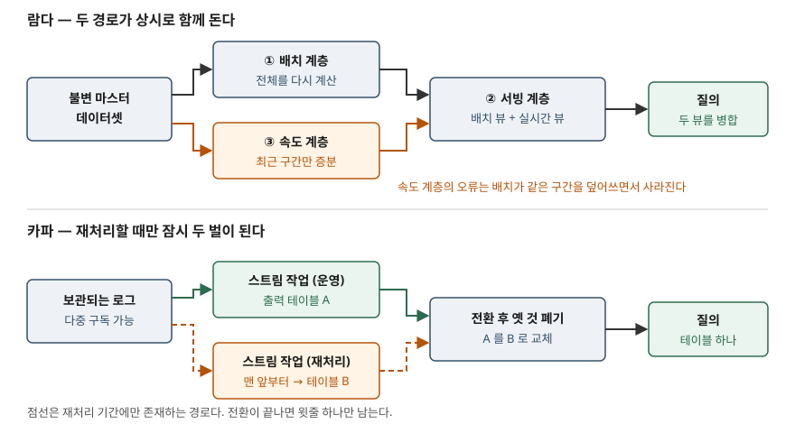

> **실행 검증 없음.** 이 글은 두 아키텍처를 **제안한 당사자의 원문**과 Apache Kafka 공식 문서의
> 서술만으로 정리한 개념 글이다. 실행 예제가 없고, 처리량·지연 수치나 도입 효과는 싣지 않았다.

## 들어가며

같은 지표를 두 곳에서 내는 조직은 흔하다. 일 단위 집계는 밤에 도는 배치가 내고, 화면에 뜨는
실시간 숫자는 스트림 처리기가 낸다. 처음에는 잘 돌지만, 집계 규칙이 한 번 바뀌면 배치 쪽
코드와 스트림 쪽 코드를 **둘 다** 고쳐야 하고, 둘 중 하나만 반영된 기간이 생기면 두 숫자가
어긋난다. 시험은 이 중복을 전제로 설계한 구조(람다)와 중복 자체를 없애려는 구조(카파)를
나란히 묻는다. 답안에는 두 구조의 계층 구성과 단계 수, 그리고 **무엇을 맞바꾸는지**를 적어야 한다.

## 정의

**람다 아키텍처**는 Nathan Marz가 2011년 제안한 구조로, 모든 질의를 **`query = function(all data)`**,
곧 전체 데이터에 대한 함수로 보고 그 함수를 **배치 계층·서빙 계층·속도 계층의 3계층**으로 나눠
계산하는 구조다. 데이터는 타임스탬프가 붙은 사실로만 쌓이고 **변경되거나 삭제되지 않는다.**

**카파 아키텍처**는 Jay Kreps가 2014년 람다를 비판하며 제시한 대안으로, **보관되는 로그 하나를
유일한 입력으로 두고 스트림 처리 경로만 유지하며, 재처리가 필요하면 같은 작업을 로그 처음부터
다시 돌려 출력을 통째로 교체하는** 구조다.

답안 첫 줄은 이렇게 쓴다 — **람다는 같은 계산을 배치와 스트림 두 경로로 수행해 질의 시점에
병합하는 구조이고, 카파는 그 두 경로를 스트림 하나로 합치고 재처리를 로그 재생으로 대신하는
구조다.**

## 등장 배경

Marz가 2011년 글에서 든 문제는 **인적 내결함성**이다. 값을 제자리에서 갱신하는 시스템은 사람이
낸 실수를 되돌릴 수 없다. 잘못된 로직이 집계를 덮어쓰면 원래 값이 사라지기 때문이다. 데이터를
불변의 사실로만 쌓아 두면 버그를 고친 뒤 원본에서 다시 계산하면 되고, 나쁜 데이터는 지우고
뷰를 다시 만들면 된다. **좋은 것이 덮어써지는 일이 없다**는 것이 이 설계의 출발점이다.

문제는 전체 재계산이 몇 시간씩 걸려 최근 구간이 비는 것이다. 그래서 그 구간만 증분으로 메우는
경로를 덧댄다. 여기서 **같은 계산 로직이 두 시스템에 존재한다**는 비용이 생긴다.

Kreps가 2014년에 친 지점이 정확히 이 비용이다. 그는 같은 로직을 두 분산 시스템에서 동작시키는
일이 **"보이는 그대로 고통스럽다"** 고 적고, 이것이 고칠 수 있는 문제가 아니라고 본다. 코드는
프레임워크에 묶이고, 운영 복잡도는 이 방식을 실제로 쓰는 사람들이 모두 동의하는 단점이라는
것이다. Summingbird 같은 추상화 계층이 도움은 되지만 **두 시스템이 공통으로 가진 기능만
지원**하고 추상화가 새기 때문에 결국 양쪽을 깊이 알아야 한다고 LinkedIn 경험을 들어 적는다.

## 구성요소

### 람다 아키텍처 — 3계층

계층 이름은 Marz와 Warren의 책 『Big Data』(Manning, 2015)가 **Part 1 Batch Layer,
Part 2 Serving Layer, Part 3 Speed Layer**로 책 전체를 나눌 만큼 이 구조의 뼈대다.

| 계층 | 하는 일 | 2011년 원문이 든 구현 |
|---|---|---|
| ① 배치 계층 | 불변 마스터 데이터셋 **전체**에 함수를 적용해 배치 뷰를 미리 계산한다 | Hadoop MapReduce |
| ② 서빙 계층 | 배치 뷰를 읽기 전용으로 색인해 애플리케이션이 빠르게 읽게 한다 | ElephantDB |
| ③ 속도 계층 | 배치가 아직 처리하지 못한 **최근 몇 시간** 구간만 증분 갱신한다 | Storm + Cassandra |

질의는 **배치 뷰와 실시간 뷰를 각각 읽어 병합**해 답한다. 이 구조에서 속도 계층의 오류는
일시적이다. 뒤따라온 배치 계층이 같은 구간을 다시 계산해 덮어쓰기 때문이다. 틀려도 되는
경로와 틀리면 안 되는 경로를 분리한 것이 설계의 요점이다.

### 카파 아키텍처 — 재처리 4단계

Kreps가 "선호하는 방식"으로 제시한 절차는 **4단계**다.

| 단계 | 하는 일 |
|---|---|
| ① 보관 | Kafka 같은 시스템에 입력 데이터의 **전체 로그**를 보관하고 다중 구독을 지원하게 한다 |
| ② 재처리 | 재처리가 필요하면 스트림 작업의 **두 번째 인스턴스**를 로그 맨 앞부터 돌려 **새 출력 테이블**에 쓴다 |
| ③ 전환 | 두 번째 작업이 따라잡으면 애플리케이션이 새 테이블을 읽도록 전환한다 |
| ④ 폐기 | 기존 작업을 멈추고 옛 출력 테이블을 지운다 |

Kreps는 되돌리기 쉽도록 **두 테이블을 잠시 함께 두라**고 덧붙이고, 전환을 A/B 테스트로
조절하는 선택지도 든다. 그리고 "이것을 카파 아키텍처라 불러도 되겠다"며, 그리스 문자를 붙일
만큼 복잡한 것인지는 모르겠다는 단서를 함께 단다. 이름이 본인 손에서 조심스럽게 붙었다는
점은 답안에 쓸 만한 사실이다.

### 카파를 성립시키는 전제 — 로그의 3가지 성질

이 절차는 로그 저장소가 다음을 만족해야 돌아간다. Apache Kafka 공식 문서는 자신의 핵심 역량을
**발행·구독, 보관, 처리의 3가지**로 들고 그 성질을 이렇게 적는다.

- **원하는 만큼 오래 내구성 있게 보관한다.** 보관 기간은 **토픽마다 따로 설정**하고, 그 기간이
  지난 이벤트는 버린다
- **읽어도 이벤트가 지워지지 않는다.** 전통적인 메시징 시스템과 달라, 여러 소비자가 같은
  데이터를 각자 독립적으로 읽을 수 있다
- **저장량이 늘어도 성능이 거의 일정하다.** 그래서 데이터를 오래 보관하는 운용이 현실적이다

②의 "두 번째 인스턴스"는 첫 번째 성질이 아니라 **두 번째 성질** 덕분에 가능하다. 재처리 작업이
로그를 읽어도 운영 중인 작업이 읽을 데이터가 줄지 않기 때문이다.

## 도식

> **출처**: [Nathan Marz, How to beat the CAP theorem (2011-10-13)](http://nathanmarz.com/blog/how-to-beat-the-cap-theorem.html) — 배치 뷰·실시간 뷰와 질의 시 병합, [Marz·Warren, Big Data (Manning, 2015)](https://www.manning.com/books/big-data) — Batch·Serving·Speed 계층 구분, [Jay Kreps, Questioning the Lambda Architecture (O'Reilly Radar, 2014-07-02)](https://webarchive.library.unt.edu/web/20170117163041mp_/http://radar.oreilly.com/2014/07/questioning-the-lambda-architecture.html) — 재처리 4단계와 출력 테이블 교체.

위쪽은 같은 입력이 두 갈래로 갈라졌다가 질의 시점에 다시 합쳐지고, 아래쪽은 갈라지지 않는 대신
**재처리할 때만 일시적으로 두 벌이 된다.** 람다의 두 경로는 상시 두 벌이고 카파의 두 벌은
전환이 끝나면 사라진다는 점이 그림에서 보여야 한다.

## 비교

| | 람다 아키텍처 | 카파 아키텍처 |
|---|---|---|
| 제안 | Nathan Marz (2011) | Jay Kreps (2014) |
| 입력 | 불변 마스터 데이터셋 | 보관되는 로그 |
| 처리 경로 | 배치 + 스트림, 상시 2개 | 스트림 1개 |
| 로직 구현 | 두 벌(프레임워크가 다름) | 한 벌 |
| 최근 구간 보정 | 속도 계층이 메우고 배치가 덮어쓴다 | 보정 개념이 없다(한 경로가 전부) |
| 재계산 방법 | 배치 계층이 전체를 다시 돈다 | 로그 맨 앞부터 두 번째 작업을 돌린다 |
| 질의 시점 | 배치 뷰 + 실시간 뷰를 병합 | 현재 출력 테이블 하나를 읽는다 |
| 일시적 중복 | 상시 | 재처리 구간에서만 |
| 전제 조건 | 전체 재계산이 가능한 배치 기반 | 로그 보관 기간이 재처리 범위를 덮을 것 |
| 주요 비용 | 두 시스템의 운영·디버깅 | 재처리 시 자원 두 벌, 보관 비용 |

두 구조가 **공유하는 전제**를 놓치지 않는다. 입력을 불변으로 두는 것, 그리고 원본에서 결과를
다시 계산할 수 있게 하는 것이다. Kreps 자신이 람다의 이 두 가지를 가치 있는 원칙으로 인정하고,
자신이 문제 삼는 것은 **두 경로를 유지하는 방식**이라고 밝힌다.

## 적용 시 고려사항

- **보관 기간이 재처리 범위의 상한이다.** Kafka는 토픽마다 보관 기간을 두고 지난 이벤트를
  버린다. 1년치를 다시 계산해야 하는데 로그가 30일치면 카파의 ② 단계가 성립하지 않는다.
  보관 정책을 먼저 정하지 않고 카파를 고르면, 필요한 날 재처리를 못 한다.
- **재처리 비용은 보관량에 비례한다.** 맨 앞부터 다시 읽는 방식이므로 로그가 길수록 따라잡는
  시간이 길어지고, 그 기간에는 운영 작업과 재처리 작업이 **동시에** 돈다. 전환이 끝날 때까지
  자원도 출력 저장소도 두 벌을 잡아 둬야 한다.
- **전환 시점을 설계에 넣는다.** ③ 단계는 애플리케이션이 읽는 대상을 통째로 바꾸는 작업이다.
  Kreps가 옛 테이블을 바로 지우지 말라고 적은 이유가 여기 있다. 전환을 되돌릴 수단 없이
  ④를 먼저 하면 복구 수단이 사라진다.
- **람다의 비용은 코드 줄 수가 아니라 운영이다.** 추상화로 코드를 한 벌처럼 보이게 해도
  두 시스템을 돌리고 디버깅하는 비용은 남고, 추상화는 두 시스템의 교집합만 제공한다.
  "공통 DSL을 쓰면 해결된다"고 쓰면 원문이 이미 반박한 답을 쓰는 셈이 된다.
- **둘 중 하나를 "더 나은 것"으로 쓰지 않는다.** 카파는 로그 재생으로 배치를 대신할 수 있을 때
  성립하는 구조다. 재계산이 로그 재생으로 표현되지 않는 작업(외부 시스템 대량 조인, 로그에
  없는 과거 데이터의 백필)이 있으면 배치 경로가 여전히 필요하다. 답안에서는 **선택 기준**을
  적는 쪽이 점수가 된다.

## 정리

- 정의: 람다는 **`query = function(all data)`를 배치·서빙·속도 3계층으로 나눠 계산하고 질의
  시점에 병합**하는 구조, 카파는 **보관 로그 하나를 입력으로 스트림 경로만 두고 재처리를 로그
  재생으로 대신**하는 구조.
- 람다 **3계층 "배·서·속"** — 배치 계층(전체 재계산), 서빙 계층(배치 뷰 색인), 속도 계층(최근 구간).
  속도 계층의 오류는 **배치가 덮어쓰므로 일시적**이다.
- 카파 **4단계 "보·재·전·폐"** — 로그 보관, 맨 앞부터 재처리, 새 출력으로 전환, 옛 것 폐기.
- 카파의 전제는 로그의 **3가지 성질** — 기간 설정 가능한 내구성 보관, 읽어도 지워지지 않음,
  저장량과 거의 무관한 성능.
- 가르는 축은 하나다. **로직을 두 벌 유지하는 비용**(람다)과 **로그를 길게 보관하고 재처리에
  자원을 두 벌 쓰는 비용**(카파) 가운데 무엇을 받아들일 것인가.
- 공통 전제는 **입력 불변 + 원본에서 재계산 가능**. 이 둘은 카파도 버리지 않았다.

> 기출 답안: [기출문제 — 데이터 레이크 아키텍처와 데이터 스웜프](../../exam/2026-10-13-data-lake-architecture-data-swamp/index.md)

> 관련 개념: [데이터 웨어하우스·레이크·레이크하우스 — 스키마를 언제 정하는가](../2026-10-06-dw-lake-lakehouse-schema-timing/index.md)

## 참고 자료

- [Nathan Marz — How to beat the CAP theorem (2011-10-13)](http://nathanmarz.com/blog/how-to-beat-the-cap-theorem.html) — `query = function(all data)`, 불변 마스터 데이터셋, 배치 뷰와 실시간 뷰의 병합, 인적 내결함성
- [Nathan Marz, James Warren — Big Data: Principles and best practices of scalable realtime data systems (Manning, 2015)](https://www.manning.com/books/big-data) — Batch Layer · Serving Layer · Speed Layer로 나뉜 책 구성
- [Jay Kreps — Questioning the Lambda Architecture (O'Reilly Radar, 2014-07-02)](https://webarchive.library.unt.edu/web/20170117163041mp_/http://radar.oreilly.com/2014/07/questioning-the-lambda-architecture.html) — 람다 비판, 재처리 4단계, "카파 아키텍처" 명명 (원문은 [oreilly.com](https://www.oreilly.com/radar/questioning-the-lambda-architecture/), 여기서는 아카이브본을 확인했다)
- [Apache Kafka — Introduction](https://kafka.apache.org/intro) — 핵심 역량 3가지, 토픽별 보관 기간, 읽어도 삭제되지 않는 소비 모델
