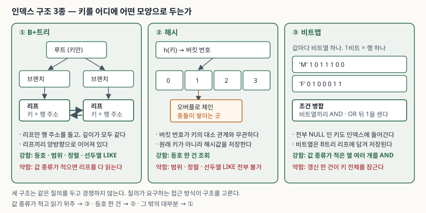

> **실행 검증 없음.** 이 글은 Oracle Database 19c 개념 설명서와 PostgreSQL 17
> 공식 문서, 그리고 각 구조의 원 논문에 적힌 내용만으로 정리했다. 성능 수치나
> 실행계획은 싣지 않는다.

## 들어가며

인덱스 문제는 "B트리를 그려라"로 끝나지 않는다. 구조를 하나 더 얹어 "이 질의에는
어느 구조가 맞고 왜 그런가"를 묻는 쪽이 배점이 크다. 실무에서도 같은 질문을 받는다.
성별이나 상태 코드처럼 값이 몇 종류뿐인 열에 인덱스를 걸었는데 옵티마이저가
안 쓰거나, 쓰는데도 느려지는 일이 있다. 구조가 다르면 잘하는 일이 다르기 때문이다.

세 구조를 **키를 어디에 어떤 모양으로 두는가**로 갈라 보면 나머지가 따라온다.

## 정의

| 구조 | 한 문장 정의 |
|---|---|
| **B+트리** | 모든 키가 리프에 모이고 리프끼리 양방향으로 이어진, 높이가 균일한 다분기 트리 |
| **해시** | 키에 해시 함수를 적용해 얻은 버킷 번호로 저장 위치를 직접 계산하는 구조 |
| **비트맵** | 키 값마다 비트열을 하나씩 두고, 각 비트를 행 하나에 대응시키는 구조 |

Oracle 개념 설명서는 B트리 인덱스를 **브랜치 블록과 리프 블록**으로 나누고,
리프 블록이 "모든 인덱스 값과 각 행의 rowid"를 담으며 서로 양방향 연결 리스트로
이어져 범위 스캔을 받친다고 적는다. 이것이 B+트리의 정의 그대로다.
같은 문서는 비트맵 인덱스를 "인덱스 키마다 비트맵을 하나씩 저장하고, 비트가 켜져
있으면 그 rowid의 행이 그 키 값을 갖는다"로 정의한다.

PostgreSQL 문서는 해시 인덱스가 "인덱스 열 값에서 유도한 32비트 해시 코드를
저장하므로 단순 등호 비교만 처리할 수 있다"고 적는다. **원래 키를 저장하지 않는다**는
점이 이 구조의 모든 제약을 낳는다.

## 등장 배경

세 구조는 서로 다른 문제에서 나왔다.

1. **B+트리** — 디스크는 블록 단위로 읽힌다. 이진 트리는 키가 100만 개면 높이가
   20이고, 그만큼 블록을 읽어야 한다. Bayer와 McCreight(1972)는 한 노드의 분기 수를
   블록 하나에 들어갈 만큼 키워 높이를 서너 단계로 줄였다. Comer(1979)가 정리한
   B+트리 변형은 여기서 한 걸음 더 나아가 **데이터 포인터를 리프에만 두고 리프를
   연결**해, 범위 질의가 트리를 다시 타지 않고 옆으로 걸어가게 만들었다.
2. **해시** — 등호 한 건을 찾는 데 트리 높이만큼 블록을 읽는 것도 아깝다는 데서
   출발했다. 주소를 계산해 한 번에 간다. 파일이 커질 때 전체를 다시 해싱하지 않는
   방법이 과제였고, 확장성 해싱(Fagin 외, 1979)과 선형 해싱(Litwin, 1980)이 답을 냈다.
3. **비트맵** — 데이터 웨어하우스에서는 값 종류가 적은 열 여러 개에 조건이 동시에
   걸린다. 조건마다 rowid 목록을 만들어 교집합을 구하는 대신, 비트열을 비트 연산으로
   겹치면 훨씬 싸다는 것이 O'Neil과 Quass(1997)의 관찰이다.

## 구성요소 — 구조마다 3가지

| 구조 | 구성요소 3가지 |
|---|---|
| B+트리 | ① 루트 블록 ② 브랜치 블록(분기용 키 접두사) ③ 리프 블록(키 + 행 주소) |
| 해시 | ① 해시 함수 ② 버킷 배열 ③ 충돌 처리(오버플로 체인 등) |
| 비트맵 | ① 키 값 ② 비트열 ③ 비트 위치 ↔ rowid 사상 함수 |

Oracle 문서는 브랜치 블록이 "두 키를 구분하는 데 필요한 최소 접두사"만 담아 블록당
항목 수를 늘린다고 적고, 비트맵 역시 내부적으로는 B트리 구조에 담겨 리프 블록이
개별 비트맵을 들고 있다고 설명한다. **비트맵은 B트리를 대체하는 것이 아니라
B트리 위에 올라간 저장 방식**이라는 점을 답안에 적어 두면 좋다.

## 도식

> **출처**: [Oracle Database 19c Concepts — Indexes and Index-Organized Tables §3 (B-tree 구조, Bitmap Indexes)](https://docs.oracle.com/en/database/oracle/oracle-database/19/cncpt/indexes-and-index-organized-tables.html), [PostgreSQL 17 Documentation — Index Types §11.2 Hash](https://www.postgresql.org/docs/17/indexes-types.html)

## 비교 — 7개 항목

| 항목 | B+트리 | 해시 | 비트맵 |
|---|---|---|---|
| 지원 연산 | 등호·범위·`BETWEEN`·`IN`·`IS NULL`·선두 고정 `LIKE` | 등호만 | 등호 중심, 조건 여러 개를 병합 |
| 정렬 출력 | 가능 (리프가 키 순서) | 불가 (버킷 번호가 키 순서와 무관) | 불가 |
| 다중 열 | 지원 | PostgreSQL 기준 미지원 | 지원하되 열별 인덱스를 병합하는 쪽이 일반적 |
| 유일성 제약 | 지원 | PostgreSQL 기준 미지원 | 해당 없음 |
| 적합한 카디널리티 | 값 종류가 많을수록 유리 | 값 종류가 많은 열의 등호 조회 | 값 종류가 적을수록 유리 |
| NULL 취급 | 전부 NULL인 키는 색인하지 않음(Oracle) | 등호 대상이 아님 | 전부 NULL인 키도 색인 |
| 갱신 동시성 | 변경된 행의 항목만 영향 | 버킷 단위 | **키 항목 전체가 잠김** |

"다중 열"과 "유일성 제약" 칸은 PostgreSQL 17 문서 기준이다. 같은 문서가 다중 열
인덱스를 지원하는 방식으로 B트리·GiST·GIN·BRIN 네 가지를 들고, 유일 인덱스는
B트리만 지원한다고 적는다. 구현마다 다를 수 있으므로 답안에는 **"대표 구현 기준"**을
밝히고 쓴다.

## 적용 시 고려사항 — 4가지

1. **카디널리티를 먼저 센다.** 값 종류가 적은 열에 B+트리를 걸면 리프를 훑고도
   걸러지는 행이 적다. 반대로 값 종류가 많은 열에 비트맵을 걸면 비트열 개수가
   값 종류만큼 늘어난다. Oracle 문서가 비트맵을 "카디널리티가 낮은 열"에
   권하는 이유다.
2. **질의가 요구하는 접근 방식을 본다.** `ORDER BY`나 범위 조건이 섞이면 해시는
   후보에서 빠진다. 정렬 출력이 필요한지는 질의문만 봐서는 놓치기 쉬우므로,
   `GROUP BY`·윈도 함수·머지 조인처럼 정렬을 전제하는 연산까지 세어 본다.
3. **갱신 빈도와 동시성을 본다.** 비트맵에서 인덱스 열을 갱신하면 그 행의 비트
   하나가 아니라 **해당 키 항목 전체가 잠긴다.** 키 하나가 수많은 행을 덮으므로
   한 건의 갱신이 다른 수많은 행의 갱신을 막는다. Oracle 문서가 비트맵을 OLTP에
   부적합하다고 적는 근거가 이것이다.
4. **조합을 본다.** 조건이 걸리는 열이 여럿이고 각각 값 종류가 적다면, 열마다
   비트맵을 두고 비트 연산으로 겹치는 편이 복합 B+트리 하나보다 유연하다.
   어떤 열 조합이 올지 미리 모르는 애드혹 질의가 이 경우다.

## 정리

- **구조 3가지**: B+트리(리프 연결 트리) · 해시(주소 계산) · 비트맵(값당 비트열)
- **구성요소도 각각 3가지**: 루트·브랜치·리프 / 함수·버킷·충돌 처리 / 키·비트열·사상
- **고려사항 4가지**: 카디널리티 · 질의 형태 · 갱신 동시성 · 열 조합
- 한 줄 단서: **"범위와 정렬이면 B+, 등호 한 건이면 해시, 낮은 카디널리티 다중
  조건이면 비트맵"**
- 함정 하나만 외운다면 **비트맵의 잠금 단위는 비트가 아니라 키**다

> 제품에서 실제로 무엇을 제공하는지는 [Tibero 7 인덱스 종류 — B-Tree 말고 무엇이 있는가](../../../Database/tibero/2026-09-28-tibero7-index-types/index.md)에 정리돼 있다.

## 참고 자료

- [Oracle Database 19c Concepts — Indexes and Index-Organized Tables](https://docs.oracle.com/en/database/oracle/oracle-database/19/cncpt/indexes-and-index-organized-tables.html)
- [PostgreSQL 17 Documentation — §11.2 Index Types](https://www.postgresql.org/docs/17/indexes-types.html)
- [PostgreSQL 17 Documentation — CREATE INDEX](https://www.postgresql.org/docs/17/sql-createindex.html)
- Bayer, R., McCreight, E. — *Organization and Maintenance of Large Ordered Indices*, Acta Informatica 1(3), 1972. [doi:10.1007/BF00288683](https://doi.org/10.1007/BF00288683)
- Comer, D. — *The Ubiquitous B-Tree*, ACM Computing Surveys 11(2), 1979. [doi:10.1145/356770.356776](https://doi.org/10.1145/356770.356776)
- Fagin, R. 외 — *Extendible Hashing — A Fast Access Method for Dynamic Files*, ACM TODS 4(3), 1979. [doi:10.1145/320083.320092](https://doi.org/10.1145/320083.320092)
- O'Neil, P., Quass, D. — *Improved Query Performance with Variant Indexes*, ACM SIGMOD, 1997. [doi:10.1145/253260.253268](https://doi.org/10.1145/253260.253268)
