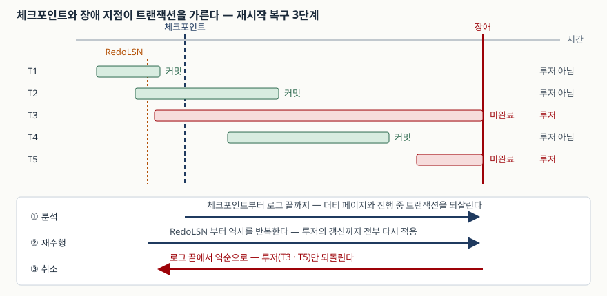

> **실행 검증 없음.** 이 글은 표준 문서와 원 논문의 근거만으로 정리했다.
> 측정값·실행 결과는 싣지 않는다.

## 들어가며

장애 복구는 시험에서 두 갈래로 나온다. 하나는 "백업을 어떻게 떠 두는가"라는
운영 쪽이고, 다른 하나는 "전원이 꺼진 뒤 데이터베이스가 어떻게 일관된 상태로
돌아오는가"라는 엔진 쪽이다. 두 갈래는 **RPO·RTO라는 목표값에서 만난다.**

실무에서도 같은 자리에서 갈린다. 백업 주기를 정하려면 얼마만큼의 데이터 손실을
받아들일지 정해야 하고, 그 값은 로그를 얼마나 자주 안정 저장소로 내리는지와
체크포인트 주기가 결정한다. 답안에서 둘을 따로 쓰면 반쪽이 된다.

## Ⅰ. 정의

- **백업(backup)**: 장애 뒤 복원할 목적으로 시스템의 데이터를 별도 매체에
  사본으로 보관하는 활동. 미국 NIST의 비상계획 지침(SP 800-34 Rev.1)은 백업이
  복구를 일차 목적으로 수행된다고 밝히고, 통제 항목 CP-9에서 사용자 수준 정보와
  시스템 수준 정보를 복구 목표에 맞는 주기로 백업할 것을 요구한다.
- **복구(recovery)**: 장애 시점의 데이터베이스를 트랜잭션의 원자성과 지속성이
  성립하는 일관된 상태로 되돌리는 절차. 로그 기반 복구의 표준 설계인 ARIES는
  이를 **로그에 대한 세 번의 패스**로 정의한다.

## Ⅱ. 등장 배경 — 그림자 페이징에서 WAL로

초기 System R 계열은 **그림자 페이징**을 썼다. 갱신한 페이지를 원래 자리가 아닌
다른 자리에 쓰고, 장애가 나면 이전 버전 페이지로 되돌리는 방식이다. 되돌리기는
간단하지만 페이지가 디스크 곳곳으로 흩어져 인접성이 깨지고, 갱신마다 페이지
테이블을 바꿔야 한다.

ARIES 논문은 그 대안으로 **제자리 갱신(in-place update)** 과 WAL을 택한 이유를
설명한다. 갱신한 페이지는 읽어 온 자리에 그대로 쓰고, 대신 **로그를 먼저 안정
저장소에 내린다.** WAL 규약이 요구하는 것은 하나다 — 어떤 데이터의 변경을 담은
로그 레코드가 안정 저장소에 가 있기 전에는, 그 변경이 비휘발성 저장소의 이전
버전을 덮을 수 없다. 적어도 그 페이지 갱신의 **취소(undo) 정보**는 먼저 기록돼
있어야 한다.

## Ⅲ. 구성요소

### 가. 백업 3유형

미국 NIST의 비상계획 지침은 시스템 백업 방법을 **3가지**로 든다.

| 유형 | 무엇을 담는가 | 수행 시간 | 복원에 필요한 매체 |
|---|---|---|---|
| 전체(Full) | 선택한 디스크·폴더의 모든 파일 | 가장 길다 | 전체 1벌 |
| 증분(Incremental) | 유형에 관계없이 **마지막 백업 이후** 생성·변경된 파일 | 가장 짧다 | 전체 1벌 + 그 뒤 증분 전부 |
| 차등(Differential) | **마지막 전체 백업 이후** 생성·변경된 파일 | 중간 | 전체 1벌 + 마지막 차등 1벌 |

차등은 다음 전체 백업까지 날마다 양이 늘어나므로 증분보다 수행 시간이 길어지고,
대신 복원에 필요한 매체가 적다. **수행 시간과 복원 시간을 맞바꾸는 선택**이다.

### 나. 재시작 복구 3단계

ARIES는 시스템 장애 뒤 재시작 복구를 **3개의 패스**로 수행한다.

1. **분석(analysis)** — 마지막 체크포인트의 첫 레코드부터 로그 끝까지 전진 주사.
   더티 페이지 정보와 진행 중이던 트랜잭션 정보를 로그 끝 시점 기준으로 갱신한다.
   이 과정에서 ① 다음 재수행 패스의 시작 지점(RedoLSN)과 ② 취소 대상 트랜잭션
   목록이 정해진다.
2. **재수행(redo)** — RedoLSN부터 전진하며 **역사를 반복한다.** 안정 저장소의
   로그에는 있지만 장애 전에 데이터베이스 페이지로 내려가지 못한 갱신을 다시
   적용한다. 커밋하지 못한 트랜잭션(루저)의 갱신까지 포함한다. 적용 여부는
   페이지의 page-LSN이 로그 레코드의 LSN보다 작은지로 판단하고, 재수행 자체는
   로그를 남기지 않는다.
3. **취소(undo)** — 로그 끝에서 역방향으로 한 번 훑으며 루저 트랜잭션의 갱신만
   되돌린다. 재수행과 달리 조건 비교 없이 수행한다.

"왜 루저 것까지 다시 적용하고 나서 되돌리는가"가 이 설계의 핵심이다. 재수행
패스가 장애 직전 상태를 **그대로 복원해 놓아야**, 취소 패스가 정상 운영 중의
롤백과 똑같은 절차로 동작할 수 있다. 복구 전용 경로를 따로 두지 않는 것이다.

### 다. 체크포인트

체크포인트는 분석 패스의 **시작 지점**을 정한다. 체크포인트가 없으면 로그의
맨 처음부터 읽어야 하므로, 주기가 복구 시간을 직접 좌우한다.

## Ⅳ. 도식

> **출처**: [ARIES: A Transaction Recovery Method Supporting Fine-Granularity Locking and Partial Rollbacks Using Write-Ahead Logging, ACM TODS 17(1), 1992, §3 Overview of ARIES (p.111)](https://dl.acm.org/doi/10.1145/128765.128770)

## Ⅴ. 비교 — 복구 지표 3가지

NIST의 비상계획 지침은 다운타임 지표를 **3가지**로 나눈다(§3.2).

| 지표 | 무엇을 정하는가 | 무엇이 결정하는가 |
|---|---|---|
| MTD (최대 허용 중단 시간) | 업무 프로세스 중단을 감내할 수 있는 총 시간 | 복구 방식 선택의 상한 |
| RTO (복구 시간 목표) | 자원이 가용하지 않은 채로 있을 수 있는 최대 시간 | 체크포인트 주기, 대체 사이트 등급 |
| RPO (복구 시점 목표) | 장애 직전 어느 시점까지 데이터를 복구할 것인가 | 백업·로그 전송 주기 |

지침은 RTO가 MTD에 포함되지만 **RPO는 MTD의 일부가 아니라고** 명시한다. RPO는
시간이 아니라 **감내할 데이터 손실량**을 재는 값이기 때문이다. 답안에서 이 둘을
섞어 쓰면 감점된다.

## Ⅵ. 적용 시 고려사항 — 4가지

1. **RPO를 먼저 정하고 백업 주기를 역산한다.** 순서를 뒤집어 "하루 한 번 전체
   백업"을 먼저 정하면 RPO가 24시간으로 사후 확정된다. 지침의 백업 통제(CP-9)도
   백업 주기를 복구 목표에 맞추라고 적는다.
2. **백업은 복원해 봐야 백업이다.** 지침은 매체 신뢰성과 무결성을 확인하기 위해
   백업 정보를 주기적으로 시험하고(CP-9(1)), 비상계획 훈련의 일부로 실제 복원을
   해 볼 것(CP-9(2))을 통제로 둔다. 떠 두기만 한 백업은 통제를 충족하지 않는다.
3. **원격지 보관은 같은 재해에 함께 당하지 않을 거리여야 한다.** 대체 저장소
   통제(CP-6)는 주 저장소와 지리적으로 분리돼 동일 위험에 노출되지 않을 것을
   요구하고, 복구 시간·복구 시점 목표에 맞춰 구성할 것을 더한다.
4. **체크포인트 주기는 평시 성능과 복구 시간의 교환이다.** 자주 찍으면 분석·재수행
   구간이 짧아져 RTO에 유리하지만 평시 I/O가 늘고, 드물게 찍으면 반대가 된다.
   ARIES가 퍼지 체크포인트를 지원하는 이유도 평시 부담을 줄이기 위해서다.

## Ⅶ. 정리

- 백업 **3유형**: 전체 / 증분(마지막 백업 기준) / 차등(마지막 전체 백업 기준).
  **"증분은 백업 기준, 차등은 전체 기준"** 으로 외운다
- 재시작 복구 **3단계**: 분석 → 재수행 → 취소. **"분·재·취"**. 방향은
  앞 → 앞 → 뒤다
- WAL 규약 한 줄: **로그가 먼저, 페이지가 나중.** 적어도 취소 정보는 먼저 안정
  저장소에 있어야 한다
- 재수행은 **루저 것까지** 다시 적용한다(역사의 반복). 그래야 취소가 평시
  롤백과 같은 절차로 돌아간다
- 지표 **3가지**: MTD ⊃ RTO, 그리고 RPO는 그 바깥. RPO는 시간이 아니라 손실량을
  정한다

## 참고 자료

- [NIST SP 800-34 Rev.1, Contingency Planning Guide for Federal Information Systems (2010)](https://csrc.nist.gov/pubs/sp/800/34/r1/upd1/final) — §3.2 다운타임 지표(MTD·RTO·RPO), §5.1.2 백업 3유형, Appendix E 통제 CP-6·CP-9
- [C. Mohan 외, ARIES: A Transaction Recovery Method Supporting Fine-Granularity Locking and Partial Rollbacks Using Write-Ahead Logging, ACM TODS 17(1), 1992](https://dl.acm.org/doi/10.1145/128765.128770) — §2 WAL 규약과 그림자 페이징 대비, §3 재시작 복구 3단계, §4.3 트랜잭션 테이블, §4.4 더티 페이지 테이블
- [SQLite — Write-Ahead Logging](https://www.sqlite.org/wal.html) — 실제 구현에서 체크포인트가 어떻게 도는지
