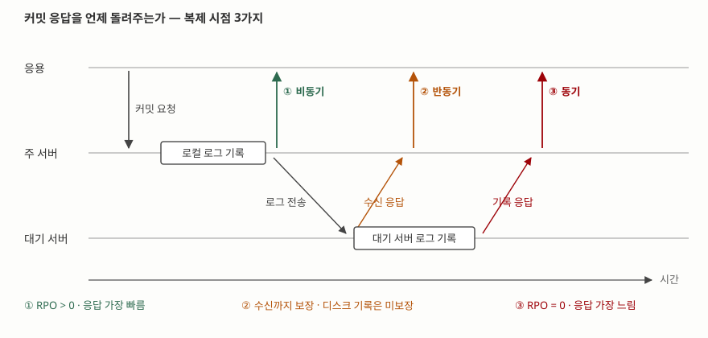

> **실행 검증 없음.** 이 글은 각 제품의 공개 매뉴얼과 표준 문서를 근거로 정리했다.
> 측정값이나 실행 출력은 싣지 않는다.

## 들어가며

데이터베이스 이중화는 정보관리기술사 시험에서 가용성·재해복구·분산시스템 어느
쪽으로도 묶여 나온다. 묻는 형태는 대개 "동기와 비동기를 비교하라"이지만, 점수가
갈리는 곳은 비교표가 아니라 **무엇과 무엇을 맞바꾸는지를 지표로 말할 수 있는가**다.
실무에서도 같다. 이중화 구성을 고르는 일은 기술 선택이 아니라 "데이터를 얼마나
잃어도 되는가"라는 사업 요구를 숫자로 받아 적는 일이다.

## Ⅰ. 정의

**데이터베이스 이중화**는 동일한 데이터를 둘 이상의 서버에 유지해, 한쪽이 멈춰도
서비스가 이어지도록 하는 구성이다. 그 안에서 변경분을 다른 서버로 옮기는 행위를
**복제(replication)** 라 한다.

가용성 측면의 정의는 NIST가 간명하게 적는다. 고가용성은 "장치나 구성요소가
중단되는 동안에도 가용성을 보장하는 장애 조치 기능"이다.

> **출처**: [NIST Computer Security Resource Center Glossary — High Availability](https://csrc.nist.gov/glossary/term/high_availability) (출처 문서: NIST SP 800-113)

## Ⅱ. 등장 배경

단일 서버에 백업만 두는 구성은 두 지표에서 막힌다.

- **RPO(Recovery Point Objective)** — "장애 이후 데이터가 복구되어야 하는 시점".
  하루 한 번 백업하면 최대 24시간치를 잃는다
- **RTO(Recovery Time Objective)** — "정보시스템 구성요소가 복구 단계에 머무를 수
  있는 전체 시간". 테이프에서 복원하면 시간 단위가 든다

두 정의 모두 NIST SP 800-34 Rev. 1(*Contingency Planning Guide for Federal
Information Systems*, 2010년 5월)이 출처다. 이중화는 이 둘을 **백업 주기와
복원 시간에서 떼어내** 복제 지연과 전환 시간으로 바꾸는 구성이다.

## Ⅲ. 구성요소

### 가. 복제 계층 — 4가지

무엇을 복사해 보내느냐로 나뉜다. PostgreSQL 공식 문서가 해법들을 나란히 비교해
둔 절이 분류의 근거가 된다.

| 계층 | 보내는 것 | 특징 |
|---|---|---|
| ① 저장장치 | 디스크 블록 | 공유 디스크 또는 블록 장치 미러링. DB가 관여하지 않는다 |
| ② 물리 로그 | WAL·redo·binlog | 블록 단위 변경을 그대로 재현. 가장 널리 쓰인다 |
| ③ 논리 | 행 변경 또는 SQL 문 | 표 단위로 고를 수 있고 버전이 달라도 된다 |
| ④ 미들웨어 | SQL 문 자체 | 질의를 가로채 여러 서버로 보낸다 |

PostgreSQL 문서는 ①을 "동기화 부담을 피하기 위해 데이터베이스 사본을 하나만
두는" 방식으로, ④를 "모든 SQL 질의를 가로채 하나 또는 전부의 서버로 보내는"
방식으로 적는다.

> **출처**: [PostgreSQL 17 Documentation §26.1 Comparison of Different Solutions](https://www.postgresql.org/docs/17/different-replication-solutions.html)

### 나. 복제 시점 — 3가지

> **출처**: [PostgreSQL 17 Documentation §26.2.8 Synchronous Replication](https://www.postgresql.org/docs/17/warm-standby.html#SYNCHRONOUS-REPLICATION) 의 `synchronous_commit` 수준과 [MySQL 8.0 Reference Manual §19.4.10 Semisynchronous Replication](https://dev.mysql.com/doc/refman/8.0/en/replication-semisync.html) 을 합쳐 그렸다.

① **비동기** — 주 서버가 로컬에 기록하면 바로 응답한다. MySQL 문서는 이 상태를
"원본은 복제본이 트랜잭션을 가져갔는지, 언제 가져갈지 알지 못하며, 어떤 이벤트가
복제본에 도달한다는 보장도 없다"고 적는다. PostgreSQL도 기본값이 비동기이며
"주 서버가 손상되면 커밋된 일부 트랜잭션이 복제되지 않아 데이터가 유실될 수
있다"고 밝힌다.

② **반동기** — 대기 서버가 **받았다고 알려 오면** 응답한다. MySQL 문서의 보장은
"원본이 손상되더라도 그것이 커밋한 모든 트랜잭션은 최소 한 대의 복제본으로
전송되었음을 보장한다"는 것이다. 받은 것과 디스크에 기록한 것은 다르므로 보장이
한 단계 약하다. 응답이 없이 제한 시간이 지나면 **비동기로 내려간다.**

③ **동기** — 대기 서버가 **기록했다고 알려 와야** 응답한다. PostgreSQL의
`synchronous_commit = on` 이 "대기 서버가 커밋 레코드를 영속 저장장치에 기록했다는
확인을 기다리게" 하는 설정이다.

PostgreSQL은 ②와 ③ 사이를 더 잘게 나눈다. `remote_write` 는 대기 서버의 운영체제에
넘어간 것까지, `remote_apply` 는 대기 서버가 **재생해 질의에 보이는 것**까지
기다린다. 뒤쪽은 읽기를 대기 서버로 분산할 때 인과 일관성을 얻기 위한 수준이다.

### 다. 쓰기 노드 수 — 2가지

- **단일 마스터** — 쓰기를 한 서버가 받는다. 충돌이 없다
- **다중 마스터** — 여러 서버가 쓰기를 받는다. PostgreSQL 문서는 비동기 다중
  마스터를 "각 서버가 독립적으로 동작하고 주기적으로 통신해 충돌하는 트랜잭션을
  식별하는" 방식으로 적는다. **충돌 해소 규칙이 반드시 필요하다**

### 라. 장애 전환 절차 — 5단계

1. **감지** — 심박 신호 중단이나 질의 실패로 주 서버 이상을 판정한다
2. **격리(펜싱)** — 옛 주 서버가 쓰기를 못 하게 막는다. 생략하면 양쪽이 모두
   주 서버로 동작하는 **스플릿 브레인**이 생긴다
3. **승격** — 대기 서버를 주 서버로 올린다
4. **경로 전환** — 가상 IP·DNS·프록시로 응용의 접속 지점을 옮긴다
5. **재동기화** — 복구된 옛 주 서버를 대기 서버로 되돌린다

## Ⅳ. 비교

### 가. 복제 시점 3가지

| 구분 | 비동기 | 반동기 | 동기 |
|---|---|---|---|
| 커밋 응답 시점 | 로컬 기록 직후 | 대기 서버 수신 확인 후 | 대기 서버 기록 확인 후 |
| RPO | 0보다 크다 | 전송된 범위까지 0 | 0 |
| 응답시간 영향 | 없음 | 왕복 1회 | 왕복 1회 + 원격 기록 |
| 대기 서버 장애 시 | 영향 없음 | 비동기로 내려감 | 설정에 따라 **커밋 중단** |
| 거리 제약 | 없음 | 중간 | 지연에 직접 비례 |

### 나. 제품별 설정 이름

| 제품 | 비동기 | 반동기 | 동기 |
|---|---|---|---|
| PostgreSQL 17 | 기본값 | `remote_write` | `synchronous_commit = on` / `remote_apply` |
| MySQL 8.0 | 기본값 | 반동기 복제 플러그인 | (아래 주 참조) |
| Oracle 19c Data Guard | 최대 성능 | (해당 없음) | 최대 가용성 / 최대 보호 |

MySQL 8.0의 그룹 복제는 이 세 칸에 그대로 들어가지 않는다. 단일 서버가 대기
서버의 응답을 기다리는 구조가 아니라 그룹의 합의로 커밋 순서를 정하는 별도
구조이므로, 답안에서 비교표에 끼워 넣기보다 **다중 마스터 쪽 항목으로 따로
적는 편**이 정확하다.

Oracle의 세 보호 모드는 **대기 서버가 응답하지 않을 때의 처신**으로 갈린다.
최대 가용성은 "동기화된 대기 데이터베이스 중 최소 한 대에서 응답을 받지 못하면
최대 성능 모드처럼 동작"해 가용성을 지키고, 최대 보호는 "보호되지 않는 트랜잭션을
계속 처리하도록 두느니 주 데이터베이스를 중단시킨다". 같은 동기 복제라도 **일관성과
가용성 중 무엇을 포기하는지가 반대**다.

> **출처**: [Oracle Database 19c Data Guard Concepts and Administration — Oracle Data Guard Protection Modes](https://docs.oracle.com/en/database/oracle/oracle-database/19/sbydb/oracle-data-guard-protection-modes.html)

## Ⅴ. 적용 시 고려사항

1. **RPO를 숫자로 먼저 받는다.** "데이터를 잃으면 안 된다"는 요구는 동기 복제를
   뜻하고, 그 비용은 커밋마다 붙는 네트워크 왕복이다. 거리가 멀수록 응답시간이
   비례해 늘어나므로, 원거리 재해복구 구성에서 동기를 택하면 평상시 성능이
   재해 대비 비용이 된다
2. **스플릿 브레인 방지를 설계에 넣는다.** 자동 전환을 쓰면서 격리 수단이 없으면
   망 분단 때 양쪽이 모두 쓰기를 받아 데이터가 갈린다. 판정 노드를 홀수로 두어
   과반을 쥔 쪽만 주 서버가 되게 하거나, 전원·저장장치 차원에서 옛 주 서버를
   끊는 수단을 둔다
3. **반동기의 폴백을 인지한다.** 제한 시간 안에 응답이 없으면 비동기로 내려가므로,
   **가장 필요한 순간에 보장이 약해진다.** 폴백 발생을 지표로 수집해야 한다
4. **읽기 분산은 일관성 수준을 함께 정한다.** 대기 서버로 읽기를 보내면 복제
   지연만큼 과거를 읽는다. 쓰고 바로 읽는 화면은 주 서버로 보내거나,
   PostgreSQL의 `remote_apply` 처럼 재생까지 기다리는 수준을 쓴다
5. **전환을 정기적으로 연습한다.** 구성해 두고 한 번도 전환하지 않은 이중화는
   RTO가 측정된 적 없는 구성이다. 계획된 전환을 주기적으로 수행해 절차와 시간을
   실측해 둔다

## Ⅵ. 정리

- **계층 4 · 시점 3 · 쓰기 노드 2 · 전환 5단계**로 외운다
- 계층 4가지: **저·물·논·미** (저장장치 → 물리 로그 → 논리 → 미들웨어)
- 시점 3가지: **비 · 반 · 동** — 응답을 돌려주는 지점이 로컬 기록 → 원격 수신 →
  원격 기록으로 한 칸씩 늦어지고, 그만큼 RPO가 0에 가까워진다
- 전환 5단계: **감 · 격 · 승 · 경 · 재** (감지 → 격리 → 승격 → 경로 전환 → 재동기화).
  **격리를 빠뜨리면 스플릿 브레인**이라는 한 줄이 답안에서 변별력을 만든다
- 동기 복제도 제품에 따라 대기 서버 장애 시의 처신이 다르다. Oracle의 최대 가용성과
  최대 보호가 **가용성과 일관성 중 반대쪽을 포기**하는 대비는 그대로 쓸 수 있는 소재다

## 참고 자료

- [PostgreSQL 17 Documentation §26.1 Comparison of Different Solutions](https://www.postgresql.org/docs/17/different-replication-solutions.html) — 복제 계층 분류
- [PostgreSQL 17 Documentation §26.2 Log-Shipping Standby Servers](https://www.postgresql.org/docs/17/warm-standby.html) — 스트리밍 복제, `synchronous_commit` 수준
- [MySQL 8.0 Reference Manual §19.4.10 Semisynchronous Replication](https://dev.mysql.com/doc/refman/8.0/en/replication-semisync.html) — 반동기의 보장 범위와 폴백
- [Oracle Database 19c — Oracle Data Guard Protection Modes](https://docs.oracle.com/en/database/oracle/oracle-database/19/sbydb/oracle-data-guard-protection-modes.html) — 보호 모드 3가지
- [NIST SP 800-34 Rev. 1 — Contingency Planning Guide for Federal Information Systems](https://csrc.nist.gov/pubs/sp/800/34/r1/upd1/final) — RPO·RTO 정의
- [NIST CSRC Glossary — High Availability](https://csrc.nist.gov/glossary/term/high_availability) — 고가용성 정의
