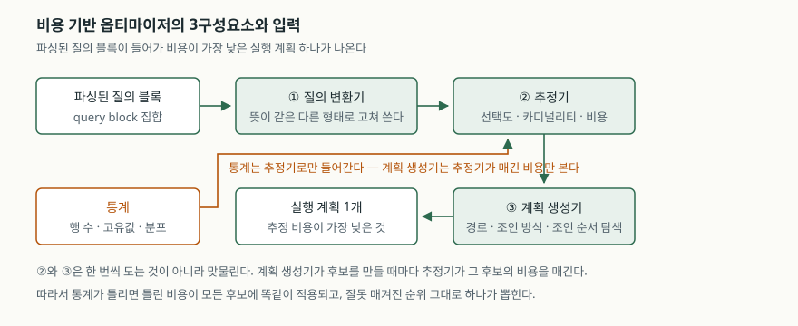
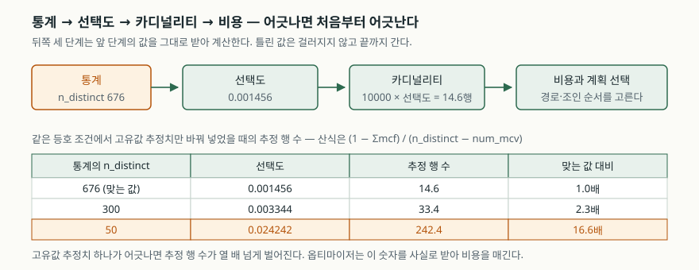

## 들어가며

같은 결과를 내는 SQL 실행 방법은 하나가 아니다. 두 표를 조인할 때 어느 쪽을
먼저 읽을지, 인덱스를 탈지 전부 훑을지, 중첩 루프로 붙일지 해시로 붙일지에
따라 실행 시간이 몇백 배까지 갈린다. 사용자는 **무엇을 원하는지**만 적고
**어떻게 가져올지**는 적지 않으므로, 그 선택은 전부 옵티마이저가 한다.

시험에서 이 주제가 반복해 나오는 이유는 두 가지다. 선언형 질의 언어가
성립하려면 이 단계가 반드시 있어야 한다는 점이 하나고, 실무에서 성능 문제의
상당수가 "옵티마이저가 잘못 골랐다"로 수렴하는데 그 원인이 대개
**옵티마이저가 아니라 옵티마이저에게 준 정보**에 있다는 점이 다른 하나다.
답안은 그 두 가지를 모두 짚어야 한다.

## 정의

**쿼리 최적화(query optimization)** 는 같은 결과를 내는 여러 실행 방법 가운데
추정 비용이 가장 낮은 하나를 고르는 단계다. 이때의 **비용**은 실행 시간이
아니라, 그 계획이 쓸 것으로 예상되는 디스크 I/O·CPU·메모리를 나타내는
내부 수치다. Oracle 문서는 이 값이 실행 시간과 같지 않으며 서로 다른 질의의
비용끼리 비교할 수 없다고 못 박는다.

## 등장 배경

초기의 **규칙 기반 옵티마이저(RBO)** 는 미리 정해진 우선순위 목록으로
접근 경로를 골랐다. "유일 인덱스 등호 조회가 범위 인덱스 조회보다 낫고,
그것이 전체 스캔보다 낫다"는 식의 순위표다. 데이터를 보지 않으므로
계획이 예측 가능하고 계획 수립이 빠르다.

문제는 **같은 질의라도 데이터에 따라 옳은 답이 달라진다**는 데 있다.
100만 행 중 세 행을 고르면 인덱스가 이기지만, 60만 행을 고르면 인덱스로
한 행씩 찾아가는 쪽이 전체 스캔보다 느리다. 규칙표에는 "몇 행이 나오는가"를
적을 자리가 없다. 그래서 1979년 System R 연구가 접근 경로를 **통계로
추정한 비용**으로 고르는 방식을 제시했고, 오늘날 상용·오픈소스 엔진의
옵티마이저는 모두 이 **비용 기반(CBO)** 계열이다. Oracle 문서는 지금의
옵티마이저를 레거시 RBO와 대비해 CBO라고 부른다고 적는다.

## 구성요소 — 3가지

Oracle의 SQL Tuning Guide는 옵티마이저를 **3개 구성요소**로 나눈다.

| 구성요소 | 하는 일 |
|---|---|
| ① 질의 변환기 | 뜻이 같되 비용이 낮을 수 있는 형태로 문장을 고쳐 쓴다 (`OR` → `UNION ALL` 등) |
| ② 추정기 | 통계를 받아 각 후보의 비용을 매긴다 |
| ③ 계획 생성기 | 접근 경로·조인 방식·조인 순서를 바꿔 가며 후보를 만들고 가장 싼 것을 고른다 |

추정기가 계산하는 측정값은 **3가지**이고, 뒤의 것이 앞의 것을 재료로 쓴다.

1. **선택도(selectivity)** — 조건이 고르는 행의 비율. 0.0~1.0. 0에 가까울수록
   조건이 깐깐하다. 실행계획에는 보이지 않는 내부 값이다
2. **카디널리티(cardinality)** — 각 연산이 돌려줄 행 수. `선택도 × 입력 행 수`.
   실행계획의 `Rows` 열에 추정치로 나온다
3. **비용(cost)** — 그 계획이 쓸 자원의 내부 수치

## 도식

> **출처**: [Oracle Database 19c SQL Tuning Guide — Query Optimizer Concepts, Components of the Query Optimizer](https://docs.oracle.com/en/database/oracle/oracle-database/19/tgsql/query-optimizer-concepts.html)

> **출처**: [PostgreSQL 16 — 76.1. Row Estimation Examples](https://www.postgresql.org/docs/16/row-estimation-examples.html) (수치는 아래 검산 결과)

## 선택도는 어떻게 계산되는가 — 직접 검산

선택도 산식은 엔진마다 다르지만 PostgreSQL 문서가 수치까지 공개한다.
문서의 통계값을 같은 산식에 넣어 다시 계산해 보면 네 가지 경우가 모두
문서 값과 맞는다. 계산 소스는 [`code/`](code/), 실행 기록은
[`code/output.txt`](code/output.txt)에 있다.

| 조건 | 산식 | 선택도 | 추정 행 수 |
|---|---|---|---|
| 범위, 히스토그램 | 버킷 안을 선형 보간 | 0.100697 | 1,007 |
| 등호, 값이 MCV 안 | 그 값의 빈도 | 0.003000 | 30 |
| 등호, 값이 MCV 밖 | `(1 − Σmcf) / (n_distinct − num_mcv)` | 0.001456 | 14.6 |
| 두 조건을 AND | 두 선택도의 **곱** | 0.000147 | 1.5 |

여기서 답안에 쓸 만한 대목은 마지막 줄이다. 옵티마이저는 조건들이 서로
**독립이라고 가정하고 선택도를 곱한다.** 실제 데이터에서 "시/도 = 서울"과
"구 = 강남구"처럼 상관이 있는 두 조건이 함께 오면, 곱한 값은 실제보다
훨씬 작아지고 추정 행 수가 실제보다 적게 나온다.

## 비교

| 항목 | 규칙 기반 (RBO) | 비용 기반 (CBO) |
|---|---|---|
| 판단 근거 | 접근 경로 우선순위표 | 통계로 추정한 비용 |
| 데이터 분포 반영 | 하지 않는다 | 한다 |
| 같은 질의의 계획 | 데이터가 변해도 같다 | 통계가 변하면 바뀔 수 있다 |
| 계획 수립 비용 | 낮다 | 후보 탐색만큼 든다 |
| 약점 | 데이터가 치우치면 계속 틀린 선택을 한다 | 통계가 낡거나 가정이 깨지면 틀린다 |
| 운영 부담 | 없다 | 통계 수집 주기를 관리해야 한다 |

조인 순서를 고르는 탐색 전략도 **3가지**로 갈린다.

| 전략 | 방식 | 한계 |
|---|---|---|
| 전수 탐색 | 가능한 순서를 모두 본다 | 조인 수의 계승으로 늘어 10개를 넘기면 계획 수립이 과해진다 |
| 탐욕적 선택 | 매 단계에서 가장 싼 간선 하나만 고른다 | 빠르지만 전체 최적을 놓친다 |
| 상위 N개 유지 | 단계마다 좋은 경로 N개를 남긴다 | N을 키운 만큼 계산이 늘고, 그래도 최적은 보장되지 않는다 |

SQLite 문서는 TPC-H 8번 질의에서 탐욕적 선택이 고른 계획과 전수 탐색이
고른 계획의 비용이 로그 척도로 36.92 대 27.38이었다고 적는다.
PostgreSQL은 조인 대상이 `geqo_threshold`를 넘으면 전수에 가까운 탐색을
포기하고 유전 알고리즘으로 바꾼다.

## 적용 시 고려사항

**통계 수집 주기를 적재 주기에 맞춘다.** 대량 적재 직후 통계가 그대로면
옵티마이저는 적재 전 분포를 사실로 받아 계획을 세운다. 고유값 추정치
하나만 676에서 50으로 어긋나도 같은 조건의 추정 행 수가 14.6행에서
242.4행으로, 약 16.6배 벌어진다(위 검산 결과). 그 숫자는 조인 순서와
접근 경로 판단에 그대로 들어간다.

**"더 나은 계획"이 항상 빨라지지는 않는다.** SQLite 문서는 조인 순서
탐색을 개선한 뒤 Fossil의 한 질의가 수 밀리초에서 약 10초로 느려진 사례를
기록한다. 통계가 없어 두 인덱스의 품질을 같다고 본 탓에, 새 탐색이
"수학적으로 조금 나은" 계획을 골랐는데 실제로는 선택도가 낮은 인덱스였다.
옵티마이저를 바꾸는 변경은 **회귀 질의 집합으로 검증**해야 한다.

**힌트는 마지막 수단으로 둔다.** 조인 순서를 고정하는 구문이나 인덱스 지정
힌트는 당장은 듣지만, 데이터가 바뀌어 최적해가 옮겨가도 계획이 따라가지
않는다. 통계를 맞추는 것이 먼저이고, 같은 문서도 강제 힌트보다 통계
자동 갱신을 권한다.

**상관된 조건은 독립 가정을 깬다.** 선택도를 곱하는 가정이 깨지는 자리는
다중 컬럼 통계나 확장 통계로 보완할 수 있는지 확인한다. 보완 수단이 없으면
질의를 나누거나 조건을 하나로 합치는 쪽을 검토한다.

## 정리

암기 단서는 **3 · 3 · 3**이다.

- **구성요소 3**: 질의 변환기 · 추정기 · 계획 생성기
- **추정 측정값 3**: 선택도 → 카디널리티 → 비용 (앞의 것이 뒤의 재료)
- **조인 탐색 전략 3**: 전수 · 탐욕 · 상위 N개 유지

여기에 두 문장을 붙이면 답안이 선다. RBO는 데이터를 보지 않아 분포가
치우치면 계속 틀리고, CBO는 데이터를 보되 **본 것이 통계뿐**이라 통계가
낡거나 독립 가정이 깨지면 틀린다. 그래서 운영의 초점은 옵티마이저를
설득하는 것이 아니라 **옵티마이저가 보는 숫자를 실제와 맞추는 것**이다.

## 참고 자료

- [Oracle Database 19c SQL Tuning Guide — Query Optimizer Concepts](https://docs.oracle.com/en/database/oracle/oracle-database/19/tgsql/query-optimizer-concepts.html)
- [PostgreSQL 16 — 52.5. Planner/Optimizer](https://www.postgresql.org/docs/16/planner-optimizer.html)
- [PostgreSQL 16 — 76.1. Row Estimation Examples](https://www.postgresql.org/docs/16/row-estimation-examples.html)
- [SQLite — The Next-Generation Query Planner §3.3 Finding The Best Query Plan](https://www.sqlite.org/queryplanner-ng.html#_finding_the_best_query_plan)
- [SQLite — The Next-Generation Query Planner §5.1 Case Study: Upgrading Fossil to the NGQP](https://www.sqlite.org/queryplanner-ng.html#_case_study_upgrading_fossil_to_the_ngqp)
- [Selinger et al., *Access Path Selection in a Relational Database Management System*, ACM SIGMOD 1979](https://dl.acm.org/doi/10.1145/582095.582099)
