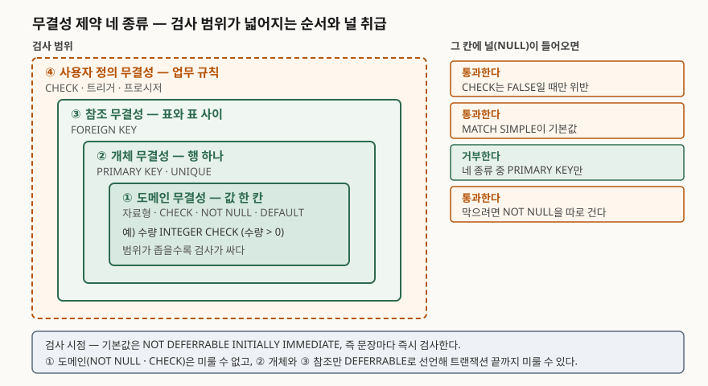

## 들어가며

무결성 제약은 데이터베이스 과목에서 단답형으로도 나오고 논술형의 한 항목으로도 나온다.
그런데 네 이름을 나열하는 것만으로는 점수가 붙지 않는다. 네 종류라는 묶음 자체가 어느
표준에 박혀 있는 규정이 아니라 벤더와 교과서가 쓰는 분류이기 때문에, 이름만 적으면
채점자가 확인할 것이 없다. 점수가 갈리는 자리는 **각 제약이 널을 어떻게 취급하고 언제
검사되는지**, 그리고 **선언으로 걸 수 없는 규칙을 어디서 받아야 하는지**다. 실무에서
제약이 "걸려 있는데도 이상한 데이터가 들어온" 사고는 거의 전부 이 두 자리에서 난다.

> **실행 검증 없음.** 제품 공식 매뉴얼 근거로만 정리했다.

---

## 정의

**무결성 제약(Integrity Constraint)은 데이터가 항상 만족해야 하는 조건을 스키마에 선언해,
그 조건을 깨는 갱신 자체를 데이터베이스 엔진이 거부하도록 만드는 장치다.**

핵심은 "선언"과 "엔진"이다. 코드로 검사하면 그 코드를 거치는 경로에서만 지켜지고,
엔진에 선언하면 어떤 경로로 들어오든 지켜진다.

네 갈래로 나누는 분류는 마이크로소프트 SQL Server 문서가 쓰는 방식이 가장 또렷하다.
그 문서는 "데이터 무결성은 다음 범주로 나뉜다"고 적고 네 항목을 든다. 다만 **문서 자체는
"네 가지"라고 개수를 쓰지 않고 네 항목을 나열할 뿐이다.** 답안에 "4가지"라고 쓸 때는
이것이 표준의 규정이 아니라 통용되는 분류라는 점을 알고 써야 한다.

| 범주 | 문서의 정의 |
|---|---|
| 개체 무결성 | 행을 그 표에서 유일한 개체로 정의한다 |
| 도메인 무결성 | 특정 열에 들어가는 값이 유효한가를 본다 |
| 참조 무결성 | 행이 들어오거나 지워질 때 표 사이에 정의된 관계를 보존한다 |
| 사용자 정의 무결성 | 다른 범주에 속하지 않는 업무 규칙을 정의하게 해 준다 |

## 등장 배경

제약을 엔진에 넣기 전에는 같은 검사를 애플리케이션이 했다. 이 방식의 문제는 검사가 틀려서가
아니라 **검사가 빠지는 경로가 반드시 생기기 때문**이다. 배치 적재, 데이터 보정 스크립트,
다른 팀이 붙인 두 번째 애플리케이션, 장애 복구 중 손으로 친 UPDATE가 그렇다. 한 번이라도
빠지면 그 뒤로는 데이터가 조건을 만족한다고 가정할 수 없고, 가정할 수 없으면 조회하는 쪽이
매번 방어 코드를 써야 한다.

동시성까지 보면 차이가 더 벌어진다. 애플리케이션이 "부모 행이 있는가"를 조회해 확인하고
자식 행을 넣는 사이에 다른 트랜잭션이 부모 행을 지울 수 있다. 조회와 삽입이 하나의 검사로
묶이지 않기 때문이다. 엔진에 건 외래키는 삽입하는 그 시점에 부모 행을 잠그면서 검사하므로
이 틈이 생기지 않는다.

엔진이 제약을 특별 취급한다는 사실은 매뉴얼에도 드러난다. PostgreSQL 18 문서는 NOT NULL이
`CHECK (column_name IS NOT NULL)`과 기능적으로 같지만 명시적인 NOT NULL 제약을 만드는 쪽이
더 효율적이라고 적는다. 같은 조건이라도 엔진이 알아볼 수 있는 모양으로 선언하면 검사
비용이 달라진다는 뜻이다.

## 구성요소 — 네 종류

이 글은 **검사 범위가 좁은 쪽부터** 적는다. 널 취급도 검사 비용도 범위를 따라가고, 범위가
겹치는 자리에서 가장 많이 헷갈리기 때문이다.

### 가. 도메인 무결성 — 값 한 칸

한 칸에 들어갈 수 있는 값의 집합을 좁힌다. 자료형이 1차 방어이고, 그 위에 CHECK로 조건을
붙이거나 NOT NULL로 널을 막는다. SQL 표준에는 조건이 붙은 자료형을 이름으로 만들어 두는
`CREATE DOMAIN`이 있고, PostgreSQL도 지원한다.

여기서 반드시 알아야 할 동작이 하나 있다. **CHECK는 식이 참이거나 널일 때 통과하고, 거짓일
때만 위반**이다. PostgreSQL 18 문서는 "참 또는 UNKNOWN으로 평가되는 식은 성공한다"고 적고,
대부분의 식은 피연산자 하나가 널이면 널이 되므로 CHECK만으로는 널을 막지 못한다고 못박는다.
MySQL 8.4 문서도 식이 각 행에 대해 TRUE 또는 (널일 때의) UNKNOWN으로 평가되어야 한다고
같은 규칙을 적는다. **널을 막으려면 NOT NULL을 따로 건다.**

PostgreSQL의 도메인은 한 단계 더 조심할 곳이 있다. 도메인에 건 NOT NULL은 값이 그 도메인
타입으로 변환될 때만 검사되므로, 외부 조인의 결과로 생긴 널은 여전히 나올 수 있다. 문서는
도메인 제약은 널을 허용하도록 설계하고 열 수준에서 NOT NULL을 걸라고 권한다.

### 나. 개체 무결성 — 행 하나

행 하나를 표 안에서 유일하게 가리킬 수 있게 만든다. PRIMARY KEY와 UNIQUE가 장치다.
PostgreSQL 18 문서는 PRIMARY KEY가 **UNIQUE와 NOT NULL을 합친 것과 같은 제약을 강제**하며,
표마다 기본키는 최대 하나라고 적는다.

**네 종류 중 널을 거부하는 것은 사실상 이 하나뿐**이고, 그마저도 PRIMARY KEY에 한정된다.
UNIQUE는 다르다. PostgreSQL 문서는 두 널 값을 같다고 보지 않는 것이 기본이어서, 유일 제약이
걸려 있어도 제약 대상 열에 널이 든 중복 행을 저장할 수 있다고 적는다. PostgreSQL 18에는
이를 뒤집는 `NULLS NOT DISTINCT` 옵션이 있고, 기본값은 `NULLS DISTINCT`다. 같은 문서는
유일 제약에서 널을 어떻게 다룰지가 SQL 표준에서 구현에 맡겨져 있어 제품마다 다르다고
덧붙인다. **"UNIQUE면 중복이 없다"는 답안은 널을 빼놓은 답안이다.**

### 다. 참조 무결성 — 표와 표 사이

자식 표의 외래키 값이 부모 표에 실제로 있어야 한다는 제약이다. 여기에는 외워 둘 항목이
두 묶음 있다.

**일치 방식 3가지** — PostgreSQL 18 문서는 `MATCH FULL`, `MATCH PARTIAL`, `MATCH SIMPLE`
세 가지가 있고 **`MATCH SIMPLE`이 기본값**이라고 적는다. 복합 외래키에서 동작이 갈린다.
`MATCH SIMPLE`은 외래키 열 중 **아무거나 하나라도 널이면** 부모와 맞을 필요가 없고,
`MATCH FULL`은 **전부 널일 때만** 면제된다. 즉 일부만 널인 조합은 `MATCH FULL`에서 반드시
실패한다. `MATCH PARTIAL`은 같은 문서가 아직 구현되지 않았다고 밝힌다. MySQL 8.4의 외래키
문서에는 이 절들에 대한 설명이 없다.

**참조 동작 5가지** — `NO ACTION`, `RESTRICT`, `CASCADE`, `SET NULL`, `SET DEFAULT`이고
기본값은 `NO ACTION`이다. `NO ACTION`과 `RESTRICT`의 차이가 답안에서 자주 틀린다.
PostgreSQL 문서는 `NO ACTION`이면 삭제 자체는 진행되고 제약 검사만 남으므로 보통 오류가
나지만 **검사를 트랜잭션 뒤로 미뤄 두면 그 사이에 다른 명령이 상황을 고칠 수 있다**고 적고,
`RESTRICT`는 더 엄격해서 **검사를 미룰 수 없다**고 적는다. MySQL 8.4의 InnoDB는 이 둘을
구분하지 않는다 — 문서는 InnoDB에서 `NO ACTION`이 `RESTRICT`와 같고 부모 표의 삭제·갱신이
즉시 거부된다고 적는다. 같은 문서는 `SET DEFAULT`가 파서에는 받아들여지지만 InnoDB와 NDB
모두 그 정의를 거부한다고 밝힌다.

### 라. 사용자 정의 무결성 — 업무 규칙

앞의 셋으로 표현되지 않는 규칙이 전부 여기로 온다. SQL Server 문서는 이 범주를 "다른
무결성 범주에 속하지 않는 업무 규칙"으로 정의하고 CREATE TABLE의 열·표 수준 제약, 저장
프로시저, 트리거가 여기 들어간다고 적는다.

문제는 **선언만으로 걸리지 않는 규칙이 여기 몰린다**는 것이다. PostgreSQL 18 문서는 CHECK가
검사 대상이 되는 그 행 바깥의 데이터를 참조하는 것을 지원하지 않는다고 못박고, 행 사이
규칙은 UNIQUE·EXCLUDE·FOREIGN KEY로 풀라고 안내한다. MySQL 8.4의 CHECK는 제한이 더 많다 —
부질의, 저장 함수, 변수, 다른 표의 열, AUTO_INCREMENT 열이 모두 금지되고
`CONNECTION_ID()`·`NOW()` 같은 비결정적 함수도 쓸 수 없다.

표 여러 개에 걸친 조건을 선언으로 거는 장치는 SQL 표준의 `CREATE ASSERTION`인데,
**PostgreSQL 18의 SQL 명령 목록에 그 항목이 없다.** 그래서 이 자리는 실무에서 트리거,
저장 프로시저, 또는 애플리케이션 계층으로 내려간다. PostgreSQL에는 행 사이 조건을 선언으로
거는 `EXCLUDE` 제약이 있어 일부를 덜어내지만, 문서가 적듯 연산자가 교환법칙을 만족해야 하는
등 쓸 수 있는 모양이 정해져 있다.

## 도식

> **출처**: [Data Integrity (SQL Server 2008 문서, 아카이브)](https://learn.microsoft.com/en-us/previous-versions/sql/sql-server-2008/ms184276%28v%3Dsql.100%29) — 네 범주 분류, [PostgreSQL 18 §5.5 Constraints](https://www.postgresql.org/docs/18/ddl-constraints.html) 및 [CREATE TABLE](https://www.postgresql.org/docs/18/sql-createtable.html) — 널 취급과 검사 시점

## 비교

### 가. 네 종류를 한 줄로

| | 검사 범위 | 대표 장치 | 널이 들어오면 | 미룰 수 있나 |
|---|---|---|---|---|
| 도메인 | 값 한 칸 | 자료형·CHECK·NOT NULL | 통과 (CHECK는 FALSE만 위반) | 불가 |
| 개체 | 행 하나 | PRIMARY KEY·UNIQUE | PK는 거부, UNIQUE는 통과 | 가능 |
| 참조 | 표와 표 사이 | FOREIGN KEY | 통과 (MATCH SIMPLE 기준) | 가능 |
| 사용자 정의 | 그 바깥 | CHECK·트리거·프로시저 | 통과 | CHECK는 불가 |

"미룰 수 있나"의 근거는 PostgreSQL 18 문서다. `NOT DEFERRABLE`이 기본값이고, `UNIQUE`·
`PRIMARY KEY`·`EXCLUDE`·`REFERENCES`만 이 절을 받으며 **`NOT NULL`과 `CHECK`는 미룰 수
없다**고 적는다. 미룰 수 있게 선언했을 때의 기본 시점은 `INITIALLY IMMEDIATE`, 즉 문장마다
검사이고, `INITIALLY DEFERRED`면 트랜잭션 끝에만 검사한다. 시점은 `SET CONSTRAINTS`로 바꾼다.

### 나. PostgreSQL 18과 MySQL 8.4가 갈리는 자리

| 항목 | PostgreSQL 18 | MySQL 8.4 |
|---|---|---|
| CHECK가 널일 때 | 통과 | 통과 |
| CHECK에 부질의 | 불가 (그 행 바깥 참조 불가) | 불가 (명시적으로 금지) |
| NO ACTION과 RESTRICT | 다름 (NO ACTION만 지연 가능) | InnoDB에서 같음, 즉시 거부 |
| SET DEFAULT | 지원 | 파서는 받고 InnoDB·NDB가 거부 |
| 제약 지연 | UNIQUE·PK·EXCLUDE·FK 가능 | 문서는 NDB의 지연 검사만 언급 |
| CREATE DOMAIN | 있음 | 문서에서 확인되지 않음 |
| CREATE ASSERTION | SQL 명령 목록에 없음 | 문서에서 확인되지 않음 |

## 적용 시 고려사항

**첫째, 널은 기본적으로 제약을 통과한다는 전제로 설계한다.** 네 종류 중 널을 거부하는 것은
PRIMARY KEY 하나뿐이다. CHECK도, UNIQUE도, 외래키도 널 앞에서는 비켜선다. 그래서 "값이
있다면 이 조건" 과 "값이 반드시 있다"는 **항상 두 개의 제약**으로 걸어야 한다. 복합 외래키를
쓰면서 일부 열만 널인 조합을 막아야 한다면 `MATCH FULL`을 명시하거나 열에 NOT NULL을 건다.

**둘째, 미룰 수 없는 제약이 설계를 묶는다.** 서로를 참조하는 두 표에 행을 동시에 넣어야
하거나 대량 적재 중간 상태가 제약을 깨는 경우, 해법은 제약 지연이다. 그런데 지연이 가능한
것은 개체와 참조뿐이고 CHECK와 NOT NULL은 어떤 선언으로도 미룰 수 없다. 중간 상태가 CHECK를
깨는 설계라면 지연으로는 풀리지 않으므로 적재 절차 자체를 바꿔야 한다. 또한 지연하려면
**제약을 만들 때 `DEFERRABLE`로 선언해 두어야** 하고, 기본값은 `NOT DEFERRABLE`이다.

**셋째, 같은 선언이 제품마다 다르게 동작한다.** `MATCH PARTIAL`은 PostgreSQL에서 문법은
통과하지만 구현되어 있지 않고, `SET DEFAULT`는 MySQL의 파서는 통과하지만 InnoDB가 거부하며,
`NO ACTION`과 `RESTRICT`의 차이는 PostgreSQL에만 있다. 이식을 전제한 스키마라면 **기본값에
기대지 말고 의도한 동작을 명시**하는 편이 안전하다.

**넷째, 선언으로 못 거는 규칙은 비용이 사람에게 넘어온다.** 표 여러 개에 걸친 조건은
표준의 `CREATE ASSERTION` 자리인데 제품에 없다. 트리거나 애플리케이션으로 내려가는 순간
검사 시점, 경합, 누락 경로를 설계자가 직접 관리해야 한다. 이때 판단 기준은 하나다.
**그 규칙이 깨졌을 때 데이터를 되돌릴 수 있는가.** 되돌릴 수 없는 규칙은 비용을 치르더라도
갱신 경로를 하나로 좁혀 그 길목에서 막는다.

## 정리

- 네 범주는 **검사 범위 순으로 값 → 행 → 사이 → 바깥**으로 외운다. 도메인(값 한 칸),
  개체(행 하나), 참조(표와 표 사이), 사용자 정의(그 바깥)
- 장치는 각각 **자료형·CHECK·NOT NULL / PRIMARY KEY·UNIQUE / FOREIGN KEY / 트리거·프로시저**
- **널을 거부하는 것은 PRIMARY KEY 하나뿐.** 나머지 셋은 널 앞에서 비켜선다
- 참조 무결성은 **일치 방식 3가지**(SIMPLE 기본·FULL·PARTIAL 미구현)와 **참조 동작 5가지**
  (NO ACTION 기본·RESTRICT·CASCADE·SET NULL·SET DEFAULT)를 개수까지 적는다
- **미룰 수 있는 것은 개체와 참조뿐.** 기본값은 NOT DEFERRABLE INITIALLY IMMEDIATE
- 네 갈래 분류는 표준의 규정이 아니라 통용되는 분류다. 답안에 개수를 쓰되 그 사실을 안다

> 기출 답안: [기출문제 — 정보모델링의 참조 무결성](../../exam/2026-10-26-referential-integrity-information-modeling/index.md)

## 참고 자료

- [PostgreSQL 18 Documentation §5.5 Constraints](https://www.postgresql.org/docs/18/ddl-constraints.html) — CHECK의 널 취급, UNIQUE의 널 비교, PRIMARY KEY, MATCH FULL, NO ACTION과 RESTRICT
- [PostgreSQL 18 Documentation — CREATE TABLE](https://www.postgresql.org/docs/18/sql-createtable.html) — MATCH 기본값과 PARTIAL 미구현, DEFERRABLE·INITIALLY 기본값과 적용 대상, EXCLUDE
- [PostgreSQL 18 Documentation — CREATE DOMAIN](https://www.postgresql.org/docs/18/sql-createdomain.html) — 도메인 CHECK와 NOT NULL의 검사 시점
- [PostgreSQL 18 Documentation — SQL Commands](https://www.postgresql.org/docs/18/sql-commands.html) — CREATE ASSERTION 부재 확인
- [MySQL 8.4 Reference Manual §15.1.20.5 FOREIGN KEY Constraints](https://dev.mysql.com/doc/refman/8.4/en/create-table-foreign-keys.html) — 참조 동작, InnoDB의 NO ACTION 취급, SET DEFAULT 거부
- [MySQL 8.4 Reference Manual §15.1.20.6 CHECK Constraints](https://dev.mysql.com/doc/refman/8.4/en/create-table-check-constraints.html) — 식의 평가 규칙과 금지 항목
- [Data Integrity — SQL Server 2008 문서 (아카이브)](https://learn.microsoft.com/en-us/previous-versions/sql/sql-server-2008/ms184276%28v%3Dsql.100%29) — 네 범주 분류와 각 범주의 정의
