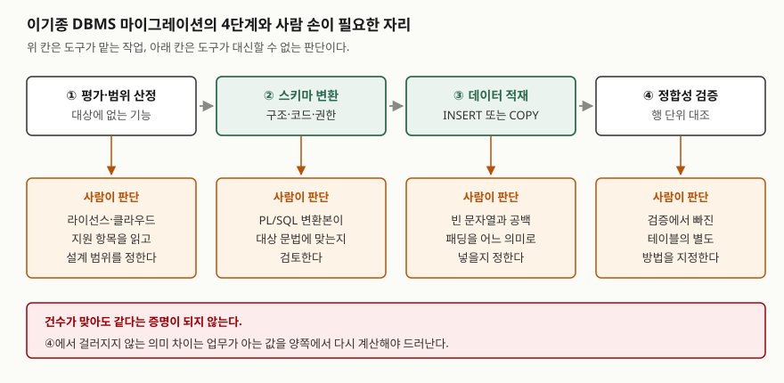

## 들어가며

이기종 DBMS 마이그레이션은 데이터베이스 과목에서도 나오고 사업 관리 과목에서도 나온다.
그런데 "스키마를 변환하고 데이터를 옮긴 뒤 검증한다"는 세 줄은 채점자가 확인할 것이
없는 문장이다. 점수가 붙는 자리는 **자동 변환이 어디서 끊기는지**와 **옮긴 데이터가
같다는 것을 무엇으로 증명하는지**다. 실무에서 전환이 실패로 평가되는 사고도 대개
데이터가 사라져서가 아니라, 건수는 맞는데 **값의 의미가 조용히 달라져 있어서** 난다.

> **실행 검증 없음.** 제품·도구 공식 문서 근거로만 정리했다.

---

## 정의

**이기종 DBMS 마이그레이션은 원본 DBMS의 스키마와 데이터를 구조와 문법이 다른 대상
DBMS로 옮기고, 옮긴 결과가 원본과 같다는 것을 대조로 증명하는 작업이다.**

이 용어에는 **표준이 규정한 정의가 없다.** ISO 표준이나 RFC가 "heterogeneous database
migration"을 정의해 둔 자리가 없고, 쓸 수 있는 1차 자료는 변환·적재 도구를 만든 쪽의
공식 문서다. 그래서 정의는 그 문서들이 **자기 도구가 무엇을 한다고 적는지**를 모아
세우는 수밖에 없다. 답안에서 "ISO가 정의하기를"로 시작하지 않는다.

도구 문서가 적는 작업은 두 갈래로 갈린다.

- **스키마 변환** — AWS Schema Conversion Tool 문서는 자동으로 변환되지 않는 요소에
  대해서는 **동등한 스키마를 만드는 지침을 제공한다**고 적는다. 즉 변환은 처음부터
  **전부 자동이 아닌 것을 전제로** 설계되어 있다
- **데이터 정합성 검증** — AWS DMS 문서는 검증이 **원본의 각 행을 대상의 대응하는 행과
  비교한다**고 적는다. 건수만 세는 것이 아니라 행 단위 대조라는 점이 규정의 핵심이다

## 등장 배경

같은 제품의 상위 버전으로 올리는 일과 이기종으로 옮기는 일은 성격이 다르다. 전자는
엔진이 데이터 파일을 그대로 읽어 주지만, 후자는 **데이터를 꺼내 다시 넣는 것 말고 방법이
없다.** 꺼내고 넣는 사이에 타입·문법·의미가 각각 한 번씩 번역된다.

번역이 세 겹이라는 것이 문제의 전부다. 타입은 이름이 같아도 저장 규칙이 다르고, 문법은
표준 SQL을 벗어난 부분이 제품마다 다르며, 의미는 같은 값을 엔진이 다르게 해석한다. 앞의
두 겹은 변환 도구가 상당 부분 맡아 주지만 **세 번째 겹은 도구가 알아낼 수 없다.** 값이
들어오는 시점에는 그 값이 "빈 문자열"로 의도된 것인지 "없음"으로 의도된 것인지가 데이터
안에 남아 있지 않기 때문이다.

그래서 전환 과제는 "옮겼다"가 아니라 "같다는 것을 보였다"로 끝나야 하고, 검증 절차가
사업 범위 안에 처음부터 들어가 있어야 한다.

## 구성요소 — 변환 대상 4계층과 검증 3단계

### 가. 변환 대상 4계층

Ora2Pg 문서가 자동으로 내보낸다고 밝힌 객체 목록을 성격별로 묶으면 네 계층이 된다.
문서는 TABLE(제약 포함)·VIEW·MVIEW·TABLESPACE·SEQUENCE·INDEXES·TRIGGER·GRANT·
FUNCTION·PROCEDURE·PACKAGE·PARTITION·TYPE·INSERT 또는 COPY·FDW·QUERY·KETTLE·SYNONYM을
든다.

| 계층 | 들어가는 것 | 자동 변환 |
|---|---|---|
| 1. 저장 구조 | 테이블, 제약, 인덱스, 파티션, 테이블스페이스 | 대체로 된다 |
| 2. 데이터 | 행 적재(INSERT 또는 COPY) | 된다 |
| 3. 코드 | 함수, 프로시저, 패키지, 트리거 | **부분만 된다** |
| 4. 권한·부속 | GRANT, 시퀀스, 동의어, 외부 테이블 | 대체로 되나 매핑이 필요하다 |

3계층이 갈리는 지점이다. 같은 문서는 PL/SQL에 대해 **PL/pgSQL로의 기본적인 자동 변환**을
제공한다고 적고, 변환된 코드는 **PostgreSQL 문법에 맞는지 검토해야 한다**고 덧붙인다.
"변환된다"와 "검토 없이 쓸 수 있다"는 다른 말이다.

### 나. 검증 3단계

AWS DMS 문서가 규정하는 검증을 단계로 펴면 셋이다.

1. **대조 가능 여부 판정** — 검증은 테이블에 **기본 키나 고유 인덱스가 있을 것을
   요구한다.** 없으면 그 테이블은 검증 대상이 아니다
2. **행 단위 대조** — 원본의 각 행을 대상의 대응하는 행과 비교한다. 문서는 데이터를
   가져오기 위해 **적절한 질의를 발행한다**고만 적고, 비교에 쓰는 알고리즘은 밝히지
   않는다. 향상된 검증의 사전 조건으로 `DBMS_CRYPTO`·`pgcrypto`·`BIT_XOR` 집계를
   요구한다는 서술이 있지만, **해시 방식이라고 문서가 단정하지는 않는다**
3. **불일치 분류** — 실패는 제어 테이블에 네 가지로 기록된다. `RECORD_DIFF`(값이 다름),
   `MISSING_SOURCE`(원본에 없음), `MISSING_TARGET`(대상에 없음),
   `TABLE_WARNING`(테이블 수준 경고)

테이블마다 붙는 검증 상태도 문서가 열거한다. 검증됨, 보류 레코드, 불일치 레코드, 보류된
레코드, 기본 키 없음, 테이블 오류 등이다. **"검증됨"이 아닌 상태가 남아 있는 테이블을
세는 것**이 보고서의 첫 줄이 되어야 한다.

## 도식

> **출처**: [AWS Schema Conversion Tool 사용 설명서 — Schema conversion overview, Using the assessment report](https://docs.aws.amazon.com/SchemaConversionTool/latest/userguide/CHAP_Welcome.html) (평가 보고서의 구성과 자동 변환 불가 요소 안내) · [AWS DMS 사용 설명서 — Data validation, Limitations, Replication task statistics, Troubleshooting](https://docs.aws.amazon.com/dms/latest/userguide/CHAP_Validating.html) (행 단위 대조·기본 키 요구·실패 분류) · [Ora2Pg — Features](https://ora2pg.darold.net/docs/features) (자동 내보내기 객체 목록과 PL/SQL 검토 요구)

답안지에는 네 칸을 가로로 늘어놓고, 칸 아래에 "사람이 해야 하는 것"을 한 줄씩 달면 된다.

## 비교

### 가. 의미가 갈리는 자리 — 두 제품의 문서가 실제로 적는 것

변환 도구가 잡아 주지 못하는 세 번째 겹이 여기다. 같은 값을 넣어도 엔진이 다르게
해석한다.

| 쟁점 | Oracle 19c 문서 | PostgreSQL 17 문서 |
|---|---|---|
| 길이 0인 문자열 | **길이가 0인 문자 값을 널로 취급한다** | 길이 0인 문자열과 널은 별개다 |
| 향후 변경 | 현재는 그렇게 취급하지만 **이후 릴리스에서도 그러리라는 보장은 없다**고 적고, **빈 문자열을 널과 같게 다루지 말 것을 권고**한다 | 해당 없음 |
| `CHAR(n)` 저장 | CHAR는 **컬럼 길이에 맞춰 공백을 채운다** | **지정 너비 n까지 공백으로 물리적으로 채운다** |
| `CHAR(n)` 비교 | — | 두 값을 비교할 때 **뒤쪽 공백을 의미상 중요하지 않은 것으로 취급**한다 |
| `VARCHAR` 비교 | VARCHAR2는 **공백을 채우지 않는 비교 의미**를 쓴다 | `character varying`·`text`에서는 **뒤쪽 공백이 의미상 중요하다** |
| 널끼리의 비교 | **널은 어떤 값과도, 다른 널과도 같거나 다를 수 없다.** 다만 `DECODE`와 복합 키에서는 두 널을 같은 것으로 본다 | — |

**이 표가 검증 설계를 좌우한다.** 원본에서 빈 문자열이었던 컬럼은 Oracle 쪽에서 널로
저장되어 있으므로, 대상에 빈 문자열로 들어가면 두 값은 **같지 않다.** 반대로 `CHAR(n)`에
들어 있던 값은 양쪽 모두 공백이 채워지지만 **비교 규칙이 달라서** 같은 질의가 다른 결과를
낸다. 건수 대조로는 둘 다 잡히지 않는다.

Oracle 문서가 **빈 문자열을 널과 같게 다루지 말라고 권고**해 둔 것도 그대로 쓸 수 있는
근거다. 이 권고는 마이그레이션을 위한 것이 아니라 Oracle 자신의 향후 변경 가능성 때문에
적힌 것인데, 결과적으로 이기종 전환에서 가장 먼저 걸리는 자리를 가리킨다.

### 나. 검증에서 빠지는 것

DMS 문서가 제한 사항으로 열거한 것들이다. 검증을 돌렸다고 전부 본 것이 아니다.

| 빠지는 것 | 문서의 서술 |
|---|---|
| 기본 키·고유 인덱스가 없는 테이블 | 검증 자체가 요구 조건을 만족하지 못한다 |
| 널인 기본 키·고유 키 값 | 검증되지 않는다 |
| 기본 키가 CLOB·BLOB·BINARY·BYTE인 경우 | 기본 키로 쓸 수 없다 |
| 기본 키 문자열 길이 1024 이상 | VARCHAR·CHAR 기본 키는 1024 미만이어야 한다 |
| Oracle `LONG` 타입 | 검증을 지원하지 않는다 |
| Oracle `NOVALIDATE`로 만든 키 | 기본 키·고유 인덱스로 취급되지 않는다 |
| 뷰 | 검증되지 않는다 |
| 마스킹된 컬럼 | 무시된다 |

여기에 중단 조건도 하나 있다. 실패하거나 보류된 레코드가 **10,000건을 넘으면 검증을
멈춘다.** 즉 실패가 많은 전환일수록 **검증 결과 자체가 불완전해진다.** 보고서에 "불일치
0건"이 아니라 "검증이 끝까지 돌았는가"를 먼저 적어야 하는 이유다.

## 적용 시 고려사항 — 4가지

### 가. 공수 산정은 도구가 주는 숫자를 그대로 쓰지 않는다

평가 도구는 공수를 숫자로 내놓는다. AWS SCT 문서는 평가 보고서가 **동등한 코드를 작성하는
데 드는 노력의 추정치**를 제공한다고 적지만, **단위는 밝히지 않는다.** Ora2Pg는 마이그레이션
비용 평가와 난이도 수준 평가를 제공하고, 평가 단위의 값을 `COST_UNIT_VALUE` 지시자로
정하며 **기본값은 단위당 5분**이다. 명령행 도움말은 이 값이 **PostgreSQL 전문가가 수행하는
경우에 해당**하며 **첫 마이그레이션이라면 10으로 올리라**고 적는다.

그런데 같은 README 안에서 값이 어긋나는 자리가 있다. B에서 C로 난이도가 바뀌는 사람·일
한계가 명령행 도움말에서는 **5 person-days**, 지시자 설명에서는 **10 person-days**로
적혀 있다. 문서가 스스로 갈리는 숫자를 답안이나 제안서에 근거로 옮기지 않는다. 쓸 수
있는 것은 **"도구가 내는 추정치는 전제가 붙은 값"이라는 사실**까지다.

### 나. 평가 보고서는 변환이 아니라 범위 산정에 쓴다

AWS SCT 평가 보고서의 구성은 요약, **라이선스 평가**, **클라우드 지원**(원본에는 있으나
대상에서 제공되지 않는 기능), 권고 사항이다. CSV나 PDF로 내보낼 수 있다. 여기서 볼 것은
변환 결과가 아니라 **대상에 없는 기능의 목록**이다. 그 목록이 곧 설계 변경이 필요한
범위이고, 전환 과제에서 일정이 틀어지는 자리는 거의 전부 여기다.

### 다. 정합성은 세 층으로 쌓아 증명한다

도구의 행 단위 검증만으로는 받아들여지지 않는 경우가 많다. 증명은 층을 쌓는다.

1. **건수** — 테이블별 행 수. 빠르지만 값이 바뀐 것은 못 잡는다
2. **행 단위 대조** — 도구가 하는 일. 기본 키가 있는 테이블만, 위 표에서 빠진 것을 뺀
   나머지만 본다
3. **업무 규칙 재계산** — 월 마감 합계, 잔액, 집계 테이블처럼 **업무가 아는 값**을 양쪽에서
   다시 계산해 맞춘다. 1·2가 못 보는 의미 차이가 여기서 드러난다

3번을 생략하면 앞의 두 층이 아무리 깨끗해도 "같다"를 증명한 것이 아니다. 빈 문자열이
널로 바뀐 컬럼은 건수도 맞고 행 대조도 통과할 수 있지만, 그 컬럼을 조건으로 세는 집계는
달라진다.

### 라. 검증 대상에서 빠진 테이블의 처리를 미리 정한다

기본 키가 없는 테이블, `LONG` 컬럼을 가진 테이블, 뷰는 도구가 봐주지 않는다. 전환
착수 전에 이 목록을 뽑아 **별도 검증 방법을 테이블마다 지정**해 두어야 한다. 전환이
끝난 뒤에 "이건 검증이 안 됩니다"를 보고하면 그때는 선택지가 재적재뿐이다.

## 정리

- **표준 정의가 없는 용어다.** 1차 자료는 변환·적재 도구의 공식 문서이고, 정의는 그
  문서들이 자기 도구가 무엇을 한다고 적는지에서 세운다
- **변환 대상 4계층 — 저장 구조·데이터·코드·권한.** 끊기는 곳은 3계층이고, 도구 문서도
  변환된 코드를 **검토해야 한다**고 적는다
- **검증 3단계 — 대조 가능 여부 판정 → 행 단위 대조 → 불일치 분류.** 불일치 유형은
  값 차이·원본 없음·대상 없음·테이블 경고 **4가지**
- **검증에서 빠지는 것이 8가지.** 기본 키 없음, 널 키, 큰 객체 키, 1024 이상 문자열 키,
  `LONG`, `NOVALIDATE` 키, 뷰, 마스킹 컬럼. 실패 10,000건을 넘으면 검증이 멈춘다
- **의미가 갈리는 대표 자리는 둘.** 길이 0인 문자열의 널 취급, `CHAR(n)`의 뒤쪽 공백
  취급. 둘 다 건수 대조로는 보이지 않는다
- **증명은 건수 → 행 대조 → 업무 규칙 재계산 3층으로 쌓는다**

> 기출 답안: [기출문제 — 상용 DBMS의 오픈소스 전환: 배경·제약사항·마이그레이션 절차·HA 구성](../../exam/2026-10-28-open-source-dbms-migration-and-ha/index.md)

## 참고 자료

- [Oracle Database 19c SQL Language Reference — *Nulls*](https://docs.oracle.com/en/database/oracle/oracle-database/19/sqlrf/Nulls.html) — 길이 0인 문자 값의 널 취급, 향후 릴리스 변경 가능성과 권고, 널끼리의 비교, `DECODE`·복합 키에서의 예외 (1차)
- [Oracle Database 19c SQL Language Reference — *Data Types*](https://docs.oracle.com/en/database/oracle/oracle-database/19/sqlrf/Data-Types.html) — VARCHAR2의 비패딩 비교 의미, CHAR의 공백 채움 (1차)
- [PostgreSQL 17 Documentation — §8.3 Character Types](https://www.postgresql.org/docs/17/datatype-character.html) — `character(n)`의 공백 채움과 비교 시 뒤쪽 공백 취급, `character varying`·`text`에서 뒤쪽 공백의 의미, 타입별 성능 비교 (1차)
- [AWS Database Migration Service User Guide — *Data validation*](https://docs.aws.amazon.com/dms/latest/userguide/CHAP_Validating.html) — 행 단위 대조의 정의, 기본 키 요구와 제한 사항, 검증 상태 값, 실패 유형 4가지, 10,000건 중단 (1차)
- [AWS Schema Conversion Tool User Guide — *What is AWS SCT*](https://docs.aws.amazon.com/SchemaConversionTool/latest/userguide/CHAP_Welcome.html) · [*Converting database schemas*](https://docs.aws.amazon.com/SchemaConversionTool/latest/userguide/CHAP_Converting.html) — 자동 변환되지 않는 요소에 대한 지침 제공, 평가 보고서의 구성과 노력 추정치 (1차)
- [Ora2Pg — *Features*](https://ora2pg.darold.net/docs/features) — 자동 내보내기 객체 목록, PL/SQL의 기본 자동 변환과 검토 요구, 마이그레이션 비용·난이도 평가 (1차)
- [Ora2Pg README (master 브랜치)](https://raw.githubusercontent.com/darold/ora2pg/master/README) — `COST_UNIT_VALUE` 기본 5분, `ESTIMATE_COST`, `HUMAN_DAYS_LIMIT`와 명령행 도움말의 기본값이 서로 다르게 적힌 자리 (1차)
