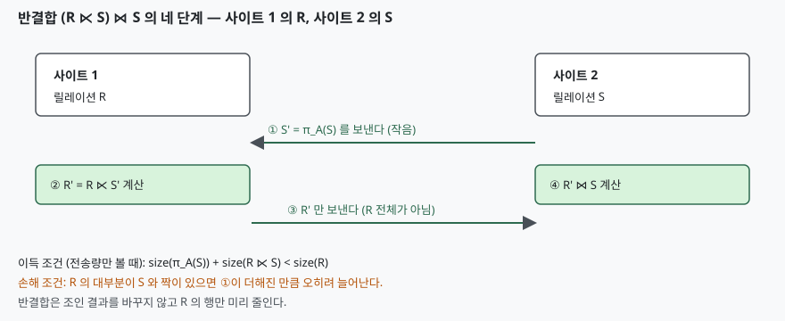

## 들어가며

분산 데이터베이스에서 사이트가 다른 두 릴레이션을 조인하는 질의는 시험에 자주 나온다. 유도 수평분할의 정의에도, 분산 질의 최적화의 전략 선택에도 반결합이 나오기 때문이다. 실무에서는 사이트 사이 통신이 로컬 디스크 읽기보다 훨씬 비싼 경우가 많아, 조인 전에 **무엇을 얼마나 보낼지**가 비용의 대부분을 정한다.

답안에 쓰려면 정의, 4단계 절차, 이득 조건, 그리고 손해가 되는 경우까지 한 묶음으로 알고 있어야 한다. 이득 조건만 외우면 "언제 쓰지 말아야 하는가"를 묻는 문항에서 막힌다.

## 정의

**반결합(semijoin) R ⋉_A S** 는 R의 튜플 가운데 조인 속성 A의 값이 S에 있는 튜플만 남긴 R의 부분집합이다. 결과의 속성은 R의 것뿐이다. 관계대수로는 `R ⋉_A S = π_R(R ⋈_A S)` 로 쓸 수 있다.

분산 질의 맥락에서는 **조인 전에 한 릴레이션을 줄여서 보내기 위한 연산**으로 쓴다. Özsu & Valduriez의 질의 최적화 강의 슬라이드(Ch.8)는 이를 "피연산자의 전송 크기를 줄이는 데 쓴다"고 설명한다.

## 등장 배경

사이트 1의 R과 사이트 2의 S를 조인할 때 가장 단순한 방법은 한 릴레이션을 통째로 상대 사이트로 보내는 것이다(ship-whole). 두 릴레이션 크기가 비슷하면 어느 쪽을 보내도 비싸고, 보낸 릴레이션 가운데 **짝이 없어서 조인 결과에 들어가지 못하는 튜플도 함께 전송된다.** 반결합은 이 낭비를 보내기 전에 걸러낸다.

## 구성요소 / 절차

반결합 기반 조인 `(R ⋉_A S) ⋈_A S` 는 **4단계**다.

1. 사이트 2가 S의 조인 속성만 뽑아 `S' = π_A(S)` 를 만든다
2. S'를 사이트 1로 전송한다
3. 사이트 1이 `R' = R ⋉_A S'` 를 계산하고 R'를 사이트 2로 전송한다
4. 사이트 2가 `R' ⋈_A S` 를 계산한다



> **출처**: [Özsu & Valduriez, *Principles of Distributed Database Systems* 3판 (2011) Ch.8 강의 슬라이드 12~13쪽](https://users.dimi.uniud.it/~dario.dellamonica/teaching/22_23_2sem_DMBD_ADBS4BD/course_material/slides/2_distributed_database_architectures/2e_Query_Optimization_ozsu_ch8_SPLIT.pdf)

같은 슬라이드는 R, S 양쪽에서 쓸 수 있는 **3가지 변형**을 든다: `(R ⋉ S) ⋈ S`, `R ⋈ (S ⋉ R)`, `(R ⋉ S) ⋈ (S ⋉ R)`.

## 비교 — 언제 이득이고 언제 손해인가

전송량만 따지면 반결합이 이득인 조건은 다음과 같다.

```text
size(π_A(S)) + size(R ⋉ S) < size(R)
```

다음 표는 R과 S를 가상 데이터로 만들어 전송 바이트를 직접 센 결과다. R은 10,000행 × 100바이트(합계 1,000,000바이트), 조인 값은 4바이트이고, S의 서로 다른 조인 값 수만 바꿨다. 소스는 [`code/semijoin_cost.py`](code/semijoin_cost.py), 수행 기록은 [`code/output.txt`](code/output.txt)다.

| S의 조인 값 수 | R 중 짝 있는 행 | A 전체 전송 | B 반결합 | C 비트 배열 | 반결합 이득 |
|---:|---:|---:|---:|---:|:--:|
| 200 | 46 | 1,000,000 | 5,400 | 25,924 | 이득 |
| 5,000 | 1,028 | 1,000,000 | 122,800 | 497,924 | 이득 |
| 48,000 | 9,569 | 1,000,000 | 1,148,900 | 1,001,024 | **손해** |

S가 클수록 π(S)가 커지고 R에서 걸러지는 행이 줄어, 마지막 줄에서는 반결합이 전체 전송보다 14.9% 더 보낸다. 같은 슬라이드(14쪽)가 정리한 대로 **R ⋉ S가 R ⋈ S보다 훨씬 작을 때**, 즉 선택도가 높거나 R의 튜플이 클 때 이득이다.

**비트 배열(bit array)** 변형은 π(S) 대신 해시 버킷 비트 배열을 보낸다. S의 값 v마다 `BA[h(v)] = 1` 로 표시하고, R의 튜플은 `BA[h(v)] = 1` 일 때만 남긴다(슬라이드 15쪽). 결과 R'는 R ⋉ S의 **과대 근사**라서 짝이 없는 튜플이 섞인다(거짓 양성). 위 계산에서 비트 배열은 8,192비트(1,024바이트)로, 첫 줄에서 R' 249행 중 203행이 거짓 양성이었다. 비트 배열이 작아 버킷이 금방 차기 때문이며, 버킷 수를 키우면 줄어든다(이번에는 재지 않았다).

## 적용 시 고려사항

**첫째, 인덱스를 잃는다.** 슬라이드 14쪽이 반결합의 단점으로 드는 것이 인덱스 손실이다. 줄어든 R'는 새로 만들어진 임시 릴레이션이라 원래 R의 인덱스를 쓸 수 없다.

**둘째, 계산 비용이 늘어난다.** 슬라이드 4쪽의 표현대로 반결합은 통신을 아끼는 대신 로컬 처리를 더 쓴다. 위 계산은 전송 바이트만 셌고, 사이트 1에서 R ⋉ S'를 계산하는 시간은 포함하지 않았다.

**셋째, 세 릴레이션 이상에서는 반결합 프로그램을 짜야 한다.** `EMP ⋈ ASG ⋈ PROJ = EMP' ⋈ ASG' ⋈ PROJ` (EMP' = EMP ⋉ ASG, ASG' = ASG ⋉ PROJ) 처럼 연쇄할 수 있고, 가장 많이 줄이는 반결합 순서를 완전 축소기(full reducer)라 한다. 순환 질의에는 완전 축소기가 없고, 일반 질의에서 찾는 것은 NP-hard라서 사슬 형태 같은 단순한 경우에만 쓴다(슬라이드 17~19쪽).

**넷째, 선택도를 통계로 추정해야 한다.** 이득 조건은 R ⋉ S의 크기를 알아야 판정되는데, 이는 실행 전에는 통계로 추정할 수밖에 없다. 통계가 틀리면 위 표의 마지막 줄처럼 손해 쪽으로 갈 수 있다.

## 정리

- 반결합 = **R의 튜플 중 S와 짝이 있는 것만** 남긴 R의 부분집합
- 절차 **4단계**: π(S) 생성 → 전송 → R' 계산·전송 → R' ⋈ S
- 이득 조건: `size(π_A(S)) + size(R ⋉ S) < size(R)`
- 변형 **3가지**와 비트 배열 변형(과대 근사, 거짓 양성)
- 단점 **3가지** 암기: 인덱스 손실, 로컬 계산 증가, 선택도 추정 의존

관련 개념: 유도 수평분할이 반결합으로 정의되는 이유는 [분산 데이터베이스 분할 단위 기출 답안](../../exam/2026-11-03-distributed-db-fragmentation-units-horizontal-vertical/index.md)에서 다룬다.

## 참고 자료

- [Özsu & Valduriez, *Principles of Distributed Database Systems* 3판 (2011) Ch.8 강의 슬라이드](https://users.dimi.uniud.it/~dario.dellamonica/teaching/22_23_2sem_DMBD_ADBS4BD/course_material/slides/2_distributed_database_architectures/2e_Query_Optimization_ozsu_ch8_SPLIT.pdf) — 이 글의 정의·절차·이득 조건·비트 배열은 모두 이 슬라이드에서 가져왔다
- 가상 데이터 계산은 직접 수행했다. 크기·행 수는 시드 고정 난수로 만든 것이고 실제 시스템의 측정값이 아니다
