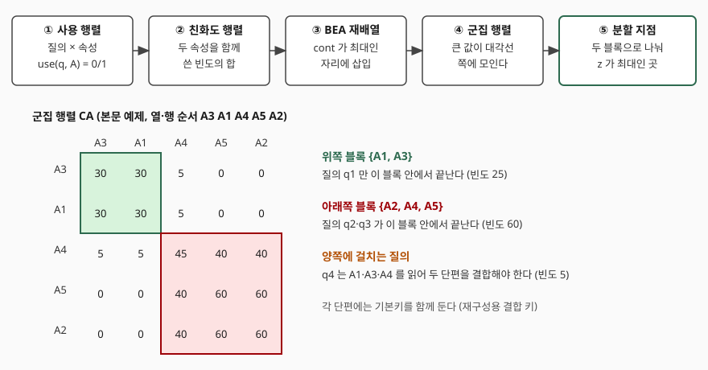

## 들어가며

수직분할은 릴레이션을 열 단위로 가른다. 열이 5개면 묶는 방법이 52가지이고 10개면 115,975가지로 늘어나서, 눈으로 훑어 정하거나 전수 탐색으로 푸는 방법은 곧 한계에 닿는다. 기술사 시험에서는 이 문제를 **"질의가 어떤 속성을 함께 읽는가"라는 숫자로 바꿔 푸는 절차**로 묻는다. 그 절차의 중심이 속성 친화도 행렬과 결합 에너지 알고리즘(BEA)이다. 이 글은 5개 속성·4개 질의의 작은 예제를 코드로 직접 계산해 각 단계의 숫자가 어떻게 나오는지 보인다.

## 정의

**속성 친화도(attribute affinity)는 두 속성을 함께 읽는 질의들의 접근 빈도 합이고, 결합 에너지 알고리즘(Bond Energy Algorithm)은 이 친화도 행렬의 행과 열을 같은 순서로 재배열해 친화도가 큰 속성끼리 대각선 가까이 모이게 하는 군집화 알고리즘이다.**

수식으로는 질의 q, 속성 사용 여부 use(q, A)(쓰면 1, 아니면 0), 접근 빈도 acc(q)에 대해 aff(Aᵢ, Aⱼ) = Σ use(q, Aᵢ) · use(q, Aⱼ) · acc(q)이다. 두 속성을 모두 쓰는 질의의 빈도만 더해진다.

## 등장 배경

수평분할은 조건식이라는 뚜렷한 기준이 있지만 수직분할에는 그런 기준이 없다. 어떤 열을 같은 단편에 둘지는 **응용이 그 열들을 함께 읽는지**로만 정해진다. 함께 읽는 열이 서로 다른 단편에 있으면 질의마다 단편을 결합해야 하고, 쓰지 않는 열까지 같은 단편에 두면 그 열을 읽는 비용이 낭비된다.

Hoffer와 Severance(VLDB 1975)가 질의 접근 패턴에서 나온 속성 사이의 유사도를 클러스터 분석으로 묶는 방법을 물리 설계에 적용했고, Navathe 등(ACM TODS 1984)이 이를 수직분할 알고리즘으로 체계화했다.

## 구성요소와 절차

절차는 **5단계**다.

1. **사용 행렬 작성** — 질의 × 속성 표에 use(q, A)를 적고 질의별 접근 빈도 acc(q)를 붙인다
2. **친화도 행렬 AA 계산** — 모든 속성 쌍에 대해 위 식으로 aff를 구한다. 대칭 행렬이고 대각선 aff(A, A)는 그 속성을 쓰는 질의의 빈도 합이다
3. **BEA로 재배열** — 속성을 하나씩 넣으며 가장 큰 증가분이 나오는 자리에 삽입한다
4. **군집 행렬 CA 확인** — 큰 값이 대각선 쪽 블록에 모였는지 본다
5. **분할 지점 선택** — 군집 행렬을 위·아래 두 블록으로 나누는 지점 중 목적식이 가장 큰 곳을 고른다

3단계의 계산에 쓰는 값이 **세 가지**다. 강의 자료의 정의는 다음과 같다.

| 값 | 식 | 뜻 |
|---|---|---|
| bond(Aₓ, A_y) | Σ_z aff(A_z, Aₓ) · aff(A_z, A_y) | 두 속성의 친화도 열이 얼마나 닮았는가 |
| AM | Σ_j [bond(A_j, A_{j−1}) + bond(A_j, A_{j+1})] | 이웃 속성끼리의 결합 에너지 총합, 클수록 군집이 뚜렷하다 |
| cont(Aᵢ, A_k, A_j) | 2·bond(Aᵢ, A_k) + 2·bond(A_k, A_j) − 2·bond(Aᵢ, A_j) | A_k 를 Aᵢ와 A_j 사이에 넣을 때 AM 의 증가분 |

속성 A_k를 넣을 자리가 맨 왼쪽이나 맨 오른쪽이면 바깥쪽 bond를 0으로 본다. 모든 자리의 cont를 비교해 최댓값 자리에 넣고, 같은 값이면 왼쪽 자리를 고른다. 처음 두 속성은 그대로 두고 세 번째부터 넣는다.

## 도식



> **출처**: [Özsu & Valduriez, *Principles of Distributed Database Systems* 3판 Ch.3 강의 슬라이드 59쪽 (aff 정의)](https://users.dimi.uniud.it/~dario.dellamonica/teaching/23_24_2sem_ADBS/course_material/slides/2_distributed_database_architectures/2b_Distribution_Design_ozsu_ch3_SPLIT.pdf), [USC CSCI585 Distributed Databases 강의 슬라이드 42~48쪽 (aff·bond·AM·cont)](https://infolab.usc.edu/csci585/Spring2008/Lectures/DDBMS-Design.pdf)

## 예제 계산 — 직접 돌린 결과

사용 행렬과 빈도는 q1이 A1·A3(빈도 25), q2가 A2·A4·A5(40), q3가 A2·A5(20), q4가 A1·A3·A4(5)다. 전체 소스는 [code/bea_vertical_partition.py](code/bea_vertical_partition.py)에 있고, 출력은 [code/output.txt](code/output.txt)에서 가져왔다.

원래 순서(A1~A5)의 친화도 행렬은 다음과 같다. 예를 들어 aff(A1, A3)은 A1과 A3을 함께 쓰는 q1(25)과 q4(5)의 합 30이다.

```text
         A1   A2   A3   A4   A5
   A1    30    0   30    5    0
   A2     0   60    0   40   60
   A3    30    0   30    5    0
   A4     5   40    5   45   40
   A5     0   60    0   40   60
  전체 결합 에너지 AM = 15050
```

A1과 A3이 떨어져 있고 A2와 A5도 떨어져 있어 군집이 보이지 않는다. BEA가 속성을 넣을 때의 cont는 이렇게 나왔다.

```text
  A3 삽입 → 자리0:3650, 자리1:3650, 자리2:400 → 자리0 선택
  A4 삽입 → 자리0:1050, 자리1:-1550, 자리2:13850, 자리3:13200 → 자리2 선택
  A5 삽입 → 자리0:400, 자리1:-2850, 자리2:12550, 자리3:17600, 자리4:17600 → 자리3 선택
  최종 순서: A3 A1 A4 A5 A2
```

A3은 자리0과 자리1이 같은 값이라 왼쪽 자리를 골랐고, A5도 자리3과 자리4가 같아 왼쪽을 골랐다. 이 선택 규칙이 달라지면 같은 군집이 좌우로 뒤집힌 순서가 나올 수 있다. 재배열한 군집 행렬은 큰 값이 두 블록으로 모였고 AM은 15050에서 35500으로 올랐다.

```text
         A3   A1   A4   A5   A2
   A3    30   30    5    0    0
   A1    30   30    5    0    0
   A4     5    5   45   40   40
   A5     0    0   40   60   60
   A2     0    0   40   60   60
  전체 결합 에너지 AM = 35500
```

마지막 5단계는 대각선을 따라 가능한 분할 지점을 모두 잡아 목적식을 비교한다. 위쪽 블록 속성만 쓰는 질의의 빈도를 CTQ, 아래쪽 블록 속성만 쓰는 질의의 빈도를 CBQ, 양쪽에 걸치는 질의의 빈도를 COQ라 하고 z = CTQ·CBQ − COQ²를 최대로 하는 지점을 고른다. 이 목적식은 교과서 원문을 이번에 열람하지 못해 슬라이드 근거 밖이다. 결과는 아래와 같다.

```text
  ['A1', 'A3'] | ['A2', 'A4', 'A5']  CTQ=25 CBQ=60 COQ=5  z=1475
  ['A1', 'A3', 'A4'] | ['A2', 'A5']  CTQ=30 CBQ=20 COQ=40  z=-1000
```

z가 양수인 지점은 {A1, A3} | {A2, A4, A5} 하나뿐이다. 이때 q4만 두 단편에 걸쳐 결합이 필요하고 그 빈도는 5다. 이 계산은 **실행 검증을 마쳤고**, 값은 모두 위 코드가 만들었다.

## 비교

| 구분 | 수평분할(기본) | 수직분할(친화도 기반) |
|---|---|---|
| 기준 | 단순 조건식의 최소항 | 속성 친화도 |
| 입력 | 조건식과 접근 빈도 | 사용 행렬과 접근 빈도 |
| 탐색 방법 | 최소항 구성 | 군집화(BEA)와 분할 지점 탐색 |
| 재구성 | 합집합 | 결합 (기본키를 모든 단편이 보유) |
| 결과가 흔들리는 곳 | 조건식 집합 | 동률 처리, 질의 빈도 추정 |

> 기출 답안: [기출문제 — 분산 데이터베이스의 분할 단위와 수평분할·수직분할](../../exam/2026-11-03-distributed-db-fragmentation-units-horizontal-vertical/index.md)

## 적용 시 고려사항

1. **질의 빈도가 입력이므로 워크로드가 바뀌면 다시 계산한다.** 친화도의 모든 값이 acc(q)에서 나오므로 빈도 추정이 틀리면 군집이 틀린다
2. **동률일 때의 선택이 결과 순서를 정한다.** 위 예제처럼 같은 cont가 나오면 구현의 규칙에 따라 좌우가 뒤집힐 수 있으나 군집 구성은 달라지지 않는다
3. **BEA는 군집을 보일 뿐 분할 지점을 정하지 않는다.** 분할 지점은 별도의 목적식으로 고르며, 위 예제의 z 외에도 여러 목적식이 있다
4. **양쪽에 걸치는 질의의 비용을 따로 본다.** 위 예제의 q4처럼 빈도가 작아도 결합이 필요한 질의가 남고, 그 질의가 지연에 민감하면 군집이 좋아도 분할 안을 다시 본다
5. **기본키는 모든 단편에 둔다.** 재구성이 결합이므로 키가 없으면 단편을 이을 수 없다

## 정리

- 수직분할 설계는 **5단계**다: 사용 행렬 → 친화도 행렬 → BEA 재배열 → 군집 행렬 → 분할 지점
- 친화도는 **두 속성을 함께 쓰는 질의의 빈도 합**이다
- BEA의 계산 값은 **bond · AM · cont 3가지**다
- 암기 단서는 "사-친-재-군-분"이다
- 재구성은 결합이므로 기본키를 모든 단편이 가진다

## 참고 자료

- [Özsu & Valduriez, *Principles of Distributed Database Systems* 3판 Ch.3 강의 슬라이드](https://users.dimi.uniud.it/~dario.dellamonica/teaching/23_24_2sem_ADBS/course_material/slides/2_distributed_database_architectures/2b_Distribution_Design_ozsu_ch3_SPLIT.pdf) — 59쪽 친화도 정의와 예제
- [USC CSCI585 Distributed Databases, DDBMS-Design 슬라이드 (2008)](https://infolab.usc.edu/csci585/Spring2008/Lectures/DDBMS-Design.pdf) — 42~48쪽 aff·bond·AM·cont
- [S. Navathe, S. Ceri, G. Wiederhold, J. Dou, "Vertical partitioning algorithms for database design", ACM TODS 9(4), 1984, pp.680–710](https://doi.org/10.1145/1994.2209)
- [J. A. Hoffer, D. G. Severance, "The use of cluster analysis in physical data base design", VLDB 1975, p.69](https://doi.org/10.1145/1282480.1282486)
