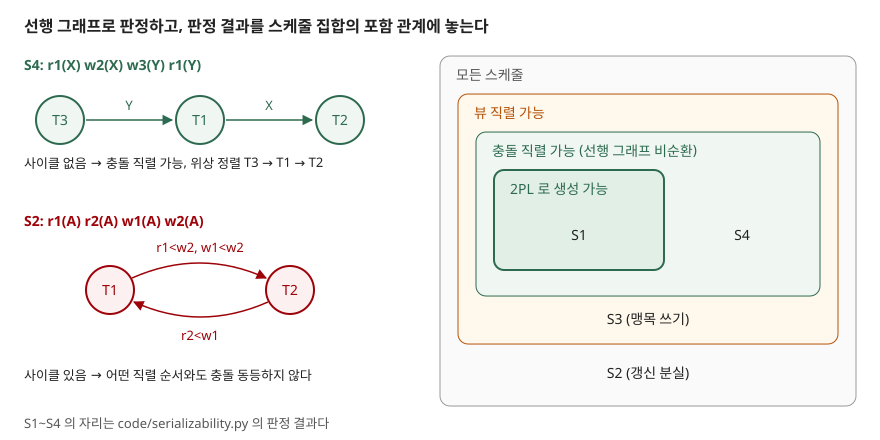

## 들어가며

DBMS 는 처리량을 높이려고 여러 트랜잭션의 연산을 섞어 실행한다. 섞인 결과가 "트랜잭션을 하나씩 차례로 돌린 것과 같다"는 보장이 직렬 가능성이고, 격리 수준 `SERIALIZABLE` 이 약속하는 것이 바로 이것이다. 시험에서는 스케줄을 주고 직렬 가능한지 판정하게 하거나, 충돌 직렬 가능성과 뷰 직렬 가능성을 비교하게 하거나, 2단계 로킹(2PL)과의 관계를 묻는다. 판정 방법을 손으로 돌릴 수 있어야 세 유형 모두에 답할 수 있다.

## 정의

**충돌 직렬 가능**(conflict serializable)이란 스케줄 S 를, 충돌하지 않는 이웃 연산끼리 자리를 바꾸는 일을 되풀이해 어떤 직렬 스케줄로 만들 수 있다는 뜻이다. 이렇게 서로 바뀔 수 있는 두 스케줄을 **충돌 동등**하다고 한다. 정의는 Silberschatz 교재의 충돌 직렬 가능성 절을 따른다.

**충돌**은 서로 다른 트랜잭션의 두 연산이 같은 항목 Q 에 접근하고, 그중 적어도 하나가 쓰기일 때 생긴다. 경우는 4가지다.

| 앞 연산 | 뒤 연산 | 충돌 |
|---|---|---|
| read(Q) | read(Q) | 아니다 — 순서를 바꿔도 읽는 값이 같다 |
| read(Q) | write(Q) | 충돌 |
| write(Q) | read(Q) | 충돌 |
| write(Q) | write(Q) | 충돌 |

충돌하는 두 연산은 순서를 바꾸면 읽는 값이나 마지막에 남는 값이 달라진다. 그래서 충돌 쌍의 앞뒤 순서가 곧 트랜잭션 사이의 논리적 선후가 된다.

## 등장 배경

직렬 실행은 각 트랜잭션이 일관성을 지킨다는 가정만으로 결과가 옳지만, 한 번에 하나만 돌리면 동시성이 없다. 섞어 실행하면 갱신 분실 같은 이상이 생긴다. 그렇다면 "섞었지만 결과는 직렬과 같은" 스케줄을 가려낼 기준이 필요하다. 결과값을 직접 비교하는 것은 연산의 의미를 알아야 하므로 일반적으로 할 수 없고, 읽기와 쓰기의 순서만 보고 판정하자는 것이 충돌 직렬 가능성과 뷰 직렬 가능성이다.

## 구성요소 — 판정 절차 3단계

교재의 선행 그래프 판정 절은 이렇게 정한다.

1. **정점**: 스케줄에 참여한 트랜잭션마다 정점 하나
2. **간선**: Ti 와 Tj 의 연산이 충돌하고 Ti 가 그 항목에 먼저 접근했으면 Ti → Tj. 간선에 항목 이름을 붙여도 된다
3. **판정**: 그래프에 사이클이 없으면, 그리고 그때만 충돌 직렬 가능하다. 위상 정렬 결과가 동등한 직렬 순서다

교재는 사이클 검출이 정점 수 n 에 대해 n² 차수, 더 나은 알고리즘은 n + e(간선 수) 차수라고 적는다.

**뷰 동등 조건 3가지.** 같은 트랜잭션 집합의 두 스케줄 S, S' 가 항목 Q 마다 다음을 만족하면 뷰 동등이다.

1. S 에서 Ti 가 Q 의 **초기값**을 읽으면 S' 에서도 Ti 가 초기값을 읽는다
2. S 에서 Ti 가 Tj 가 쓴 Q 를 읽으면 S' 에서도 **같은 쓰기**의 값을 읽는다
3. S 에서 Q 를 **마지막으로 쓴** 트랜잭션이 S' 에서도 마지막으로 쓴다

어떤 직렬 스케줄과 뷰 동등하면 **뷰 직렬 가능**이다.

## 도식



> **출처**: 충돌·선행 그래프·뷰 직렬 가능성 정의는 [Silberschatz 7th ed. Ch.17 슬라이드 17.18~17.27](https://www.db-book.com/slides-dir/PDF-dir/ch17.pdf), 2PL 과 포함 관계는 [같은 교재 Ch.18 슬라이드 18.9·18.11](https://www.db-book.com/slides-dir/PDF-dir/ch18.pdf). S1~S4 의 자리는 `code/serializability.py` 로 계산했다.

답안지에는 왼쪽의 원 셋과 화살표 둘, 오른쪽의 겹친 사각형 넷이면 충분하다.

## 검산 — 스케줄 4개

전체 소스: [`code/`](code/) · 수행 기록: [`code/output.txt`](code/output.txt)

선행 그래프 판정과 별도로, 모든 직렬 순서를 하나씩 놓고 충돌 쌍의 순서를 다 지키는지 **전수 검사**해 결과를 맞대었다. 뷰 직렬 가능성은 세 조건을 그대로 코드로 옮겨 모든 직렬 순서와 비교했다.

```text
== S4 2PL 불가 ==
  스케줄        : r1(X) w2(X) w3(Y) r1(Y)
  간선 T1->T2   : r1(X)<w2(X)
  간선 T3->T1   : w3(Y)<r1(Y)
  선행 그래프   : 사이클 없음, 직렬 순서 T3->T1->T2
  전수(충돌)    : ['T3->T1->T2']
  전수(뷰)      : ['T3->T1->T2']
  2PL 생성 가능 : 아니오
```

**예상과 달랐던 점은 직렬 순서가 시작 순서와 다르다는 것이다.** S4 는 T1 이 가장 먼저 시작했는데 동등한 직렬 순서는 T3 이 맨 앞이다. T1 이 마지막에 읽는 Y 를 T3 이 먼저 썼기 때문이다. 직렬 순서는 시각이 아니라 충돌 쌍이 정한다.

나머지 셋의 결과는 이랬다.

| 스케줄 | 선행 그래프 | 충돌 직렬 | 뷰 직렬 | 2PL 생성 |
|---|---|---|---|---|
| S1 `r1(A) w1(A) r2(A) w2(A) r1(B) w1(B) r2(B) w2(B)` | T1→T2 하나 (충돌 쌍 6개가 한 간선으로 모임) | T1→T2 | T1→T2 | 가능 |
| S2 `r1(A) r2(A) w1(A) w2(A)` | T1⇄T2 사이클 | 없음 | 없음 | 불가 |
| S3 `r1(Q) w2(Q) w1(Q) w3(Q)` | T1⇄T2 사이클 | 없음 | T1→T2→T3 | 불가 |

S3 은 교재가 말하는 "뷰 직렬 가능하지만 충돌 직렬 가능하지 않은" 경우다. T2 와 T1 의 쓰기는 읽지 않고 쓰는 **맹목 쓰기**(blind write)이고, 어차피 T3 이 마지막에 덮어쓰므로 둘의 순서가 결과에 남지 않는다. 교재는 이런 스케줄에는 반드시 맹목 쓰기가 있다고 적는다.

2PL 생성 여부는 트랜잭션마다 **락 포인트**(마지막 락을 얻는 시점)를 연산 사이의 모든 자리에 놓아 보고, 2PL 이 허락하는 가장 짧은 구간만 락을 잡았을 때 충돌 락끼리 겹치지 않는 경우가 있는지 전수로 찾았다(락 업그레이드는 다루지 않았다). S4 는 T1 이 X 의 락을 w2(X) 전에 풀어야 하는데, 2PL 에서는 풀기 전에 Y 의 락까지 얻어야 하고, 그러면 w3(Y) 가 막힌다. 충돌 직렬 가능하지만 2PL 로는 만들 수 없는 스케줄이 실제로 있다는 교재의 설명과 맞다.

## 비교

| 구분 | 충돌 직렬 가능성 | 뷰 직렬 가능성 | 2PL |
|---|---|---|---|
| 성격 | 스케줄의 성질 | 스케줄의 성질 | 스케줄을 만드는 규약 |
| 판정 | 선행 그래프 사이클 검사, 다항 시간 | NP-완전 (교재) | 판정이 아니라 락 규칙을 강제 |
| 포함 관계 | 뷰 직렬 가능의 부분집합 | 충돌 직렬 가능을 포함 | 만든 스케줄은 충돌 직렬 가능 |
| 차이를 만드는 것 | 모든 충돌 쌍의 순서를 본다 | 읽은 값의 출처와 마지막 쓰기만 본다 | 커지는 단계·줄어드는 단계 |

교재는 2PL 이 만든 스케줄은 **락 포인트 순서로 직렬화된다**고 적는다. 동시에 2PL 은 직렬 가능성의 필요조건이 아니어서, S4 처럼 2PL 로는 나올 수 없는 충돌 직렬 가능 스케줄이 있다.

선행 그래프는 교착 탐지의 **대기 그래프**와 모양이 같지만 뜻이 다르다. 대기 그래프의 간선은 "락을 기다린다"이고 사이클은 교착이다. 선행 그래프의 간선은 "먼저 접근했다"이고 사이클은 직렬 불가다. → [자원 할당 그래프와 대기 그래프](../../system/2026-11-02-resource-allocation-graph-and-wait-for-graph/index.md)

## 적용 시 고려사항

**첫째, 실제 DBMS 는 선행 그래프를 그리지 않는다.** 교재도 동시성 제어 규약은 그래프를 실행 중에 검사하지 않고, 직렬 불가 스케줄이 생기지 않게 규율을 강제한다고 적는다. 판정 이론은 "그 규약이 왜 옳은가"를 보이는 도구다.

**둘째, 직렬 가능만으로는 부족하다.** 교재는 스케줄이 직렬 가능할 뿐 아니라 회복 가능해야 하고, 가능하면 연쇄 철회가 없어야 한다고 적는다. 교재는 기본 2PL 만으로는 회복 가능성과 연쇄 철회 방지가 보장되지 않아, 배타 락을 커밋·철회까지 잡는 엄격 2PL 이나 모든 락을 끝까지 잡는 엄밀 2PL 이 필요하다고 적는다. 대부분의 DBMS 가 구현하는 것은 엄밀 2PL 이고, 이 경우 커밋 순서가 곧 직렬 순서다.

**셋째, 읽기·쓰기 모델 밖의 충돌이 있다.** 술어로 행을 고르는 질의와 그 술어에 걸리는 삽입은 같은 행에 접근하지 않아도 충돌한다(팬텀). 행 단위 락만으로는 직렬 가능성이 깨질 수 있어 인덱스 락이나 다음 키 락이 필요하다고 교재가 설명한다.

**넷째, 뷰 직렬 가능성은 판정 비용 때문에 규약의 목표로 잘 쓰이지 않는다.** 교재는 일부 규약(토마스 쓰기 규칙)이 뷰 직렬 가능하지만 충돌 직렬 가능하지 않은 스케줄을 허용한다고 적는다. S3 처럼 맹목 쓰기를 무시해도 되는 경우다.

## 정리

- 충돌: 다른 트랜잭션·같은 항목·하나 이상 쓰기 — **4경우 중 3경우**
- 판정 **3단계**: 정점(트랜잭션) → 간선(먼저 접근한 쪽에서) → 사이클 없으면 위상 정렬이 직렬 순서
- 뷰 동등 **3조건**: 초기값 읽기, 읽은 값의 출처, 마지막 쓰기
- 포함 관계: 2PL 생성 ⊂ 충돌 직렬 ⊂ 뷰 직렬, 둘째와 셋째의 차이는 맹목 쓰기
- 직렬 순서는 시작 순서가 아니라 충돌 쌍이 정한다

> 관련 개념: [ACID 와 격리 수준](../2026-09-23-acid-and-isolation-levels/index.md)

## 참고 자료

- [Silberschatz·Korth·Sudarshan, Database System Concepts 7th ed. Ch.17 Transactions 슬라이드](https://www.db-book.com/slides-dir/PDF-dir/ch17.pdf) — 17.18 충돌 4경우, 17.19 충돌 동등, 17.22~17.23 뷰 동등 3조건과 맹목 쓰기, 17.25~17.27 선행 그래프 판정과 뷰 판정의 NP-완전성, 17.31~17.33 회복 가능성과 규약의 역할
- [같은 교재 Ch.18 Concurrency Control 슬라이드](https://www.db-book.com/slides-dir/PDF-dir/ch18.pdf) — 18.9 2PL 과 락 포인트, 18.10 엄격·엄밀 2PL, 18.11 2PL 이 필요조건이 아님, 18.33~18.37 팬텀과 다음 키 락, 18.47 토마스 쓰기 규칙
