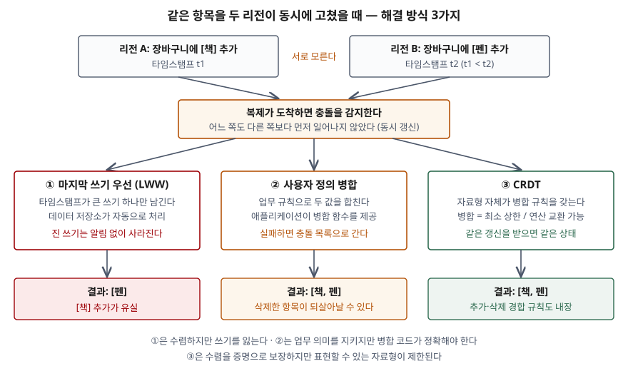

> **실행 검증 없음.** CRDT 원 논문(INRIA RR-7687)과 Dynamo 논문, Azure Cosmos DB·Amazon
> DynamoDB 공식 문서만 근거로 정리했다. 성능 수치는 싣지 않는다.

## 들어가며

다중 리전 동시 가동 문항에서 "충돌 해결이 필요하다"까지 쓰는 답안은 많지만, 무엇이
충돌이고 해결 방식마다 **무엇을 잃는지**까지 쓰는 답안은 드물다. 점수는 거기서 갈린다.

실무 사고도 같은 자리에서 난다. 두 리전에서 같은 장바구니에 물건을 넣었는데 하나가 사라지고,
지운 물건이 다시 나타나고, 재고가 1개인데 두 리전에서 모두 주문이 성공한다. 셋 다 오류
메시지 없이 일어난다. 해결 방식을 고르는 일은 이 중 어떤 이상 동작을 받아들일지 고르는
일이다.

## 정의

**쓰기 충돌(conflict)은 각각은 올바른 동시 갱신들이 함께 적용되면 어떤 불변식을 어기게
되는 조합이다.** CRDT 원 논문(Shapiro 외, INRIA RR-7687, 2011)이 서론의 각주에서 이렇게
정의한다. 여기서 **동시(concurrent)** 는 두 갱신 중 어느 쪽도 다른 쪽보다 먼저 일어나지
않았다는 뜻이다. 한 갱신이 다른 갱신을 이미 받은 상태에서 실행됐다면 둘은 순서가 있고,
충돌이 아니다.

**쓰기 충돌 해결**은 동시 갱신이 서로 다른 리전에 적용된 뒤 모든 복제본이 **같은 값으로
수렴하도록** 남길 값을 정하는 규칙이다. 규칙이 없으면 리전마다 다른 값이 남는다.

## 등장 배경

단일 주 리전 구조에서는 모든 쓰기가 한 곳을 거치므로 순서가 하나로 정해지고 충돌이 없다.
이 방식은 갱신을 전역 순서로 줄 세우는 것이며, 논문은 이것이 성능·확장의 병목이 되고
네트워크 분할 상황에서 가용성과 부딪친다고 적는다(CAP 정리).

그래서 각 리전이 동기화 없이 쓰기를 받고 나중에 퍼뜨리는 **최종 일관성** 방식이 나왔다.
문제는 동시 갱신을 나중에 정리하는 방법이었다. 논문은 기존 최종 일관성 방식들이
임시방편이라 오류가 잦다고 평가하고, 그 예로 Amazon 장바구니의 동시성 이상을 든다.
해결 방식은 이 정리 작업을 **누가(저장소·애플리케이션·자료형) 어떤 근거로** 하느냐에 따라
갈린다.

## 구성요소 — 충돌 3유형과 해결 방식 3가지

### 충돌 3유형

Azure Cosmos DB 문서는 다중 쓰기 리전에서 생기는 충돌을 **3가지**로 나눈다.

1. **삽입 충돌** — 같은 고유 키(예: `id`)를 두 리전에서 동시에 넣는다
2. **교체 충돌** — 같은 항목을 두 리전에서 동시에 고친다
3. **삭제 충돌** — 한 리전은 항목을 지우고 다른 리전은 같은 항목을 고친다

### 해결 방식 3가지

**① 마지막 쓰기 우선(LWW, Last-Writer-Wins)**

동시 갱신 중 타임스탬프가 가장 큰 것 하나를 남긴다. 논문은 이 규칙이 Johnson과 Thomas에서
나왔으며 **동시 갱신을 잃는 대가로** 연산의 전체 순서를 보장한다고 정리한다.

- DynamoDB 전역 테이블의 최종 일관성 모드(MREC)는 항목 단위로 내부 타임스탬프가 가장 늦은
  수정을 남긴다
- Cosmos DB는 기본 정책이 LWW이고, 시스템 타임스탬프 대신 숫자형 속성을 **충돌 해결 경로**로
  지정할 수 있다. 삭제 충돌에서는 그 값과 상관없이 **삭제가 항상 이긴다**
- Dynamo 논문은 고객 세션 정보를 다루는 서비스가 물리 타임스탬프가 가장 큰 버전을 고르는
  이 모드를 쓴다고 적는다

**② 사용자 정의 병합(semantic reconciliation)**

저장소는 충돌을 감지해 여러 버전을 넘기고, **업무 규칙을 아는 쪽이 합친다.** Dynamo 논문은
벡터 시계로 두 버전이 인과 순서인지 병렬 갈래인지 판별한다. 한쪽이 다른 쪽의 조상이면 시스템이
스스로 정리하고(구문적 조정), 병렬 갈래면 클라이언트가 합친다(의미적 조정). 장바구니를 합치면
"담기"는 절대 잃지 않지만 **지운 항목이 되살아날 수 있다**고 논문이 명시한다.

Cosmos DB의 사용자 정의 정책은 병합 저장 프로시저를 등록해 두면 충돌 감지 시 커밋 과정에서
**정확히 한 번** 실행한다. 프로시저가 없거나 실행 중 예외가 나면 충돌은 **충돌 피드**에 쌓이고
애플리케이션이 수동으로 처리해야 한다. 이 정책은 컨테이너를 만들 때만 지정할 수 있다.

**③ CRDT(Conflict-free Replicated Data Type)**

병합 규칙을 데이터 형식 안에 넣어 **충돌이 생길 수 없게** 설계한 자료형이다. 논문은 이를
**강한 최종 일관성(SEC)** 으로 정식화한다. 최종 일관성의 3가지 조건(최종 전달·수렴·종료)에
"같은 갱신을 받은 정상 복제본은 **즉시** 같은 상태다"라는 **강한 수렴**을 더한 것이다(정의 2.3).
충분조건은 2가지다.

- **상태 기반(CvRDT)**: 상태 집합이 반격자를 이루고, 병합이 두 상태의 **최소 상한**을
  계산하며, 갱신이 상태를 줄이지 않으면 SEC다(정리 2.1)
- **연산 기반(CmRDT)**: 인과 순서 전달을 전제로 **모든 동시 연산이 교환 가능**하면 SEC다(정리 2.2)

두 방식은 서로를 흉내 낼 수 있어 표현력이 같다(정리 3.1·3.2). 논문은 SEC 복제본이 네트워크
상태와 무관하게 읽기·쓰기 모두 가능하고 **합의(consensus)가 필요 없다**고 적는다.

## 도식

> **출처**: [Shapiro et al., Conflict-free Replicated Data Types, INRIA RR-7687 §2.2–2.4, §6](https://inria.hal.science/inria-00609399) · [DeCandia et al., Dynamo, SOSP 2007 §4.4 Data Versioning](https://www.allthingsdistributed.com/files/amazon-dynamo-sosp2007.pdf) · [Azure Cosmos DB — Conflict types and resolution policies](https://learn.microsoft.com/en-us/azure/cosmos-db/conflict-resolution-policies)

같은 장바구니를 예로 들었다. LWW는 시각이 늦은 [펜]만 남기고 [책] 추가를 버린다. 합집합으로
병합하면 둘 다 남지만, 한쪽에서 지운 항목도 다른 쪽 버전에 남아 있으면 함께 되살아난다.
CRDT 집합은 동시에 같은 원소를 추가·삭제했을 때 어느 쪽을 이기게 할지를 **자료형의 명세로**
정해 둔다. 논문은 추가 우선을 예로 들면서, 삭제 우선이나 다른 규칙도 강한 수렴을 만족한다고
적는다. 무엇을 고르느냐는 업무 의미의 문제다.

## 비교

| 구분 | ① LWW | ② 사용자 정의 병합 | ③ CRDT | (참고) 충돌을 오류로 반환 |
|---|---|---|---|---|
| 판단 주체 | 저장소 | 애플리케이션 코드 | 자료형 명세 | 저장소 + 재시도 |
| 근거 | 타임스탬프(또는 지정 숫자 속성) | 업무 규칙 | 반격자 최소 상한 / 연산 교환 | 다른 리전의 진행 중 수정 |
| 수렴 보장 | 보장 | 병합 함수가 결정적일 때만 | 증명으로 보장 | 충돌 자체를 막는다 |
| 잃는 것 | 진 쓰기 전체 (알림 없음) | 병합 규칙이 놓친 의미 | 표현할 수 있는 자료형 | 쓰기 가용성·지연 |
| 사람 개입 | 없음 | 병합 실패 시 충돌 피드 | 없음 | 없음 |
| 구현 예 | DynamoDB MREC, Cosmos DB 기본 | Cosmos DB 병합 프로시저, Dynamo 장바구니 | 카운터·집합·레지스터 등 | DynamoDB MRSC |

마지막 열은 해결이 아니라 **회피**다. DynamoDB 강한 일관성 모드(MRSC)는 다른 리전이 고치고
있는 항목에 쓰면 `ReplicatedWriteConflictException`으로 실패시키고 재시도하게 한다.

| 비교 | 운영 변환(OT) | CRDT |
|---|---|---|
| 연산 설계 | 교환 가능하게 설계하지 않는다 | 동시 연산이 교환 가능하도록 설계한다 |
| 동시 연산 처리 | 받은 연산을 이미 실행한 동시 연산에 맞춰 **변환** | 그대로 적용해도 같은 결과 |
| 논문의 평가 | 분산형 OT 알고리즘 상당수가 틀렸다는 연구를 인용 | 처음부터 교환성을 설계하는 편이 단순하다 |

## 적용 시 고려사항

- **LWW는 "충돌이 없다"가 아니라 "충돌을 버린다"이다.** 오류도 로그도 남지 않으므로, 잃어도
  되는 값(마지막 접속 시각, 세션 정보)에만 쓴다. 판단 근거가 물리 시계라면 리전 간 시계 차이가
  어느 쓰기가 이길지에 영향을 준다는 점도 함께 따진다.
- **조건부 쓰기와 트랜잭션은 리전 경계를 넘지 않는다.** DynamoDB MREC는 조건부 쓰기의 조건을
  **로컬 리전의 항목 버전**으로만 검사하고, 트랜잭션도 실행한 리전 안에서만 원자적이며 다른
  복제본에는 일부만 반영된 상태가 보일 수 있다. 재고 차감처럼 불변식을 지켜야 하는 쓰기는
  동시 갱신 해결 방식으로 지킬 수 없다.
- **CRDT도 전역 불변식은 못 지킨다.** 논문은 그래프 CRDT에서 "간선의 양끝 정점이 존재한다"는
  불변식을 지키려면 어느 연산을 우선할지 골라야 하고, 동시 연산이 끝날 때까지 기다리는 방식은
  동기화가 필요해 비동기·내결함성 목표를 깬다고 적는다. 잔액 ≥ 0 같은 제약은 쓰기 리전을 하나로
  모으거나 동기 방식으로 보낸다.
- **삭제는 흔적을 남긴다.** 상태 기반 집합은 지운 원소를 **툼스톤(tombstone) 집합**에 남겨야
  다른 리전의 옛 상태와 병합할 때 되살아나지 않는다. 툼스톤은 쌓이므로 모든 복제본이 받은
  뒤에만 지우는 가비지 컬렉션이 필요하다고 논문이 적는다.
- **충돌 자체를 피하는 설계를 먼저 검토한다.** 사용자 ID로 쓰기 리전을 나누면(write partitioned)
  같은 항목에 두 리전이 쓰는 일이 없다. 해결 규칙은 피할 수 없는 경우에만 쓴다.

## 정리

- **정의**: 충돌 = 각각 올바른 동시 갱신이 함께 적용되면 불변식을 어기는 조합
- **유형 3가지**: 삽입·교체·삭제 — "**삽교삭**"
- **해결 3가지**: LWW(버린다) · 사용자 정의 병합(합친다) · CRDT(애초에 충돌하지 않는다) —
  "**버합무**"
- **CRDT 조건 2가지**: 상태 기반은 **반격자 + 최소 상한 병합 + 단조 갱신**, 연산 기반은
  **인과 전달 + 동시 연산 교환**
- 어느 방식도 **전역 불변식**은 지키지 못한다. 그런 쓰기는 한 리전으로 모으거나 동기 처리한다

> 기출 답안: [기출문제 — 다중 리전 동시 가동 재해복구시스템의 개념과 기술 요소](../../exam/2026-11-14-multi-region-active-active-dr/index.md)
>
> 관련 개념: [분산 데이터베이스 — CAP 정리와 BASE](../2026-10-06-cap-theorem-base-pacelc/index.md)
>
> 관련 개념: [데이터베이스 이중화와 복제 방식](../2026-10-27-database-replication-ha/index.md)

## 참고 자료

- [Shapiro, Preguiça, Baquero, Zawirski, Conflict-free Replicated Data Types, INRIA Research Report RR-7687 v2 (2011-08-25)](https://inria.hal.science/inria-00609399) — 충돌 정의(각주 1), SEC(정의 2.3), CvRDT(정리 2.1), CmRDT(정리 2.2), 등가성(정리 3.1·3.2), CAP와 SEC(§3.1), 집합의 추가 우선 예(§3.3), 툼스톤(§4.2), 그래프 불변식(§5.2), LWW·OT 비교(§6). 학회판은 SSS 2011, LNCS 6976
- [DeCandia et al., Dynamo: Amazon's Highly Available Key-value Store, SOSP 2007](https://www.allthingsdistributed.com/files/amazon-dynamo-sosp2007.pdf) — §4.4 Data Versioning(벡터 시계, 구문적·의미적 조정, 되살아나는 삭제 항목), §6 타임스탬프 기반 조정
- [Microsoft, Azure Cosmos DB — Conflict types and resolution policies (2026-04-27 갱신)](https://learn.microsoft.com/en-us/azure/cosmos-db/conflict-resolution-policies) — 충돌 3유형, LWW 충돌 해결 경로, 삭제 우선, 병합 저장 프로시저, 충돌 피드
- [AWS, Amazon DynamoDB Developer Guide — How DynamoDB global tables work](https://docs.aws.amazon.com/amazondynamodb/latest/developerguide/V2globaltables_HowItWorks.html) — MREC의 LWW, 로컬 조건부 쓰기, 리전 내 트랜잭션, MRSC의 복제 쓰기 충돌 예외
