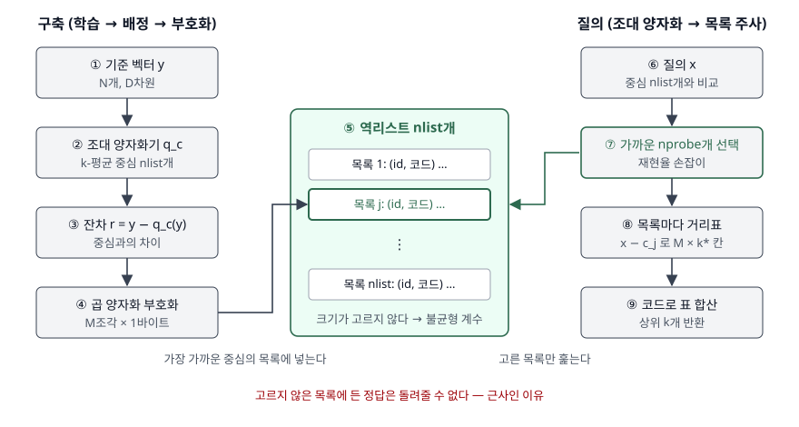

## 들어가며

벡터 데이터베이스 문제에서 HNSW와 함께 거의 항상 짝으로 나오는 것이 IVF다. 답안에 "군집으로
나눠 일부만 찾는다"까지는 누구나 쓰지만, 점수는 **몇 개의 칸을 왜 그만큼 만들고, 실제로 몇 번의
거리 계산이 드는지, 압축을 왜 잔차에 거는지**에서 갈린다. 실무에서도 메모리에 다 올릴 수 없는
수천만 건 이상의 벡터를 다룰 때 사실상 남는 선택지가 IVF-PQ다.

이 글의 수치는 numpy로 IVF와 IVF-PQ를 직접 구현해 합성 데이터(2만 건, 32차원)에서 계산한
값이다. 소스는 [`code/`](code/)에, 돌린 기록은 [`code/output.txt`](code/output.txt)에 있다.
재현율 숫자는 이 데이터에서의 값이며 다른 데이터에 그대로 옮길 수 없다.

## 정의

**IVF(Inverted File, 역파일 색인)는 조대 양자화기로 벡터 공간을 `nlist`개 칸으로 나누고, 칸마다
그 칸에 배정된 벡터의 목록(역리스트)을 두어, 질의 때 가까운 `nprobe`개 칸의 목록만 비교하는
비전수 근사 최근접 탐색 색인이다.** Faiss 라이브러리 논문의 역파일 절(§5.1)이 이 구조를 IVF로
부르고, 조대 양자화기는 보통 k-평균으로 학습한다.

**IVF-PQ는 역리스트에 벡터 원본 대신, 벡터와 그 칸 중심의 차이(잔차)를 곱 양자화로 압축한
코드를 저장하는 IVF다.** 제구·두즈·슈미드가 2011년 곱 양자화 논문에서 조대 양자화기와 잔차
부호화를 결합한 비전수 탐색으로 제안했다.

## 등장 배경

전수 비교(Flat)는 질의마다 N번 거리를 잰다. 고차원에서는 kd-트리 같은 정확 색인이 가지치기를
못 해 순차 주사보다 나을 것이 없으므로, 정확성을 일부 내주고 **비교 대상을 미리 좁히는** 방식이
필요했다. 문서 검색이 "단어 → 문서 목록" 역색인으로 전체 문서를 훑지 않듯, IVF는 "**군집 중심 →
그 군집의 벡터 목록**"으로 전체 벡터를 훑지 않는다.

범위를 좁혀도 메모리 문제는 남는다. 32차원 float32 벡터는 128바이트이고 차원이 수백이면
벡터 하나가 킬로바이트 단위다. 그래서 목록 안의 벡터를 **수 바이트 코드로 압축**하는 단계가
더해졌고, 이것이 IVF-PQ다.

## 구성요소 — 5가지

| 구성요소 | 역할 | 정하는 값 |
|---|---|---|
| ① 조대 양자화기 | k-평균으로 학습한 중심 `nlist`개. 벡터를 가장 가까운 중심 번호로 바꾼다 | `nlist` |
| ② 역리스트 | 중심마다 1개. 배정된 벡터의 (id, 벡터 또는 코드)를 모아 둔다 | — |
| ③ 잔차 계산 | `r = y − q_c(y)`. 벡터에서 배정된 중심을 뺀다 | — |
| ④ 곱 양자화기 | 잔차를 `M`조각으로 잘라 조각마다 `k*`개 코드북 중 하나로 바꾼다 | `M`, `k*` |
| ⑤ 목록 선택 | 질의와 중심을 비교해 가까운 `nprobe`개 목록을 고른다 | `nprobe` |

①·②만 있으면 IVFFlat, ③·④가 더해지면 IVF-PQ다. Faiss는 `IndexIVFFlat`도 **학습 단계가
필요하다**고 명시한다(Faiss 위키 Faster search). 중심을 정해야 배정을 할 수 있기 때문이다.

## 도식



> **출처**: [Douze et al., *The Faiss library*, arXiv:2401.08281v4, §5.1 Inverted files](https://arxiv.org/html/2401.08281v4) · [Jégou, Douze, Schmid, *Product Quantization for Nearest Neighbor Search*, IEEE TPAMI 33(1), 2011](https://doi.org/10.1109/TPAMI.2010.57)

구축은 **4단계**다. ① 표본으로 k-평균을 돌려 중심을 정하고, ② 각 벡터를 가장 가까운 중심의
목록에 넣고, ③ 잔차를 구해, ④ 곱 양자화 코드로 저장한다. 질의도 **4단계**다. ⑥ 질의를 중심
`nlist`개와 비교해 ⑦ 가까운 `nprobe`개를 고르고, ⑧ 목록마다 `x − c_j`로 옮긴 질의와 코드북 사이의
거리표(`M × k*` 칸)를 만든 뒤, ⑨ 각 코드가 가리키는 칸을 더해 거리를 근사하고 상위 k를 남긴다.

## 비용 식과 불균형 계수

Faiss 논문은 목록 크기가 고르다고 가정할 때 질의 하나의 거리 계산 횟수를
**`nlist + nprobe × N / nlist`** 로 적는다(§5.1 식 18). 앞항은 중심 비교, 뒷항은 목록 원소 비교다.
`nlist`로 미분하면 **`nlist = √(nprobe·N)`** 에서 최소가 된다. 칸을 늘리면 목록은 짧아지지만
중심 비교가 늘어나는 교환이다.

실제로는 목록 크기가 고르지 않다. 이 정도를 재는 값이 **불균형 계수**이고, Faiss 소스의
`imbalance_factor`는 `nlist · Σnᵢ² / N²`로 계산한다. 평균 대비 분산으로 풀면 `1 + Var(n)/평균²`
이므로 모든 목록이 같으면 정확히 1이다. 질의가 데이터와 같은 분포에서 오면 큰 목록에 더 자주
떨어지므로, `nprobe = 1`에서 기대 목록 크기는 `N/nlist`가 아니라 **불균형 계수 × N/nlist**가 된다.

```text
[A] 조대 양자화기 학습 — k-평균, nlist=128, 반복 20회
  역리스트 크기  최소 2 / 중앙 130 / 최대 510 / 평균 N/nlist = 156.2
  불균형 계수 nlist·Σn²/N² = 1.319   (모든 목록이 같은 크기면 1.000)

[B] nprobe 를 바꿀 때 — nlist=128 고정
  nprobe |  식 nlist+nprobe·N/nlist |   실제 평균 |  실제/식 | 전수 대비 | recall@10
       1 |                      284 |        343 |   1.207 |     1.7% | 0.562
       4 |                      753 |        896 |   1.190 |     4.5% | 0.899
      16 |                    2,628 |      2,754 |   1.048 |    13.8% | 0.990
      32 |                    5,128 |      5,252 |   1.024 |    26.3% | 1.000
  nprobe=1 일 때 기대 목록 크기 Σn²/N = 불균형 계수 × N/nlist = 206
```

`nprobe = 1`의 실제 목록 원소 비교는 343 − 128 = 215회로, 불균형 계수로 예측한 206회에 가깝다.
식만 믿으면 비용을 약 20% 적게 잡는다는 뜻이다. `nprobe`가 커지면 큰 목록과 작은 목록이 함께
섞여 비율이 1에 다가간다. 재현율은 `nprobe`가 손잡이다. 1개 목록만 보면 0.562였고, 전체의
13.8%만 비교한 `nprobe = 16`에서 0.990이 됐다.

`nlist`를 바꾸면 이렇다.

```text
[C] nlist 를 바꿀 때 — nprobe=8 고정, 식의 최솟점 √(nprobe·N) = 400
   nlist |   식 | 실제 평균 | 불균형 계수 | recall@10
      32 | 5,032 |    6,005 |      1.965 | 1.000
     128 | 1,378 |    1,514 |      1.319 | 0.958
     512 |   824 |      860 |      1.253 | 0.832
```

칸을 늘리면 비용은 식대로 줄지만 **같은 `nprobe`에서 재현율이 떨어진다.** 칸이 작아질수록 정답
이웃이 여러 칸에 흩어지기 때문이다. Faiss 논문이 식 18을 거친 근사라고 하는 첫째 이유가 이것이다.
`nlist`는 비용 식만으로 정할 수 없고, 목표 재현율을 정한 뒤 `nprobe`와 함께 골라야 한다.

## 잔차 부호화가 필요한 이유

같은 8바이트 코드라도 무엇을 부호화하느냐에 따라 정확도가 크게 갈린다.

```text
[D] IVF-PQ — 원래 벡터를 부호화할 때와 잔차를 부호화할 때 (nlist=128)
  벡터 1개: float32 128바이트 → PQ 코드 8바이트 (M=8, 부분공간 4차원, k*=256)
  평균 제곱 노름      원래 벡터   519.44 | 잔차    66.85
  복원 제곱오차       원래 벡터    24.73 | 잔차     6.08
  nprobe | IVFFlat | IVF-PQ 원래 벡터 | IVF-PQ 잔차   (recall@10)
      16 |   0.990 |            0.357 |        0.660
```

잔차의 제곱 노름은 원래 벡터의 약 13%다. 중심이 이미 벡터의 큰 부분을 설명하므로, 같은 코드북
크기로 **좁은 범위만 표현하면 된다.** 복원 오차가 1/4로 줄고 재현율은 0.357에서 0.660으로 오른다.
Faiss 논문(§5.1)도 같은 두 가지 이유, 즉 잔차의 노름이 작고 조대 양자화기의 정보를 활용한다는
점을 들어 잔차 부호화를 기본값(`by_residual`)으로 둔다.

원래 벡터를 부호화한 쪽은 `nprobe`를 늘려도 0.358에서 멈춘다. **후보 범위가 아니라 거리 근사가
병목**이라는 뜻이다. 반대로 IVFFlat은 같은 `nprobe`에서 0.990이므로, IVF-PQ에서 남는 격차는
압축이 낸 오차다. 실무에서 IVF-PQ 결과를 원본 벡터로 다시 정렬(재순위화)하는 이유가 여기 있다.

## 비교

| 구분 | 전수(Flat) | IVFFlat | IVF-PQ | HNSW |
|---|---|---|---|---|
| 후보를 좁히는 방식 | 없음 | 가까운 칸 `nprobe`개 | 가까운 칸 `nprobe`개 | 계층 그래프 탐색 |
| 저장 단위 | 원본 | 원본 | 잔차의 PQ 코드 | 원본 + 간선 |
| 사전 학습 | 없음 | k-평균 | k-평균 + PQ 코드북 | 없음 |
| 재현율 손잡이 | — (정확) | `nprobe` | `nprobe` + 재순위화 | `ef` |
| 메모리 | 원본 크기 | 원본 + 중심 | 원본의 수십분의 1 | 원본보다 크다 |
| 분포 변화 | 영향 없음 | 중심이 낡아 불균형 증가 | 중심·코드북 모두 낡는다 | 삽입하며 적응 |

Faiss 논문은 칸 수가 많을 때 조대 양자화기 자체를 HNSW로 만드는 구성이 흔하다고 적는다.
두 색인은 대립하지 않고 층을 나눠 결합된다.

## 적용 시 고려사항

**첫째, 학습 표본이 운영 분포를 대표해야 한다.** 중심과 코드북은 학습 데이터에 맞춰진다.
pgvector도 IVFFlat 색인을 테이블에 데이터가 들어간 뒤에 만들라고 권한다. 분포가 바뀌면
불균형 계수가 커지고 비용이 식보다 늘어나므로, 불균형 계수를 감시 지표로 두고 재학습 시점을 정한다.

**둘째, `nlist`와 `nprobe`는 목표 재현율에서 거꾸로 정한다.** 식의 최솟점 `√(nprobe·N)`은
출발점일 뿐이다. 위 [C]처럼 칸을 늘리면 같은 `nprobe`의 재현율이 떨어진다. pgvector는 100만
행까지 `행 수/1000`, 그 이상은 `√행 수`를 `lists` 시작값으로 권하고 `probes`는 `√lists`부터
시험하라고 한다.

**셋째, 압축률과 재현율을 맞바꾼다는 점을 수치로 확인한다.** 이 예제에서 16배 압축은 재현율
0.99를 0.66으로 낮췄다. 상위 수백 개를 IVF-PQ로 뽑은 뒤 원본으로 재순위화할지, `M`을 늘려
코드를 키울지는 메모리 예산과 지연 목표로 정한다.

**넷째, 경계 근처의 질의는 구조적으로 놓친다.** 고르지 않은 칸의 정답은 돌려줄 수 없다.
`nprobe = nlist`로 두면 전수 탐색과 결과가 같아지므로(Faiss 위키), 운영 표본으로 이 값과 비교해
실제 재현율을 재는 절차를 남겨 둔다.

## 정리

- **정의**: 조대 양자화기로 `nlist`칸을 나누고 가까운 `nprobe`칸의 역리스트만 비교하는 비전수 색인.
  IVF-PQ는 목록에 **잔차의 PQ 코드**를 저장한다
- **구성요소 5가지**: 조대 양자화기 · 역리스트 · 잔차 · 곱 양자화기 · 목록 선택
- **절차 4+4**: 구축(학습 → 배정 → 잔차 → 부호화), 질의(중심 비교 → `nprobe` 선택 → 거리표 → 합산)
- **식 2개**: 비용 `nlist + nprobe·N/nlist`, 최솟점 `√(nprobe·N)`. 실제 비용은 **불균형 계수** `nlist·Σnᵢ²/N²`만큼 늘어난다
- **잔차를 쓰는 이유 2가지**: 노름이 작아 오차가 줄고, 조대 양자화기의 정보를 재사용한다

> 기출 답안: [기출문제 — 벡터 데이터베이스의 HNSW와 IVF 색인 동작 원리](../../exam/2026-11-16-vector-db-hnsw-ivf-search-principles/index.md)

> 함께 보기: [근사 최근접 이웃 탐색과 HNSW 색인 — 정확한 답을 포기하고 얻는 것](../2026-09-22-approximate-nearest-neighbor-hnsw/index.md) · [벡터 양자화와 율-왜곡 이론 — 비트를 줄이면 무엇을 잃는가](../../data-analysis/2026-10-19-vector-quantization-rate-distortion/index.md)

## 참고 자료

- [M. Douze 외, *The Faiss library*, arXiv:2401.08281v4 (2025-10-23)](https://arxiv.org/html/2401.08281v4) — §5.1 Inverted files(식 18, 불균형 계수, 잔차 부호화와 `by_residual` 기본값, HNSW 조대 양자화기)
- [H. Jégou, M. Douze, C. Schmid, *Product Quantization for Nearest Neighbor Search*, IEEE TPAMI 33(1), pp.117–128, 2011](https://doi.org/10.1109/TPAMI.2010.57) — 조대 양자화기와 잔차 곱 양자화를 결합한 비전수 탐색의 원 제안
- [Faiss 소스 `faiss/utils/utils.cpp` — `imbalance_factor`](https://github.com/facebookresearch/faiss/blob/main/faiss/utils/utils.cpp) — 불균형 계수 계산식
- [Faiss wiki — Faster search](https://github.com/facebookresearch/faiss/wiki/Faster-search) — `IndexIVFFlat`의 학습 단계, `nlist`·`nprobe`, `nprobe = nlist`이면 전수 탐색과 같은 결과
- [R. Weber, H.-J. Schek, S. Blott, *A Quantitative Analysis and Performance Study for Similarity-Search Methods in High-Dimensional Spaces*, VLDB 1998](https://dl.acm.org/doi/10.5555/645924.671192) — 고차원에서 트리·분할 기반 정확 색인이 순차 주사에 진다
- [pgvector README](https://github.com/pgvector/pgvector) — IVFFlat `lists`·`probes` 권장값과 데이터를 넣은 뒤 색인을 만들라는 권고
