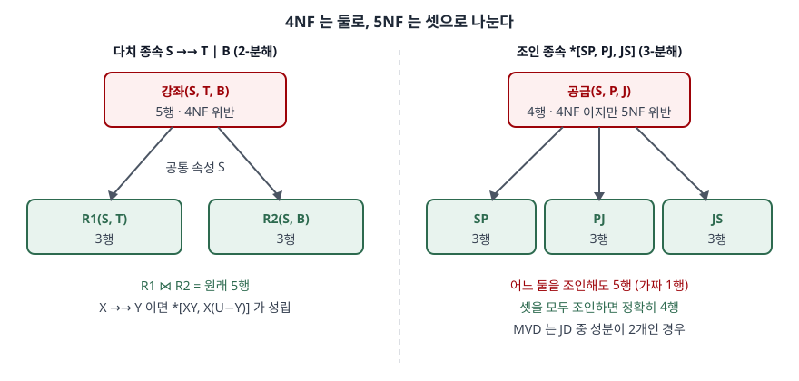

<!-- related:start -->
> **같은 기능을 다른 환경에서 다룬 글** (`normalization`)
> - [정규화 1NF부터 BCNF까지](../2026-09-23-normalization-1nf-to-bcnf/index.md) — Python 3.13.5, SQLite 3.49.1, Windows 11
<!-- related:end -->

## 들어가며

정규화 답안은 대개 BCNF 에서 멈추지만, 시험은 그다음 두 단계를 따로 묻는다. 함수 종속이 하나도 없는데 행이 조합 수만큼 불어나는 표가 제4정규형(4NF)의 대상이고, 4NF 까지 만족해도 둘로는 나눌 수 없고 셋으로만 나뉘는 표가 제5정규형(5NF)의 대상이다. 두 정규형은 각각 **다치 종속**과 **조인 종속**이라는 종속으로 정의되며, 다치 종속은 조인 종속의 특수한 경우다. 이 관계를 한 줄로 쓸 수 있으면 4NF·5NF 문제를 같은 틀로 답할 수 있다.

## 정의

**조인 종속**(join dependency, JD) `*[R1, …, Rn]` 은 릴레이션 R 이 자신의 프로젝션 R1, …, Rn 을 자연 조인한 것과 언제나 같다는 제약이다. 각 Ri 는 R 의 속성 부분집합이고 합집합이 R 의 속성 전체다(Abiteboul 외, 정의 8.3.1).

**다치 종속**(multivalued dependency, MVD) `X →→ Y` 는 성분이 2개인 조인 종속 `*[XY, X(U−Y)]` 이다(같은 책 정의 8.3.2). 교재마다 표현이 다르다. Silberschatz 교재는 튜플 존재 조건으로 정의한다. `t1[X] = t2[X]` 인 두 튜플이 있으면 X 값은 같고 Y 는 t1 에서, 나머지는 t2 에서 가져온 튜플 t3 가 반드시 있어야 한다는 것이다. 두 정의가 같다는 것이 Fagin(1977)의 정리이고, 아래 검산에서 직접 확인했다.

| 정규형 | 정의 |
|---|---|
| **4NF** | 자명하지 않은 MVD `X →→ Y` 가 성립할 때마다 X 가 슈퍼키다. 자명하다는 것은 Y ⊆ X 이거나 X ∪ Y = R 인 경우다 |
| **5NF (PJ/NF)** | 성립하는 모든 JD 가 **키 종속만으로 함의**된다 |

5NF 의 원래 이름은 프로젝션-조인 정규형(project-join normal form, PJ/NF)이고, Fagin(1979)이 제안했다. Silberschatz 교재도 PJNF 를 "제5정규형이라고도 부른다"고 적는다.

## 등장 배경

BCNF 는 함수 종속만 본다. 그런데 사원의 자격증과 외국어처럼 **서로 무관한 목록 두 개**를 한 표에 담으면, 함수 종속은 없는데 자격증 수 × 외국어 수만큼 행이 생긴다. 자격증 하나를 더하려면 외국어 수만큼 행을 넣어야 하는 갱신 이상이 남는다. Abiteboul 교재는 이 상황을 "무관한 정보를 한 릴레이션에 저장하지 말라"는 말로 4NF 의 취지를 요약한다. 이것을 설명하려고 Fagin 이 1977년에 다치 종속과 4NF 를 도입했다.

4NF 는 "둘로 나눠서 무손실로 돌아오는가"만 본다. 그러나 공급자가 부품을 공급하고, 프로젝트가 그 부품을 쓰고, 공급자가 그 프로젝트와 거래하면 공급자가 그 부품을 그 프로젝트에 공급한다는 식의 **세 쌍이 맞물린 규칙**이 있으면, 둘로는 나눌 수 없고 셋으로만 무손실로 나뉜다. Abiteboul 교재는 간식·유통사·극장 릴레이션(그림 8.2)으로 같은 상황을 보이고, 이 경우 세 릴레이션으로 나누는 편이 자연스러운 스키마라고 설명한다. 조인 종속은 이것을 다루려고 성분 수를 n 개로 넓힌 것이다.

## 구성요소

### 가. 다치 종속의 추론 규칙 — 6가지

Abiteboul 교재(§8.3 Axiomatizations)는 MVD 만의 규칙 4개와, 함수 종속(FD)과 함께 쓸 때 필요한 규칙 2개를 든다. U 는 릴레이션의 속성 전체다.

| 규칙 | 내용 |
|---|---|
| ① MVD0 상보 | X →→ Y 이면 X →→ (U − Y) |
| ② MVD1 반사 | Y ⊆ X 이면 X →→ Y |
| ③ MVD2 증가 | X →→ Y 이면 XZ →→ YZ |
| ④ MVD3 이행 | X →→ Y 이고 Y →→ Z 이면 X →→ (Z − Y) |
| ⑤ FMVD1 변환 | X → Y 이면 X →→ Y — 모든 FD 는 MVD 다 |
| ⑥ FMVD2 상호작용 | X →→ Y 이고 XY → Z 이면 X → (Z − Y) |

FD 의 암스트롱 공리 3개와 위 6개를 합친 9개가 FD 와 MVD 를 함께 다룰 때 건전하고 완전하다(같은 책 정리 8.3.5). 반면 **조인 종속 전체에 대해서는 공리계가 존재하지 않는다**(정리 8.3.4). 5NF 판정이 어려운 이유가 여기에 있다.

④ 이행 규칙의 결론이 Z 가 아니라 Z − Y 라는 점, 그리고 ① 상보 규칙 때문에 MVD 를 `X →→ Y | Z` 로 함께 적는다는 점이 FD 와 다르다.

### 나. 정규형의 포함 관계 — 6단계

```
1NF ⊃ 2NF ⊃ 3NF ⊃ BCNF ⊃ 4NF ⊃ 5NF(PJ/NF)
```

4NF 이면 BCNF 이고(정의 11.2.2 바로 아래), PJ/NF 이면 4NF 다(연습문제 11.7). MVD 가 JD 의 특수한 경우이므로, "모든 JD 가 키로 함의된다"는 조건은 "모든 MVD 가 키로 함의된다"를 포함한다. 4NF 를 키 종속으로 다시 쓴 형태(연습문제 11.5)와 나란히 놓으면 차이가 성분 수뿐임이 드러난다.

## 도식



> **출처**: [Abiteboul·Hull·Vianu, Foundations of Databases, Chapter 8 §8.3 Join and Multivalued Dependencies (정의 8.3.1·8.3.2)](http://webdam.di.ens.fr/Alice/pdfs/Chapter-8.pdf), [같은 책 Chapter 11 §11.2 Normal Forms (정의 11.2.2, 연습문제 11.6 PJ/NF)](http://webdam.di.ens.fr/Alice/pdfs/Chapter-11.pdf). 행 수와 가짜 행은 아래 검산 [1]·[5] 를 Python 3.13.5 로 돌린 결과다.

답안지에는 박스 6개면 된다. 왼쪽은 공통 속성 S 하나로 둘로 갈라지고, 오른쪽은 공통 속성이 쌍마다 다른 세 갈래다.

## 검산 — 파이썬으로 직접 돌리기

전체 소스: [`code/dependencies.py`](code/dependencies.py) · 수행 기록: [`code/output.txt`](code/output.txt)

릴레이션을 행 집합으로 두고 프로젝션과 자연 조인을 직접 구현했다. MVD 는 두 방법(튜플 존재 조건, `*[XY, X(U−Y)]` 조인)으로 따로 판정한다.

**[1] 4NF 예제.** 강좌(과목 S, 강사 T, 교재 B)에서 db 과목은 강사 2명 × 교재 2권 = 4행이다.

```text
  S →→ T  정의로 판정: True · 조인으로 판정: True
  S →→ B  (상보 규칙)  : True
  이 인스턴스에서 성립하는 비자명 FD(결정자 1개 이하): [('T', 'S'), ('T', 'ST'), ('B', 'S'), ('B', 'BS')]
  R1 ⋈ R2 = 원래 릴레이션? True  (5행)
```

5행짜리 인스턴스에서는 T → S(강사마다 과목이 하나) 같은 FD 도 **우연히** 성립했다. 종속은 업무 규칙으로 선언하는 스키마의 제약이고, 인스턴스는 종속을 반증할 수만 있다. 여기서 선언한 것은 `S →→ T | B` 하나뿐이다.

강사와 교재가 묶여 있는 경우(kim 은 book1 만, lee 는 book2 만)에는 S →→ T 가 두 판정 모두 False 였고, 둘로 나눠 조인하면 `(db, kim, book2)`, `(db, lee, book1)` 두 가짜 행이 생겼다. 독립성이 없으면 나누는 순간 정보가 틀어진다.

**[2] 두 정의는 같은가.** 값이 2개씩인 무작위 릴레이션 3,000개씩을 만들고, 가능한 (X, Y) 쌍마다 두 방법으로 판정했다.

```text
  U=ABC 값 2개씩 · 릴레이션 3000개 · (X,Y) 판정 192000회 · 일치 192000회 · MVD 성립 155540회
  U=ABCD 값 2개씩 · 릴레이션 3000개 · (X,Y) 판정 768000회 · 일치 768000회 · MVD 성립 464342회
```

96만 회 모두 일치했다. MVD 가 성립하는 것과 두 프로젝션으로 무손실 분해되는 것이 같다는 정리를 숫자로 확인한 셈이다.

**[3] 추론 규칙 6가지.** 무작위 릴레이션 400개에서 전제가 성립한 모든 경우에 결론도 성립하는지 셌다.

```text
  MVD0 상보        전제 성립    61608회 · 결론 깨짐 0회
  MVD3 이행        전제 성립   595480회 · 결론 깨짐 0회
  FMVD2 상호작용     전제 성립   706316회 · 결론 깨짐 0회
```

(수행 기록 6줄 중 3줄이다. 나머지 반사·증가·변환도 깨짐 0회다.) 반례가 없다는 것은 건전성의 확인이지 증명은 아니다. 완전성은 이렇게 셀 수 없다.

**[4] 묶음을 쪼갤 수 없다.** `A →→ BC` 가 성립하는데 `A →→ B` 는 성립하지 않는 릴레이션이 55번째 시도에서 나왔다.

```text
    A | B | C | D
    a0 | b0 | c0 | d0
    a0 | b1 | c0 | d0
    a0 | b1 | c1 | d0
    a1 | b0 | c0 | d0
    a1 | b1 | c0 | d0
    a1 | b1 | c1 | d0
  A →→ BC: True · A →→ B: False
```

D 가 전부 d0 이라 상보 규칙으로 `A →→ D` 와 같은 `A →→ BC` 는 성립한다. 그러나 a0 에 (b0, c1) 조합이 없어서, A 값이 같을 때 B 와 C 가 서로 독립이 아니다. FD 의 분해 규칙(X → YZ 이면 X → Y)이 MVD 에는 없다.

**[5] 5NF 예제.** 공급(공급자 S, 부품 P, 프로젝트 J) 4행이다.

```text
  비자명 MVD 목록: 없음
  *[SP, PJ]  조인 5행 · 가짜 행 [('s2', 'p1', 'j2')]
  *[SP, JS]  조인 5행 · 가짜 행 [('s1', 'p2', 'j2')]
  *[PJ, JS]  조인 5행 · 가짜 행 [('s2', 'p2', 'j1')]
  *[SP, PJ, JS] 조인 4행 · 가짜 행 [] · 성립 True
```

자명하지 않은 MVD 가 하나도 없으므로 4NF 다. 그러나 어느 두 프로젝션을 조인해도 가짜 행이 하나씩 생기고, 세 프로젝션을 모두 조인해야 정확히 4행이 돌아온다. 이 JD 는 키(S, P, J 전체)로 함의되지 않으므로 PJ/NF 가 아니고, SP·PJ·JS 세 릴레이션(각 3행)으로 나눈다.

**[6] 튜플 하나를 빼면.** `(s1, p1, j1)` 을 빼면 세 프로젝션의 조인이 그 행을 되살려 JD 가 깨졌다. 거꾸로 말하면, 이 JD 가 업무 규칙이라면 (s1, p1, j2)·(s1, p2, j1)·(s2, p1, j1) 이 있을 때 (s1, p1, j1) 은 **반드시** 있어야 한다. 원래 표에 한 행을 넣을 때 다른 행이 따라 들어가야 하는 갱신 이상이 5NF 위반의 모습이다.

## 비교

| 구분 | BCNF | 4NF | 5NF (PJ/NF) |
|---|---|---|---|
| 다루는 종속 | 함수 종속 | 다치 종속(FD 포함) | 조인 종속(MVD 포함) |
| 조건 | 자명하지 않은 X → Y 의 X 가 슈퍼키 | 자명하지 않은 X →→ Y 의 X 가 슈퍼키 | 모든 JD 가 키 종속으로 함의 |
| 분해 형태 | 둘로 | 둘로 | n 개로 (셋 이상이 핵심) |
| 없애는 이상 | 결정자가 키가 아닌 중복 | 독립 목록의 조합 중복 | 세 쌍 이상이 맞물린 순환 제약의 중복 |
| 추론 공리계 | 있음 (암스트롱 3개) | 있음 (FD+MVD 9개) | 없음 (JD 전체) |
| 제안 | Codd (1974) | Fagin (1977) | Fagin (1979) |

| 구분 | 다치 종속 | 조인 종속 |
|---|---|---|
| 성분 수 | 2 | n (2 이상) |
| 관계 | JD 의 특수한 경우 | MVD 의 일반화 |
| 판정 | 튜플 존재 조건 또는 2-조인 | n 개 프로젝션의 조인이 원래와 같은가 |

## 적용 시 고려사항

1. **종속은 데이터가 아니라 업무 규칙에서 찾는다.** [1] 처럼 작은 인스턴스에는 우연한 FD·MVD 가 많이 보인다. "자격증과 외국어가 서로 무관한가", "공급자·부품·프로젝트가 순환 규칙을 따르는가"를 업무 담당자에게 확인한 뒤 선언한다.
2. **5NF 위반은 규칙이 진짜일 때만 위반이다.** [5] 의 공급 표도 순환 규칙이 없으면(공급자가 특정 프로젝트에 특정 부품을 공급한다는 3자 사실이면) JD 가 성립하지 않고 이미 5NF 다. 이때 셋으로 나누면 [1-2] 처럼 가짜 행이 생긴다.
3. **분해할수록 조인이 늘어난다.** 5NF 분해는 원래 모양으로 볼 때 3-way 조인이 필요하다. 조회가 잦으면 뷰를 두고, 갱신 이상이 실제로 문제가 되는 표만 나눈다.
4. **묶음 단위로 옮긴다.** [4] 처럼 X →→ YZ 에서 Y 만 떼어 내면 안 된다. 함께 움직이는 속성은 한 덩어리로 분해한다.
5. **판정 도구가 약하다.** JD 에는 공리계가 없으므로 "이 표가 5NF 인가"를 기계적으로 증명하기 어렵다. 실무에서는 다대다 관계가 셋 이상 얽힌 연관 표만 골라 점검한다.

## 정리

- **한 줄**: MVD 는 성분 2개짜리 JD 이고, 4NF 는 MVD 의, 5NF(PJ/NF)는 JD 의 결정 조건이 키라는 정규형이다
- **추론 규칙 6가지**: 상보·반사·증가·이행(MVD 4) + 변환·상호작용(FD 혼합 2). JD 에는 공리계가 없다
- **포함 6단계**: 1NF ⊃ 2NF ⊃ 3NF ⊃ BCNF ⊃ 4NF ⊃ 5NF
- **검산**: 두 MVD 정의는 96만 회 일치, 규칙 6개는 반례 0, X →→ YZ ⇏ X →→ Y 는 반례 있음
- **5NF 예**: 어느 둘로 나눠도 가짜 행 1개, 셋으로 나누면 정확히 복원

> 기출 답안: [기출문제 — 제4정규형(4NF)](../../exam/2026-11-19-fourth-normal-form-multivalued-dependency/index.md) · 앞 단계: [정규화 1NF부터 BCNF까지](../2026-09-23-normalization-1nf-to-bcnf/index.md)

## 참고 자료

- [Abiteboul·Hull·Vianu, Foundations of Databases (Addison-Wesley, 1995), Chapter 8 Functional and Join Dependency](http://webdam.di.ens.fr/Alice/pdfs/Chapter-8.pdf) — 조인 종속의 정의(정의 8.3.1), MVD 를 2-성분 JD 로 정의(정의 8.3.2), 3-성분 JD 예(그림 8.2), JD 공리계 부재(정리 8.3.4), MVD·FMVD 규칙과 완전성(정리 8.3.5)
- [같은 책, Chapter 11 Design and Dependencies](http://webdam.di.ens.fr/Alice/pdfs/Chapter-11.pdf) — BCNF(정의 11.2.1), 4NF(정의 11.2.2), PJ/NF 정의(연습문제 11.6), 포함 관계(연습문제 11.7), 정규형별 원 논문 목록(참고 문헌 주석)
- [Silberschatz·Korth·Sudarshan, Database System Concepts 7th ed., Chapter 7 슬라이드](https://www.db-book.com/slides-dir/PDF-dir/ch7.pdf) — MVD 의 튜플 존재 정의(7.76), 4NF 정의(7.82), 4NF 분해 알고리즘(7.84), JD 와 PJNF(7.87)
- [R. Fagin, Multivalued Dependencies and a New Normal Form for Relational Databases, ACM TODS 2(3), 1977](https://doi.org/10.1145/320557.320571) — 다치 종속과 4NF 의 원 논문 (본문 미열람, 서지 정보)
- [R. Fagin, Normal Forms and Relational Database Operators, SIGMOD 1979](https://doi.org/10.1145/582095.582120) — PJ/NF 의 원 논문 (본문 미열람, 서지 정보)
