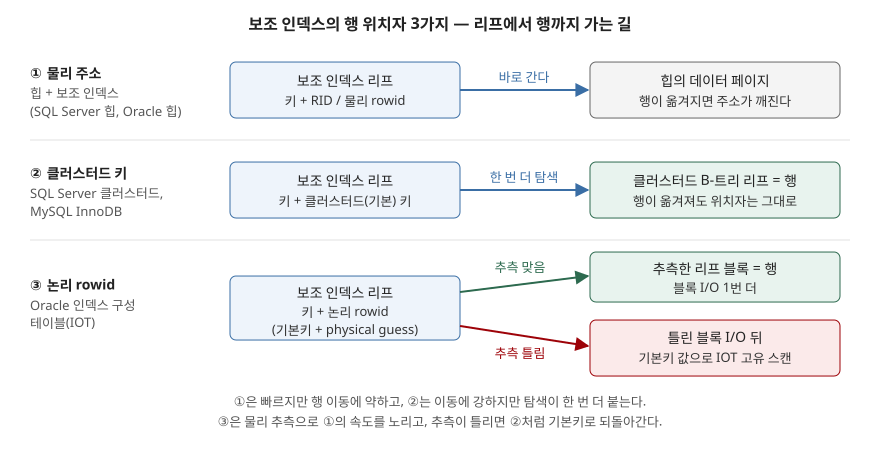

> 실행 검증 없음. Oracle·SQL Server·MySQL·PostgreSQL 공식 문서에 적힌 구조와 접근 경로만으로
> 정리했다. 성능 수치와 실행계획은 싣지 않았다.

## 들어가며

인덱스 문제에서 "클러스터드 인덱스"는 거의 빠지지 않는다. 그런데 같은 개념이 Oracle에서는
**인덱스 구성 테이블**(IOT, Index-Organized Table)이라는 다른 이름으로 나오고, 보조 인덱스가 행을
찾는 방식도 제품마다 다르다. 답안에서 "정렬돼 있어서 빠르다"로 끝내지 않으려면, 행이 어디에
놓이고 **보조 인덱스가 그 행을 무엇으로 가리키는지**까지 한 묶음으로 알아야 한다.

## 정의

- **인덱스 구성 테이블**(Oracle 19c 개념 설명서): B-트리 인덱스 구조를 변형해 저장하는 테이블. 행은
  테이블의 **기본키에 정의한 인덱스**에 저장되고, B-트리의 각 인덱스 항목이 비키 열 값까지 함께 담는다.
  설명서는 이를 "인덱스가 곧 데이터이고 데이터가 곧 인덱스"라고 요약한다.
- **클러스터드 인덱스**(SQL Server 문서): 데이터 행을 키 값 순서로 정렬해 저장하는 인덱스. 리프가 곧
  데이터 페이지이며, 행은 한 가지 순서로만 놓일 수 있으므로 테이블당 하나다.

두 정의는 같은 생각을 다르게 부른 것이다. **행 자체를 키 순서의 B-트리 리프에 둔다.** Oracle은 그
키를 기본키로 고정하고, SQL Server는 클러스터드 인덱스의 키를 고를 수 있게 한 점이 다르다.

## 등장 배경

기본 저장 방식인 **힙**(heap, 빈자리에 행을 넣는 구조)은 삽입이 싸지만, 기본키로 행을 찾으려면
기본키 인덱스를 탐색한 뒤 그 인덱스가 가리키는 힙 블록을 한 번 더 읽어야 한다. 기본키 값이
인덱스와 테이블 양쪽에 저장되는 셈이기도 하다. Oracle 설명서는 힙 테이블의 B-트리 항목이 키와
rowid로 이뤄져 보통 작다고 적는다. 행을 인덱스 리프에 직접 두면 이 두 번째 읽기와 중복 저장이 사라진다.
대신 행이 키 순서를 지켜야 하므로 삽입 때 리프 안팎으로 행이 움직이고, 그 결과 **행의 물리 주소가
고정되지 않는다.** 보조 인덱스가 무엇으로 행을 가리킬지가 여기서 새 문제로 생긴다.

## 구성요소 — IOT 5가지

| 구성요소 | 담는 것 | 근거 |
|---|---|---|
| ① 기본키 B-트리 (인덱스 세그먼트) | 기본키 순서로 정렬된 행 | 기본키 제약이 반드시 있어야 한다 |
| ② 인덱스 항목 | 기본키 열 전부 + 일부 비키 열 (+ 오버플로 부분을 가리키는 물리 rowid) | 행 오버플로 절 |
| ③ 오버플로 세그먼트 (선택) | 인덱스 항목에 담지 않은 나머지 비키 열 | 행 전체를 담아 항목이 커지는 것을 막는다 |
| ④ 논리 rowid | 기본키를 base64로 표현한 값 + **physical guess** | 보조 인덱스의 행 위치자 |
| ⑤ 매핑 테이블 (비트맵 인덱스가 있을 때) | IOT 행마다 논리 rowid 하나를 담는 힙 테이블 | 비트맵의 물리 rowid → 논리 rowid 변환 |

physical guess는 인덱스 항목이 **처음 만들어졌을 때의 물리 rowid**다. 행은 삽입 때문에 블록 안이나
블록 사이로 움직일 수 있으므로 이 추측은 낡을 수 있다. 설명서는 추측이 낡아도 논리 rowid는
유효하다고 적는다. 기본키가 함께 들어 있기 때문이다.

## 보조 인덱스 접근 경로 — 3가지

Oracle 설명서는 IOT의 보조 인덱스로 행을 읽는 경우를 셋으로 나눈다.

1. **추측이 맞을 때**: 보조 인덱스 스캔 + 행이 든 블록을 읽는 I/O 1회. 기본키 탐색을 건너뛴다
2. **추측이 틀릴 때**: 보조 인덱스 스캔 + 추측이 가리킨 **틀린 블록** I/O + 기본키 값으로 IOT 고유 스캔
3. **추측이 없을 때**: 보조 인덱스 스캔 + 기본키 인덱스 스캔, 두 번의 인덱스 스캔

2번이 3번보다 I/O가 하나 많다는 점이 함정이다. 추측이 많이 낡은 IOT는 추측을 쓰지 않는 것보다 느릴 수 있다.

## 도식

> **출처**: [Oracle Database 19c Concepts, 3 Indexes and Index-Organized Tables — Secondary Indexes, Logical Rowids and Physical Guesses](https://docs.oracle.com/en/database/oracle/oracle-database/19/cncpt/indexes-and-index-organized-tables.html), [Microsoft Learn — Index Architecture and Design Guide, Nonclustered index architecture](https://learn.microsoft.com/en-us/sql/relational-databases/sql-server-index-design-guide), [MySQL 8.0 Reference Manual §17.6.2.1 Clustered and Secondary Indexes](https://dev.mysql.com/doc/refman/8.0/en/innodb-index-types.html)

## 비교

### 힙 구성 테이블과 IOT (Oracle 비교표 7항목)

| 항목 | 힙 구성 테이블 | 인덱스 구성 테이블 |
|---|---|---|
| 행 식별 | rowid. 기본키 제약은 선택 | 기본키. 기본키 제약 필수 |
| 보조 인덱스 근거 | 물리 rowid | 논리 rowid |
| 개별 행 접근 | rowid로 직접 | 기본키로 간접 |
| 전체 읽기 | 전체 테이블 스캔 | 전체 인덱스 스캔·빠른 전체 인덱스 스캔 |
| 테이블 클러스터 | 다른 테이블과 함께 저장 가능 | 불가 |
| LOB·LONG | 둘 다 가능 | LOB만 가능, LONG 불가 |
| 가상 열 | 가능 | 불가 |

### 행 위치자로 본 제품 4종

| 제품 | 행을 두는 곳 | 보조 인덱스의 행 위치자 |
|---|---|---|
| SQL Server | 클러스터드 인덱스가 있으면 그 리프, 없으면 힙 | 힙이면 RID(파일 ID·페이지 번호·행 번호), 클러스터드면 클러스터드 키. 비유일 키면 4바이트 uniqueifier를 덧붙인다 |
| MySQL InnoDB | **항상** 클러스터드 인덱스 리프. 기본키 → 첫 번째 NOT NULL 유일 인덱스 → 숨은 `GEN_CLUST_INDEX`(6바이트 행 ID) 순으로 고른다 | 기본키 열 |
| Oracle | 기본은 힙, `ORGANIZATION INDEX`로 만들면 IOT | 힙이면 물리 rowid, IOT면 논리 rowid(기본키 + physical guess) |
| PostgreSQL | **항상** 힙. 클러스터드 인덱스가 없다 | 힙의 튜플 위치. `CLUSTER` 명령은 한 번 다시 정렬할 뿐 이후 변경에는 순서를 유지하지 않는다 |

세 위치자는 하나의 트레이드오프 위에 놓인다. 물리 주소는 한 번에 가지만 행이 옮겨지면 깨진다.
클러스터드 키는 행이 옮겨져도 그대로지만 B-트리를 한 번 더 탐색한다. 논리 rowid는 물리 추측으로
앞의 속도를 노리고, 추측이 틀리면 기본키로 되돌아가 뒤의 안정성을 지킨다.

## 적용 시 고려사항

| 구분 | 판단할 것 | 근거 |
|---|---|---|
| ① 접근 패턴 | 기본키 단건·범위 조회가 대부분인 OLTP 테이블이면 IOT·클러스터드가 맞다. 보조 인덱스 조회가 대부분이면 위치자 탐색이 매번 붙는다 | Oracle 비교표(개별 행 접근), 접근 경로 3가지 |
| ② 키 길이 | 클러스터드 키·논리 rowid는 기본키 길이에 비례한다. 키가 길면 **모든 보조 인덱스**가 커진다. 좁고·유일하고·증가하고·바뀌지 않는 키를 고른다 | SQL Server 클러스터드 설계 지침, Oracle 논리 rowid 길이 |
| ③ 행 길이 | 행이 크면 리프 하나에 담기는 행이 줄어 범위 읽기 이점이 줄어든다. IOT는 일부 비키 열만 인덱스 항목에 남기고 나머지를 오버플로 세그먼트로 보낼 수 있다 | Oracle 행 오버플로 절 |
| ④ 보조 인덱스 비중 | IOT에 보조 인덱스가 많고 삽입이 잦으면 physical guess가 낡아 2번 경로(틀린 블록 I/O 추가)가 늘어난다 | Oracle 논리 rowid 절 |
| ⑤ 제품 제약 | IOT는 테이블 클러스터·LONG·가상 열을 쓸 수 없고, PostgreSQL에는 유지되는 클러스터드 구조가 없다 | Oracle 비교표, PostgreSQL CLUSTER |

## 정리

- **한 문장**: 행을 키 순서 B-트리의 리프에 직접 두는 저장 방식. SQL Server·InnoDB는 클러스터드 인덱스,
  Oracle은 인덱스 구성 테이블이라 부른다.
- **IOT 구성 5가지 — "트·항·오·논·매"**: 기본키 B-트리, 인덱스 항목, 오버플로 세그먼트, 논리 rowid, 매핑 테이블.
- **보조 인덱스 경로 3가지 — "맞·틀·없"**: 추측 맞음(I/O 1), 추측 틀림(틀린 I/O + 기본키 스캔), 추측 없음(인덱스 스캔 2).
- **행 위치자 3종 — "물·클·논"**: 물리 주소(빠르나 이동에 약함), 클러스터드 키(안정하나 한 번 더 탐색), 논리 rowid(둘의 절충).

> 기출 답안: [데이터베이스 인덱스, 클러스터드와 논클러스터드 인덱스 비교](../../exam/2026-11-25-clustered-vs-nonclustered-index/index.md)
>
> 관련 글: [인덱스 구조 비교 — B+트리, 해시, 비트맵](../2026-10-26-index-structure-comparison/index.md)

## 참고 자료

- [Oracle Database 19c Concepts, 3 Indexes and Index-Organized Tables](https://docs.oracle.com/en/database/oracle/oracle-database/19/cncpt/indexes-and-index-organized-tables.html) — IOT 정의, 힙 대 IOT 비교표(Table 3-6), 행 오버플로 영역, 보조 인덱스와 논리 rowid, physical guess와 접근 경로 3가지, 비트맵 인덱스의 매핑 테이블
- [Oracle Database 19c Administrator's Guide, 20.13 Managing Index-Organized Tables](https://docs.oracle.com/en/database/oracle/oracle-database/19/admin/managing-tables.html) — IOT 생성·관리 절차(`ORGANIZATION INDEX`, 오버플로 영역 지정)
- [Microsoft Learn, Index Architecture and Design Guide (SQL Server)](https://learn.microsoft.com/en-us/sql/relational-databases/sql-server-index-design-guide) — 클러스터드 설계 지침(Narrow·Unique·Ever-increasing·Immutable), uniqueifier, 논클러스터드의 행 위치자(RID·클러스터드 키)
- [Microsoft Learn, Clustered and Nonclustered Indexes Described](https://learn.microsoft.com/en-us/sql/relational-databases/indexes/clustered-and-nonclustered-indexes-described) — 클러스터드 인덱스 정의, 테이블당 1개
- [MySQL 8.0 Reference Manual, 17.6.2.1 Clustered and Secondary Indexes](https://dev.mysql.com/doc/refman/8.0/en/innodb-index-types.html) — InnoDB 클러스터드 인덱스 선정 순서, `GEN_CLUST_INDEX` 6바이트 행 ID, 보조 인덱스의 기본키 열
- [PostgreSQL 16 Documentation, CLUSTER](https://www.postgresql.org/docs/16/sql-cluster.html) — 일회성 재정렬
