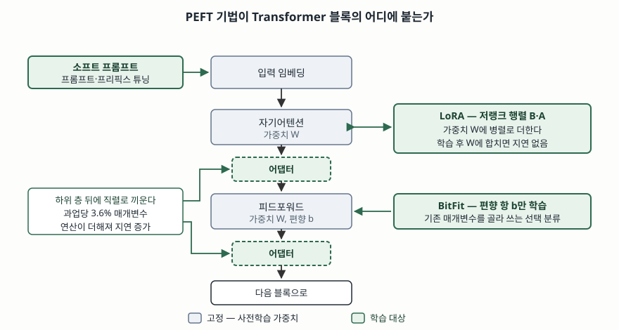

> 실행 검증 없음. 어댑터·프리픽스 튜닝·프롬프트 튜닝·LoRA·QLoRA 원 논문과 PEFT 서베이의
> 정의·분류·수치만으로 정리했다. 원문에 적힌 수치만 인용하고 추정값은 싣지 않는다.

## 들어가며

사내에 LLM을 들이고 나면 과업이 하나로 끝나지 않는다. 회의록 요약, 민원 분류, 상담 응대,
코드 리뷰처럼 성격이 다른 과업이 줄줄이 붙고, 각각 응답 형식과 어조가 다르다. 과업마다
전체 미세조정을 하면 **과업 수만큼 모델 전체 사본이 생긴다.** 175B 모델이면 사본 하나가
수백 기가바이트이므로 저장도 배포도 감당이 안 되고, 학습할 때는 가중치에 더해 옵티마이저
상태까지 올려야 해서 GPU 메모리가 먼저 막힌다. 시험에서 PEFT를 묻는 이유가 이것이다.
정확도를 더 올리는 기법이 아니라 **다중 과업을 운영 가능한 비용으로 유지하는 구조**를
묻는 문제다.

## 정의

**PEFT(Parameter-Efficient Fine-Tuning, 매개변수 효율적 미세조정)** 는
**사전학습 모델의 가중치 대부분을 고정한 채 전체의 일부에 해당하는 소수의 매개변수만
학습해, 전체 미세조정에 근접한 성능을 훨씬 적은 학습·저장 비용으로 얻는 미세조정 방법군**이다.

단일 표준 정의를 둔 기구는 없고 **방법들의 묶음을 가리키는 이름**이다. Lialin 등의 서베이는
2019년 초부터 2024년 중반 사이의 50편이 넘는 논문을 묶어 이 범주를 정리했으므로, 답안에서는
"특정 기법"이 아니라 **"분류 체계를 가진 방법군"** 으로 쓰는 쪽이 맞다.

## 등장 배경

전체 미세조정(full fine-tuning)이 남긴 비용이 **3가지**다.

**첫째, 과업마다 전체 사본이 필요하다.** 프리픽스 튜닝 논문은 전체 미세조정이 언어 모델의
모든 매개변수를 수정하므로 **과업마다 전체 사본을 저장해야 한다**는 점을 문제로 든다.
어댑터 논문도 전체 미세조정은 과업마다 매개변수의 **100%** 를 학습한다고 적는다.

**둘째, 학습 시 메모리가 가중치 크기만으로 정해지지 않는다.** 역전파를 걸려면 가중치 외에
기울기와 옵티마이저 상태까지 올려야 한다. LoRA 논문은 GPT-3 175B를 Adam으로 전체 미세조정
하는 경우와 비교해 **GPU 메모리 요구량을 3배 줄인다**고 적는데, 줄어드는 쪽이 대부분
이 부수 상태다.

**셋째, 과업 전환이 모델 교체가 된다.** 서비스 중에 과업을 바꾸려면 수백 기가바이트짜리
체크포인트를 바꿔 끼워야 한다. 고정된 기반 모델 하나에 작은 조각만 갈아 끼우는 구조라면
이 비용이 조각 크기로 줄어든다.

세 비용의 공통 원인은 하나다. **무엇이 과업에 고유한 정보인지 분리되어 있지 않다는 것.**
PEFT는 그 고유한 부분만 따로 떼어 학습 대상으로 삼는다.

## 구성요소 — 3가지 분류와 대표 기법 4가지

Lialin 등의 서베이는 PEFT를 **3가지 분류**로 나누고, 둘 이상을 합친 것을 **혼합(hybrid)**
으로 따로 둔다.

| 분류 | 무엇을 하는가 | 하위 갈래·대표 기법 |
|---|---|---|
| **가산(additive)** | 모델에 **매개변수나 층을 더하고** 더한 것만 학습한다 | 어댑터, 소프트 프롬프트, 기타(Ladder-Side Tuning, (IA)³) |
| **선택(selective)** | 기존 매개변수 중 **일부만 골라** 학습한다 | BitFit, FishMask |
| **재매개변수화(reparametrization)** | 가중치 변화량을 **저랭크로 다시 표현**해 학습량을 줄인다 | LoRA, KronA |
| 혼합(hybrid) | 위 분류를 조합한다 | MAM Adapter, UniPELT, Compacter |

시험에 자주 나오는 대표 기법은 **4가지**다.

**① 어댑터(Adapter)** — Houlsby 등(2019)이 제안했다. Transformer 하위 층 뒤에 작은 완전연결
신경망을 끼워 넣고 그것만 학습한다. 원 논문은 과업마다 **3.6%** 의 매개변수만 더해 GLUE에서
전체 미세조정 대비 **0.4% 이내**의 성능을 얻었다고 보고한다. 층 사이에 연산이 직렬로 끼므로
추론 지연이 늘어난다는 점이 뒤의 LoRA와 갈리는 지점이다.

**② 프리픽스 튜닝(Prefix-Tuning)** — Li와 Liang(2021)이 제안했다. 언어 모델 매개변수는
고정하고, 각 층의 입력 앞에 붙는 **연속 벡터(프리픽스)** 만 최적화한다. 원 논문은 매개변수의
**0.1%** 만 학습해 전체 데이터 조건에서 비슷한 성능을 얻었다고 적는다.

**③ 프롬프트 튜닝(Prompt Tuning)** — Lester 등(2021)이 제안했다. 프리픽스 튜닝을 단순화해
**입력 임베딩 앞에만** 학습 가능한 소프트 프롬프트를 둔다. 원 논문은 모델이 **수십억 매개변수
규모를 넘어가면** 전체 미세조정과의 격차가 사라진다고 보고한다. 즉 이 기법의 전제는
**모델 크기**다.

**④ LoRA(Low-Rank Adaptation)** — Hu 등(2021)이 제안했다. 사전학습 가중치는 고정하고
Transformer 각 층에 학습 가능한 **저랭크 분해 행렬**을 끼워 넣는다. 원 논문은 GPT-3 175B 기준
학습 대상 매개변수를 **10,000배**, GPU 메모리를 **3배** 줄였고, 어댑터와 달리 **추가 추론
지연이 없다**고 적는다. 학습한 행렬을 원 가중치에 더해 하나로 합칠 수 있기 때문이다.

LoRA를 4비트 양자화와 결합한 **QLoRA**(Dettmers 등, 2023)는 4비트로 양자화한 사전학습 모델을
고정하고 그 위로 기울기를 흘려 LoRA만 학습하며, 4비트 NormalFloat·이중 양자화·페이지 옵티마이저
**3가지 기법**으로 65B 모델을 **단일 48GB GPU**에서 미세조정할 수 있다고 보고한다.

## 도식

> **출처**: [Lialin et al., Scaling Down to Scale Up: A Guide to Parameter-Efficient Fine-Tuning §3 Taxonomy (arXiv:2303.15647)](https://arxiv.org/abs/2303.15647) · [Hu et al., LoRA: Low-Rank Adaptation of Large Language Models §4.1 (arXiv:2106.09685v2, 2021-10)](https://arxiv.org/abs/2106.09685) · [Houlsby et al., Parameter-Efficient Transfer Learning for NLP §2 Adapter tuning (arXiv:1902.00751)](https://arxiv.org/abs/1902.00751)

## 비교

| 비교 항목 | 어댑터 | 프리픽스/프롬프트 튜닝 | LoRA | BitFit (선택) |
|---|---|---|---|---|
| 분류 | 가산 | 가산(소프트 프롬프트) | 재매개변수화 | 선택 |
| 붙는 위치 | 하위 층 뒤에 직렬 | 입력(또는 각 층 입력) 앞 | 가중치 행렬에 병렬 | 기존 편향 항 |
| 학습 비율(원 논문) | 과업당 3.6% | 0.1% | GPT-3 기준 1/10,000 수준 | 편향 항만 |
| 추론 지연 | 늘어난다 | 입력 길이가 늘어 문맥 창을 쓴다 | 합치면 늘지 않는다 | 늘지 않는다 |
| 과업 전환 | 어댑터 교체 | 프롬프트 벡터 교체 | 합치지 않으면 행렬 교체 | 편향 집합 교체 |
| 모델 크기 의존 | 낮다 | **높다** — 클수록 유리 | 낮다 | 낮다 |
| 구조 변경 | 있음 | 없음 | 있음(합치면 사라짐) | 없음 |

전체 미세조정과의 관계도 한 줄로 정리된다. **전체 미세조정은 지식과 행동을 함께 바꾸고,
PEFT는 바꿀 수 있는 폭을 좁혀 비용을 줄인다.** 폭이 좁다는 것은 단점만이 아니다. 원 가중치가
그대로 남으므로 **되돌리기가 조각 삭제로 끝나고**, 과업별 조각을 따로 보관하므로
어느 과업이 무엇을 바꿨는지 추적된다.

## 적용 시 고려사항 — 5가지

**① 다중 과업 운영 형태를 먼저 정한다.** 과업을 요청마다 바꿔 가며 서비스한다면 LoRA를
원 가중치에 합치지 않고 조각으로 두는 편이 유리하고, 과업 하나를 고정해 대량으로 돌린다면
합쳐서 추론 지연을 없애는 편이 유리하다. 같은 기법이라도 운영 형태에 따라 선택이 갈린다.

**② 소프트 프롬프트는 문맥 창을 쓴다는 점을 계산에 넣는다.** 입력 앞에 벡터가 붙으므로
실제 질의에 쓸 수 있는 길이가 줄어든다. RAG처럼 긴 문서를 함께 넣는 시스템에서는
이 손실이 작지 않다.

**③ 사실 지식을 PEFT로 넣으려 하지 않는다.** 학습 대상이 전체의 수 퍼센트 이하이므로
바뀌는 것은 주로 응답 방식이다. 자주 갱신되고 출처를 제시해야 하는 사실은 검색 증강 쪽에
두고, PEFT에는 형식·어조·절차를 맡기는 분리가 기본 설계다.

**④ 평가 기준에 일반 능력을 함께 둔다.** 적은 매개변수만 바꿔도 대상 과업에 과하게 맞춰져
다른 과업 성능이 떨어질 수 있다. 과업 지표와 공통 지표를 함께 재야 조각을 되돌릴 판단이 선다.

**⑤ 조각도 학습 데이터의 흔적을 담는다.** 크기가 작다고 해서 개인정보·영업비밀이
들어가지 않는 것은 아니다. 조각 파일의 배포 범위와 보존 기간을 모델 본체와 같은 기준으로
관리하고, 외부에서 받은 조각을 붙일 때는 출처를 확인한다.

## 정리

- **정의 한 줄** — 사전학습 가중치는 고정하고 **소수의 매개변수만 학습**해 전체 미세조정에
  근접한 성능을 얻는 방법군.
- **분류 3가지** — 더해서 학습하는 **가산**, 골라서 학습하는 **선택**, 저랭크로 다시 쓰는
  **재매개변수화**. 둘 이상을 합치면 **혼합**.
- **대표 기법 4가지와 숫자** — 어댑터 **3.6%**, 프리픽스 튜닝 **0.1%**, 프롬프트 튜닝은
  **모델이 클수록 유리**, LoRA는 GPT-3 기준 **10,000배** 감소에 **추론 지연 없음**.
- **갈리는 축 2개** — 붙는 위치가 **직렬인가 병렬인가**(추론 지연), 효과가 **모델 크기에
  의존하는가**(소프트 프롬프트만 높다).
- 전체 미세조정과의 차이는 성능이 아니라 **바꿀 수 있는 폭과 되돌릴 수 있는 단위**다.

> 기출 답안: [기출문제 — 파인튜닝과 RAG, RLHF와 RAFT 학습 파이프라인 비교](../../exam/2026-10-13-finetuning-rag-rlhf-vs-raft/index.md)

## 참고 자료

- [N. Houlsby et al., "Parameter-Efficient Transfer Learning for NLP", ICML 2019 (arXiv:1902.00751)](https://arxiv.org/abs/1902.00751) — 어댑터 구조, 과업당 3.6% 매개변수와 GLUE 0.4% 이내
- [X. L. Li, P. Liang, "Prefix-Tuning: Optimizing Continuous Prompts for Generation", ACL 2021 (arXiv:2101.00190)](https://arxiv.org/abs/2101.00190) — 언어 모델 고정, 매개변수 0.1% 학습
- [B. Lester et al., "The Power of Scale for Parameter-Efficient Prompt Tuning", EMNLP 2021 (arXiv:2104.08691)](https://aclanthology.org/2021.emnlp-main.243/) — 소프트 프롬프트, 모델 규모가 커질수록 전체 미세조정과의 격차 소멸
- [E. J. Hu et al., "LoRA: Low-Rank Adaptation of Large Language Models", arXiv:2106.09685v2 (2021-10)](https://arxiv.org/abs/2106.09685) — 저랭크 분해 행렬 삽입, 학습 매개변수 10,000배·GPU 메모리 3배 감소, 추론 지연 없음
- [T. Dettmers et al., "QLoRA: Efficient Finetuning of Quantized LLMs", NeurIPS 2023 (arXiv:2305.14314)](https://arxiv.org/abs/2305.14314) — 4비트 NormalFloat·이중 양자화·페이지 옵티마이저, 65B 단일 48GB GPU
- [V. Lialin et al., "Scaling Down to Scale Up: A Guide to Parameter-Efficient Fine-Tuning", arXiv:2303.15647](https://arxiv.org/abs/2303.15647) — 가산·선택·재매개변수화 분류와 혼합 기법, 50편 이상 조사
