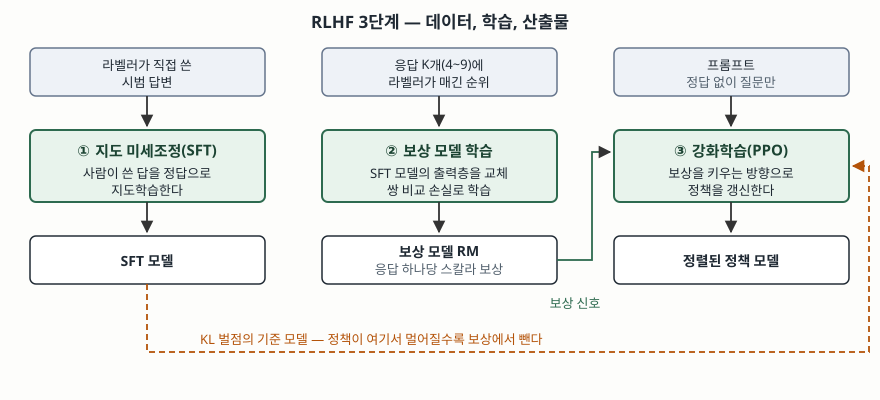

> 실행 검증 없음. 사람 선호 기반 강화학습 원 논문, InstructGPT 논문, DPO 논문,
> Constitutional AI 논문의 정의와 절차만으로 정리했다. 논문에 실린 성능 수치 중
> 원문에 명시된 것만 인용하고 추정값은 싣지 않는다.

## 들어가며

사내 문서로 챗봇을 만들어 보면 사실은 맞는데 쓸 수 없는 답을 만나는 구간이 온다.
질문은 "휴가 규정을 요약해 줘"인데 규정 전문을 그대로 옮겨 적거나, 자료에 없는 숫자를
그럴듯하게 지어내거나, 거절해야 할 요청에 성실하게 답한다. 사전학습 언어 모델이 최적화한
목적함수가 **다음 토큰을 맞히는 것**이지 **사람이 원하는 답을 내는 것**이 아니기 때문이다.
시험에서 RLHF를 묻는 이유가 여기 있다. 모델을 더 키우는 문제가 아니라 **정답을 글로 적을 수
없는 과업에 무엇을 정답으로 줄 것인가**의 문제이고, 그 자리에 사람의 선호가 들어간다.

## 정의

**RLHF(Reinforcement Learning from Human Feedback, 사람 피드백 강화학습)** 는
**사람이 매긴 응답 간 선호를 보상 모델로 학습하고, 그 보상 모델이 내는 보상을 최대화하도록
강화학습으로 정책을 갱신하는 정렬 기법**이다.

출처마다 범위가 다르다. Christiano 등(2017)은 언어 모델에 한정하지 않고, 궤적 구간 쌍에 대한
비전문가의 선호 비교만으로 보상 함수 없이 강화학습 목표를 정의하는 일반 기법으로 제안했다.
Ouyang 등(2022)은 이를 언어 모델에 적용해 지도 미세조정 → 보상 모델 → 강화학습의 3단계
절차로 정리했다. 답안의 정의는 후자를 쓰되, **원 제안이 언어 모델 전용이 아니었다**는 한 줄을
덧붙이면 개념의 상위 범주를 아는 것으로 읽힌다.

## 등장 배경

사전학습만으로 메워지지 않는 간극이 **2가지**다.

**첫째, 목적함수가 다르다.** 다음 토큰 예측은 말뭉치의 분포를 따라가는 것이지 유용하거나
해롭지 않은 답을 내는 것이 아니다. 두 목표는 많은 구간에서 겹치지만, 거절·요약 수준·어조처럼
사람이 기대를 갖는 지점에서 갈린다.

**둘째, 보상 함수를 손으로 쓸 수 없다.** 요약의 품질이나 응답의 무해함을 수식으로 적을 수
없으니 강화학습을 바로 걸 수 없다. Christiano 등은 여기서 보상 함수를 사람의 **쌍 비교**로
대체했고, 에이전트가 환경과 주고받은 상호작용의 **1% 미만**에만 피드백을 주고도 복잡한 행동을
학습시켰으며 그 사람 투입이 **약 1시간**이었다고 보고한다. 피드백의 단가가 충분히 싸야
이 구조가 성립한다는 뜻이다.

지도 미세조정(SFT)만으로 끝내지 않는 이유도 여기서 나온다. 정답을 직접 작성하는 비용이
"둘 중 어느 쪽이 나은가"를 고르는 비용보다 크고, 더 중요하게는 **SFT가 사람이 쓴 답의 수준을
넘어서지 못한다.** 순위 비교는 모델이 스스로 만든 응답들 가운데서 고르는 것이므로, 모델이
좋아질수록 비교 대상도 함께 좋아진다.

## 구성요소 — 3단계와 모델 3개

InstructGPT 논문이 정리한 절차가 표준형이다.

**① 지도 미세조정(SFT)** — 라벨러가 프롬프트에 대해 직접 작성한 시범 답변으로 사전학습
모델을 지도학습한다. 뒤의 두 단계가 출발할 기준점을 만드는 단계다.

**② 보상 모델(RM) 학습** — 같은 프롬프트에 대해 모델이 생성한 응답 **K개(4~9개)** 를
라벨러가 순위로 매긴다. K개에서 2개를 고르는 모든 조합이 "이쪽이 낫다"는 비교 데이터가 되므로,
순위 한 번이 비교 쌍 여러 개를 만든다. 보상 모델은 SFT 모델의 마지막 출력층을 떼고 프롬프트와
응답을 받아 **스칼라 보상 하나**를 내도록 바꾼 구조이며, 선호된 응답의 보상이 더 높아지도록
**쌍 비교 손실**로 학습한다. 논문은 한 프롬프트에서 나온 모든 쌍을 서로 다른 배치에 흩지 않고
**한 배치에 함께 넣어** 과적합을 줄인다고 적는다.

**③ 강화학습(PPO)** — 프롬프트를 주면 정책 모델이 응답을 생성하고, 보상 모델이 그 응답에
보상을 매기면 PPO로 보상을 키우는 방향으로 정책을 갱신한다. 이때 **SFT 모델과의 KL 발산을
토큰마다 벌점으로 빼서** 정책이 보상 모델을 과하게 파고드는 것을 막는다. 공개 벤치마크 성능이
떨어지는 현상을 줄이려고 사전학습 데이터의 손실을 섞는 변형(PPO-ptx)도 함께 쓴다.

3단계에 등장하는 **모델은 3개**다. 갱신 대상인 **정책 모델**, 보상을 매기는 **보상 모델**,
KL 벌점의 기준이 되는 **SFT 모델**이다. 셋을 동시에 올려 두어야 한다는 점이 뒤에서 볼
운영 부담의 근거가 된다.

## 도식

> **출처**: [Ouyang et al., Training language models to follow instructions with human feedback §3.5 Models (arXiv:2203.02155, 2022-03)](https://arxiv.org/abs/2203.02155)

## 비교 — 보상 모델을 두는 길과 두지 않는 길

RLHF의 부담은 대부분 ③단계에서 나온다. 모델 셋을 동시에 올리고, 학습 중 매 스텝 응답을
생성해야 하며, KL 계수와 PPO 하이퍼파라미터에 민감하다. 이 부담을 덜려는 대안이 둘 나왔다.

| 구분 | RLHF (PPO 기반) | DPO | RLAIF (Constitutional AI) |
|---|---|---|---|
| 선호 라벨 작성 주체 | 사람 | 사람 | AI (사람은 원칙 목록만 작성) |
| 보상 모델 | 별도로 학습 | 없음 — 정책 자체를 보상으로 재매개변수화 | 선호 모델을 별도로 학습 |
| 학습 방식 | 지도학습 + 강화학습 | 분류 손실 기반 지도학습 | 지도학습 + 강화학습 |
| 학습 중 응답 생성 | 필요 | 불필요 | 필요 |
| 하이퍼파라미터 | 민감 | 원 논문은 큰 조정이 필요 없다고 적음 | 민감 |
| 동시 적재 모델 | 정책·보상·기준 3개 | 정책·기준 2개 | 정책·선호·기준 3개 |
| 사람 투입 | 라벨러 상시 필요 | 라벨러 상시 필요 | 원칙 작성 시점에 집중 |

**DPO**(Rafailov 등, 2023)는 보상 모델의 매개변수화를 바꿔, 보상 모델을 따로 학습한 뒤 강화학습을
돌리지 않고도 같은 목표의 최적 정책을 **단순한 분류 손실**만으로 얻는다. 원 논문은 미세조정 중
언어 모델에서 샘플링할 필요가 없고 대규모 하이퍼파라미터 조정도 필요 없다고 적는다.

**RLAIF**(Bai 등, 2022)는 사람이 다는 선호 라벨을 AI가 대신 달게 한다. 사람이 제공하는 것은
원칙 목록뿐이고, 모델이 자기 응답을 비판·수정해 지도학습 데이터를 만든 뒤, 두 응답 중 어느
쪽이 원칙에 맞는지도 모델이 판단해 선호 모델을 학습시킨다. 사람 선호를 AI 선호로 바꾼 것이지
**강화학습 구조 자체를 뺀 것은 아니다.** 셋은 대체재가 아니라, 라벨의 출처(사람/AI)와 보상
모델의 유무(있음/없음)라는 두 축의 조합이다.

## 적용 시 고려사항 — 5가지

**① 라벨 지침이 곧 모델의 성격이 된다.** 보상 모델이 배우는 것은 "좋은 응답"이 아니라
"이 라벨러 집단이 이 지침에 따라 좋다고 고른 응답"이다. 라벨러 선발 기준과 지침 문서가
모델 산출물의 사양서 역할을 하므로, 지침을 버전 관리하고 라벨러 간 일치도를 측정해 둔다.

**② 보상 해킹을 전제로 KL 계수를 설계한다.** 정책이 보상 모델의 허점을 찾아 보상만 높고
사람 평가는 나쁜 응답으로 수렴하는 현상이 기본값에 가깝다. KL 벌점은 이를 막는 장치이므로
계수를 고정값으로 두지 말고, 보상 곡선과 사람 평가를 함께 보며 조정한다.

**③ 정렬 비용을 측정 항목에 넣는다.** 정렬을 걸면 공개 벤치마크 점수가 떨어지는 구간이
생긴다. 사전학습 손실을 섞는 변형이 이를 줄이려는 장치이므로, 평가를 "선호 승률"
하나로 두지 말고 **일반 능력 지표를 함께** 본다. 어느 쪽이 떨어졌는지 보이지 않으면
되돌릴 지점을 찾을 수 없다.

**④ 기업은 DPO부터 검토한다.** RLHF 전 과정을 수행하려면 라벨러 조직, 보상 모델, 강화학습
인프라가 모두 필요하다. 이미 정렬된 모델을 기반으로 두고, 기업 고유의 어조·거절 정책만
맞추는 수준이면 선호 쌍 데이터로 DPO를 돌리는 쪽이 적재 모델 수와 운영 복잡도에서 유리하다.

**⑤ 선호 데이터도 개인정보 검토 대상이다.** 라벨링에 쓰는 프롬프트는 대개 실제 사용자 질의에서
나오고, 그 안에는 식별 정보와 영업비밀이 섞인다. 선호 데이터는 가중치에 녹아 들어가 사후에
지울 수 없으므로 수집 단계에서 비식별 처리와 보존 기간을 정해 둔다.

## 정리

- **3단계**로 외운다 — 시범 답변으로 **SFT**, 순위 라벨로 **보상 모델**, 보상 최대화로 **PPO**.
- **모델 3개**가 동시에 돈다 — 갱신되는 **정책**, 점수를 매기는 **보상**, 기준이 되는 **SFT**.
- **억제 장치 2개**가 붙는다 — 보상 모델 과최적화를 막는 **KL 벌점**, 일반 능력 하락을 막는
  **사전학습 손실 혼합**.
- 대안은 **두 축의 조합**이다 — 라벨을 누가 다는가(사람/AI), 보상 모델을 두는가(둠/안 둠).
  보상 모델을 빼면 **DPO**, 라벨을 AI가 달면 **RLAIF**다.
- 사람 비교 피드백이 **상호작용의 1% 미만**으로도 동작한다는 원 논문의 보고가 이 구조가
  성립하는 전제다.

> 기출 답안: [기출문제 — 파인튜닝과 RAG, RLHF와 RAFT 학습 파이프라인 비교](../../exam/2026-10-13-finetuning-rag-rlhf-vs-raft/index.md)

## 참고 자료

- [P. F. Christiano et al., "Deep Reinforcement Learning from Human Preferences", NeurIPS 2017 (arXiv:1706.03741, 2017-06)](https://arxiv.org/abs/1706.03741) — 궤적 구간 쌍 선호로 보상 함수를 대체, 상호작용 1% 미만 피드백
- [L. Ouyang et al., "Training language models to follow instructions with human feedback", arXiv:2203.02155 (2022-03)](https://arxiv.org/abs/2203.02155) — §3.5 SFT·RM·RL 3단계, K=4~9 순위와 쌍 비교 손실, KL 벌점과 PPO-ptx
- [R. Rafailov et al., "Direct Preference Optimization: Your Language Model is Secretly a Reward Model", NeurIPS 2023 (arXiv:2305.18290)](https://arxiv.org/abs/2305.18290) — 보상 모델 재매개변수화, 분류 손실만으로 정렬
- [Y. Bai et al., "Constitutional AI: Harmlessness from AI Feedback", arXiv:2212.08073 (2022-12)](https://arxiv.org/abs/2212.08073) — 원칙 목록 기반 자기비판·수정과 RLAIF
- [N. Stiennon et al., "Learning to Summarize from Human Feedback", NeurIPS 2020 (arXiv:2009.01325)](https://arxiv.org/abs/2009.01325) — 요약 과업에 사람 선호 기반 보상 모델을 적용한 선행 연구
