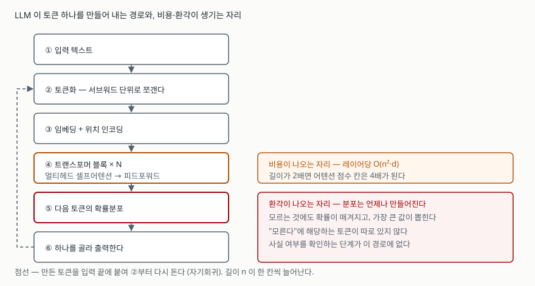

## 들어가며

LLM은 1교시 단답형과 2~4교시 논술형 양쪽에 걸쳐 나온다. 그런데 "방대한 데이터를
학습해 사람처럼 답하는 모델"이라고 쓰면 점수가 붙지 않는다. 채점자가 보려는 것은
**구조를 알고 있는가**, 그리고 **그 구조에서 한계가 왜 따라 나오는지 설명할 수 있는가**이다.

비용과 환각은 LLM을 다루는 거의 모든 문항에 딸려 나오는 항목이다. 둘 다 운영을
잘못해서 생기는 문제가 아니라 구조에서 바로 따라 나온다. 이 글은 트랜스포머의
경로를 한 번 따라가면서 그 두 지점을 짚는다.

## 정의

**대규모 언어 모델(LLM)은 트랜스포머 구조를 대규모 말뭉치로 사전학습해, 주어진
토큰 열 다음에 올 토큰의 확률분포를 내놓는 모델이다.**

밑줄 쳐 둘 것은 "확률분포를 내놓는다"이다. 답을 내놓는 것이 아니라 분포를 내놓고,
그중 하나를 뽑는다. 뒤에 나오는 한계가 전부 이 문장에서 따라 나온다.

트랜스포머는 Vaswani 외 7인이 2017년에 제안한 구조다. 논문 초록은 이 구조가
어텐션만으로 이루어졌고 순환과 합성곱을 완전히 걷어냈다고 적는다.

## 등장 배경

트랜스포머 이전의 주류는 RNN 계열이었고, 거기에는 구조적 병목이 둘 있었다.

**첫째, 순차 처리다.** RNN은 앞 토큰의 계산이 끝나야 다음 토큰을 계산한다.
논문의 레이어 비교표(Table 1)는 순환 레이어가 길이 n에 비례하는 순차 연산을
요구한다고 적는다. 문장이 길수록 병렬화가 막히고, GPU를 늘려도 학습이 빨라지지 않는다.

**둘째, 먼 거리 의존성이다.** 같은 표에서 순환 레이어의 최대 경로 길이는 O(n)이다.
문장 맨 앞의 단어가 맨 뒤에 영향을 주려면 n번의 단계를 거쳐야 하고, 그 사이에
신호가 묽어진다.

셀프어텐션은 이 둘을 동시에 바꿨다. 순차 연산이 O(1)이 되어 학습이 병렬화되고,
최대 경로 길이도 O(1)이 되어 어느 위치든 한 번에 닿는다. 대신 레이어당 복잡도가
O(n²·d)로 올라갔다. **얻은 것과 내준 것이 분명한 교환이다.**

## 구성요소 — 추론 경로 6단계

LLM이 토큰 하나를 만들어 내는 과정은 **6단계**다.

| 단계 | 하는 일 |
|---|---|
| ① 입력 | 텍스트를 받는다 |
| ② 토큰화 | 서브워드 단위로 쪼개 정수 열로 바꾼다 |
| ③ 임베딩 + 위치 인코딩 | 각 토큰을 벡터로 바꾸고 순서 정보를 더한다 |
| ④ 트랜스포머 블록 × N | 멀티헤드 셀프어텐션과 피드포워드를 N번 통과시킨다 |
| ⑤ 확률분포 | 어휘 전체에 대한 다음 토큰 확률을 낸다 |
| ⑥ 선택과 되돌림 | 하나를 골라 출력하고, 입력 끝에 붙여 ②부터 다시 돈다 |

④의 블록 하나는 **하위 레이어 2개**로 이루어진다. 논문의 인코더·디코더 스택
설명(§3.1)은 각 레이어가 멀티헤드 셀프어텐션과 위치별 완전연결 피드포워드
망으로 구성되고, 둘 각각에 잔차 연결과 층 정규화가 붙는다고 적는다.
디코더는 인코더 출력에 어텐션하는 세 번째 하위 레이어가 더해져 **3개**가 된다.

논문의 base 모델 값은 N = 6, d_model = 512, 헤드 수 h = 8이고 헤드마다
d_k = d_v = 64다.

## 도식



> **출처**: [Attention Is All You Need §3.1 Encoder and Decoder Stacks · §3.2.2 Multi-Head Attention · Table 1](https://arxiv.org/abs/1706.03762) · [NIST AI 600-1 §2.2 Confabulation](https://nvlpubs.nist.gov/nistpubs/ai/NIST.AI.600-1.pdf)

## 비용이 나오는 지점 — ④

논문의 레이어 비교표(Table 1)가 적는 레이어당 복잡도는 셋이 다르다.

| 레이어 유형 | 레이어당 복잡도 | 순차 연산 | 최대 경로 길이 |
|---|---|---|---|
| 셀프어텐션 | O(n²·d) | O(1) | O(1) |
| 순환 | O(n·d²) | O(n) | O(n) |
| 합성곱 | O(k·n·d²) | O(1) | O(log<sub>k</sub>n) |

n이 입력 길이, d가 표현 차원, k가 합성곱 커널 크기다. 셀프어텐션만 n에 제곱으로
붙는다. 모든 토큰이 모든 토큰을 본다는 정의에서 바로 따라 나오는 결과다.

base 모델 값으로 실제 숫자를 내 보면 이렇게 늘어난다. 계산 소스는
[`code/`](code/)에 있고, 아래는 돌린 기록인 [`code/output.txt`](code/output.txt)에서 가져왔다.

```text
    길이 n |      어텐션 점수 칸 | 직전 대비 |     KV 캐시 | 직전 대비
  ----------------------------------------------------------------------
       128 |            786,432 |       - |    1.50 MiB |       -
       256 |          3,145,728 |    4.0배 |    3.00 MiB |    2.0배
       512 |         12,582,912 |    4.0배 |    6.00 MiB |    2.0배
     1,024 |         50,331,648 |    4.0배 |   12.00 MiB |    2.0배
     2,048 |        201,326,592 |    4.0배 |   24.00 MiB |    2.0배
     4,096 |        805,306,368 |    4.0배 |   48.00 MiB |    2.0배
```

**입력을 2배로 늘리면 어텐션 점수 칸은 4배, KV 캐시는 2배가 된다.** 둘이 다른
비율로 늘어난다는 점이 답안에서 갈리는 자리다. 캐시는 길이에 비례하고 연산은
제곱으로 붙으므로, 길어질수록 **메모리보다 연산이 먼저 문제가 된다.**

## 환각이 나오는 지점 — ⑤

미국 NIST의 생성형 AI 프로파일(NIST AI 600-1)은 생성형 AI 고유의 위험
**12가지**를 정의하고, 그중 두 번째 항목(§2.2)에 이 현상을 **작화(confabulation)**
라는 이름으로 올려 두었다. 문서는 이를 생성형 AI가 잘못되거나 거짓인 내용을
**확신을 담아** 제시하는 현상으로 정의하고, 통상 "환각(hallucination)"이라고도
불린다고 적는다.

중요한 것은 같은 절의 원인 설명이다. 문서는 작화가 **생성 모델이 설계된 방식에서
자연스럽게 따라 나오는 결과**라고 적는다. 모델은 학습 데이터의 통계적 분포를
근사하는 출력을 내도록 만들어져 있고, LLM의 경우 그것이 다음 토큰을 예측하는
형태라는 것이다. 통계적 예측은 정확한 출력도 내지만 사실과 어긋나거나 앞뒤가
맞지 않는 출력도 낸다.

구조로 돌아가 보면 이유가 분명해진다. ⑤단계에서 나오는 것은 **언제나 분포**다.
모델이 모르는 것을 물어도 분포는 나오고, 그중 가장 큰 값이 뽑힌다. 어휘 안에
"모른다"에 해당하는 토큰이 따로 있지 않고, **사실 여부를 확인하는 단계가 이 경로
어디에도 없다.** 그래서 환각은 고장이 아니라 설계의 결과다.

## 적용 시 고려사항

**첫째, 입력 길이를 비용으로 환산해 설계한다.** 프롬프트에 문서를 통째로 넣는
설계는 길이가 늘어날 때 연산이 제곱으로 붙는다. 검색으로 필요한 조각만 골라
넣는 방식이 비용 면에서 다른 선택이 되는 이유다.

**둘째, 사실 확인 단계를 경로 밖에 따로 둔다.** 모델이 스스로 확인하게 만드는
설계는 같은 경로를 한 번 더 도는 것이라 같은 한계를 그대로 받는다. 근거 문서를
함께 제시하게 하고 그 근거가 실재하는지를 **시스템이 검증**해야 한다. NIST 문서는
같은 절에서 모델이 틀린 답에도 그럴듯한 논리 단계나 인용을 붙여 사람이 더 믿게
만들 수 있다고 적는다.

**셋째, 지식의 시점이 가중치에 고정돼 있음을 전제한다.** 사전학습이 끝난 시점
이후의 사실은 가중치 안에 없다. 최신성이 필요한 업무는 외부 조회를 붙여야 하고,
그 조회 결과와 모델 출력 중 무엇을 우선할지를 설계에서 정해 두어야 한다.

**넷째, 적용 범위를 결과의 되돌림 가능성으로 가른다.** NIST 문서는 작화의 위험이
결과가 중대한 의사결정에 통합될 때 특히 중요하다고 적는다. 초안 작성처럼 사람이
검토하고 되돌릴 수 있는 일과, 그대로 실행되는 일은 같은 기준으로 다룰 수 없다.

## 정리

- 정의는 **"다음 토큰의 확률분포를 내놓는 모델"** 로 잡는다. 한계가 전부 여기서 나온다.
- 추론 경로는 **6단계**(입력 → 토큰화 → 임베딩·위치 → 블록 × N → 분포 → 선택·되돌림).
- 블록 하나의 하위 레이어는 인코더 **2개**, 디코더 **3개**.
- 비용은 **④**에서 나온다. 셀프어텐션의 레이어당 복잡도 **O(n²·d)**. 길이 2배 → 연산 4배, 캐시 2배.
- 환각은 **⑤**에서 나온다. 분포는 언제나 나오고, "모른다" 토큰도 검증 단계도 경로에 없다.
- 암기 단서: **구조는 "6단계 · 블록 2층"**, **한계는 "④ 제곱 · ⑤ 분포"**.

## 참고 자료

- Vaswani, A. et al., [Attention Is All You Need](https://arxiv.org/abs/1706.03762), arXiv:1706.03762, 2017 — §3.1 Encoder and Decoder Stacks, §3.2.2 Multi-Head Attention, Table 1
- NIST, [Artificial Intelligence Risk Management Framework: Generative Artificial Intelligence Profile (NIST AI 600-1)](https://nvlpubs.nist.gov/nistpubs/ai/NIST.AI.600-1.pdf), 2024 — §2.2 Confabulation
- NIST, [AI Risk Management Framework (AI RMF 1.0)](https://www.nist.gov/itl/ai-risk-management-framework)
