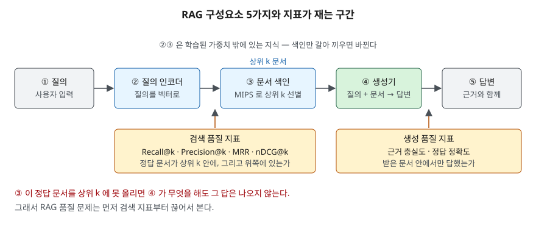

## 들어가며

사내 규정 질의응답 챗봇을 올렸는데 답이 자꾸 틀린다는 민원이 들어온다. 로그를 보면
모델은 그럴듯한 문장을 만들어 내고 있다. 그런데 근거로 붙은 문서가 엉뚱하다.
이때 흔히 택하는 조치는 프롬프트를 고치거나 더 큰 모델로 바꾸는 것이다.

틀린 처방이다. 생성기는 **받은 문서 안에 없는 사실을 만들어 낼 수 없거나, 만들어
내면 환각이다.** 검색이 정답 문서를 올려 주지 못했다면 모델을 아무리 키워도 그 답은
나오지 않는다. 그래서 RAG의 품질 문제는 검색과 생성을 끊어서 재는 데서 시작한다.
기술사 답안에서도 "검색 품질 지표를 쓴다"가 아니라 **어떤 지표가 무엇을 재는지**까지
내려가야 점수가 붙는다.

## 정의

**RAG(Retrieval-Augmented Generation, 검색 증강 생성)** 는 사전학습 언어모델의
**매개변수 메모리(parametric memory)** 에, 외부 문서 색인을 검색해 얻는
**비매개변수 메모리(non-parametric memory)** 를 결합해 생성하는 모델이다
(Lewis et al., NeurIPS 2020).

답안 첫 줄에 쓸 한 문장으로 줄이면 이렇다. **"질의로 외부 문서를 검색해 상위 k건을
생성기 입력에 함께 넣어, 학습 가중치 밖의 지식으로 답을 만드는 구조."**

## 등장 배경

원 논문이 든 문제는 세 가지다.

1. **지식이 가중치에 갇힌다.** 사전학습 모델은 사실을 매개변수에 저장하지만 그것을
   정확히 꺼내 다루지 못해, 지식 집약 과제에서 과제별 전용 구조에 밀린다.
2. **근거를 댈 수 없다.** 가중치에서 나온 답은 어느 문서에서 왔는지 가리킬 수 없다.
3. **갱신하려면 다시 학습해야 한다.** 규정이 바뀌면 모델을 다시 만들어야 한다.

비매개변수 메모리를 밖에 두면 세 번째 문제가 바로 풀린다. 색인만 갈아 끼우면
모델은 그대로 둔 채 지식이 바뀐다.

## 구성요소 — 5가지

| # | 구성요소 | 하는 일 | 원 논문의 구현 |
|---|---|---|---|
| ① | 질의 | 사용자 입력 | — |
| ② | 질의 인코더 | 질의를 벡터로 바꾼다 | DPR의 BERT-base 질의 인코더 (미세조정 대상) |
| ③ | 문서 색인 | 문서 벡터를 담고 상위 k를 고른다 | 문서 인코더는 고정, FAISS MIPS 색인 |
| ④ | 생성기 | 질의와 문서를 합쳐 답을 만든다 | BART-large (약 4억 매개변수) |
| ⑤ | 답변 | 근거 문서와 함께 돌려준다 | — |

②와 ③을 묶어 **검색기(retriever)**, ④를 **생성기(generator)** 라 부른다.
질의 인코더와 문서 인코더가 따로 있는 **이중 인코더(bi-encoder)** 구조이며,
상위 k 선별은 **최대 내적 탐색(MIPS)** 문제로 풀어 근사적으로 준선형 시간에 끝낸다.

원 논문은 생성 방식을 **2가지**로 나눈다. **RAG-Sequence**는 검색된 문서 하나로
답 전체를 생성한 뒤 문서별 확률을 주변화하고, **RAG-Token**은 토큰마다 다른 문서를
쓸 수 있다.

## 도식



> **출처**: [Lewis et al., *Retrieval-Augmented Generation for Knowledge-Intensive NLP Tasks*, NeurIPS 2020 §2.2 Retriever: DPR, §2.3 Generator: BART, §3 Training](https://arxiv.org/abs/2005.11401)

## 검색 품질 지표 — 4가지

정답 문서 집합(ground truth)이 있는 질의를 모아 놓고, 검색기가 돌려준 순위를 잰다.

| 지표 | 무엇을 재는가 | 순위를 보는가 | 등급을 보는가 |
|---|---|---|---|
| **Recall@k** | 정답 문서 중 상위 k 안에 들어온 비율 | 아니다 | 아니다 |
| **Precision@k** | 상위 k 중 정답인 비율 | 아니다 | 아니다 |
| **MRR** | 첫 정답이 나온 순위의 역수를 질의마다 평균 | 첫 건만 | 아니다 |
| **nDCG@k** | 등급을 매긴 적합도를 순위로 할인해 더한 값 | 전부 | 그렇다 |

nDCG는 적합도에 등급(예: 0~3)을 매기고, 아래쪽에 있을수록 이득을 깎는다.
Järvelin & Kekäläinen(2002)의 정의이며, 널리 쓰이는 지수형 이득으로 쓰면
`DCG@k = Σ (2^rel_i − 1) / log₂(i+1)` 이고, 이상적 순서의 값(IDCG)으로 나눠
0~1로 만든다.

### 직접 계산해 본 결과

정답 등급이 매겨진 질의 3건에 검색기 두 개의 순위를 대고 계산했다.
코드는 [`code/retrieval_metrics.py`](code/retrieval_metrics.py), 실행 기록은
[`code/output.txt`](code/output.txt)에 있다.

```text
검색기       Recall@3  Recall@5     P@3     P@5     MRR   nDCG@5
-------------------------------------------------------------
검색기 A        0.778     1.000   0.667   0.533   0.833    0.877
검색기 B        0.222     0.889   0.222   0.467   0.306    0.497
```

Q1에서는 두 검색기가 **같은 5건을 순서만 바꿔** 돌려줬다. Recall@5는 둘 다 1.0으로
같지만 nDCG@5는 0.9461과 0.5514다. 손 계산과 맞춰 둔 항은 이렇다.

```text
검색기 A  등급 [3, 0, 2, 0, 1]
    (2^3-1)/log2(1+1) = 7.0000
    (2^2-1)/log2(3+1) = 1.5000
    (2^1-1)/log2(5+1) = 0.3869
  DCG@5   = 8.8869  → nDCG@5 = 8.8869 / 9.3928 = 0.9461

검색기 B  등급 [0, 0, 3, 2, 1]
  DCG@5   = 5.1789  → nDCG@5 = 5.1789 / 9.3928 = 0.5514
```

**Recall@k만 보면 두 검색기가 같아 보인다.** 그런데 생성기에 넣는 문서 수를 줄이면
차이가 그대로 드러난다.

```text
  k |        검색기 A |        검색기 B
------------------------------------
  1 |            2 |            0
  3 |            6 |            2
  5 |            8 |            7
  8 |            8 |            8
```

전체 정답 8건 중 상위 3건만 넣을 때 A는 6건, B는 2건이 들어간다.
컨텍스트 예산이 좁을수록 **순위를 보는 지표가 실제 성능과 가깝다.**

## 적용 시 고려사항 — 4가지

1. **k를 생성기에 실제로 넣는 수에 맞춘다.** Recall@20이 좋아도 프롬프트에 3건만
   넣는다면 의미가 없다. 재는 k와 쓰는 k가 다르면 지표가 좋아져도 답은 그대로다.
2. **정답 집합부터 만든다.** 위 지표는 전부 정답 문서가 정해져 있어야 계산된다.
   질의 수십 건에 사람이 등급을 매기는 작업이 선행 과제다. 이게 없으면 "좋아졌다"를
   말할 근거가 없다.
3. **지표를 하나만 보지 않는다.** Precision@k는 k를 키우면 분모만 커져 떨어지고,
   Recall@k는 k를 키우면 오른다. 둘을 같이 봐야 k 설정이 판단된다.
4. **검색과 생성을 분리해 잰다.** 최종 답만 채점하면 검색이 틀린 것인지 생성이
   틀린 것인지 구분되지 않는다. 검색 지표가 낮으면 색인·청크 크기·임베딩을,
   검색은 맞는데 답이 틀리면 프롬프트와 생성기를 본다.

## 정리

- RAG = **매개변수 메모리(생성기) + 비매개변수 메모리(검색 색인)**. 색인만 갈아
  끼우면 재학습 없이 지식이 바뀐다.
- 구성요소 **5가지**: 질의 → 질의 인코더 → 문서 색인 → 생성기 → 답변.
  생성 방식은 **2가지**(RAG-Sequence / RAG-Token).
- 검색 지표 **4가지**: Recall@k · Precision@k · MRR · nDCG@k.
  **순위를 보느냐 / 등급을 보느냐**로 갈린다 — 둘 다 보는 것이 nDCG다.
- 같은 5건을 순서만 바꿔 돌려줬을 때 Recall@5는 1.0으로 같았고 nDCG@5는
  0.9461 대 0.5514였다. **Recall만으로는 두 검색기를 구분할 수 없다.**
- 암기 단서: 구성요소는 **질-인-색-생-답**, 지표는 **R·P·M·N**.

## 참고 자료

- [Patrick Lewis et al., *Retrieval-Augmented Generation for Knowledge-Intensive NLP Tasks*, NeurIPS 2020 (arXiv:2005.11401)](https://arxiv.org/abs/2005.11401)
- [Kalervo Järvelin, Jaana Kekäläinen, *Cumulated gain-based evaluation of IR techniques*, ACM TOIS 20(4), pp. 422–446, 2002](https://doi.org/10.1145/582415.582418)
- [Vladimir Karpukhin et al., *Dense Passage Retrieval for Open-Domain Question Answering*, EMNLP 2020 (arXiv:2004.04906)](https://arxiv.org/abs/2004.04906)
- [Nandan Thakur et al., *BEIR: A Heterogeneous Benchmark for Zero-shot Evaluation of Information Retrieval Models*, NeurIPS 2021 Datasets and Benchmarks (arXiv:2104.08663)](https://arxiv.org/abs/2104.08663)
- [Ellen M. Voorhees, *The TREC-8 Question Answering Track Report*, NIST, 1999](https://trec.nist.gov/pubs/trec8/papers/qa8.pdf)
