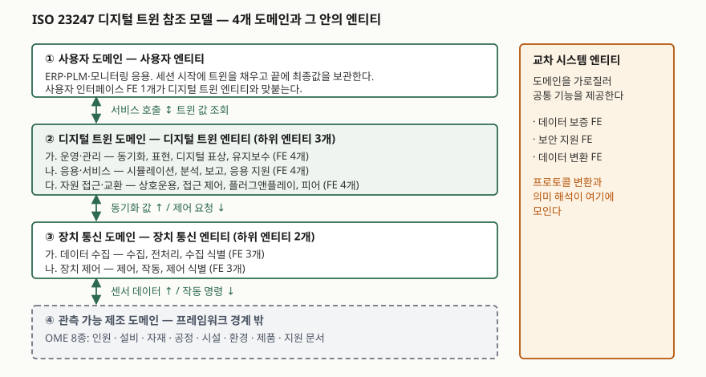

> **실행 검증 없음.** 표준 문서 근거만으로 정리한 글이다. 측정값이나 구현 결과를 싣지 않는다.
> 근거로 삼은 것은 공개된 **최종 국제표준안(FDIS) 본문**이다. 발행본과 조항 번호·문구가 다를 수 있다.

## 들어가며

공장 라인을 3D로 그려 놓고 "디지털 트윈을 구축했다"고 부르는 발표를 흔히 본다.
그런데 그 모델을 열어 보면 설비가 지금 돌고 있는지 멈춰 있는지 알 수 없는 경우가 많다.
시험에서 디지털 트윈을 묻는 문항이 거의 항상 "시뮬레이션과 무엇이 다른가"로 들어오는 이유가 여기 있다.
둘을 가르는 선이 모델의 정밀도가 아니라는 것을, 표준이 정의 문장 하나로 못 박아 두었다.

## 정의 — 한 문장으로

ISO 23247의 정의 조항(ISO 23247-1 §3.2.3)은 제조 분야의 디지털 트윈을 이렇게 적는다.

> 관측 가능 제조 요소(OME)의 **목적에 맞는 디지털 표상**으로서, 그 요소와 디지털 표상 **사이에 동기화가 있는 것**.

답안 첫 줄에 쓸 때는 두 가지를 반드시 남긴다. **목적 적합성(fit for purpose)** 과 **동기화(synchronization)** 다.
앞의 것은 "실물을 통째로 복제하지 않는다"는 뜻이고, 뒤의 것은 시뮬레이션과 갈리는 지점이다.

표준은 디지털 트윈이 맥락 의존적이며 물리 시스템의 **부분적인 표상일 수 있다**고 적는다.
의도한 목적에 필요한 데이터와 모델만 가질 수 있다는 것이다. 완전한 복제를 요구하지 않는다.

## 등장 배경

제조 현장에는 이미 CAD·CAM·CAE 모델이 있었다. 문제는 그 모델이 **설계 시점에 멈춰 있다**는 것이었다.
설비가 마모되고 공정 조건이 바뀌어도 모델은 그대로다. 그래서 모델로 계산한 예측과 현장의 결과가 벌어진다.

센서와 네트워크 값이 싸지면서 "현장 값을 계속 모델에 되먹이면 되지 않나"는 접근이 가능해졌지만,
제품마다 데이터 형식과 프로토콜이 제각각이라 구축 경험이 다른 공장으로 옮겨지지 않았다.
ISO/TC 184/SC 4가 만든 ISO 23247 시리즈는 이 지점을 겨냥한다. 특정 구현 기술을 요구하지 않으면서
**무엇을 갖춰야 디지털 트윈이라 부를 수 있는지**와 **어떤 덩어리로 나눠 만들어야 하는지**를 정한다.
참조 아키텍처는 IoT 참조 아키텍처인 ISO/IEC 30141을 바탕으로 제조용으로 확장한 것이다.

## 구성요소 — 숫자로 외운다

### 시리즈 구성 — 처음 4부

| 부 | 무엇을 정하나 |
|---|---|
| 1부 | 개요와 일반 원칙 — 정의, OME 분류, 요구사항 |
| 2부 | 참조 아키텍처 — 도메인·엔티티 참조 모델과 기능 관점 |
| 3부 | OME의 기본 정보 속성 목록 |
| 4부 | 엔티티 사이 정보 교환의 기술 요구사항 |

이후 디지털 스레드(5부)와 디지털 트윈 조합(6부)이 뒤이어 추가됐다.

### 관측 가능 제조 요소(OME) — 8종

**인원 · 설비 · 자재 · 공정 · 시설 · 환경 · 제품 · 지원 문서.**
"OME는 설비"라고만 외우면 틀린다. 사람과 문서가 들어가 있는 것이 이 목록의 특징이다.

### 디지털 트윈의 요구사항 — 15가지

정확성, 통신, 데이터 수집, 데이터 분석, 데이터 무결성, 확장성, 입도, 식별,
관리, 제품 수명주기, 보안, 시뮬레이션, 동기화, 관점, 계층 모델링.
답안에서 전부 쓸 일은 드물다. **동기화·식별·입도·보안** 네 개를 먼저 적고 나머지를 묶어 나열하면 된다.

- **동기화**는 이벤트 기반과 시간 기반 두 방식이 있다고 적혀 있다. 이벤트 기반은 사건이 생길 때 갱신하고,
  시간 기반은 타임스탬프가 붙은 데이터 스트림을 계속 읽어 갱신한다
- **계층 모델링**은 IEC 62264-1(ISA-95)이 정의한 기능·역할 계층의 어느 수준이든 모델링할 수 있어야 한다고 적는다.
  디지털 트윈이 설비 한 대 단위에만 묶이지 않는다는 근거다

### 참조 모델 — 도메인 4개, 엔티티 4개

> **출처**: [ISO/FDIS 23247-2:2021 — §5.2 Domain-based reference model, §5.3 Entity-based reference model](http://www.sandelman.ca/tmp/iso/ISO%20FDIS%2023247-2.pdf)

도메인은 **사용자 · 디지털 트윈 · 장치 통신 · 관측 가능 제조** 넷이다.
여기서 점수가 갈리는 대목이 하나 있다. **관측 가능 제조 도메인은 프레임워크 경계 밖**이다.
표준은 그 도메인을 이해를 돕기 위해 그려 둘 뿐이라고 밝히고, 구현은 나머지 **세 도메인**으로 나뉜다고 적는다.
실물 설비는 트윈이 만드는 대상이지 트윈의 일부가 아니다.

엔티티는 **장치 통신 · 디지털 트윈 · 사용자 · 교차 시스템** 넷이다.
앞의 셋은 도메인 하나씩을 맡고, 교차 시스템 엔티티만 **도메인을 가로질러** 데이터 보증·보안 지원·데이터 변환을 공통으로 제공한다.
기능 엔티티(FE)는 모두 22개다 — 장치 통신 6개, 디지털 트윈 12개, 사용자 인터페이스 1개, 교차 시스템 3개.

## 비교 — 시뮬레이션·CPS와 무엇이 다른가

| 구분 | 시뮬레이션 모델 | 디지털 트윈 (ISO 23247) | 사이버물리시스템(CPS) |
|---|---|---|---|
| 실물과의 연결 | 없다. 입력을 사람이 준다 | **동기화가 정의에 포함된다** | 연결된다 |
| 대상 | 가정한 상황 | 식별된 OME 하나하나 | 물리 프로세스 전반 |
| 생애 | 분석이 끝나면 버린다 | 제품 수명주기 동안 유지된다 | 시스템과 함께 간다 |
| 제어 | 하지 않는다 | 장치 제어 하위 엔티티가 맡는다 | 제어가 본래 목적이다 |
| 표준 위치 | 기법 | ISO 23247 (IoT RA인 ISO/IEC 30141 확장) | 개념 범주 |

가장 자주 틀리는 자리가 **시뮬레이션을 디지털 트윈의 반대말로 쓰는 것**이다.
표준에서 시뮬레이션은 디지털 트윈 엔티티 안에 있는 **기능 엔티티 하나**다.
OME의 거동을 예측하는 역할을 맡는다. 트윈이 시뮬레이션을 **품고 있는** 구조이지 둘이 대립하지 않는다.
답안에서는 "시뮬레이션은 트윈의 구성 기능이고, 트윈을 트윈이게 하는 것은 동기화"라고 쓰면 정확하다.

## 적용 시 고려사항

1. **식별 방법을 먼저 정한다.** 표준은 구현 절차의 첫 항목으로 OME의 디지털 식별 방법 선정을 든다.
   UUID처럼 **일관된 방법 하나**를 쓰면 구현 복잡도가 줄어든다고 적는다.
   제품 수명주기의 단계마다 다른 시스템이 같은 OME를 다른 키로 부르면, 뒤에서 아무리 맞춰도 동기화가 성립하지 않는다
2. **동기화 방식을 이벤트 기반과 시간 기반 중에서 고른다.** 설비 상태 변화처럼 사건이 드물면 이벤트 기반이,
   온도·진동처럼 연속값이면 시간 기반이 맞는다. 둘을 섞을 때는 시각 기준을 통일해야 한다
3. **입도(granularity)를 목적에서 거꾸로 잡는다.** 정의가 "목적에 맞는" 표상을 요구하므로,
   무엇을 판단하려는지가 먼저다. 예지보전이면 베어링 진동이, 생산 스케줄링이면 설비 가동 상태가 필요한 입도다
4. **데이터 변환 부담을 교차 시스템 엔티티로 모은다.** 표준이 프로토콜과 데이터 형식을 지정하지 않으므로
   현장에는 이기종이 남는다. 변환을 각 응용에 흩어 두면 설비 한 대를 바꿀 때마다 응용을 전부 고쳐야 한다
5. **보안을 요구사항으로 먼저 적는다.** 디지털 트윈은 **인가된 자원과만 통신해야 한다**고 요구사항에 적혀 있다.
   장치 제어 하위 엔티티가 실제 설비를 움직이므로, 트윈 침해가 공정 사고로 이어지는 경로가 열려 있다

## 정리

- **정의 한 줄**: OME의 목적에 맞는 디지털 표상 + **동기화**. 동기화를 빼면 시뮬레이션 모델이다
- **4·4·8·15·22**로 묶는다 — 도메인 4, 엔티티 4, OME 8종, 요구사항 15가지, 기능 엔티티 22개
- 도메인 넷 중 **관측 가능 제조 도메인은 프레임워크 밖**이다. 구현은 나머지 셋
- 교차 시스템 엔티티만 도메인을 **가로지른다** — 데이터 보증·보안 지원·데이터 변환
- 뿌리는 **IoT 참조 아키텍처 ISO/IEC 30141**이고, 계층은 **IEC 62264-1(ISA-95)** 을 따른다

## 참고 자료

- [ISO/FDIS 23247-1:2021 — Digital twin framework for manufacturing, Part 1: Overview and general principles](http://www.sandelman.ca/tmp/iso/ISO%20FDIS%2023247-1.pdf) — 정의 조항(§3.2), OME 8종(§4.4), 요구사항 15가지(§5.3), 구현 절차 개요(§5.4)
- [ISO/FDIS 23247-2:2021 — Part 2: Reference architecture](http://www.sandelman.ca/tmp/iso/ISO%20FDIS%2023247-2.pdf) — 도메인·엔티티 참조 모델(§5), 기능 관점과 기능 엔티티(§6)
- [ISO 23247-1:2021 카탈로그 항목](https://www.iso.org/standard/75066.html) — 발행본 서지 정보 (ISO/TC 184/SC 4)
- [BS ISO 23247-5 — Part 5: Digital thread for digital twin](https://knowledge.bsigroup.com/products/bs-iso-23247-5-automation-systems-and-integration-digital-twin-framework-for-manufacturing-part-5-digital-thread-for-digital-twin) — 4부 이후 추가된 파트
- [ISO/IEC 30141 — Internet of Things (IoT) Reference Architecture](https://www.iso.org/standard/65695.html) — 23247 참조 아키텍처가 확장한 바탕
