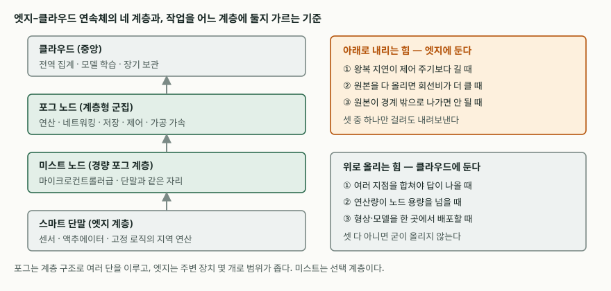

> **실행 검증 없음.** 표준 문서와 공식 규격의 정의·구조를 정리한 글이다. 측정값이나
> 실행 결과는 싣지 않았다.

## 들어가며

엣지 컴퓨팅은 시험에서 단독 개념으로도 나오지만, **클라우드와 어떻게 나눠 쓰는가**를
묻는 형태가 더 많다. 스마트 팩토리, 자율주행, CDN 어느 문항에 끼어들어도 답안의
한 축이 "무엇을 엣지에 두고 무엇을 중앙에 둘 것인가"로 모인다.

이때 답안이 갈리는 지점은 용어 암기가 아니다. **배치 기준을 근거로 말할 수 있는가**다.
"지연이 줄어든다"까지는 누구나 쓰고, 그 아래 "그래서 어느 작업이 내려가고 어느 작업이
올라가는가"를 쓰면 점수가 붙는다.

엣지·포그·미스트는 서로 혼용되는 말이라 정의부터 출처를 밝혀 끊어 줘야 한다.
NIST도 이 문서를 쓸 당시 **이 개념들 사이에 합의가 없었다**고 명시한다.

## 정의

> **엣지 컴퓨팅**은 단말과 그 사용자를 포함하는 네트워크 계층으로, 센서·계측기 등
> 네트워크로 접근 가능한 장치 위에서 지역 연산 능력을 제공하는 것이다.
> — NIST SP 500-325 Annex A

> **포그 컴퓨팅**은 다계층 구조에서 하드웨어와 소프트웨어 기능을 분리·결합해 응용을
> 실행하며, 연산·네트워킹에 더해 **저장·제어·데이터 가공 가속**까지 다루는 계층이다.
> — NIST SP 500-325 Annex A

**엣지–클라우드 연속체**(continuum)는 이 둘과 클라우드를 끊어진 선택지가 아니라
하나의 이어진 자원 계층으로 보고, 작업을 그 위 어느 지점에 배치할지 정하는 구조다.

## 등장 배경

중앙 클라우드만으로 IoT를 처리하기 어려운 이유를 NIST는 셋으로 든다 —
**대규모**(scale), **이기종성**(heterogeneity), **높은 지연**(high latency)이다.

| 이전 방식 | 무엇이 문제였나 |
|---|---|
| 단말 → 중앙 클라우드 직결 | 왕복 지연이 제어 주기를 넘으면 제어가 성립하지 않는다 |
| 원본 데이터 전량 업로드 | 센서 수에 비례해 회선 비용이 늘고 업링크가 포화된다 |
| 중앙 집중 저장 | 원본이 조직·국가 경계를 넘어가 규제와 충돌한다 |

## 구성요소

### 가. 연속체의 네 계층

1. **스마트 단말 (엣지 계층)** — 센서·액추에이터. 고정된 로직을 그 자리에서 수행한다
2. **미스트 노드** — 경량 포그 계층. 마이크로컨트롤러급이며 **선택 계층**이다
3. **포그 노드** — 게이트웨이·스위치·라우터·서버 또는 그 가상화 형태. 계층형 군집을 이룬다
4. **클라우드** — 전역 집계, 모델 학습, 장기 보관

### 나. 포그 컴퓨팅의 필수 특성 — 6가지

NIST SP 500-325의 **포그 컴퓨팅 필수 특성 절(§2.3)** 은 다른 패러다임과 구별되는
특성으로 **6가지**를 든다.

1. 맥락적 위치 인지와 저지연
2. 지리적 분산
3. 이기종성
4. 상호운용성과 연합(federation)
5. 실시간 상호작용
6. 연합된 포그 노드 군집의 확장성과 민첩성

### 다. 포그 노드가 갖춰야 할 속성 — 5가지

자율성, 이기종성, 계층적 군집화, 관리가능성, 프로그래머빌리티.

### 라. 연계 구조의 기능 요소 — ETSI MEC 기준 10가지

ETSI GS MEC 003의 일반 참조구조(§6.1)는 기능 요소를 **10가지**로 둔다.

| 구분 | 기능 요소 | 역할 |
|---|---|---|
| 호스트 | MEC 호스트 | 가상화 인프라와 플랫폼·응용을 담는 그릇 |
| 호스트 | MEC 플랫폼 | 서비스 등록·탐색, 트래픽 규칙·DNS 설정 |
| 호스트 | MEC 응용 | VM·컨테이너로 도는 응용. 지연 등 요구사항을 선언한다 |
| 시스템 관리 | MEO (다중접속 엣지 오케스트레이터) | 전체 조망, 온보딩, **호스트 선정** |
| 시스템 관리 | OSS | 요청 수락 여부를 판단해 MEO로 넘긴다 |
| 시스템 관리 | 사용자 응용 LCM 프록시 | 단말 응용의 생성·종료·이전 요청을 중계한다 |
| 호스트 관리 | MEPM (MEC 플랫폼 관리자) | 응용 생명주기, 규칙·요구사항 관리 |
| 호스트 관리 | VIM (가상화 인프라 관리자) | 자원 할당·회수, 응용 이전 수행 |
| 외부 | 단말 응용 | 프록시를 통해 MEC 시스템과 상호작용 |
| 외부 | 고객 대면 서비스 포털 | 제3자가 응용을 선택·주문하는 창구 |

**답안에서 점수가 붙는 곳은 MEO의 호스트 선정 기준이다.** 규격은 그 기준을
**지연, 가용 자원, 가용 서비스**로 적는다(§7.1.4.1). 배치가 자동으로 이뤄지는
구조라는 점을 이 한 줄로 보일 수 있다.

## 도식

> **출처**: [NIST SP 500-325 Fog Computing Conceptual Model §2.2 Fog Node, §2.8–2.9 Mist Computing, Annex A](https://doi.org/10.6028/NIST.SP.500-325)

## 비교

| 구분 | 엣지 컴퓨팅 | 포그 컴퓨팅 | 클라우드 |
|---|---|---|---|
| 구조 | 고정 논리 위치 | **다계층·계층형** | 중앙 집중 |
| 범위 | 주변 장치 소수 | 지리적으로 분산된 군집 | 리전 단위 |
| 다루는 것 | 연산 + 직접 전송 | 연산·네트워킹 + **저장·제어·가공 가속** | 전 범위 |
| 재구성 | 고정 | 응용에 따라 동적 재구성 | 동적 |
| 전형적 작업 | 임계값 판정, 즉시 차단 | 지역 집계, 전처리, 지역 제어 | 전역 집계, 학습, 보관 |

> NIST는 이 둘이 자주 혼동된다고 적으며, **포그는 계층적이고 엣지는 주변 장치
> 소수로 범위가 좁다**는 점을 갈림선으로 든다.

## 적용 시 고려사항

**배치 기준은 셋이고, 하나만 걸려도 내려보낸다.** ① 왕복 지연이 제어 주기보다 긴가,
② 원본을 전량 올릴 때의 회선 비용이 지역 처리 비용보다 큰가, ③ 원본이 조직·국가
경계를 넘으면 안 되는가. 반대로 **여러 지점을 합쳐야 답이 나오는 작업**은 올린다.
"엣지가 빠르니까 다 엣지로"는 답안이 아니다.

**연합과 상호운용성이 전제 조건이다.** 포그의 필수 특성에 상호운용성과 연합이
들어 있는 이유는, 이동하는 단말이 노드를 옮겨 다니기 때문이다. 사업자가 다르면
서비스가 끊긴다. 답안에서는 표준 인터페이스(ETSI MEC의 Mp1·Mm 계열 참조점)와
도메인 간 연합을 함께 들어야 한다.

**상태 이전과 응용 이동을 설계에 넣는다.** MEC 규격은 응용 이전을 VIM의 책임으로
두고, 외부 클라우드와의 이전은 외부 클라우드 관리자와 연동해 수행한다고 적는다.
단말이 이동하면 세션 상태를 함께 옮겨야 하므로, **상태를 어디에 두는가**가 설계의
핵심 결정이 된다.

**운영 경계가 늘어난 만큼 보안 경계도 늘어난다.** 노드가 물리적으로 분산되면
물리 접근 통제가 약해진다. 노드 식별·인증, 이미지 무결성, 원격 형상 관리가
중앙 클라우드보다 더 어렵고 더 중요해진다.

**노드 수가 늘수록 형상 일관성이 문제가 된다.** 수천 개 노드에 배포된 모델·규칙의
판이 섞이면 같은 입력에 다른 판정이 나온다. 중앙에서 버전을 찍어 내려보내는
배포 경로를 구조에 넣어야 한다.

## 정리

- 계층은 **4단**이다 — 단말(엣지) · 미스트 · 포그 · 클라우드. 미스트는 선택 계층이다.
- 포그의 필수 특성은 **6가지**, 포그 노드의 속성은 **5가지**다.
- ETSI MEC 참조구조의 기능 요소는 **10가지**이고, MEO가 **지연·가용 자원·가용 서비스**
  셋을 보고 호스트를 고른다.
- 내려보내는 기준도 **3가지**(지연·대역폭·데이터 경계), 올려보내는 기준도 **3가지**
  (전역 집계·연산량·중앙 배포)다. 암기 단서는 **"4계층 · 6특성 · 3기준"**이다.
- 엣지와 포그의 갈림선은 **계층성**이다. 포그는 계층형 군집, 엣지는 주변 장치 소수.

## 참고 자료

- [NIST SP 500-325 — Fog Computing Conceptual Model](https://doi.org/10.6028/NIST.SP.500-325)
- [ETSI GS MEC 003 V2.2.1 — Multi-access Edge Computing (MEC); Framework and Reference Architecture](https://www.etsi.org/deliver/etsi_gs/MEC/001_099/003/02.02.01_60/gs_MEC003v020201p.pdf)
- [NIST SP 800-145 — The NIST Definition of Cloud Computing](https://doi.org/10.6028/NIST.SP.800-145)
