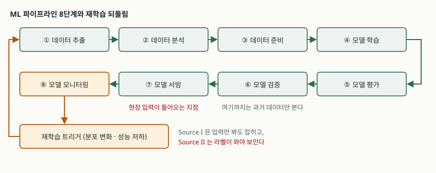

## 들어가며

모델을 올린 뒤 석 달이 지났는데 아무도 손대지 않았다. 코드는 그대로고 장애도
없었으니 시스템은 정상이다. 그런데 현업에서 "요즘 예측이 안 맞는다"는 말이 돈다.
배포한 바이너리가 똑같은데 품질이 떨어지는 이 현상은 전통적인 소프트웨어에는
없던 고장 방식이다. 시험에서는 **MLOps 파이프라인의 구성**과 **드리프트의 종류를
나누는 기준**, 그리고 **무엇을 감시해야 각 종류가 잡히는지**를 묶어 묻는다.

## 정의

**MLOps** 는 기계학습 시스템의 개발과 운영을 한 흐름으로 묶어, 학습 파이프라인
자체를 자동화·반복 실행 가능한 산출물로 다루는 공학 실무다.

**개념 드리프트**(concept drift)는 시점 t 와 t+1 사이에 입력과 정답의 결합확률이
달라지는 현상이다. 기호로 쓰면 **P_t(X,y) ≠ P_t+1(X,y)** 이고, 이 결합확률은
**P(X) × P(y|X)** 로 분해된다 (Lu et al., IEEE TKDE 2019).

## 등장 배경

전통적인 소프트웨어는 입력이 바뀌어도 같은 입력에 같은 출력을 낸다. 기계학습
시스템은 다르다. 판단 기준이 코드가 아니라 **학습 당시의 데이터 분포**에 들어 있어,
세상이 바뀌면 코드를 건드리지 않아도 틀리기 시작한다.

미국 표준기술연구소의 AI 위험관리 프레임워크는 이것을 전통적 소프트웨어 위험과
구별되는 항목으로 따로 적는다. 데이터·모델·개념 드리프트 때문에 **AI 시스템은
유지보수 주기와 교정 유지보수 발동 조건이 더 자주 필요하다**는 것이다.
그래서 같은 문서의 측정 항목(MEASURE 2.4)은 운영 중에 시스템의 동작을 감시하라고
요구하고, 관리 항목(MANAGE 4.1)은 배포 후 감시 계획을 수립해 시행하라고 요구한다.

## 구성요소 — ML 파이프라인 8단계

구글 클라우드의 MLOps 아키텍처 문서는 파이프라인을 **8단계**로 나눈다.

1. 데이터 추출 → 2. 데이터 분석 → 3. 데이터 준비 → 4. 모델 학습 →
5. 모델 평가 → 6. 모델 검증 → 7. 모델 서빙 → 8. 모델 모니터링

같은 문서는 성숙도를 **3단계**로 나눈다. 레벨 0은 전 단계를 사람이 수작업으로
돌리는 상태, 레벨 1은 파이프라인이 자동 실행되어 **모델이 아니라 학습 파이프라인
자체를 배포**하는 상태, 레벨 2는 파이프라인 구성요소까지 CI/CD로 빌드·배포하는
상태다. 레벨 0과 레벨 1을 가르는 것은 "무엇을 배포물로 보느냐"다.

재학습을 거는 **트리거는 5가지**다. 수동 실행, 일정 주기, 새 학습 데이터 도착,
성능 저하 감지, 데이터 분포의 유의미한 변화다. 뒤의 둘이 드리프트 대응이다.

## 도식

> **출처**: [Google Cloud — MLOps: Continuous delivery and automation pipelines in machine learning, "Data science steps for ML" · "ML pipeline triggers"](https://docs.cloud.google.com/architecture/mlops-continuous-delivery-and-automation-pipelines-in-machine-learning)

## 드리프트의 발생원 3가지와 유형 4가지

결합확률을 분해하면 바뀔 수 있는 자리가 둘이므로, 발생원은 **3가지**로 갈린다.

| 구분 | 무엇이 바뀌나 | 통용되는 이름 |
|---|---|---|
| Source Ⅰ | P(X) 만 바뀌고 P(y\|X) 는 그대로 | 가상 드리프트 (데이터 드리프트) |
| Source Ⅱ | P(y\|X) 가 바뀌고 P(X) 는 그대로 | 실제 드리프트 (개념 드리프트) |
| Source Ⅲ | 둘이 함께 바뀐다 | 현실에서 가장 흔한 경우 |

변화가 일어나는 **모양으로 나누면 4가지**다. 급격(sudden), 점진(gradual),
증분(incremental), 재발(reoccurring)이다. 앞의 셋은 정확도 하락 폭을 줄이고 빨리
회복하는 것이 과제고, 재발은 과거 개념을 보관해 두었다가 맞는 것을 빨리 찾는 것이
과제다.

탐지 절차는 **4단계**로 정리된다. 데이터 확보 → 데이터 모델링(선택) →
검정통계량 계산 → 가설 검정이다.

## 둘을 나누는 이유 — 직접 재어 본 결과

발생원을 나누는 것이 분류를 위한 분류인지 확인하려고, 같은 모델에 Source Ⅰ·Ⅱ·Ⅲ 을
각각 먹여 보았다. 2차원 입력에 선형 경계를 둔 모델이고, 표본은 각 20,000건,
시드는 고정했다. 전체 소스: [`code/`](code/) · 실행 기록: [`code/output.txt`](code/output.txt)

| 상황 | PSI(x1) | 예측 양성비율 | 정확도 |
|---|---:|---:|---:|
| 기준 시점 t | 0.0000 | 0.5026 | 1.0000 |
| Source Ⅰ — 입력 분포만 이동 | 1.3126 | 0.8417 | 1.0000 |
| Source Ⅱ — 참 경계만 변경 | 0.0007 | 0.5000 | 0.5022 |
| Source Ⅲ — 둘이 함께 | 1.3476 | 0.8455 | 0.6664 |

PSI 는 기준 표본의 10분위로 구간을 잡고 구간별 비율 차이를 합산한 값이다
(`Σ (현재비율 − 기준비율) × ln(현재비율 ÷ 기준비율)`).

갈리는 지점이 분명하다. **Source Ⅰ 은 입력 감시가 크게 울리는데 정확도는 1.0000
그대로였다.** 분포는 옮겨 갔지만 판단 기준은 그대로라 모델이 틀릴 이유가 없다.
반대로 **Source Ⅱ 는 PSI 가 0.0007 로 사실상 0인데 정확도가 0.5022 까지 떨어졌다.**
입력만 보는 감시로는 이 사고를 끝까지 못 잡는다.

라벨 없이 잴 수 있는 **예측 양성비율**도 Source Ⅱ 에서는 0.5000 으로 기준(0.5026)과
거의 같았다. 즉 이 경우는 **정답 라벨이 도착해야만 보인다.** 라벨이 몇 주 뒤에
오는 업무라면 그 기간만큼 틀린 채로 서비스된다.

## 적용 시 고려사항

**감시 지표를 두 층으로 깐다.** 입력 분포 지표는 라벨 없이 즉시 잴 수 있으니 빠른
경보에 쓰고, 정확도·손실 같은 성능 지표는 느리지만 Source Ⅱ 를 잡는 유일한 수단이니
반드시 함께 건다. 한쪽만 두면 위 표의 어느 한 줄을 통째로 놓친다.

**라벨 도착 지연을 설계 변수로 다룬다.** 라벨이 늦는 업무에서는 성능 저하를 알았을
때 이미 손실이 쌓여 있다. 대리 지표(사용자 이탈, 재작업률, 이의 제기 건수)를 두거나,
일부 트래픽에 사람 검수를 붙여 라벨을 빨리 확보하는 경로를 따로 만든다.

**경보 임계값을 상황 수에 맞춰 보정한다.** Source Ⅰ 의 PSI 는 1.31 이지만 그 상황에서
모델은 멀쩡했다. 분포 경보를 그대로 재학습 트리거로 쓰면 바꿀 필요 없는 모델을
계속 재학습한다. 분포 경보는 **조사 착수 신호**로 쓰고, 재배포 여부는 성능 지표로
판단하는 편이 비용이 적다.

**재학습이 항상 답은 아니다.** Source Ⅱ 처럼 판단 기준 자체가 바뀌었다면 새 개념의
라벨이 충분히 쌓이기 전에는 재학습해도 과거와 현재가 섞인 모델이 나온다. 재발형
드리프트라면 과거 모델을 보관했다가 되돌리는 쪽이 빠르다.

## 정리

- MLOps 파이프라인 **8단계**, 성숙도 **3단계**, 재학습 트리거 **5가지**. 레벨 1의 핵심은
  배포물이 모델에서 **학습 파이프라인**으로 바뀌는 것이다.
- 드리프트 발생원 **3가지**는 P(X,y) = P(X) × P(y|X) 의 분해에서 나온다.
  유형은 모양으로 **4가지**(급격·점진·증분·재발), 탐지 절차는 **4단계**다.
- 암기 단서: **8-3-5 / 3-4-4**. 파이프라인 8·성숙도 3·트리거 5, 발생원 3·유형 4·탐지 4.
- 둘을 나누는 실익은 감시 설계에 있다. 입력 감시는 Source Ⅰ 을, 성능 감시는
  Source Ⅱ 를 잡는다. 둘 중 하나만 걸면 반쪽이다.

## 참고 자료

- [J. Lu et al., "Learning under Concept Drift: A Review", IEEE Transactions on Knowledge and Data Engineering 31(12), 2019 (arXiv:2004.05785)](https://arxiv.org/abs/2004.05785)
- [NIST AI 100-1, Artificial Intelligence Risk Management Framework (AI RMF 1.0), 2023 — MEASURE 2.4 · MANAGE 4.1 · Appendix B](https://nvlpubs.nist.gov/nistpubs/ai/NIST.AI.100-1.pdf)
- [Google Cloud — MLOps: Continuous delivery and automation pipelines in machine learning](https://docs.cloud.google.com/architecture/mlops-continuous-delivery-and-automation-pipelines-in-machine-learning)
