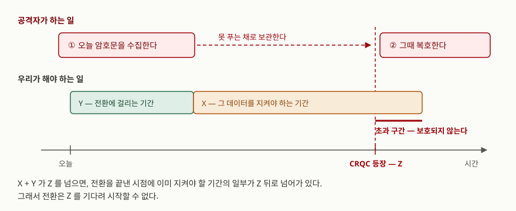

> **실행 검증 없음.** NIST 표준 문서와 공개 보고서의 정의·수치를 정리한 개념 글이다.
> 측정값이나 실행 출력은 싣지 않는다.

## 들어가며

양자컴퓨터 이야기가 나오면 답안에서 가장 흔히 보는 문장이 "아직 멀었다"다. 실제로
NIST도 현재 보안 수준을 위협하는 양자컴퓨터는 없다고 적는다. 그런데 같은 문서가
바로 다음 문단에서 **지금 시작하라**고 쓴다.

모순처럼 보이는 이 두 문장이 이 주제의 핵심이다. 암호 전환은 깨지는 날에 맞춰
하는 일이 아니다. 오늘 오간 암호문은 공격자가 그대로 복사해 보관할 수 있고,
**푸는 일은 나중에 해도 되기 때문이다.** 시험에서 점수가 갈리는 지점도 알고리즘
이름이 아니라 이 시간 구조를 설명하는가에 있다.

## 정의

**양자 내성 암호(PQC, Post-Quantum Cryptography)** 는 고전 컴퓨터에서 동작하면서
양자컴퓨터를 가진 공격자에게도 안전하도록 설계된 공개키 암호다. 양자컴퓨터로
구현하는 암호(양자 암호·QKD)와 다르다. 기존 서버·단말·라이브러리에서 그대로 돌아간다.

NIST는 깨뜨리는 쪽을 **암호학적으로 유의미한 양자컴퓨터(CRQC)** 로 부르고,
용어집에서 "일반 컴퓨터로는 공격이 불가능한 실제 암호 시스템을 실제로 공격할 수
있는 양자컴퓨터"로 정의한다. CRQC는 아직 없다는 것이 NIST의 기술 현황 판단이다.

## 등장 배경

공개키 암호가 흔들리는 이유는 **공개키와 대칭키가 받는 타격이 다르기** 때문이다.

- RSA·ECDSA·DH의 안전성은 소인수분해와 이산대수에 기대는데, 이 두 문제는
  양자 알고리즘으로 다항시간에 풀린다. 키를 늘려도 지수적 이득이 사라진다.
- AES·SHA 같은 대칭키·해시는 탐색 속도가 제곱근으로 빨라지는 수준이라
  **키 길이를 올리는 것으로 대응된다.** 그래서 NIST 전환 문서도 대칭키는 별도
  절에서 짧게 다루고, 공개키 쪽에 기한을 건다.

여기에 시간 구조가 겹친다. NIST는 과거 암호 전환이 10년 넘게 걸렸고 이번은 더
복잡하다고 적는다. 전환에 10년이 걸리는데 지켜야 할 데이터의 수명이 20년이면,
CRQC가 20년 뒤에 나와도 이미 늦는다.

## 구성요소 — 표준 3종과 전환 절차 4단계

### NIST 표준 3종 (2024-08-13 확정)

| 표준 | 알고리즘 | 용도 | 수학적 기반 | 파라미터 세트 |
|---|---|---|---|---|
| FIPS 203 | ML-KEM | 키 캡슐화 | Module-LWE (격자) | 3개 |
| FIPS 204 | ML-DSA | 전자서명 | 격자 | 3개 |
| FIPS 205 | SLH-DSA | 전자서명 | 해시 | 12개 |

서명 표준이 둘인 것이 이 구성의 설계 의도다. ML-DSA가 주력이고, SLH-DSA는 격자
문제 자체가 흔들릴 경우를 대비한 **다른 수학에 기반한 예비책**이다. 키 설정 쪽에도
같은 이유로 격자가 아닌 HQC가 2025년에 추가 표준화 대상으로 선정됐다.

### 전환 절차 4단계

1. **적용 사례별로 위협을 나눈다.** NIST는 코드 서명, 사용자·기기 인증,
   네트워크 보안 프로토콜, 이메일·문서 서명/암호화의 **4가지 사례**를 나눠 다룬다.
2. **키 설정을 먼저 바꾼다.** 인증은 수행 시점에만 안전하면 되지만 기밀성은
   나중에 깨진다. NIST도 TLS·IKE 같은 대화형 프로토콜의 키 설정 전환을
   우선하겠다고 적는다.
3. **하이브리드를 경유한다.** 고전 알고리즘과 PQC를 함께 써 **둘 중 하나만
   안전해도 안전하도록** 구성한다. 다만 NIST는 이것을 일시적 조치로 보고,
   뒤에 PQC 전용으로 가는 **두 번째 전환**이 따라온다고 적는다.
4. **기한 안에 끝낸다.** 2030년과 2035년이 기준선이다.

## 도식 — 왜 지금 시작해야 하는가

> **출처**: [NIST IR 8547 ipd §3 Migration Considerations](https://csrc.nist.gov/pubs/ir/8547/ipd) (Mosca 정리와 "harvest now, decrypt later" 서술)

NIST가 인용하는 **Mosca 정리**는 세 기간으로 판단한다. 데이터를 지켜야 하는 기간을
X, 전환에 걸리는 기간을 Y, CRQC가 나오기까지를 Z라 할 때 **X + Y가 Z를 넘기 전에
전환을 시작해야 한다.** 세 값 중 조직이 통제할 수 있는 것은 Y뿐이고, Z는 추정조차
어렵다. 그래서 답은 "Z를 기다린다"가 아니라 "Y를 지금 줄인다"가 된다.

이 그림이 그대로 **"harvest now, decrypt later"** 위협이다. 공격자는 오늘 암호문을
모아 두기만 하면 되고, 푸는 일은 Z 이후로 미룰 수 있다. NIST는 정부 기밀이나
의료 기록처럼 장기 기밀성이 필요한 데이터에서 이 위협이 특히 크다고 적는다.

## 비교

### 세 알고리즘

| | ML-KEM-768 | ML-DSA-65 | SLH-DSA-SHA2-128s |
|---|---|---|---|
| 용도 | 키 캡슐화 | 서명 | 서명 |
| 기반 | 격자 (Module-LWE) | 격자 | 해시 |
| 공개키 | 1,184 바이트 | 1,952 바이트 | 32 바이트 |
| 전송물 | 암호문 1,088 바이트 | 서명 3,309 바이트 | 서명 7,856 바이트 |
| 특징 | 공유 비밀은 32 바이트 고정 | 범용 주력 | 서명이 가장 크다 |

크기 수치는 각 표준의 파라미터 절에 실린 값이다(FIPS 203 Table 3, FIPS 204 Table 2,
FIPS 205 Table 2). SLH-DSA는 공개키가 32바이트로 가장 작은데 서명은 가장 크다.
같은 128비트 범주에서도 빠른 쪽(`128f`)을 고르면 서명이 17,088바이트가 된다.
**속도와 크기를 맞바꾸는 선택지가 12개 파라미터 세트로 펼쳐져 있는 것**이다.

### 고전 암호와의 대비

| | RSA-2048 / ECDSA P-256 | PQC |
|---|---|---|
| 깨지는 원리 | 소인수분해·이산대수 | 해당 없음 (격자·해시) |
| 서명 크기 | 256 / 64 바이트 | 3,309 바이트 (ML-DSA-65) |
| 전환 기한 | 2030년 이후 deprecated, 2035년 이후 disallowed | — |

여기서 **deprecated와 disallowed를 구분하는 것이 답안 포인트**다. NIST 용어집은
deprecated를 "쓸 수는 있으나 사용자가 일정 보안 위험을 감수해야 하는 상태",
disallowed를 "암호 보호 적용에 더는 허용되지 않는 상태"로 정의한다. 2030년은
금지선이 아니라 경고선이다.

기한의 적용 범위도 두 갈래다. 전환 보고서의 표는 112비트 강도(RSA-2048, P-256 급)를
**2030년 이후 deprecated, 2035년 이후 disallowed**로, 128비트 이상은 **2035년 이후
disallowed**로 적는다. 즉 키를 늘려도 2035년이라는 최종 기한은 그대로다.

## 적용 시 고려사항

- **인증과 기밀성의 기한을 같이 잡지 않는다.** 인증은 수행 시점에만 안전하면
  되므로 CRQC가 나올 때까지 고전 알고리즘을 쓸 여지가 있지만, 기밀성은 오늘
  보낸 것이 뒤에 깨진다. 전환 비용이 한정돼 있으면 키 설정부터 쓴다.
- **크기 증가가 프로토콜을 먼저 건드린다.** 서명이 64바이트에서 3,309바이트가
  되면 인증서 체인, TLS 핸드셰이크 패킷, 펌웨어 서명 영역, 스마트카드 저장 공간이
  차례로 걸린다. 알고리즘 교체보다 **이 제약을 가진 구성요소를 찾아내는 일**이
  일정의 대부분을 차지한다.
- **하이브리드는 목적지가 아니라 경유지다.** 둘 중 하나만 안전해도 되는 성질을
  얻는 대신 구현과 아키텍처가 복잡해지고 비용·보안 위험이 늘어난다. NIST도
  이것을 일시적 조치로 보고 두 번째 전환을 예고한다. 그러니 하이브리드 도입
  시점에 **그것을 걷어낼 계획을 같이 세운다.**
- **교체 가능하게 만든다(크립토 애자일리티).** 표준이 하나 더 추가되는 중이고
  (HQC 선정) 서명 쪽도 예비책을 둘로 가져간다. 알고리즘을 코드에 박지 말고
  설정으로 빼 두어야 다음 전환에서 같은 비용을 다시 치르지 않는다.

## 정리

- PQC는 **고전 컴퓨터에서 도는** 양자 내성 공개키 암호다. QKD와 구분한다.
- 표준은 **3종**이다 — FIPS **203**(ML-KEM, 키 캡슐화), **204**(ML-DSA, 서명),
  **205**(SLH-DSA, 서명). 번호 순서대로 키 → 격자 서명 → 해시 서명으로 외운다.
- 기준은 **X + Y > Z**다. 통제 가능한 값은 Y뿐이라 지금 시작한다.
- 기한은 **2030 / 2035**다. 2030은 deprecated(경고), 2035는 disallowed(금지).
- 절차는 **4단계** — 사례별 위협 구분 → 키 설정 우선 → 하이브리드 경유 → 기한 완료.

## 참고 자료

- [NIST FIPS 203 — Module-Lattice-Based Key-Encapsulation Mechanism Standard (2024-08-13)](https://csrc.nist.gov/pubs/fips/203/final) — §8 Parameter Sets, Table 3 Sizes
- [NIST FIPS 204 — Module-Lattice-Based Digital Signature Standard (2024-08-13)](https://csrc.nist.gov/pubs/fips/204/final) — Table 2 Sizes
- [NIST FIPS 205 — Stateless Hash-Based Digital Signature Standard (2024-08-13)](https://csrc.nist.gov/pubs/fips/205/final) — §11 Parameter Sets, Table 2
- [NIST IR 8547 ipd — Transition to Post-Quantum Cryptography Standards (2024-11-12)](https://csrc.nist.gov/pubs/ir/8547/ipd) — §3 Migration Considerations, §3.2 PQC-Classical Hybrid Protocols, §4.1 전환 일정표, Appendix A Glossary
- [NIST Post-Quantum Cryptography Project](https://csrc.nist.gov/projects/post-quantum-cryptography) — HQC 추가 표준화 선정
