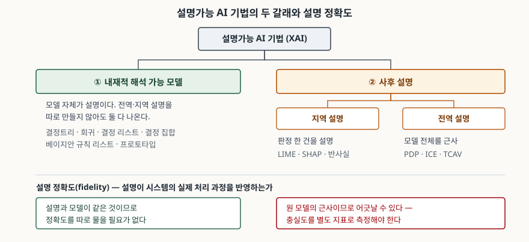

> **실행 검증 없음.** 개념·표준 정리 글이라 실행 예제가 없다. 아래 내용은 NIST IR
> 8312(2021)과 ISO/IEC TS 6254:2025 등 공개 자료의 기술을 근거로 정리했고,
> 성능 수치나 측정값은 싣지 않는다.

## 들어가며

대출 심사나 의료 영상 판독에 모델을 넣으면 "왜 거절됐는지 설명하라"는 요구가
따라온다. 규제 쪽에서도 같은 요구가 온다. 그래서 보통 LIME이나 SHAP 같은 도구를
붙여 기여도 그래프를 뽑고, 그것으로 설명 요구를 충족했다고 본다.

그런데 그 그래프가 **모델이 실제로 그렇게 판정한 근거인지**는 별개 문제다. 사후
설명 도구는 원 모델을 바깥에서 두드려 보고 근사한 결과물이고, 근사는 어긋날 수
있다. 이 어긋남을 이용해 편향을 숨기는 공격까지 보고돼 있다.

시험에서 XAI는 "기법을 분류하고 각각의 한계를 쓰라"는 형태로 나온다. 이름을
나열하는 데서 끝나면 점수가 붙지 않는다. **무엇을 기준으로 갈라지는지**와 **그
갈래마다 설명을 얼마나 믿을 수 있는지**가 답안의 축이다.

## 정의

설명가능 AI(XAI)는 **AI 시스템이 산출물에 대한 근거를 함께 제시하고, 그 근거가
의도한 사용자에게 이해되며 시스템의 실제 처리 과정을 반영하도록 하는 속성과
그 속성을 달성하는 기법의 총칭**이다.

NIST IR 8312는 이것을 네 가지 원칙으로 끊어 정의한다. 답안 첫 줄에는 위 한 문장을
쓰고, 바로 아래에 네 원칙을 붙이는 편이 안전하다.

| 원칙 | 요구 |
|---|---|
| 설명(Explanation) | 산출물과 함께 증거나 근거를 제시한다 |
| 유의미성(Meaningful) | 의도한 소비자가 이해할 수 있는 설명을 제시한다 |
| 설명 정확도(Explanation Accuracy) | 설명이 산출의 이유를 올바르게 반영하거나 시스템의 처리 과정을 정확히 반영한다 |
| 지식 한계(Knowledge Limits) | 설계된 조건에서만, 그리고 산출에 충분한 확신이 있을 때만 동작한다 |

> **출처**: [NIST IR 8312 §2 Four Principles of Explainable AI](https://doi.org/10.6028/NIST.IR.8312)

이 표에서 **세 번째 원칙이 이 글의 전부**다. 같은 문서가 앞 두 원칙만으로는
"설명이 시스템의 산출 과정을 올바르게 반영할 것을 요구하지 않는다"고 명시한다.
즉 이해하기 쉽고 그럴듯한 설명은 처음 두 원칙만 만족시킨 채로도 만들어진다.

## 등장 배경

세 가지가 겹쳐 생겼다.

1. **모델 쪽**: 심층 신경망이 성능에서 앞서면서, 판정 근거를 사람이 읽을 수 있는
   형태로 꺼낼 수 없는 모델이 실무에 들어왔다.
2. **제도 쪽**: NIST IR 8312는 각주에서 미국 공정신용보고법(FCRA)과 EU GDPR
   제13조를 들어, 설명 요구가 규제에서 온다는 점을 짚는다.
3. **표준 쪽**: ISO/IEC JTC 1/SC 42가 ISO/IEC TS 6254:2025를 펴냈다. ISO 카탈로그는
   이 문서를 기계학습 모델·AI 시스템의 설명가능성 목표를 달성하기 위한 접근법과
   방법, 그리고 그것을 수명주기에 적용하는 지침을 다루는 기술 명세로 소개한다.

여기서 구분해 둘 것이 하나 있다. **설명 정확도는 판정 정확도와 다른 개념이다.**
NIST 문서가 이 둘을 명시적으로 떼어 놓는다. 모델이 옳게 판정했는지와, 그 판정의
설명이 모델의 실제 경로를 그리고 있는지는 서로 독립이다.

## 구성요소 — 두 갈래, 그리고 사후 설명의 두 하위 갈래

NIST IR 8312는 XAI 알고리즘을 **두 범주**로 조직한다.

**① 내재적 해석 가능 모델 (self-interpretable models)** — 모델 자체가 설명이다.
사람이 모델(또는 모델의 표현)을 직접 읽어 해석할 수 있다. 전역 설명이 되는 동시에,
입력 하나를 모델에 통과시켜 보면 그 건에 대한 지역 설명도 나온다. 문서가 드는 예는
결정트리, 회귀(로지스틱 회귀 포함), 결정 리스트, 결정 집합, 베이지안 규칙 리스트,
프로토타입이다.

**② 사후 설명 (post-hoc explanations)** — 별도의 도구가 알고리즘을 기술·설명·모형화해
동작 방식의 상을 준다. 내부를 몰라도 **입력을 골라 출력을 질의할 수 있기만 하면**
적용된다. 이 범주는 다시 둘로 나뉜다.

- **지역 설명 (local)**: 판정 한 건, 또는 입력의 일부 집합을 설명한다.
  - LIME — 판정 한 건을 두고 **주변 점들을 질의해** 그 지역을 대표하는 해석 가능
    모델(기본값은 로지스틱 회귀)을 세우고 거기서 특성별 설명을 뽑는다.
  - SHAP — 특성을 참가자로, 시스템 출력을 보수로 놓아 **협조적 게임**으로 바꾼 뒤
    섀플리 값을 구해 특성별 기여도를 낸다.
  - 반사실(counterfactual) — "입력이 이렇게 달랐다면 판정이 달라졌을 것"을 제시한다.
    내부를 드러내지 않으므로 지식재산을 보호하는 성질이 있다.
- **전역 설명 (global)**: 알고리즘 전체를 대상으로 근사 모델을 만든다.
  - PDP(부분 의존도 그래프) — 특성 값이 바뀔 때 예측 응답의 한계 변화를 보인다.
    관계가 선형인지 더 복잡한지 판별하는 데 쓴다.
  - ICE — 데이터 사례마다의 한계 효과를 잘게 그린다. PDP가 보인 관계가 모든 사례에서
    같은지 확인하고 상호작용을 짚는 데 쓴다.
  - TCAV — 신경망 상태를 사람이 이해하는 개념의 선형 가중으로 표현한다.
  - 지역 설명을 모아 요약하는 방식(SP-LIME 등)도 전역 설명이 된다.

## 도식

> **출처**: [NIST IR 8312 §6 Overview of Explainable AI Algorithms](https://doi.org/10.6028/NIST.IR.8312) — §6.1 Self-Interpretable Models, §6.2.1 Local Explanations, §6.2.2 Global Explanations

답안지에는 박스 다섯 개(뿌리·내재적·사후·지역·전역)만 그리고 기법 이름은 박스 밑에
글로 적는다. 아래 띠(설명 정확도)를 빼먹지 않는다. 분류만 그리면 흔한 계통도가 되고,
저 띠가 붙어야 이 문제에 답한 그림이 된다.

## 비교 — 두 갈래가 갈리는 네 축

| 축 | ① 내재적 해석 가능 모델 | ② 사후 설명 |
|---|---|---|
| 설명의 출처 | 모델 자체가 설명 | 별도 도구가 생성한 근사 |
| 적용 조건 | 모델을 그 형태로 **먼저 설계**해야 한다 | 입력에 대한 출력을 질의할 수 있으면 된다 |
| 설명 정확도 | 설명과 모델이 같으므로 어긋날 여지가 없다 | **근사이므로 어긋날 수 있다.** 충실도를 따로 측정해야 한다 |
| 범위 | 전역·지역이 동시에 나온다 | 지역과 전역을 따로 만들어야 한다 |

성능과 해석성이 맞바꾸기 관계인지에 대해서는 **정리된 결론이 없다.** NIST 문서는
해석 가능 모델의 판정 정확도가 낮다는 견해를 소개하면서, 루딘(Rudin) 등이 반드시
그런 맞바꾸기가 있는 것은 아니며 많은 경우 정확도 손실 없이 해석 가능 모델을 쓸 수
있다고 반박한다는 점을 함께 적는다. 답안에서는 단정하지 말고 쟁점으로 쓴다.

## 설명을 공격할 수 있다 — 사후 설명의 고유 위험

사후 설명이 근사라는 성질에서 공격면이 생긴다. NIST IR 8312의 설명가능성 공격
항목(§6.3)은, 설명 정확도가 100%가 아니면 적대자가 **입력의 작은 섭동에 대한 분류기
출력을 조작해 시스템의 편향을 숨기는** 데 악용할 수 있다고 적는다. 드는 유형은 넷이다.

1. **설명이 예측을 흉내 내는 것만으로는 부족하다.** 닫힌 모델의 예측을 모사하는
   설명이라도 설명 정확도로는 불충분하며, 사용자를 오도하는 설명이 나올 수 있다.
2. **설명 도구를 겨냥한 비계(scaffolding).** 원래 분류기와 모든 입력 사례에서 같은
   분류를 내지만 작은 섭동에 대해서는 출력을 바꾸는 구조를 덧씌운다. LIME처럼
   **훈련 사례와 비슷한 점들을 질의하는 도구**를 상정하고 그런 질의에만 다른 규칙으로
   답하게 만들면, 지역 질의만으로는 전역 거동을 가릴 수 있다.
3. **페어워싱(fairwashing).** 닫힌 모델을 근사하되 더 공정한 해석 가능 모델들의
   앙상블을 만들어, 원 모델의 불공정성을 가린다.
4. **입력 불변성 결여.** 많은 중요도 지도(saliency) 설명은 입력의 작은 변화에
   출력과 픽셀 귀속이 크게 달라진다.

**이 절이 이 주제에서 가장 배점이 큰 자리다.** "사후 설명은 근사라서 틀릴 수 있다"는
일반론에서 멈추지 말고, 틀림을 **의도적으로 만들어 낼 수 있다**는 데까지 써야
한계를 안다고 평가된다.

## 적용 시 고려사항

- **설명 정확도를 측정 항목으로 삼는다.** NIST 문서는 이를 충실도(fidelity) 연구와
  이어 놓고, 시스템 출력을 정답으로 두고 사후 설명 모델을 기계학습 지표로 평가하는
  방식, 사람이 건전성 검사를 하는 방식, 설명이 지목한 특성을 지우거나 바꿔 가며
  출력 변화를 재는 방식을 든다. **설명 도구를 붙였다는 사실 자체는 지표가 아니다.**
- **위험 등급이 높은 판정에는 내재적 해석 가능 모델을 먼저 검토한다.** 설명이
  어긋날 여지를 구조적으로 없애는 유일한 길이다. 성능 손실을 당연한 전제로 깔지
  말고, 그 영역에서 해석 가능 모델이 실제로 얼마나 떨어지는지를 재서 판단한다.
- **설명의 수신자를 먼저 정한다.** NIST 문서는 설명을 목적(purpose)과 방식(style)
  두 속성으로 특징짓고, 방식의 요소로 **상세 수준·상호작용 정도·형식 세 가지**를 든다.
  상호작용 정도는 선언형 · 단방향 · 양방향 세 단계이며, 현재 대부분의 XAI 기법은
  선언형이다. 규제기관·개발자·당사자가 요구하는 설명은 서로 다른 지점에 놓인다.
- **지식 한계를 산출에 포함시킨다.** 네 번째 원칙이다. 설계 범위 밖의 입력이거나
  확신이 임계값에 못 미치면 **답을 내지 않고 그 사실을 알리는 것**이 곧 설명이다.
  설명 기능만 붙이고 이 경로를 빼면 원칙 하나가 통째로 빠진 설계가 된다.

## 정리

암기 단서는 **"2-2-4-4"**로 묶는다.

- **2** — 기법은 두 갈래다. 내재적 해석 가능 모델 / 사후 설명.
- **2** — 사후 설명은 두 하위 갈래다. 지역(LIME·SHAP·반사실) / 전역(PDP·ICE·TCAV).
- **4** — NIST IR 8312의 네 원칙. 설명 · 유의미성 · 설명 정확도 · 지식 한계.
- **4** — 사후 설명을 겨냥한 공격 네 유형. 예측 모사의 불충분 · 비계 · 페어워싱 ·
  입력 불변성 결여.

여기에 한 문장을 더 붙여 닫는다. **설명 정확도는 판정 정확도와 다른 개념이며,
내재적 모델에서는 물을 필요가 없고 사후 설명에서는 반드시 따로 측정해야 한다.**

## 참고 자료

- [NIST IR 8312 — Four Principles of Explainable Artificial Intelligence (2021-09)](https://doi.org/10.6028/NIST.IR.8312) — §2 네 원칙, §3 Purposes and styles of explanations, §6 Overview of Explainable AI Algorithms, §6.3 Adversarial Attacks on Explainability, §7.2 Evaluating Explanation Accuracy
- [NIST IR 8312 본문 PDF](https://nvlpubs.nist.gov/nistpubs/ir/2021/NIST.IR.8312.pdf)
- [ISO/IEC TS 6254:2025 — 카탈로그 항목 (ISO/IEC JTC 1/SC 42)](https://www.iso.org/standard/82148.html)
