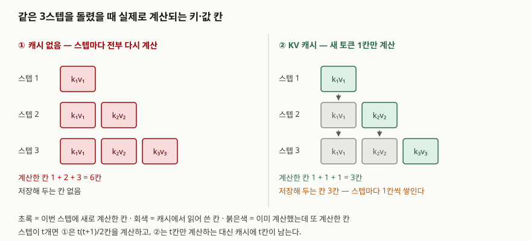

## 들어가며

LLM 문항은 이제 "무엇인가"에서 "왜 비싼가"로 옮겨 갔다. 긴 문맥을 지원한다는
기능 요구가 들어오면 제일 먼저 막히는 곳이 GPU 메모리이고, 그 메모리를 차지하는
것이 모델 가중치가 아니라 KV 캐시인 경우가 흔하다. 시험에서는 양자화·서빙 구조·
긴 문맥 처리를 묻는 문항의 공통 배경으로 깔리고, 답안에서 "캐시가 문맥 길이에
비례한다"는 한 줄을 쓸 수 있는지가 점수를 가른다.

이 글은 캐시가 왜 생겼는지, 크기가 무엇에 비례하는지, 줄이는 수단이 각각 무엇을
대가로 내놓는지를 순서대로 정리한다.

## 정의

**KV 캐시는 트랜스포머 디코더가 토큰을 하나씩 생성할 때, 앞선 스텝에서 계산한
각 레이어의 키·값 텐서를 메모리에 보관해 다음 스텝에서 다시 쓰는 구조다.**

이 구조는 샤지어의 빠른 디코딩 논문이 적은 증분 멀티헤드 어텐션(§2.4)에
그대로 나온다. 함수가 이전 스텝까지의 키·값(`prev_K`, `prev_V`)을 인자로 받아
이번 토큰의 키·값 한 벌을 덧붙이고 `new_K`, `new_V`를 돌려주는 형태다. 캐시는
별도로 고안된 최적화가 아니라 **증분 디코딩을 수식대로 적으면 따라 나오는
자료구조**라는 점을 답안 첫 줄에 두면 설명이 쉬워진다.

## 등장 배경

캐시가 없으면 스텝마다 지금까지의 모든 토큰에 대해 키·값을 다시 계산해야 한다.
셀프어텐션의 정의상 새 토큰은 앞의 모든 토큰을 봐야 하는데, 앞 토큰들의 키·값은
입력이 바뀌지 않았으므로 **스텝이 달라져도 값이 같다.** 같은 값을 매 스텝 다시
만드는 셈이다.

t개의 토큰을 만들 때 재계산 방식은 1 + 2 + … + t = t(t+1)/2칸을 계산한다.
캐시를 쓰면 t칸이면 끝난다. 대신 그 t칸을 들고 있어야 한다. **연산을 메모리와
맞바꾼 것**이고, 바로 이 교환이 오늘날 서빙의 병목을 메모리 쪽으로 옮겨 놓았다.

같은 논문의 성능 분석 항목(§2.4.1)은 증분 디코딩에서 메모리 접근량 대 연산량의
비를 Θ(n/d + 1/b)로 적는다. n이 문맥 길이, d가 표현 차원, b가 배치 크기다.
n이 d에 가까워지거나 배치가 1에 가까워지면 **연산이 아니라 메모리 대역폭이
주된 병목**이 된다고 적시한다. 캐시가 커지는 문제는 용량만의 문제가 아니라
스텝마다 그만큼을 다시 읽어 와야 하는 대역폭 문제이기도 하다.

## 구성요소 — 캐시 크기를 정하는 6가지

캐시 한 벌의 바이트 수는 **6가지 값의 곱**으로 정해진다. 모델 가중치를 받지
않아도 구조 상수만으로 계산되므로 설계 단계에서 미리 따져 볼 수 있다.

```text
bytes = 2 × L × H_kv × d_h × S × B × e
```

| 기호 | 뜻 | 커지면 |
|---|---|---|
| 2 | 키와 값 두 벌 | 고정 |
| L | 디코더 레이어 수 | 비례 |
| H_kv | 레이어당 키·값 헤드 수 | 비례 |
| d_h | 헤드 하나의 차원 | 비례 |
| S | 문맥 길이(토큰) | 비례 |
| B | 동시에 처리하는 배치 크기 | 비례 |
| e | 원소 하나의 바이트 수 | 비례 |

여섯 값이 **전부 1차로 붙는다**는 점이 중요하다. 어텐션 연산량은 문맥 길이에
제곱으로 붙지만 캐시는 1차로 붙는다. 둘이 다른 비율로 늘어나므로, 문맥을 늘릴
때 먼저 터지는 쪽이 상황에 따라 갈린다.

아래는 레이어 80, 질의 헤드 64, 헤드 차원 128을 **가정한 구성**으로 계산한
값이다. 특정 제품의 공개 수치가 아니라 위 수식에 숫자를 넣은 결과이며, 계산
소스는 [`code/`](code/)에, 돌린 기록은 [`code/output.txt`](code/output.txt)에 있다.

```text
[1] context length vs cache size (batch 1, FP16)
      tokens |            MHA |    GQA(8group) |            MQA
  --------------------------------------------------------------
       1,024 |       2.50 GiB |       0.31 GiB |       0.04 GiB
       4,096 |      10.00 GiB |       1.25 GiB |       0.16 GiB
      16,384 |      40.00 GiB |       5.00 GiB |       0.62 GiB
      65,536 |     160.00 GiB |      20.00 GiB |       2.50 GiB
     131,072 |     320.00 GiB |      40.00 GiB |       5.00 GiB
```

문맥을 2배로 늘릴 때마다 세 열 모두 정확히 2배가 된다. 배치도 같은 방식으로
붙으므로, 문맥 16,384 토큰에 배치 32를 걸면 MHA 기준 1,280 GiB가 된다.
**가속기 한 장의 메모리로 감당할 수 있는 범위를 한참 넘어선다**는 것이
긴 문맥 서빙에서 캐시가 먼저 문제가 되는 이유다.

## 도식



> **출처**: [Fast Transformer Decoding §2.4 Multihead Attention (Incremental) · §2.4.1 Performance Analysis](https://arxiv.org/abs/1911.02150)

## 비교 — 줄이는 수단 4갈래

캐시를 줄이는 수단은 위 수식에서 **어느 항을 건드리느냐**로 갈린다. 네 갈래이고,
서로 배타적이지 않아 함께 쓰는 경우가 많다.

| 갈래 | 줄이는 항 | 대표 기법 | 대가 |
|---|---|---|---|
| ① 헤드 공유 | H_kv | MQA, GQA | 품질 하락. 모델을 다시 학습하거나 변환해야 한다 |
| ② 차원 압축 | d_h | MLA(잠재 벡터로 압축) | 구조 변경이 필요해 기존 체크포인트에 바로 못 붙인다 |
| ③ 정밀도 축소 | e | KV 양자화 | 양자화 왜곡이 생성 품질에 누적된다 |
| ④ 칸 수 축소 | S | 토큰 선별 삭제, 슬라이딩 윈도 | 지운 토큰은 되살릴 수 없어 긴 의존이 끊긴다 |

①은 질의 헤드 수를 그대로 두고 키·값 헤드만 줄인다. 질의 헤드 64개가 키·값
헤드 하나를 공유하면 MQA, 8그룹으로 묶으면 GQA다. **캐시가 줄어드는 배수는
질의 헤드 수를 키·값 헤드 수로 나눈 값과 정확히 같다** — 앞의 계산에서
GQA(8그룹) 8.0배, MQA 64.0배로 검산했다. GQA 논문은 기존 멀티헤드 체크포인트를
원래 사전학습 연산량의 약 5%로 변환할 수 있고, 중간 개수의 키·값 헤드를 쓰면
MQA 수준의 속도에 멀티헤드에 가까운 품질이 나온다고 보고한다.

②는 키·값을 저차원 잠재 벡터로 눌러 담는다. DeepSeek-V2 논문은 MLA가 같은 계열
67B 모델 대비 KV 캐시를 **93.3%** 줄였다고 적는다.

③은 원소 바이트 수만 건드리므로 구조를 바꾸지 않는다. 앞의 계산에서 FP16 대비
FP8이 2배, INT4가 4배로 줄었다. 다만 **줄어드는 폭이 정해져 있어** 문맥이
길어지는 속도를 혼자 따라잡지 못한다.

④는 캐시 칸 자체를 버린다. 어텐션 점수가 특정 소수 토큰에 쏠린다는 관찰에
기대어 그 토큰과 최근 토큰만 남기는 방식이 대표적이다.

여기에 더해, **줄이는 것이 아니라 낭비를 없애는** 축이 따로 있다. 요청마다
캐시 길이가 들쭉날쭉한데 연속된 큰 덩어리로 미리 잡아 두면 단편화가 생긴다.
PagedAttention 논문은 그 이전 시스템에서 할당한 KV 캐시 메모리 중 실제 토큰
상태를 담는 비율이 **20.4%~38.2%**에 그쳤다고 보고하고, 운영체제의 페이징을
본떠 캐시를 블록 단위로 관리해 그 낭비를 없앤다.

## 적용 시 고려사항

**첫째, 캐시 크기는 설계 단계에서 계산해 둔다.** 위 수식은 곱셈 하나라 모델을
띄우기 전에 답이 나온다. 지원할 최대 문맥 길이와 목표 동시 요청 수를 넣어
보면, 가속기를 몇 장 붙여야 하는지와 어느 갈래를 먼저 써야 하는지가 정해진다.

**둘째, 용량과 대역폭을 따로 본다.** 캐시가 메모리에 들어간다고 끝이 아니다.
스텝마다 캐시 전체를 읽어야 하므로 토큰당 지연은 대역폭에 묶인다. 증분 디코딩의
병목이 대역폭이라는 분석(§2.4.1)이 가리키는 지점이 여기다. 용량만 보고 설계하면
메모리에는 올라가는데 느린 구성이 나온다.

**셋째, 품질 영향은 평가로 확인한다.** ①~④는 전부 무언가를 버린다. 헤드를
공유하면 표현력이, 양자화하면 수치 정밀도가, 토큰을 지우면 긴 의존이 줄어든다.
벤치마크 평균만 보면 차이가 묻히므로, 긴 문맥에서 앞부분 정보를 되짚어야 하는
과제를 따로 두고 재야 한다.

**넷째, 공유 가능한 접두부를 찾는다.** 같은 시스템 프롬프트를 쓰는 요청이
많으면 그 구간의 캐시는 요청마다 같은 값이다. 블록 단위로 관리하면 그 구간을
요청들이 나눠 쓸 수 있어, 줄이는 기법을 쓰지 않고도 실질 사용량이 내려간다.

## 정리

- **정의 한 줄**: 앞 스텝에서 계산한 키·값을 보관해 다시 쓰는 구조.
  연산을 메모리와 맞바꾼 것이다
- **크기 수식 6가지 곱**: 2 × L × H_kv × d_h × S × B × e — 전부 1차로 붙는다
- **줄이는 수단 4갈래**: 헤드 공유(H_kv) · 차원 압축(d_h) · 정밀도 축소(e) ·
  칸 수 축소(S). 수식의 어느 항을 건드리는지로 외우면 빠지는 항목이 없다
- **낭비 제거는 별개 축**: 블록 단위 관리로 단편화와 중복을 없앤다
- **대가는 공통**: 네 갈래 모두 품질이나 구조 변경을 대가로 낸다. 공짜는 없다

> 개념 정리: [대규모 언어 모델(LLM)의 구조와 한계](../2026-10-14-llm-architecture-limits/index.md)

> 기출 답안: [기출문제 — 터보퀀트(TurboQuant) 벡터 양자화](../../exam/2026-10-14-turboquant-vector-quantization/index.md)

## 참고 자료

- [Noam Shazeer, *Fast Transformer Decoding: One Write-Head is All You Need*, arXiv:1911.02150 (2019-11-06)](https://arxiv.org/abs/1911.02150) — §2.4 증분 멀티헤드 어텐션, §2.4.1·§3.1 성능 분석
- [Joshua Ainslie et al., *GQA: Training Generalized Multi-Query Transformer Models from Multi-Head Checkpoints*, arXiv:2305.13245 (2023-05-22, EMNLP 2023)](https://arxiv.org/abs/2305.13245)
- [Woosuk Kwon et al., *Efficient Memory Management for Large Language Model Serving with PagedAttention*, SOSP 2023, arXiv:2309.06180 (2023-09-12)](https://arxiv.org/abs/2309.06180) — §1·§3.1 기존 시스템의 캐시 사용률
- [DeepSeek-AI, *DeepSeek-V2: A Strong, Economical, and Efficient Mixture-of-Experts Language Model*, arXiv:2405.04434 (2024-05-07)](https://arxiv.org/abs/2405.04434) — MLA의 캐시 압축
- [Zhenyu Zhang et al., *H2O: Heavy-Hitter Oracle for Efficient Generative Inference of Large Language Models*, arXiv:2306.14048 (2023-06-24)](https://arxiv.org/abs/2306.14048) — 토큰 선별 삭제
- [Ashish Vaswani et al., *Attention Is All You Need*, arXiv:1706.03762 (2017-06-12)](https://arxiv.org/abs/1706.03762) — §3.2 어텐션 정의
