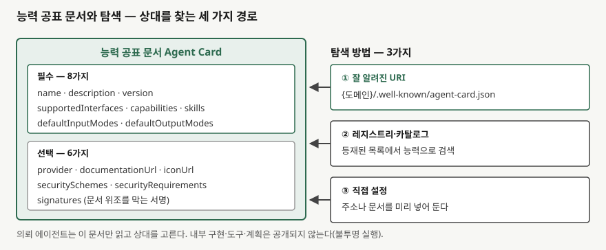
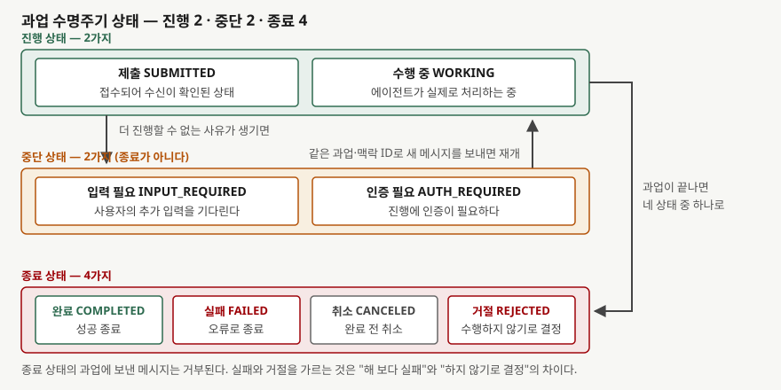

> **실행 검증 없음.** 두 규격의 공개 사양 원문을 근거로 정리했다. 필드 이름과 상태 이름은
> 사양이 정의한 식별자를 그대로 적었고, 구현체를 돌려 확인한 결과는 싣지 않았다.

## 들어가며

판단하는 주체가 여럿인 시스템을 묻는 문제는 대개 "에이전트끼리 협업한다"에서 멈춘 답안이
많이 나온다. 점수가 갈리는 자리는 그다음이다. **서로 다른 조직이 만든 두 에이전트가 상대의
코드를 모르는 채로 어떻게 상대를 찾고, 일을 맡기고, 그 일이 어디까지 갔는지 알아내는가.**
이 질문에 답하려면 규약이 무엇을 정의하는지를 이름 단위로 알아야 한다. 공표 문서의 필드와
과업 상태의 목록이 곧 답안의 항목이 된다.

## 정의

> **에이전트 간 상호운용 프로토콜은 서로 다른 조직·프레임워크가 만든 자율 에이전트가 내부
> 구현을 공개하지 않은 채, 공표된 능력 문서로 상대를 찾아 과업을 맡기고 그 과업의 상태를
> 정해진 집합 안에서 주고받게 하는 통신 규약이다.**

정의에 들어가야 할 말은 **셋**이다. **능력 공표**(상대를 찾는 수단), **과업**(주고받는 단위),
**불투명 실행**(내부를 공개하지 않는다는 제약)이다. 셋 중 하나라도 빠지면 일반적인 API
연동과 구별되지 않는다. 특히 세 번째가 이 규약을 규약이게 만든다. 내부를 열어도 된다면
굳이 능력을 문서로 공표하고 상태를 표준화할 이유가 없다.

대표 규격인 A2A 사양이 설계 원칙으로 드는 것은 **다섯 가지**다. 기존 표준(HTTP, JSON-RPC
2.0, 서버 전송 이벤트)을 재사용하는 **단순함**, 인증·인가·보안·프라이버시·추적·감시를 기존
기업 관행으로 다루는 **기업 적용성**, 오래 걸리는 과업과 사람이 끼어드는 상호작용을 기본으로
삼는 **비동기 우선**, 텍스트·음성·영상·구조화 데이터를 가리지 않는 **양식 비의존**, 그리고
내부 사고 과정·계획·도구 구현을 공유하지 않는 **불투명 실행**이다.

## 등장 배경

문제는 연동 비용이었다. 팀마다 프레임워크마다 벤더마다 따로 만든 에이전트는 서로를 발견할
수단이 없고, 붙이려면 쌍마다 전용 연동을 만들어야 한다. A2A 사양은 이 점대점 연동이 비싸고
혁신을 늦추며 보안 수준도 일관되지 않는다고 적는다. 연결의 개수는 주체 수의 제곱으로 늘어나는데,
그 하나하나에 인증 방식과 오류 처리를 따로 설계해야 한다.

다른 길도 있었다. **에이전트를 그냥 도구로 감싸는 것**이다. 모델-도구 연결 규격 위에 상대
에이전트를 함수처럼 노출하면 호출은 된다. 그러나 A2A 쪽 문서는 에이전트를 단순한 도구로
감싸면 할 수 있는 일이 제한된다고 본다. 도구 호출은 대체로 상태가 없고 한 번의 요청과 응답으로
끝나는데, 다른 에이전트에게 맡긴 일은 며칠이 걸리기도 하고 중간에 사람의 승인을 요구하기도
하며 여러 번 오가며 계획을 바꾸기도 한다. **호출과 위임은 수명이 다르다.** 이 차이가 별도
규약이 생긴 직접적인 이유다.

## 구성요소 — 네 묶음

### 가. 능력 공표 문서 — 필수 8 / 선택 6

A2A 사양에서 능력 공표 문서(Agent Card)는 에이전트가 자기 정체·능력·접점·인증 요구를 적어
공개하는 JSON 문서다. 필수 필드는 **여덟 가지**다.

| 필드 | 무엇을 적는가 |
|---|---|
| `name` / `description` | 이름과 하는 일 |
| `version` | 에이전트 자체의 판 |
| `supportedInterfaces` | 지원하는 접점과 전송 바인딩 |
| `capabilities` | 스트리밍·푸시 알림·확장 카드 지원 여부 |
| `skills` | 수행 가능한 개별 능력 |
| `defaultInputModes` / `defaultOutputModes` | 기본 입출력 양식 |

선택 필드는 **여섯 가지**로 `provider`, `documentationUrl`, `iconUrl`, `securitySchemes`,
`securityRequirements`, `signatures`다. 마지막 `signatures`가 답안에서 쓸모가 크다. 능력
문서가 위조되면 의뢰자가 엉뚱한 상대에게 과업을 넘기므로, 공표 문서 자체에 서명을 붙일 자리를
규격이 미리 둔 것이다.

### 나. 탐색 — 세 경로

상대를 찾는 방법은 **세 가지**다. 도메인의 **잘 알려진 URI**(`/.well-known/agent-card.json`)에서
직접 받는 방법, **레지스트리·카탈로그**에 등재된 목록에서 찾는 방법, 주소나 문서를 미리 넣어
두는 **직접 설정**이다. 앞의 둘은 열린 발견이고 마지막은 닫힌 연동이다. 조직 안에서는 세 번째로
시작해 두 번째로 옮겨 가는 경로가 현실적이다.

> **출처**: [A2A Protocol Specification v1.0.0 — AgentCard 필드 정의, Agent Discovery(`/.well-known/agent-card.json`과 세 가지 탐색 기전)](https://a2a-protocol.org/latest/specification/)

### 다. 주고받는 객체 — 넷

| 객체 | 정의 | 핵심 필드 |
|---|---|---|
| **과업** Task | 서버가 만드는 작업 단위 | `id`(필수), `status`(필수), `contextId`, `artifacts`, `history`, `metadata` |
| **메시지** Message | 한 번의 발화 | `messageId`(필수), `role`(필수, 사용자/에이전트), `parts`(필수), `taskId`, `contextId` |
| **조각** Part | 내용을 담는 그릇 | `text`·`raw`·`url`·`data` 중 **정확히 하나**를 가져야 한다 |
| **산출물** Artifact | 과업의 출력 | `artifactId`(필수), `parts`(필수, 1개 이상) |

조각이 네 종류 중 정확히 하나만 갖도록 규정된 점은 눈여겨볼 만하다. 텍스트든 바이트든 URL이든
구조화 데이터든 같은 자리에 담기므로, 양식이 늘어나도 메시지 구조는 바뀌지 않는다. 앞에서 든
설계 원칙 중 양식 비의존이 구현 수준에서 이렇게 떨어진다.

### 라. 과업 수명주기 — 상태 여덟

상태 열거형은 미정 상태를 포함해 아홉 값이고, 실제로 쓰이는 것은 **여덟 가지**다.

| 분류 | 상태 | 사양의 설명 |
|---|---|---|
| 진행 (2) | `SUBMITTED` | 과업이 제출되어 수신이 확인된 상태 |
| | `WORKING` | 에이전트가 실제로 처리하는 중 |
| 중단 (2) | `INPUT_REQUIRED` | 진행하려면 사용자의 추가 입력이 필요하다 |
| | `AUTH_REQUIRED` | 진행하려면 인증이 필요하다 |
| 종료 (4) | `COMPLETED` | 성공으로 끝났다 |
| | `FAILED` | 오류로 끝났다 |
| | `CANCELED` | 완료 전에 취소됐다 |
| | `REJECTED` | 에이전트가 수행하지 않기로 결정했다 |

규칙은 둘이다. **중단 상태는 종료가 아니다.** 의뢰자는 같은 과업 ID와 맥락 ID를 가리키는 새
메시지를 보내 과업을 이어 간다. 반면 **종료 상태의 과업에 보낸 메시지는 거부된다.**

실패와 거절을 따로 둔 것이 이 목록의 핵심이다. 둘 다 결과물이 없지만 의뢰자가 할 일은 정반대다.
실패는 같은 상대에게 다시 맡길 여지가 있고, 거절은 **상대를 바꾸거나 조건을 바꿔야 한다**는 뜻이다.
단일 주체 설계에서는 이 구분이 함수의 반환값이나 예외 안에 묻혀 있었다.

## 도식

> **출처**: [A2A Protocol Specification v1.0.0 — TaskState 열거형(종료 상태와 중단 상태의 구분), 중단된 과업의 재개 규칙](https://a2a-protocol.org/latest/specification/)

도식은 상태를 세 묶음으로 나눈 분류도다. 상태 사이의 모든 전이를 그리지 않은 것은, 사양이
명시하는 것이 **어느 상태가 종료이고 어느 상태가 중단인지, 중단된 과업을 어떻게 잇는지**이기
때문이다. 답안지에는 상자 여덟 개와 묶음 셋이면 충분하다.

## 비교 — 모델-도구 연결 규격과 어디서 갈리는가

A2A 사양의 부록은 두 규격을 **에이전트 시스템의 서로 다른 측면을 맡는 상호보완적 프로토콜**로
적는다. 모델-도구 연결 규격(MCP)은 모델과 에이전트를 도구·API·데이터 원천에 잇는 쪽을 표준화하고,
A2A는 독립된 에이전트들이 **대등한 주체로서** 통신하고 협업하는 쪽을 표준화한다. 사양이 든 예가
명확하다. 의뢰 에이전트가 수행 에이전트에게 과업을 맡기면, 그 수행 에이전트는 필요한 도구와
데이터에 닿기 위해 모델-도구 규격을 쓴다. **아래로는 도구 규격, 옆으로는 에이전트 규격**이다.

| 비교 축 | 모델-도구 연결 규격 (MCP, 2026-07-28판) | 에이전트 간 규격 (A2A v1.0.0) |
|---|---|---|
| 잇는 대상 | 호스트·클라이언트·서버 (모델 ↔ 도구·데이터) | 의뢰 에이전트 ↔ 수행 에이전트 |
| 상대의 성격 | 판단하지 않는 기능 제공자 | 스스로 판단하는 대등한 주체 |
| 노출 단위 | 자원(Resources)·프롬프트(Prompts)·도구(Tools) | 능력(skills)과 과업(Task) |
| 상호작용 수명 | 요청–응답 중심, 상태 없는 호출 | 비동기 우선, 오래 걸리는 과업과 다회 교환 |
| 상태 모형 | 호출 결과 | 상태 여덟 가지의 수명주기 |
| 탐색 | 호스트 설정에 등록된 서버 | 공표 문서와 레지스트리로 발견 |
| 기반 | JSON-RPC 2.0 메시지 | JSON-RPC·gRPC·HTTP+JSON/REST 바인딩 |
| 내부 공개 | 서버가 제공 기능을 그대로 드러냄 | 불투명 실행 — 내부 계획·도구를 감춘다 |
| 신뢰 원칙 | 사용자 동의와 통제, 도구 설명을 신뢰하지 않음 | 능력 문서 서명, 인증 방식 선언 |

두 규격은 경쟁 관계가 아니다. 답안에서 "MCP 대신 A2A를 쓴다"로 쓰면 틀린다. **한 에이전트가
둘을 동시에 쓴다.**

## 적용 시 고려사항

**① 신원의 단위가 사람에서 에이전트로 바뀐다.** 사용자 계정 하나로 권한을 주던 모델이 통하지
않는다. A2A 사양이 인증 방식으로 API 키, HTTP 인증, OAuth 2.0, OpenID Connect, 상호 TLS
**다섯 가지**를 두고 운영 배포에 암호화 통신을 요구하는 것은, 과업을 맡기는 쪽과 받는 쪽이
서로 다른 조직일 수 있기 때문이다. 어느 에이전트가 어느 범위까지 할 수 있는지를 사람 계정과
분리해 설계한다.

**② 공표 문서를 그대로 믿지 않는다.** 능력 문서는 상대가 스스로 적은 자기소개다. 서명 필드가
규격에 있다고 해서 모든 구현이 서명을 붙이는 것은 아니다. 조직 밖 에이전트를 붙일 때는 서명
검증과 레지스트리 등재를 전제 조건으로 둔다.

**③ 중단 상태를 처리하는 경로를 반드시 만든다.** 입력 필요와 인증 필요는 **실패가 아니다.**
이 둘을 오류로 처리하는 구현은 사람이 승인만 하면 끝날 일을 실패로 떨어뜨린다. 반대로 종료
상태에 메시지를 더 보내는 구현은 거부당한다. 상태별 분기를 코드가 아니라 설계 단계에서 적어 둔다.

**④ 과업 식별자를 축으로 추적을 설계한다.** 과업과 맥락 식별자가 주체를 가로질러 이어지므로,
이 둘을 로그와 추적의 상관 키로 삼으면 위임 경로가 복원된다. 나중에 붙이려면 이미 늦는다.

**⑤ 규약이 정하지 않는 것을 설계로 정한다.** 위임의 깊이 한계, 과업당 재시도 상한, 순환 위임
차단은 규약에 없다. 상태 모형이 있다고 해서 발산이 막히지는 않는다.

## 정리

- **정의 세 요소 — 능력 공표 · 과업 · 불투명 실행.** 셋이 다 들어가야 일반 API 연동과 갈린다
- **능력 공표 문서 — 필수 8 / 선택 6.** 필수는 이름·설명·판·지원 접점·능력·스킬·기본 입력 양식·
  기본 출력 양식, 선택 여섯 중 **서명**이 위조 방지의 자리다
- **탐색 3경로 — 잘 알려진 URI · 레지스트리 · 직접 설정**
- **객체 4 — 과업 · 메시지 · 조각 · 산출물.** 조각은 네 형태 중 정확히 하나만 갖는다
- **상태 8 = 진행 2 + 중단 2 + 종료 4.** 중단은 종료가 아니고, 종료에는 더 보낼 수 없다.
  실패와 거절의 차이가 의뢰자의 다음 행동을 가른다
- **설계 원칙 5 — 단순함 · 기업 적용성 · 비동기 우선 · 양식 비의존 · 불투명 실행**
- **역할 분담 한 줄** — 아래로는 모델-도구 규격, 옆으로는 에이전트 간 규격. 둘은 상호보완이다

> 기출 답안: [기출문제 — 다중 에이전트 시스템(MAS)의 정의·비교·효과](../../exam/2026-10-16-multi-agent-system-enterprise/index.md)

## 참고 자료

- [A2A Protocol Specification v1.0.0](https://a2a-protocol.org/latest/specification/) — AgentCard 필드, 탐색 기전, Task·Message·Part·Artifact 정의, TaskState 열거형과 종료·중단 구분, 전송 바인딩 네 가지, 인증 방식 다섯 가지, 부록 B의 MCP 관계
- [A2A Protocol — What is A2A](https://a2a-protocol.org/latest/topics/what-is-a2a/) — 점대점 연동의 비용, 에이전트를 도구로 감쌀 때의 한계, 의뢰 에이전트와 수행 에이전트의 역할
- [Model Context Protocol 사양 개정판 2026-07-28](https://modelcontextprotocol.io/specification/latest) — 호스트·클라이언트·서버 구조, 자원·프롬프트·도구, JSON-RPC 2.0 기반, 사용자 동의와 도구 안전 원칙
