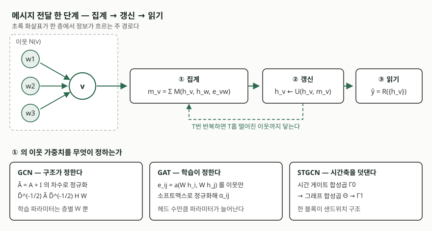

> **실행 검증 없음.** 원 논문의 정의와 수식을 근거로 정리했다. 수식 기호와 하이퍼파라미터
> 값은 논문이 적은 것을 그대로 옮겼고, 모델을 학습시켜 얻은 성능 수치는 싣지 않았다.

## 들어가며

전력망·도로망·소셜 네트워크처럼 **연결 관계 자체가 데이터인** 대상이 시험 문항에 자주
올라온다. 가상발전소 수요 예측, 교통 흐름 예측, 이상 거래 탐지가 모두 그렇다. 이런
문항에서 합성곱 신경망이나 순환 신경망을 그대로 답안에 쓰면 감점된다. 두 구조는 입력이
격자나 수열로 **같은 모양으로 늘어서 있다**는 전제 위에 서 있는데, 그래프는 노드마다
이웃 수가 다르고 순서도 없기 때문이다.

이 글은 그래프신경망이 그 전제를 어떻게 바꿔 끼웠는지, 이웃의 정보를 모을 때 가중치를
무엇으로 정하는지, 거기에 시간축을 덧대면 무엇이 달라지는지를 순서대로 정리한다.

## 정의

**그래프신경망은 노드와 엣지로 표현된 데이터에서, 각 노드가 이웃 노드의 표현을 받아
자신의 표현을 갱신하는 과정을 여러 번 되풀이해 노드·엣지·그래프 단위의 예측을 내는
신경망이다.**

이 정의의 뼈대는 길머 등이 2017년에 정리한 **메시지 전달 신경망(MPNN)** 틀이다. 그
논문은 개별 모델들을 하나씩 나열하는 대신, 당시 제안돼 있던 그래프 신경망들이 공통으로
가진 연산을 메시지 함수 `M_t`, 노드 갱신 함수 `U_t`, 읽기 함수 `R` 세 가지로 추상화했다.
답안에서는 **개별 모델보다 이 틀을 먼저 쓰는 편이 안전하다.** 뒤에 나오는 GCN·GAT는
모두 이 틀의 `M_t`를 어떻게 고르느냐의 차이로 설명된다.

## 등장 배경

합성곱 신경망의 필터는 "왼쪽 위 화소, 그 오른쪽 화소"처럼 **고정된 상대 위치**에 가중치를
하나씩 배정한다. 그래프에는 그 상대 위치가 없다. 어떤 노드는 이웃이 2개고 어떤 노드는
200개이며, 이웃들 사이에 순서를 매길 근거도 없다. 노드 번호를 바꿔 매겨도 같은 그래프이므로,
연산은 **노드 번호 바꾸기에 영향받지 않아야(permutation invariance)** 한다. MPNN의 읽기
함수가 노드 상태들의 순열에 불변이어야 한다고 못박은 이유가 여기에 있다.

초기 접근은 그래프 푸리에 변환을 거치는 스펙트럴 방법이었다. 라플라시안 행렬을 고유분해해
주파수 영역에서 필터를 곱하는 방식인데, 고유분해 비용이 크고 필터가 그래프 전체에 걸쳐
퍼져 국소성이 없었다. GCN은 이 계산을 **체비셰프 다항식으로 근사한 뒤 차수를 1로 자르고**
최대 고윳값을 2로 두는 단순화를 거쳐, 결국 한 층이 1차 이웃만 보는 형태로 떨어뜨렸다.
비용도 엣지 수에 선형인 `O(|E|FC)`로 내려온다.

## 구성요소 — 메시지 전달 3단계

MPNN은 한 번의 순전파를 **3단계**로 나눈다. 답안에서 이 세 단계를 쓰고 각 단계에 모델을
얹으면 분량과 정확성이 함께 잡힌다.

1. **메시지 계산·집계** — 노드 `v`가 이웃 `w ∈ N(v)` 각각에 대해 `M_t(h_v, h_w, e_vw)`를
   계산하고 합산해 `m_v`를 만든다. 합산이므로 이웃 수와 순서에 좌우되지 않는다
2. **노드 갱신** — `h_v ← U_t(h_v, m_v)`로 자신의 은닉 상태를 바꾼다. 1·2단계를 `T`번
   되풀이하면 `T`홉 떨어진 이웃까지 정보가 닿는다
3. **읽기(readout)** — 그래프 단위 예측이 필요하면 `R({h_v})`로 노드 상태 전체를 하나로
   모은다. 노드 단위 예측(수요 예측, 분류)이면 이 단계를 건너뛰고 `h_v`를 바로 쓴다

1단계의 가중치를 **무엇으로 정하는가**가 모델을 가른다. 대표적인 갈래는 **3가지**다.

- **GCN** — 가중치를 **차수로 고정**한다. 자기 자신을 더한 인접 행렬 `Ã = A + I`와 그
  차수 행렬 `D̃`로 `H' = σ(D̃^(-1/2) Ã D̃^(-1/2) H W)`를 계산한다. 이웃이 많은 노드의
  기여를 낮추는 정규화가 학습 없이 구조만으로 정해진다
- **GAT** — 가중치를 **학습한다**. `e_ij = a(W h_i, W h_j)`를 이웃에 대해서만 계산하고
  (마스크드 어텐션) 소프트맥스로 정규화해 `α_ij`를 얻는다. `a`는 음의 기울기 0.2인
  LeakyReLU를 쓰는 단층 신경망이다. 여러 헤드를 두되 중간 층은 이어 붙이고 마지막 층은
  평균을 낸다
- **시공간 GCN(STGCN)** — 공간 집계에 **시간축 합성곱**을 덧댄다. 블록 하나가
  시간 게이트 합성곱 → 그래프 합성곱 → 시간 게이트 합성곱 순으로 쌓인 샌드위치 구조다

## 도식

> **출처**: [Gilmer et al., *Neural Message Passing for Quantum Chemistry* §2 Eq.(1)–(3)](https://arxiv.org/abs/1704.01212), [Kipf & Welling, *Semi-Supervised Classification with Graph Convolutional Networks* §2 Eq.(2)](https://arxiv.org/abs/1609.02907), [Veličković et al., *Graph Attention Networks* §2.1 Eq.(1)–(3)](https://arxiv.org/abs/1710.10903), [Yu et al., *Spatio-Temporal Graph Convolutional Networks* §3.4 Eq.(8)](https://arxiv.org/abs/1709.04875)

## 비교 — 가중치를 정하는 세 방식

| 구분 | GCN | GAT | 시공간 GCN(STGCN) |
|---|---|---|---|
| 이웃 가중치 | 차수로 고정 (`D̃^(-1/2) Ã D̃^(-1/2)`) | 학습된 어텐션 `α_ij` | 공간은 그래프 합성곱, 시간은 게이트 합성곱 |
| 학습 파라미터 | 층별 `W` | 층별 `W` + 어텐션 벡터 `a`, 헤드마다 별도 | 시간·공간 커널 양쪽 |
| 그래프 구조 사전 지식 | 전체 인접 행렬 필요 | 이웃 목록만 있으면 되고, 미리 알 필요 없음 | 가중 인접 행렬 필요 |
| 한 헤드/층 복잡도 | `O(\|E\|FC)` | `O(\|V\|FF' + \|E\|F')` | 시간 커널 폭 `K_t`만큼 수열이 짧아짐 |
| 새 노드 대응 | 전이적(transductive) 설정이 기본 | 귀납적(inductive) 설정에 적용 가능 | 관측 지점이 고정된 망을 전제 |
| 시간축 | 없음 | 없음 | 있음 (입력 12스텝, 예측 3·6·9스텝) |

GAT가 GCN보다 항상 낫다고 쓰면 안 된다. **어텐션은 파라미터와 저장량을 헤드 수만큼
늘린다.** 이웃의 중요도가 실제로 다를 근거가 없으면 차수 정규화로 충분하고, 오히려
과적합을 피한다.

## 적용 시 고려사항

- **인접 행렬을 무엇으로 만들 것인가.** 도로망처럼 물리적 연결이 있으면 그대로 쓰지만,
  STGCN은 연결이 불분명한 관측망에서 거리 기반 가중치 `w_ij = exp(−d_ij²/σ²)`를 쓰되
  임계값 `ε` 미만은 0으로 끊는다. 논문은 `σ² = 10`, `ε = 0.5`를 썼다. **그래프를 어떻게
  정의했는지가 모델 선택만큼 결과를 좌우한다**는 점을 답안에 적을 수 있다
- **층을 깊게 쌓는다고 멀리 보는 것이 아니다.** 층수가 곧 홉 수이지만, 깊어질수록 모든
  노드의 표현이 비슷해지는 과평활(over-smoothing)이 생긴다. GCN 논문의 재정규화 기법도
  `I + D^(-1/2) A D^(-1/2)`를 반복 적용할 때 생기는 수치 불안정을 막으려는 조치였다
- **전이적 설정과 귀납적 설정을 구분한다.** 학습 때 보지 못한 노드가 추론 때 들어오는지가
  갈림길이다. GAT는 이웃 목록만으로 계산되므로 귀납적 설정에 바로 쓰이지만, 전체 인접
  행렬을 전제로 한 구성은 노드가 추가될 때마다 다시 계산해야 한다
- **시공간 문제에서는 시간 모델의 비용도 함께 센다.** STGCN이 순환 구조 대신 합성곱을
  택한 이유가 학습 속도와 파라미터 수였다. 게이트 합성곱은 커널 출력을 둘로 나눠
  `P ⊙ σ(Q)` 형태로 한쪽이 다른 쪽을 통과시키는 구조이며, 패딩 없이 적용하므로 층마다
  수열이 `K_t − 1`만큼 짧아진다

## 정리

- 그래프신경망은 **메시지 전달 3단계**(메시지 집계 → 노드 갱신 → 읽기)로 요약된다
- 모델의 차이는 1단계의 가중치를 **무엇이 정하는가**로 갈린다. 구조가 정하면 GCN,
  학습이 정하면 GAT, 거기에 시간축을 덧대면 시공간 GCN이다
- 격자·수열 구조를 쓸 수 없는 이유는 **이웃 수가 다르고 순서가 없기 때문**이며, 그래서
  집계 연산은 노드 번호 바꾸기에 불변이어야 한다
- 두문자로는 **"모·갱·읽 / 차수·어텐션·시간"** 여섯 단어면 답안 뼈대가 선다

> 기출 답안: [기출문제 — 가상발전소 전력수요 예측의 AI 기법](../../exam/2026-10-23-vpp-demand-forecasting-ai-techniques/index.md)

## 참고 자료

- [Gilmer, Schoenholz, Riley, Vinyals, Dahl, *Neural Message Passing for Quantum Chemistry* (ICML 2017, arXiv:1704.01212)](https://arxiv.org/abs/1704.01212) — §2 메시지 전달 틀, Eq.(1)–(3)
- [Kipf & Welling, *Semi-Supervised Classification with Graph Convolutional Networks* (ICLR 2017, arXiv:1609.02907)](https://arxiv.org/abs/1609.02907) — §2 층 전파 규칙 Eq.(2), §2.1 체비셰프 근사, §2.2 재정규화 기법과 `O(|E|FC)`
- [Veličković, Cucurull, Casanova, Romero, Liò, Bengio, *Graph Attention Networks* (ICLR 2018, arXiv:1710.10903)](https://arxiv.org/abs/1710.10903) — §2.1 어텐션 계수 Eq.(1)–(3), 멀티헤드 Eq.(5)–(6), §2.2 복잡도
- [Yu, Yin, Zhu, *Spatio-Temporal Graph Convolutional Networks: A Deep Learning Framework for Traffic Forecasting* (IJCAI 2018, arXiv:1709.04875)](https://arxiv.org/abs/1709.04875) — §3.3 게이트 시간 합성곱 Eq.(7), §3.4 ST-Conv 블록 Eq.(8), §4.2 가중 인접 행렬 Eq.(10)
