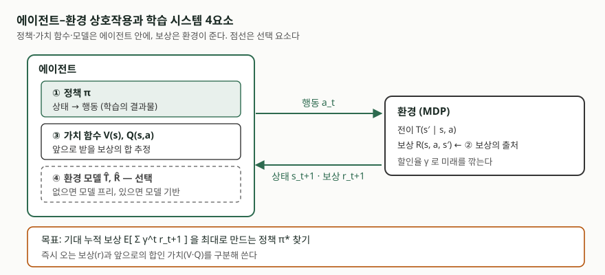

> **실행 검증 없음.** 동료 심사를 거친 서베이 논문 두 편의 정의와 수식을 근거로 정리했다.
> 기호와 구성요소 이름은 논문이 쓴 것을 그대로 옮겼고, 학습을 돌려 얻은 성능 수치는 싣지 않았다.

## 들어가며

강화학습은 다른 기계학습 기법과 함께 묶여 출제되는 일이 많다. 가상발전소 수요 예측,
자율주행, 재고·가격 결정 문항이 그렇다. 여기서 가장 자주 나오는 개념 오류가
**강화학습을 예측 기법으로 쓰는 것**이다. 예측은 "다음 시간대 수요가 얼마인가"에 답하고,
강화학습은 "그 상황에서 무엇을 할 것인가"를 고른다.

이 글은 그 차이가 어디서 오는지를 학습 신호부터 따라간다. 문제를 어떤 수학 모형으로
놓는지, 학습 시스템이 무엇으로 이루어지는지, 그리고 실무 적용에서 무엇이 걸림돌이 되는지
순서로 정리한다.

## 정의

**강화학습은 에이전트가 환경과 상호작용하며 시행착오로 얻은 보상 신호만을 근거로,
누적 보상을 최대화하는 정책을 학습하는 문제 틀이다.**

캘블링 등의 서베이는 이를 "동적 환경과의 시행착오 상호작용을 통해 행동을 학습한다"로
적는다. 중요한 것은 강화학습이 **알고리즘의 이름이 아니라 문제의 분류**라는 점이다.
같은 문제 틀 안에 Q-러닝·SARSA·REINFORCE처럼 성격이 다른 알고리즘이 함께 들어간다.
답안 첫 줄을 "기법"이 아니라 "문제 틀"로 여는 편이 뒤에 나올 분류를 받치기 좋다.

## 등장 배경 — 지도학습과 무엇이 다른가

지도학습은 입력과 정답의 쌍을 받는다. 강화학습에는 그 쌍이 없다. 같은 서베이는 차이를
**3가지**로 짚는다.

1. **정답이 주어지지 않는다.** 행동을 고르면 환경은 즉시 보상과 다음 상태만 알려 주고,
   어떤 행동이 장기적으로 최선이었는지는 말해 주지 않는다
2. **경험을 스스로 모아야 한다.** 상태·행동·전이·보상에 대한 정보를 능동적으로 수집하지
   않으면 최적 행동을 알 수 없다. 여기서 탐색(exploration)이 **문제의 일부**가 된다
3. **온라인 성능이 평가 대상이다.** 지도학습처럼 "학습 기간에는 실수를 세지 않고 이후
   성능만 본다"는 구분이 성립하지 않는다. 학습 중에 낸 손실까지 포함해 평가하는 척도가
   후회(regret)다

환경이 보상만 돌려주고 정답을 주지 않으므로, 어떤 행동이 나중의 큰 보상으로 이어졌는지
거슬러 올라가 공을 나누는 문제가 생긴다. 이것이 **지연된 보상**이며 강화학습의 핵심 난점이다.

## 구성요소 — MDP 5요소와 학습 시스템 4요소

### 문제를 놓는 틀: 마르코프 결정 과정

지연된 보상 문제는 **마르코프 결정 과정(MDP)**으로 모형화된다. 서베이의 MDP 정의 절(§3.1)은
상태 집합 `S`, 행동 집합 `A`, 보상 함수 `R : S × A → ℝ`, 상태 전이 함수
`T : S × A → Π(S)` **4가지**로 적고, 상태 전이가 **이전 상태·행동과 무관할 때** 그 모형을
마르코프하다고 한다. 심층 강화학습 서베이는 여기에 할인율 `γ ∈ [0, 1]`과 시작 상태 분포를
더해 **5요소**로 쓴다. 답안에서는 할인율을 포함한 5요소 쪽이 안전하다 — 최적성 기준이
할인율에 달려 있기 때문이다.

누적 보상을 무엇으로 정의할지에 따라 최적성 모형이 **3가지**로 갈린다. 유한 구간(앞으로
`h`스텝까지의 합), 무한 구간 할인(`Σ γ^t r_t`), 평균 보상이다. 같은 환경에서도 어느 기준을
쓰느냐에 따라 최적 정책이 달라진다.

### 학습 시스템을 이루는 4요소

에이전트 쪽에 놓이는 구성요소는 **4가지**다.

| 요소 | 무엇인가 | 필수 여부 |
|---|---|---|
| **정책** `π` | 상태를 행동(또는 행동 확률 분포)에 대응시키는 함수 | 필수 — 학습의 결과물 |
| **보상** `r` | 환경이 매 스텝 돌려주는 스칼라 신호 | 필수 — 환경이 준다 |
| **가치 함수** `V(s)`, `Q(s,a)` | 그 상태(또는 상태-행동)에서 시작해 정책을 따를 때 기대되는 누적 보상 | 가치 기반 기법에서 필수 |
| **모델** `T̂`, `R̂` | 환경의 전이와 보상을 흉내 내는 학습된 근사 | **선택** |

보상과 가치의 관계를 구분해 쓰는 것이 점수가 갈리는 자리다. **보상은 즉시 오는 신호이고,
가치는 그 뒤로 이어질 보상까지 합한 추정치다.** 최적 가치 함수는 "현재 보상 + 할인한 다음
상태의 가치"가 최대가 되는 재귀식(벨만 최적 방정식)의 해로 정의되고, 이 가치가 있으면
각 상태에서 그 값을 최대로 만드는 행동을 고르는 것으로 최적 정책이 나온다.

## 도식

> **출처**: [Kaelbling, Littman & Moore, *Reinforcement Learning: A Survey*, JAIR 4 (1996) §1.1 표준 모형, §3.1 MDP, §3.2 벨만 최적 방정식](https://www.jair.org/index.php/jair/article/view/10166), [Arulkumaran, Deisenroth, Brundage & Bharath, *Deep Reinforcement Learning: A Brief Survey*, IEEE SPM 34(6) §II-A, §III-A](https://arxiv.org/abs/1708.05866)

## 비교

### 다른 학습 틀과의 대비

| 구분 | 지도학습 | 비지도학습 | 강화학습 |
|---|---|---|---|
| 학습 신호 | 입력-정답 쌍 | 없음 (구조만) | 스칼라 보상 |
| 피드백 시점 | 즉시, 정답 그대로 | — | 지연될 수 있음 |
| 데이터 수집 | 주어진 집합 | 주어진 집합 | 에이전트의 행동이 바꾼다 |
| 평가 | 학습 후 정확도 | 군집 품질 등 | 학습 중 누적 보상(후회 포함) |

### 강화학습 안의 두 축

| 축 | 한쪽 | 다른 쪽 |
|---|---|---|
| 무엇을 학습하나 | **가치 기반** — `V`·`Q`를 추정하고 탐욕적으로 행동 선택 (Q-러닝, SARSA) | **정책 기반** — 매개화된 정책 `π_θ`를 직접 최적화 (REINFORCE) |
| 환경 모델 | **모델 프리** — 상호작용에서 바로 학습 | **모델 기반** — 전이 모형을 학습해 시뮬레이션으로 보강 |

둘을 합친 것이 **액터-크리틱**이다. 액터가 정책을, 크리틱이 가치 함수를 맡는다.
모델 기반은 표본 효율이 좋지만 모델 오차가 정책에 그대로 전파되는 위험이 있다.

## 적용 시 고려사항

- **보상 설계가 곧 시스템 설계다.** 보상은 학습이 바라보는 유일한 목표이므로, 의도하지
  않은 지름길이 보상을 더 받으면 에이전트는 그쪽을 택한다. 최종 목표에만 보상을 주면
  지연이 커지므로, 중간 단계에 국소적 보상을 주거나 쉬운 문제부터 제시하는 조성(shaping)이
  쓰인다
- **실환경 탐색 비용을 먼저 따진다.** 전력 설비나 차량처럼 잘못된 행동의 대가가 큰
  영역에서는 탐색 자체가 허용되지 않는다. 시뮬레이터에서 학습하고 실환경에는 제약을
  건 정책만 올리는 구성이 필요하며, 이때 **시뮬레이터와 실환경의 차이가 새로운 오차원**이 된다
- **상태를 온전히 관측할 수 있는지 확인한다.** MDP 기반 학습은 완전 관측을 전제한다.
  관측이 불완전하면 부분 관측 MDP(POMDP)가 되고, 관측을 상태로 취급해 학습하면 Q-러닝의
  수렴 보장이 깨진다
- **상태 공간이 크면 표로 들고 있을 수 없다.** 상태마다 값을 저장하는 방식은 작은 환경에서만
  성립한다. 함수 근사로 일반화해야 하며, 비슷한 상태가 비슷한 가치를 갖는다는 가정이
  깔린다. 심층 강화학습은 이 근사를 신경망으로 하는 갈래다

## 정리

- 강화학습은 **문제 틀**이다. 보상만으로 정책을 찾는 문제이며, 알고리즘 이름이 아니다
- 문제는 **MDP 5요소**(상태·행동·전이·보상·할인율)로 놓고, 최적성 기준은
  **3가지**(유한 구간·무한 구간 할인·평균 보상) 중에서 고른다
- 학습 시스템은 **4요소**(정책·보상·가치 함수·모델)로 이루어지고, **모델만 선택**이다
- 분류는 두 축으로 외운다 — **가치 기반 / 정책 기반**, **모델 프리 / 모델 기반**
- 지도학습과의 차이는 **3가지**(정답 없음·능동적 경험 수집·온라인 성능 평가)로 묶는다

> 기출 답안: [기출문제 — 가상발전소 전력수요 예측의 AI 기법](../../exam/2026-10-23-vpp-demand-forecasting-ai-techniques/index.md)

## 참고 자료

- [Kaelbling, Littman & Moore, *Reinforcement Learning: A Survey*, Journal of Artificial Intelligence Research 4 (1996), pp. 237-285](https://www.jair.org/index.php/jair/article/view/10166) — §1.1 표준 모형과 지도학습과의 차이, §1.3 최적성 모형 3가지와 후회, §2 탐색-활용 절충, §3.1 MDP 정의, §3.2 벨만 최적 방정식, §6 일반화, §9 조성
- [Arulkumaran, Deisenroth, Brundage & Bharath, *Deep Reinforcement Learning: A Brief Survey*, IEEE Signal Processing Magazine 34(6), 2017 (arXiv:1708.05866)](https://arxiv.org/abs/1708.05866) — §II-A MDP 5요소와 POMDP, §III-A 가치 함수·Q 함수·벨만 방정식, §III-C 정책 탐색과 액터-크리틱, §III-D 모델 기반과 모델 프리, §VI-B 탐색-활용
