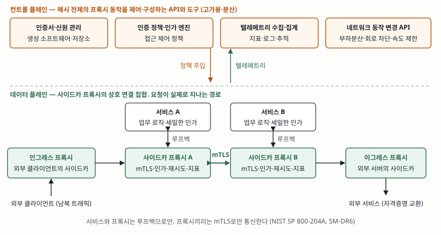

> 실행 검증 없음. 정의·구성요소·권고는 NIST SP 800-204A와 SP 800-204에 적힌 것만
> 옮겼다. 특정 제품(Istio·Linkerd 등)의 구현 세부는 다루지 않는다.

## 들어가며

마이크로서비스로 나눈 시스템에서 서비스 하나는 두 가지 일을 한다. 업무 로직을
수행하는 일과, 다른 서비스를 찾아 호출하고 재시도하고 암호화하는 통신 일이다.
서비스가 수십 개를 넘고 언어가 셋 이상 섞이면 두 번째 일이 서비스마다 다른
라이브러리로 제각각 구현되고, 인증서 교체나 접근 정책 변경 하나가 전 서비스
재배포가 된다. 서비스 메시는 그 통신 일을 서비스 옆의 프록시로 빼낸 기반 계층이다.
시험에서는 클라우드 네이티브 전환, MSA 보안, 제로 트러스트의 구현 수단으로 묻고,
점수가 갈리는 자리는 **프록시가 무엇을 가져가고 무엇이 서비스 코드에 남는가**다.

## 정의

**서비스 메시란, 서비스 디스커버리·라우팅과 내부 부하분산·트래픽 구성·암호화·
인증·인가·지표·모니터링을 통해 서비스 간 통신을 돕는 전용 기반 계층**이다.

NIST SP 800-204A의 정의 절(§3)과 SP 800-204의 서비스 메시 절(§2.7.2)이 같은 문장으로
정의한다. 같은 자리에서 두 가지를 덧붙인다. 서비스 인스턴스가 계속 생기고 없어지고
옮겨 다니는 환경에서 **네트워크 동작·인스턴스 신원·트래픽 흐름을 정책으로 선언적으로
정의**하게 해 주며, OSI 전송 계층 위에서 **서비스의 세션 계층(5계층) 관심사**를
다루는 네트워킹 모델로 볼 수 있다는 것이다. 대안 정의로 "응용 서비스 간 통신을
최적화하는 분산 컴퓨팅 미들웨어"도 함께 싣는다.

## 등장 배경

SP 800-204A는 마이크로서비스의 기능을 **업무 로직**과 **네트워크 기능** 둘로 나눈다.
업무 로직은 그 서비스가 업무 프로세스를 실행하는 주체이므로 서비스 코드의 일부여야
한다. 문제는 네트워크 기능 쪽이다.

① **언어·프레임워크마다 라이브러리가 다르다.** 서비스가 네트워크 기능을 직접
수행하면 작성 언어와 프레임워크에 따라 다른 라이브러리를 쓴다. 한 응용 안에
Java·JavaScript·Python이 섞이는 것이 현실이라, 서비스 노드마다 통신 기능을 갖추는
일이 반복 작업이 된다.

② **기존 미들웨어는 마이크로서비스에 맞지 않는다.** 응용 전달 제어기(ADC),
부하분산기, API 게이트웨이는 비용과 운영 부담이 크고, 동적 디스커버리처럼 느슨하게
결합된 모듈이 요구하는 세밀한 기능이 없다. 서비스 수가 많아지면서 서비스 간(동서)
트래픽이 클라이언트-서비스(남북) 트래픽보다 훨씬 많아졌고, 경량 미들웨어 없이는
성능이 나오지 않는다.

③ **보안 요구가 바뀌었다.** 네트워크 경계가 없고, 모든 서비스를 신뢰할 수 없는
것으로 취급해야 하며, 서비스마다 세밀한 인가가 필요하지만 정책은 중앙에서 정의되고
모든 서비스에 일관되게 집행되어야 한다.

같은 문서는 서비스 메시 코드를 두는 방식 **세 가지**를 든다(SM-AR1~3). 응용 개발
프레임워크에 내장하는 방식, 라이브러리로 두고 API 호출로 결합하는 방식, 서비스
인스턴스 앞에 프록시를 두는 방식이다. 앞의 둘은 응용 코드를 서비스 메시에
결합시키고, 문서가 다루는 것은 셋째인 **사이드카 프록시** 방식이다.

## 구성요소 — 플레인 2개와 경계 프록시 2개

### 플레인 2개

| 플레인 | 무엇인가 | 담는 것 |
|---|---|---|
| **데이터 플레인** | 서비스 간 통신을 제어하는 프록시들의 상호 연결 집합. 요청이 실제로 지나가는 경로 | 요청 전달, 헬스 체크, 부하분산, 회로 차단, 타임아웃, 재시도, 인증, 인가 |
| **컨트롤 플레인** | 메시 전체의 프록시 동작을 제어·구성하는 API와 도구의 집합 | 인증서 생성 소프트웨어와 저장소, 인증 정책, 인가 엔진, 텔레메트리 수신·집계, 부하분산·회로 차단·속도 제한을 바꾸는 API |

서비스 인스턴스마다 만들어지는 전용 프록시가 **사이드카 프록시**이고, 이것이 접근
제어와 통신 관련 보안의 런타임 동작을 수행한다. 그 동작은 컨트롤 플레인이 **정책을
프록시에 주입**해서 가능해지며, 그래서 서비스 코드를 고치지 않고 정책을 바꿀 수 있다.

컨트롤 플레인은 오케스트레이터의 컨트롤 플레인과 다른 것이다. 전자는 메시를, 후자는
클러스터를 제어한다. 다만 서비스 레지스트리 같은 핵심 데이터를 오케스트레이션
플랫폼에서 받으므로 둘은 통합되어야 하고, 컨트롤 플레인은 메시의 핵심 구성요소이므로
고가용·분산이어야 한다. 구현 형태는 설정 파일, API 호출, 사용자 인터페이스 세 가지다.

### 경계 프록시 2개

| 프록시 | 위치 | 기능 |
|---|---|---|
| **인그레스 컨트롤러** | 외부 클라이언트 → 메시. 외부 클라이언트의 사이드카로 볼 수 있다 | 5가지: 클라이언트 공통 API, 프로토콜 변환(HTTP/HTTPS → RPC/gRPC/REST), 여러 서비스 호출 결과의 조합, 부하분산, 공개 TLS 종단 |
| **이그레스 컨트롤러** | 메시 → 외부 서비스. 외부 서버들의 사이드카로 볼 수 있다 | 3가지: 외부 통신을 허용할 워크로드의 단일 집합, 내부 신원에서 외부 자격증명(SSO 토큰·API 키)으로의 교환, 프로토콜 변환(RPC/gRPC/REST → HTTP/HTTPS) |

인그레스 컨트롤러는 API 게이트웨이의 기능을 메시 안에서 실현한 것이다.

## 기능 — 5갈래

SP 800-204A의 구성요소·역량 절(§3.1)이 통신 과정에서 지원되는 기능을 다섯 갈래로 묶는다.

| # | 갈래 | 항목 |
|---|---|---|
| ① | 인증과 인가 | 인증서 생성, 키 관리, 허용·차단 목록, SSO 토큰, API 키 |
| ② | 보안 서비스 디스커버리 | 전용 서비스 레지스트리를 통한 엔드포인트 발견 |
| ③ | 보안 통신 | 상호 TLS(mTLS), 암호화, 동적 경로 생성, 다중 프로토콜 지원과 변환(HTTP/1.x·HTTP/2·gRPC) |
| ④ | 복원력·안정성 | 회로 차단기, 재시도, 타임아웃, 결함 주입·처리, 부하분산, 장애 조치, 속도 제한, 요청 섀도잉 |
| ⑤ | 관측성·모니터링 | 로깅, 지표, 분산 추적 |

## 정책이 집행되는 절차 — 4단계

1. **선언** — 운영자가 컨트롤 플레인에 인증 정책·네이밍 정보·트래픽 규칙을 설정 파일,
   API 호출, 또는 UI로 지정한다
2. **주입** — 컨트롤 플레인이 그 정책을 각 사이드카 프록시에 내려보낸다. 프록시는
   이전 구성의 요청을 완료하거나 종료하면서 새 구성으로 원자적으로 전환한다(SM-DR5)
3. **집행** — 요청이 서비스에 닿기 전에 프록시가 mTLS로 상대 신원을 확인하고, 접근
   정책을 적용하고, 재시도·타임아웃·회로 차단을 수행한다. 서비스와 프록시는 루프백
   채널로만 통신하고 프록시끼리는 mTLS로만 통신한다(SM-DR6)
4. **관측** — 프록시가 지표·로그·추적을 컨트롤 플레인으로 보내고, 컨트롤 플레인이
   집계한다

서비스 코드는 이 네 단계 어디에도 참여하지 않는다. 문서가 서비스 메시를 **응용이
인지하지 않아도 되게 응용 코드 옆에 배치되는 경량 프록시의 배열**이라고 서술하는
이유다.

## 도식

> **출처**: [NIST SP 800-204A, Building Secure Microservices-based Applications Using Service-Mesh Architecture (2020-05) — §3 Service Mesh Definitions, §3.1 Service Mesh Components & Capabilities, §3.1.1 Ingress Controller, §3.1.2 Egress Controller, SM-DR6](https://doi.org/10.6028/NIST.SP.800-204A), [NIST SP 800-204, Security Strategies for Microservices-based Application Systems (2019-08) §2.7.2 Service Mesh](https://nvlpubs.nist.gov/nistpubs/SpecialPublications/NIST.SP.800-204.pdf)

## 비교

### 사이드카가 가져가는 것과 서비스 코드에 남는 것

| | 사이드카 프록시(데이터 플레인)로 간다 | 서비스 코드에 남는다 |
|---|---|---|
| 기능 | 디스커버리, 라우팅, 부하분산, 재시도·타임아웃·회로 차단, mTLS, 서비스 단위 인증·인가, 지표·추적 수집 | 업무 로직, 계산, 서비스 조합·통합 로직 |
| 인가 | 어느 서비스가 어느 서비스를 호출할 수 있는가 | **업무 규칙에 따른 세밀한 인가** |
| 바뀔 때 | 컨트롤 플레인 정책 변경. 재배포 없음 | 코드 수정과 재배포 |

SP 800-204와 800-204A가 같은 문장으로 선을 긋는다. **세밀한 인가는 여전히
마이크로서비스 수준에서 수행해야 할 수 있는데, 업무 로직을 온전히 아는 것은 그
서비스뿐이기 때문**이다. "주문 서비스가 결제 서비스를 호출해도 되는가"는 프록시가
판단하지만, "이 사용자가 이 주문을 취소할 수 있는가"는 주문의 상태와 소유자를 아는
서비스만 판단할 수 있다. 메시를 도입했다고 서비스에서 인가 코드를 전부 걷어내면 바로
이 자리가 비게 된다.

### 유사 개념과의 대비

| 비교 축 | 서비스 메시(사이드카) | API 게이트웨이 | 라이브러리 방식(SM-AR2) |
|---|---|---|---|
| 다루는 트래픽 | 서비스 간(동서) | 클라이언트→서비스(남북) | 서비스 간 |
| 배치 단위 | 서비스 인스턴스마다 프록시 하나 | 경계에 하나, 또는 클라이언트 유형별(BFF) | 서비스 프로세스 안 |
| 응용 코드 변경 | 없음. 네트워크 수준에서 동작 | 없음 | 있음. API 호출로 결합 |
| 언어 의존 | 없음 | 없음 | 언어·프레임워크별 구현 |
| 정책 변경 | 컨트롤 플레인에서 선언, 프록시 재시작 없음 | 게이트웨이 구성 변경 | 코드 수정·재배포 |
| 비용 | 인스턴스마다 프록시 하나가 더 돈다 | 단일 지점이면 병목·단일 장애점 | 추가 프로세스 없음 |

SP 800-204는 마이크로게이트웨이와 사이드카도 구별한다. 마이크로게이트웨이는 독립
컨테이너로 API 근처에 배치되고, 사이드카는 API 엔드포인트 자체에 구현된다.

## 적용 시 고려사항 — 5가지

**① 규모가 비용을 정당화하는가.** 문서는 서비스 수가 수백·수천 규모일 때 메시 도입이
경제적이라고 적는다. 서비스마다 프록시가 하나씩 더 돌므로 런타임 인스턴스 수와 전체
공격 표면이 늘고, 프록시에 기능이 쌓일수록 통신 병목이 될 수 있다. 서비스가 열 개면
라이브러리 방식이 더 쌀 수 있다.

**② 인가의 분담선을 기능 단위로 적어 둔다.** 서비스 단위 접근은 메시, 업무 규칙
인가는 서비스로 정하고 기능마다 어느 쪽인지 표로 남긴다. "인가는 메시가 한다"로만
합의하면 업무 규칙 인가가 빠지고, "인가는 서비스가 한다"로만 합의하면 메시가 이미
하는 일을 중복 구현한다.

**③ 신원과 인증서를 기업 PKI에 묶는다.** 컨트롤 플레인의 자체 서명 인증서 생성은
끄고 기업 PKI의 신뢰 루트에서 서명 인증서를 받아야 하며(SM-DR12), 서비스 신원
인증서의 수명은 시간 단위로 짧게 두고(SM-DR13), 인증서를 발급하기 전에 오케스트레이션
엔진에 대한 증명 등으로 워크로드를 인증해야 한다(SM-DR16). 메시의 보안은 결국
프록시가 보유한 인증서의 보안이다.

**④ 외부 접근은 기본 차단, 이그레스 경유.** 메시 밖 자원 접근은 기본적으로 막고
명시적 정책으로만 허용하며 외부 자원도 메시의 서비스로 모델링한다(SM-DR8). 외부
접근에도 재시도·타임아웃·회로 차단을 똑같이 둔다(SM-DR9). 이그레스 프록시를 두어 그
프록시만 외부로 나가게 하면 특정 IP만 허용하는 기존 네트워크 보안 모델과 맞출 수
있다(SM-DR10).

**⑤ 컨트롤 플레인 자체가 핵심 자산이다.** 프록시는 디스커버리·정책·텔레메트리를 위해
컨트롤 플레인에 항상 접근할 수 있어야 하고(SM-DR2), 컨트롤 플레인은 고가용·분산이어야
한다. 관리 작업 권한 구성(§4.8)도 문서가 따로 둔 항목이다. 메시가 모든 서비스의
신원과 정책을 보유하므로 컨트롤 플레인이 침해되면 전 서비스의 신원과 정책이
침해된다.

## 정리

암기 단서는 **"2·2·5·1"**이다.

- **플레인 2개**: 데이터 플레인(사이드카 프록시 집합, 요청 경로) · 컨트롤 플레인(정책·인증서·텔레메트리·구성 API)
- **경계 프록시 2개**: 인그레스(외부 클라이언트의 사이드카) · 이그레스(외부 서버의 사이드카)
- **기능 5갈래**: 인증·인가 · 보안 디스커버리 · 보안 통신 · 복원력 · 관측성
- **남는 것 1개**: 업무 규칙에 따른 세밀한 인가는 서비스 코드에 남는다
- **배치 방식 3가지**(SM-AR1~3): 프레임워크 내장 · 라이브러리 · 사이드카 프록시
- **배포 권고 28건**(SM-DR1~28): 프록시 통신 · 인그레스 · 외부 접근 · 신원과 접근 · 모니터링 · 복원력 · CORS · 관리 권한의 8개 영역

> 기출 답안: [기출문제 — 클라우드 네이티브 전환 사업의 TA와 AA, 역할 분담과 협업](../../exam/2026-10-29-ta-aa-role-split-and-collaboration/index.md)
> · 관련 개념: [MSA — 분해 기준과 감당해야 할 비용](../../software-engineering/2026-09-22-msa-decomposition-and-cost/index.md), [제로 트러스트 아키텍처 — NIST SP 800-207의 7원칙과 3구성요소](../../security/2026-10-08-zero-trust-architecture-nist-sp-800-207/index.md)

## 참고 자료

- [NIST SP 800-204A, Building Secure Microservices-based Applications Using Service-Mesh Architecture (2020-05)](https://doi.org/10.6028/NIST.SP.800-204A)
  — §1.1 Why Service Mesh(SM-AR1~3), §3 정의, §3.1 구성요소와 역량, §3.1.1·§3.1.2 인그레스·이그레스 컨트롤러, §3.2 통신 미들웨어와의 차이, §4 배포 권고(SM-DR1~28)
- [NIST SP 800-204, Security Strategies for Microservices-based Application Systems (2019-08)](https://nvlpubs.nist.gov/nistpubs/SpecialPublications/NIST.SP.800-204.pdf)
  — §2.7.1 API 게이트웨이와 마이크로게이트웨이, §2.7.2 서비스 메시
- [NIST SP 800-204B, Attribute-based Access Control for Microservices-based Applications using a Service Mesh (2021-08)](https://doi.org/10.6028/NIST.SP.800-204B)
  — 메시 위의 인가 정책 모델
