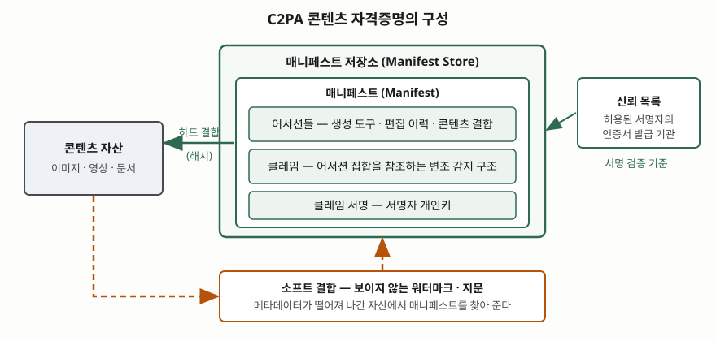

> 실행 검증 없음. 표준·보고서·법령의 진술만을 근거로 정리했다. C2PA는 명세 2.1판(2024-09)의
> 용어 정의 절과 활용 예시 절을 직접 읽었고, 그 뒤 절(결합 세부, 신뢰 목록 운영)은 읽지 않아
> 본문에 쓰지 않았다. 명세는 2.2 이후 판이 나와 있으므로 최신 판과 다를 수 있다.

## 들어가며

생성형 AI가 만든 이미지·음성·영상이 실물과 구별되지 않게 되면서 "이것이 AI 산출물인가, 누가
언제 만들었는가"를 확인하는 방법이 정보시스템의 요구사항이 됐다. 기출에서는 인공지능 기본법의
생성 사실 표시 의무, 이용자 보호 가이드라인의 표시 방식과 함께 묻는다. 답안에서 점수가 갈리는
곳은 **표시 방법을 몇 가지로 나누고 각각이 어디서 끊기는지 쓰는 대목**이다.

실무에서 풀어야 하는 문제는 두 가지다. 생성 도구가 산출물에 표시를 남기는 일, 그리고 그 산출물이
플랫폼을 거치며 변환·재업로드된 뒤에도 표시가 남아 있는지를 검증하는 일이다. 앞의 것은 쉽고
뒤의 것이 어렵다.

## 정의

**콘텐츠 출처(provenance)는 자산의 이력과, 그 자산이 행위자·다른 자산과 맺은 상호작용을
이해하는 개념이다.** C2PA 명세는 이렇게 정의한다
([C2PA Technical Specification 2.1 — 2.3.8 Provenance](https://spec.c2pa.org/specifications/specifications/2.1/specs/C2PA_Specification.html)).

**C2PA는 콘텐츠의 출처와 편집 이력을 서명된 데이터로 자산에 묶는 개방 기술 명세이고, 사용자에게
보이는 이름은 콘텐츠 자격증명(Content Credential)이다.** 명세는 자격증명을 매니페스트의
"비기술적 선호 용어"로 적는다(같은 명세 2.3.6).

NIST는 이를 상위 개념으로 놓는다. **디지털 콘텐츠 투명성(digital content transparency)은
콘텐츠의 출처와 이력에 관한 정보를 기록하고 열람하는 과정이다.** 그 안에서 출처 데이터 추적
(워터마크·메타데이터 기록)과 합성 콘텐츠 탐지가 갈린다
([NIST AI 100-4 — 1 Summary, 3.1 Provenance Data Tracking](https://nvlpubs.nist.gov/nistpubs/ai/NIST.AI.100-4.pdf)).

## 등장 배경

표시 기술은 세 단계로 나왔다. 처음에는 파일 안에 이미 있던 메타데이터(촬영 정보·저작자)를 썼다.
이것은 서명이 없어 **누구나 고치거나 지울 수 있다.** NIST는 같은 파일에 담긴 메타데이터를 복사하거나
편집하는 사람이 자기가 배포하는 판본의 메타데이터를 조작할 수 있고, 소셜 미디어로 공유될 때
메타데이터가 통째로 제거되는 일이 흔하다고 적는다(같은 보고서 3.1.2, 16쪽).

그래서 두 번째로 신호를 **콘텐츠 안에** 심는 워터마크가 나왔다. 파일이 변환돼도 남도록 만든 방식이다.
그러나 워터마크는 담을 수 있는 정보가 적고, 변형과 위조에 취약하다. 세 번째가 두 방식을 묶는 C2PA다.
서명된 메타데이터가 풍부한 이력을 담고, 메타데이터가 떨어져 나가면 지문·워터마크로 매니페스트를
다시 찾는다. 규제는 이 흐름 위에 얹혔다. 표시를 **누가, 어떤 형식으로** 해야 하는지를 법이 정한다.

## 구성요소 — C2PA 8가지

C2PA의 구성요소는 세 묶음, 8가지로 외운다. 정의는 모두 명세 2.1판의 용어 절(2.3)에 있다.

| 묶음 | 구성요소 | 정의(요지) |
|---|---|---|
| 정보 | ① 어서션(Assertion) | 서명자가 만들었거나 클레임 생성 시점에 모은, 자산에 관한 진술 |
| 정보 | ② 클레임(Claim) | 어서션 집합을 참조하는, 서명되고 변조가 드러나는 구조 |
| 정보 | ③ 클레임 서명 | 서명자의 개인키로 클레임에 거는 전자서명 |
| 포장 | ④ 매니페스트(Manifest) | 어서션 하나 이상, 클레임 하나, 클레임 서명을 묶은 출처 정보 |
| 포장 | ⑤ 매니페스트 저장소 | 매니페스트의 모음. 자산에 내장하거나 외부에 둔다 |
| 결합 | ⑥ 하드 결합 | 자산 전체나 일부를 고유하게 식별하는 암호학적 해시 |
| 결합 | ⑦ 소프트 결합 | 통계적으로 유일하지 않은 지문, 또는 보이지 않는 워터마크로 심은 식별자 |
| 신뢰 | ⑧ 신뢰 목록 | 허용된 서명자의 인증서를 발급한 기관(X.509 신뢰 앵커) 목록 |

**하드 결합과 소프트 결합이 갈리는 이유**가 핵심이다. 해시는 한 비트만 바뀌어도 달라지므로 변조를
정확히 잡지만, 재인코딩만 해도 깨진다. 지문과 워터마크는 정확하지 않은 대신 변환을 견딘다. 명세의
활용 예시는 이 용도를 직접 적는다. 메타데이터가 제거되거나 손상돼 자산이 매니페스트에서 떨어져
나갈 수 있고, 그때 지문으로 데이터베이스를 찾아 온전한 매니페스트를 되찾을 수 있다(같은 명세 2.4.1).
워터마크는 매니페스트에 대한 참조를 담는 용도로 소개된다(2.4.2).

## 도식

> **출처**: [C2PA Technical Specification 2.1 — 2.3 Terms and Definitions (2.3.1~2.3.6, 2.3.12, 2.3.13, 2.3.15), 2.4.1 Fingerprint](https://spec.c2pa.org/specifications/specifications/2.1/specs/C2PA_Specification.html)

답안에는 가운데 상자 세 겹(저장소 ⊃ 매니페스트 ⊃ 어서션·클레임·서명)과 왼쪽 화살표 둘(해시 결합,
지문·워터마크 결합)만 그려도 된다.

## 비교 — 표시 방식 3가지가 끊기는 자리

| 구분 | ① 워터마크 | ② 서명된 메타데이터 | ③ C2PA(②+①) |
|---|---|---|---|
| 위치 | 콘텐츠 안 | 파일 옆(내장 또는 외부) | 둘 다 |
| 담는 정보 | 적다 | 많다(생성 도구·이력) | 많다 |
| 끊기는 자리 | 변형·위조, 텍스트는 의역 | **제거**, 서명 없으면 위조 | 지문 DB 의존, 서명자 신뢰 |
| 서명 검증 | 해당 없음 | 가능 | 가능 |

**워터마크가 끊기는 모양은 매체마다 다르다.** NIST는 텍스트 워터마크에서 별도 모델의 의역으로
워터마크를 지울 수 있고, 약 225단어의 짧은 글은 반복 의역으로 탐지율이 20%까지 내려갈 수 있지만
약 400단어를 넘는 긴 글은 탐지율이 조금만 떨어진다고 적는다(같은 보고서 3.1.1, 13쪽).
어떤 워터마크도 원리상 적대적 변형으로 깨질 수 있음을 보이는 이론 결과가 있다는 설명도 붙는다.
위조(spoofing)도 문제다. 워터마크 신호를 흉내 내 가짜 이력을 심으면 사용자가 신호 자체를
무시하게 된다.

**메타데이터가 끊기는 자리는 제거다.** 소셜 미디어 업로드에서 흔히 일어나고, 사생활 보호 같은
정당한 이유로도 일어난다. NIST는 두 방식을 함께 쓰는 구성을 권한다. 변환에 잘 견디는 비가시
워터마크를 넣고, 받은 사람에게는 서명된 메타데이터로 상세 정보를 주는 것이다(같은 보고서 3.1).

## 법·제도가 요구하는 수준

**EU AI법 제50조**는 투명성 의무를 4개 항으로 둔다. 표시와 관련된 두 항만 보면 된다.

- **제2항(제공자)**: 합성 오디오·이미지·영상·텍스트를 생성하는 시스템의 출력은 **기계가 읽을 수
  있는 형식으로 표시되고 인위적으로 생성·조작됐음이 탐지 가능**해야 한다. 기술적으로 가능한
  범위에서 효과적·상호운용적·견고하고 신뢰할 수 있어야 한다.
- **제4항(배포자)**: 딥페이크를 만들거나 조작한 배포자는 그 사실을 **공개**해야 한다.

제50조는 2026-08-02부터 적용된다고 조문 전재 사이트에 적혀 있다. 원문(EUR-Lex)의 적용일 조항과
디지털 옴니버스에 따른 개정 여부는 직접 확인하지 못했다
([Article 50: Transparency Obligations (제3자 전재)](https://artificialintelligenceact.eu/article/50/)).

**인공지능 기본법 제31조**는 생성형 AI에 대해 사전 고지, 생성 사실 표시, 실제와 구분하기 어려운
결과물의 명확한 고지·표시를 요구한다(2026-01-22 시행). 이 글이 확인한 범위에서는 표시의 **기계 판독
형식**을 조문이 직접 명시하는지 확인하지 못했다. 표시 방식은 시행령·고시와 함께 봐야 한다.
기출 답안의 정리는 [인공지능 기본법 고영향 AI 답안](../../exam/2026-10-05-high-impact-ai-basic-act/index.md)과
[한국과 EU의 AI 규제 비교](../../it-management/2026-10-05-korea-ai-basic-act-vs-eu-ai-act/index.md)에 있다.

| 구분 | EU AI법 제50조 | 인공지능 기본법 제31조 |
|---|---|---|
| 의무 주체 | 제공자(2항), 배포자(4항) | 생성형 AI 사업자(조문의 의무 주체는 별도 확인) |
| 표시 형식 | 기계 판독 형식과 탐지 가능성 명시 | 이 글에서는 확인하지 못함 |
| 적용 | 2026-08-02(조문 전재 사이트 기준) | 2026-01-22 |

## 적용 시 고려사항

1. **방식을 하나만 쓰지 않는다.** 메타데이터만 쓰면 제거에, 워터마크만 쓰면 변형과 위조에 끊긴다.
   서명된 메타데이터와 비가시 워터마크를 함께 두고 소프트 결합으로 잇는 구성이 근거 있는 선택이다.
2. **표시가 있다는 사실이 진위를 보증하지 않는다.** NIST는 투명성이 신뢰에 기여하지만 보장하지
   않고 오히려 잘못된 신뢰를 만들 수 있다고 적는다. 정상 콘텐츠를 맥락에서 떼어 쓰는 조작은
   기술 표시로 잡히지 않는다.
3. **서명자 신뢰 체계를 설계한다.** 클레임 서명은 서명자 인증서가 신뢰 목록의 기관에서 발급됐는지로
   의미를 얻는다. 누구를 서명자로 인정할지가 운영 정책이 된다.
4. **파이프라인에서 메타데이터를 지우지 않는다.** 이미지 리사이즈·재인코딩·CDN 변환 단계가
   메타데이터를 제거하는지 점검한다. 제거되는 구간에는 소프트 결합 조회 경로를 둔다.
5. **텍스트는 별도로 생각한다.** 원문 텍스트에는 메타데이터가 따라붙지 않는 것이 일반적이다. 구조화된
   문서 형식이거나 외부 저장소, 고용량 워터마크가 있어야 표시가 가능하다(같은 보고서 3.1.2).

## 정리

- 표시 방식은 **워터마크 · 서명된 메타데이터 · C2PA(결합) 3가지**다
- C2PA 구성은 **정보 3 · 포장 2 · 결합 2 · 신뢰 1 = 8가지**
- 끊기는 자리: 워터마크는 **변형·위조**, 메타데이터는 **제거**
- 규제는 EU가 **기계 판독 형식**을 명시하고, 우리 법은 **고지·표시 의무**를 둔다
- 암기 단서: "**안에 심고(워터마크), 옆에 달고(메타데이터), 해시와 지문으로 잇는다(C2PA)**"

> 기출 답안: [기출문제 — 인공지능 기본법 목적·기본계획·위원회·진흥](../../exam/2026-11-04-ai-basic-act-purpose-plan-committee-promotion/index.md) ·
> [기출문제 — 생성형 인공지능 서비스 이용자 보호 가이드라인](../../exam/2026-10-31-generative-ai-user-protection-guideline/index.md)

## 참고 자료

- [C2PA Technical Specification 2.1 (2024-09)](https://spec.c2pa.org/specifications/specifications/2.1/specs/C2PA_Specification.html) — 2.3 용어 정의, 2.4.1·2.4.2 활용 예시
- [NIST AI 100-4, Reducing Risks Posed by Synthetic Content](https://nvlpubs.nist.gov/nistpubs/ai/NIST.AI.100-4.pdf) — 3.1.1 워터마크, 3.1.2 메타데이터 기록
- [Regulation (EU) 2024/1689 Article 50 (제3자 전재)](https://artificialintelligenceact.eu/article/50/) — 투명성 의무
- [국가법령정보센터, 인공지능 발전과 신뢰 기반 조성 등에 관한 기본법](https://www.law.go.kr/%EB%B2%95%EB%A0%B9/%EC%9D%B8%EA%B3%B5%EC%A7%80%EB%8A%A5%EB%B0%9C%EC%A0%84%EA%B3%BC%EC%8B%A0%EB%A2%B0%EA%B8%B0%EB%B0%98%EC%A1%B0%EC%84%B1%EB%93%B1%EC%97%90%EA%B4%80%ED%95%9C%EA%B8%B0%EB%B3%B8%EB%B2%95) — 제31조
