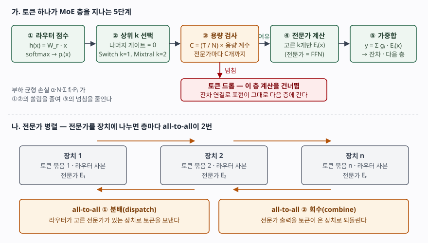

## 들어가며

밀집(dense) 언어 모델은 파라미터를 두 배로 늘리면 토큰 하나를 처리하는 연산도 두 배가 된다. 모델 용량을 키우고 싶은데 학습·추론 예산은 그대로일 때, 이 둘을 떼어 놓는 방법이 MoE다. 시험에서는 트랜스포머·대형 언어 모델 문항에 붙어 나오고, 점수는 "전문가 여러 개 중 일부만 쓴다"는 한 줄이 아니라 **라우터가 어떻게 고르는지, 쏠림을 무엇으로 막는지, 넘친 토큰은 어떻게 되는지**를 쓰는 데서 갈린다.

> 실행 검증 없음. 개념 정리이므로 원 논문 4편(arXiv 판)의 본문만 근거로 썼다. 절·식 번호는 표기한 판 기준이다. 성능 비교 수치는 실험 조건에 묶여 있어 싣지 않았다.

---

## 정의

**MoE(Mixture of Experts, 전문가 혼합) 층은 같은 구조의 전문가 네트워크 n개와, 입력마다 전문가별 가중치를 내는 게이트(라우터)로 이뤄지며, 가중치가 0인 전문가는 계산하지 않아 입력 하나에 일부 전문가만 연산하는 신경망 계층이다.**

Shazeer 등은 출력을 y = Σᵢ G(x)ᵢ·Eᵢ(x)로 두고(§2, 식 1) G(x)ᵢ가 0인 자리의 Eᵢ(x)는 계산할 필요가 없다고 적는다. 이 "입력에 따라 계산할 부분을 고르는" 방식을 **조건부 연산(conditional computation)** 이라 부른다. 오늘날 대형 언어 모델에서는 트랜스포머 층의 **위치별 FFN 자리를 MoE 층으로 바꾼** 형태로 쓰인다.

## 등장 배경

전문가 혼합이라는 발상 자체는 Jacobs·Jordan·Nowlan·Hinton의 1991년 논문까지 올라간다. 다만 그때는 모든 전문가를 계산한 뒤 섞었으므로 연산을 아끼지 못했다. Shazeer 등(2017)은 게이트가 **상위 k개만 남기고 나머지를 0으로 만들게** 해서 연산을 실제로 줄였고, LSTM 층 사이에 이 층을 넣어 **최대 1,370억 파라미터** 모델을 학습했다(초록).

희소하게 고르는 순간 세 가지 문제가 새로 생겼다. 첫째, 게이트가 몇몇 전문가만 계속 고르고 그 전문가만 학습되는 **자기 강화적 쏠림**이다(§4, Eigen 등의 관찰 인용). 둘째, 배치 b개를 n개 전문가에 나누면 전문가 하나가 받는 예제가 약 **kb/n개로 줄어드는** 문제다(§3.1). 셋째, 전문가가 여러 장치에 흩어지면 토큰을 주고받는 **네트워크 대역폭**이 병목이 된다(§3.2). 이후 GShard·Switch·Mixtral은 모두 이 세 문제를 어떻게 푸는가에서 갈린다.

## 구성요소 — 4가지

| # | 구성요소 | 하는 일 | 근거 |
|---|---|---|---|
| ① | **전문가 E₁…Eₙ** | 구조는 같고 파라미터가 따로인 FFN. 트랜스포머에서는 원래 FFN 하나가 n개로 늘어난다 | Shazeer §2, GShard §2.2 식 2 |
| ② | **라우터(게이트)** | 토큰마다 전문가별 점수를 내고 **상위 k개만** 남긴다 | Shazeer §2.1 식 3~5, Switch §2.1 식 1~2 |
| ③ | **부하 균형 보조 손실** | 전문가별 처리량이 고르도록 학습 손실에 항을 더한다 | Shazeer §4, GShard Algorithm 1, Switch §2.2 식 4~6 |
| ④ | **전문가 용량(capacity)** | 전문가 하나가 한 배치에서 받을 토큰 수의 상한. 넘친 토큰은 그 층 계산을 건너뛴다 | GShard §2.2, Switch §2.2 식 3 |

라우터에는 변형이 있다. Shazeer의 **잡음 상위 k 게이트**는 점수에 표준정규 잡음 × Softplus(x·W_noise)를 더한 뒤 상위 k개만 softmax한다(식 4~5). 논문은 이 잡음이 부하 균형에 도움이 된다고 적는다. Switch는 잡음 없이 h(x) = W_r·x에 softmax를 씌우고 **k = 1**로 줄였다.

## 도식 — 토큰 처리 5단계와 전문가 병렬

> **출처**: [Shazeer et al. §2, §2.1 식 1~5](https://arxiv.org/abs/1701.06538) · [Lepikhin et al., GShard §2.2, Algorithm 1, Figure 3](https://arxiv.org/abs/2006.16668) · [Fedus et al., Switch Transformers §2.1~2.2 식 1~6, §5.4](https://arxiv.org/abs/2101.03961)

위쪽이 한 층 안의 처리 순서다. **① 라우터 점수 → ② 상위 k 선택 → ③ 용량 검사 → ④ 선택된 전문가 계산 → ⑤ 게이트 값으로 가중합**이다. ③에서 자리가 없으면 그 토큰은 **드롭**된다. 계산을 건너뛰고 잔차 연결로 표현이 그대로 다음 층에 넘어간다(Switch §2.2). 용량은 (배치 토큰 수 ÷ 전문가 수) × **용량 계수**이고, 계수를 1보다 크게 잡으면 그만큼 여유 칸이 생긴다.

부하 균형 손실은 ①·②에서 생기는 쏠림을 줄여 ③의 드롭을 줄이는 장치다. Switch의 손실은 α·N·Σ fᵢ·Pᵢ다(식 4). fᵢ는 전문가 i로 실제 간 토큰 비율, Pᵢ는 라우터가 전문가 i에 준 확률의 평균이다. 고르게 분배되면 Σ fᵢ·Pᵢ = 1/N이 되고 이때 최소가 되며, N을 곱한 것은 전문가 수가 바뀌어도 손실 크기를 일정하게 두기 위해서다. fᵢ는 미분이 안 되고 Pᵢ는 되므로 기울기는 Pᵢ 쪽으로 흐른다. 논문은 α = 10⁻²를 썼다.

아래쪽은 **전문가 병렬**이다. GShard는 MoE 층만 장치에 나누고 나머지 층은 복제한다(Figure 3). 각 장치는 자기 토큰 묶음에 라우터를 돌린 뒤, 고른 전문가가 있는 장치로 토큰을 보내고(분배), 계산 결과를 다시 받아 온다(회수). 이 두 번이 모두 **all-to-all 통신**이다(Switch §5.4, GShard §3.3). 장치가 늘면 전문가 하나가 받는 배치가 약 kbd/n으로 d배 커지므로, 배경에서 말한 배치 축소 문제도 함께 풀린다(Shazeer §3.1).

## 비교

### 가. 게이트와 부하 균형의 변천 — 4편

| 구분 | Shazeer 2017 | GShard 2020 | Switch 2021 | Mixtral 2024 |
|---|---|---|---|---|
| 넣은 자리 | LSTM 층 사이 | 트랜스포머 FFN **한 층 걸러** | 트랜스포머 FFN | 트랜스포머 FFN (32층) |
| k | 언어 모델 실험에서 4 | 2 | **1** | 2 (전문가 8개 중) |
| 게이트 | 잡음 상위 k + softmax | 상위 2개 재정규화, 둘째는 **확률적으로** 보냄 | softmax 후 1개 | softmax(Top2(x·W_g)) |
| 균형 장치 | 중요도·부하의 변동계수 제곱 손실 2개 | (1/E)·Σ(c_e/S)·m_e 손실 + 그룹별 용량 | α·N·Σfᵢ·Pᵢ 손실 + 용량 계수 | 논문 본문에 손실 식 없음 |
| 근거 | §2.1, §4, 부록 A | §2.2, Algorithm 1 | §2.1~2.2 | §2, §2.1 |

Switch가 k = 1을 고른 이유로 논문은 **3가지**를 든다(§2.1). 라우터 계산이 줄고, 전문가 용량을 최소 절반으로 줄일 수 있고, 구현이 단순해지고 통신 비용이 준다는 것이다.

### 나. 밀집 FFN, MoE, 앙상블

| 구분 | 밀집 FFN | MoE 층 | 모델 앙상블 |
|---|---|---|---|
| 단위 | 층 하나 | **층 하나 안의** 하위 네트워크 n개 | 독립 모델 여러 개 |
| 토큰당 계산 | 전체 | 라우터가 고른 k개 | 모델 전부 |
| 학습 | 단일 모델 | 라우터와 전문가를 **함께** 학습 | 모델마다 따로 |
| 파라미터와 토큰당 연산 | 함께 증가 | **분리** | 함께 증가 |

MoE를 앙상블로 쓰면 틀린다. 전문가는 따로 학습된 모델이 아니라 한 층의 부분이고, 라우터는 층마다 따로 있어서 토큰이 층을 지날 때마다 다른 전문가 조합을 지난다.

## 적용 시 고려사항

① **메모리는 전체 파라미터로 잡는다.** 어느 전문가가 불릴지 미리 모르므로 전부 올려 둬야 한다. Mixtral은 토큰 하나가 47B 파라미터에 접근하지만 추론에는 13B만 쓰며, 서빙 메모리는 **47B에 비례**한다고 밝힌다(초록, §3). 연산 예산은 활성 파라미터로, GPU 수는 전체 파라미터로 산정한다.

② **용량 계수는 드롭과 비용 사이에서 고른다.** 계수를 키우면 드롭은 줄지만 빈 칸까지 계산·전송하므로 메모리와 통신이 는다. Switch는 1.0·1.25·2.0을 실험했고 드롭이 보통 1% 미만이었다고 적는다(§2.2). 학습 중에는 전문가별 토큰 비율과 **드롭 비율**을 지표로 남겨야 쏠림을 알아챌 수 있다.

③ **전문가 병렬은 통신과 쏠림이 같이 온다.** 층마다 all-to-all이 두 번이므로 장치 간 대역폭이 설계 제약이 된다. Mixtral의 라우팅 분석(§5)은 **연속된 토큰이 같은 전문가로 가는 비율**이 15번·31번 층에서 무작위 기준보다 뚜렷이 높았다고 보고하고, 이런 지역성이 전문가 병렬에서 특정 장치에 부하를 몰 수 있다고 적는다.

④ **"전문가"를 주제 전문가로 해석하지 않는다.** 같은 분석에서 Mixtral 연구진은 주제(분야)에 따른 뚜렷한 전문가 배정 패턴을 찾지 못했고, 대신 Python의 `self`나 들여쓰기 토큰처럼 **구문 단위**의 규칙성을 관찰했다. 특정 업무 데이터를 특정 전문가에 맡기는 식의 설계는 이 결과와 맞지 않는다.

⑤ **라우터는 수치 정밀도에 민감하다.** Switch는 라우터 입력만 float32로 계산하고 나머지는 bfloat16으로 두는 **선택적 정밀도**를 썼는데, 전부 bfloat16으로 학습한 실험은 발산했다(§2.4, 표 2). 같은 절에서 초기화 크기를 기본값의 1/10로 줄여 학습을 안정시켰다고 보고한다.

## 정리

- **정의** — 전문가 n개 + 라우터, 상위 k개만 계산하는 조건부 연산 층. y = Σ G(x)ᵢ·Eᵢ(x)
- **구성 4가지** — 전문가 · 라우터 · 부하 균형 손실 · 전문가 용량 → 암기 단서 "**전·라·손·용**"
- **처리 5단계** — 점수 → 상위 k → 용량 검사(넘치면 드롭, 잔차로 통과) → 전문가 계산 → 가중합
- **희소화가 낳은 문제 3가지** — 쏠림(손실로 대응) · 배치 축소(데이터+전문가 병렬로 대응) · 통신(all-to-all 2회, k = 1로 줄임)
- **k의 흐름** — Shazeer 4 → GShard 2 → Switch 1 → Mixtral 2

> 기출 답안: [기출문제 — 트랜스포머와 MoE: 어텐션만으로 된 층과 FFN 자리를 나눠 맡는 전문가](../../exam/2026-11-08-transformer-and-mixture-of-experts/index.md)
>
> 함께 볼 글: [KV 캐시 — 트랜스포머 추론의 메모리 병목](../2026-10-19-kv-cache-transformer-inference/index.md)

## 참고 자료

- [N. Shazeer et al., Outrageously Large Neural Networks: The Sparsely-Gated Mixture-of-Experts Layer, ICLR 2017, arXiv:1701.06538](https://arxiv.org/abs/1701.06538) — §2 식 1, §2.1 식 2~5 잡음 상위 k 게이트, §3.1 배치 축소, §3.2 대역폭, §4·부록 A 균형 손실
- [D. Lepikhin et al., GShard: Scaling Giant Models with Conditional Computation and Automatic Sharding, arXiv:2006.16668](https://arxiv.org/abs/2006.16668) — §2.1~2.2 위치별 MoE 층, Algorithm 1 그룹 단위 상위 2 게이트, §3.3 AllToAll, Figure 3
- [W. Fedus, B. Zoph, N. Shazeer, Switch Transformers: Scaling to Trillion Parameter Models with Simple and Efficient Sparsity, JMLR 23(120), 2022](https://jmlr.org/papers/v23/21-0998.html) — arXiv:2101.03961 v3 기준 §2.1 단일 전문가 라우팅, §2.2 용량·보조 손실, §2.4 선택적 정밀도, §5.4 전문가·데이터 병렬
- [A. Q. Jiang et al., Mixtral of Experts, arXiv:2401.04088](https://arxiv.org/abs/2401.04088) — §2 표 1 구성, §2.1 게이트 식, §5 라우팅 분석
- [R. A. Jacobs, M. I. Jordan, S. J. Nowlan, G. E. Hinton, Adaptive Mixtures of Local Experts, Neural Computation 3(1), pp. 79–87 (1991)](https://doi.org/10.1162/neco.1991.3.1.79)
