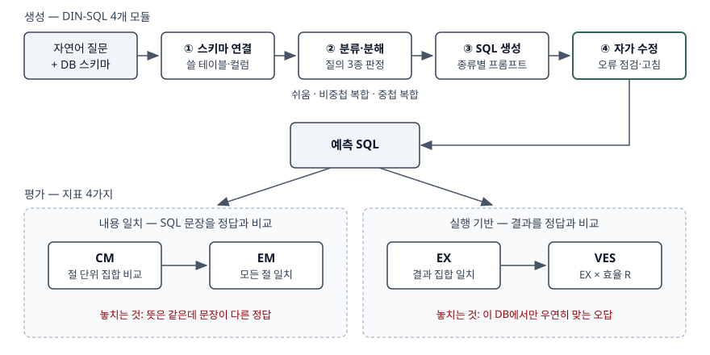

## 들어가며

Text-to-SQL 문항은 "무엇인가"에서 끝나지 않고 **어떻게 정확도를 올리고 어떻게 재는가**까지 묻는다. 실무에서도
같은 질문이 나온다. 사내 데이터에 자연어 질의를 붙였는데 "정확도 85%"라는 숫자가 나왔다면, 그것이 SQL 문장을
비교한 값인지 실행 결과를 비교한 값인지에 따라 뜻이 완전히 다르다. 이 글은 생성 절차를 DIN-SQL의 4개 모듈로,
평가를 지표 4가지로 정리하고, 지표가 서로 다른 판정을 내리는 경우를 SQLite로 직접 만들어 보였다.

> 계산 예제는 `code/metrics_demo.py`로 직접 돌렸다. 실행 기록: [`code/output.txt`](code/output.txt)

## 정의

**Text-to-SQL**: 자연어 질문과 데이터베이스 스키마를 입력받아, 그 관계형 데이터베이스에서 **실행할 수 있는 SQL
질의를 생성**하는 기술이다(Hong 등 서베이). 입력이 질문 하나가 아니라 **질문과 스키마 두 가지**라는 점이
정의의 핵심이다. 같은 질문이라도 스키마가 다르면 정답 SQL이 다르다.

## 등장 배경

Hong 등은 이 과제의 어려움을 **4가지**로 정리한다(§II-A). ① 언어의 복잡성·중의성, ② 스키마 이해와 표현,
③ 드물고 복잡한 SQL 연산, ④ 도메인 간 일반화다. 질문-SQL 쌍으로 학습한 신경망 모델은 ④에서 막혔다.
Spider(2018)는 학습과 시험에 서로 다른 DB를 두어 이 문제를 정면으로 쟀다. LLM이 등장하자 스키마 설명만으로
처음 보는 DB에 시도할 수 있게 됐지만, 한 번에 SQL 전체를 만들게 하면 조인 경로와 하위 질의에서 틀리기 쉬웠다.
DIN-SQL은 이 어려운 부분을 **떼어 내 단계별로 풀게** 하는 분해 방식을 제안했다.

## 구성요소 — 생성 4단계와 평가 지표 4가지

### 생성 절차: DIN-SQL의 4개 모듈

| 모듈 | 하는 일 |
|---|---|
| ① 스키마 연결(schema linking) | 질문의 단어가 가리키는 테이블·컬럼·값을 찾아 쓸 스키마만 고른다 |
| ② 분류·분해(classification & decomposition) | 질의를 **3종**으로 판정한다 — 쉬움, 비중첩 복합(조인 있음), 중첩 복합(하위 질의·집합 연산) |
| ③ SQL 생성 | ②에서 판정한 종류마다 다른 프롬프트로 SQL을 만든다 |
| ④ 자가 수정(self-correction) | 만든 SQL의 오류를 모델이 다시 점검해 고친다 |

④에는 프롬프트가 **2가지** 있다. 버그가 있다고 전제하고 고치게 하는 generic과, 버그를 전제하지 않고 점검하게
하는 gentle이다. 논문은 GPT-4에는 gentle이, CodeX에는 generic이 더 효과적이었다고 보고한다(§4.4).

### 평가 지표: 내용 일치 2가지, 실행 기반 2가지

| 지표 | 무엇이 같으면 맞다고 보는가 | 출처 |
|---|---|---|
| CM(Component Matching) | SELECT·WHERE·GROUP BY·ORDER BY·KEYWORDS 절마다, 절을 **집합**으로 보고 일치. F1로 보고 | Spider §6 |
| EM(Exact Matching) | **모든 절**이 CM 기준으로 일치 | Spider §6 |
| EX(Execution Accuracy) | 두 SQL을 실행한 **결과 집합**이 일치 | BIRD §5 식(2) |
| VES(Valid Efficiency Score) | 결과가 일치한 문항에 **효율 R = √(정답 실행 시간 / 예측 실행 시간)** 을 곱해 평균 | BIRD §5 식(4) |

Hong 등은 앞의 둘을 "SQL 내용 일치 기반", 뒤의 둘을 "실행 결과 기반"으로 묶는다(§III-B).
VES는 결과가 틀린 문항을 0으로 만들고, 맞은 문항에는 정답보다 빠르면 1보다 큰 점수를 준다.

## 도식



> **출처**: 4개 모듈과 질의 3분류는 [Pourreza & Rafiei, DIN-SQL §4](https://arxiv.org/html/2304.11015v3), CM·EM은 [Yu et al., Spider §6 Evaluation Metrics](https://arxiv.org/html/1809.08887v5), EX·VES 식은 [Li et al., BIRD §5 Evaluation Metrics](https://arxiv.org/html/2305.03111v3), 지표 묶음은 [Hong et al. §III-B Evaluation Metrics](https://arxiv.org/html/2406.08426)

## 검산 — 지표가 갈리는 다섯 쌍

직원 6명·부서 3개·매출 20만 행짜리 SQLite DB에 정답(gold)과 예측(pred) SQL 다섯 쌍을 돌렸다. CM 칸은
SELECT·FROM·WHERE 절이 각각 같은지를 O/X로 적었다. Spider 공식 스크립트가 아니라 절을 잘라 집합으로 비교하는
원리만 옮긴 비교기다.

```text
[2] 30세 초과 직원 수
    gold: SELECT count(*) FROM employee WHERE age > 30
    pred: SELECT count(*) FROM employee WHERE age >= 30
    문자열일치=X  CM=OOX  EM=X  EX=O  테스트스위트=X  R=1.00
[3] 30세 초과이고 급여 5000 초과인 직원 이름
    gold: SELECT name FROM employee WHERE age > 30 AND salary > 5000
    pred: SELECT name FROM employee WHERE salary > 5000 AND age > 30
    문자열일치=X  CM=OOO  EM=O  EX=O  테스트스위트=O  R=1.00
[4] 개발 부서 직원 이름
    gold: SELECT e.name FROM employee e JOIN dept d ON e.dept_id = d.id WHERE d.name = '개발'
    pred: SELECT name FROM employee WHERE dept_id IN (SELECT id FROM dept WHERE name = '개발')
    문자열일치=X  CM=XXX  EM=X  EX=O  테스트스위트=O  R=0.76
[5] 2026년 1월 매출 합계
    gold: SELECT sum(amount) FROM sales WHERE sold_on >= '2026-01-01' AND sold_on < '2026-02-01'
    pred: SELECT sum(amount) FROM sales WHERE strftime('%Y-%m', sold_on) = '2026-01'
    문자열일치=X  CM=OOX  EM=X  EX=O  테스트스위트=O  R=0.24

문자열 일치 1/5  EM 2/5  EX 5/5  테스트 스위트 4/5  VES 0.80
```

**[3]은 EM이 문장 비교가 아니라는 것을 보인다.** 조건 순서가 바뀌어 문자열은 다르지만, WHERE 절을 집합으로
보므로 EM은 맞다. Spider가 집합 비교로 "순서 문제"를 다룬다고 적은 부분이다.

**[4]는 EM의 거짓 음성이다.** 조인을 하위 질의로 풀어 세 절이 모두 달라졌지만 뜻은 같고 결과도 같다.
Spider도 EM이 새로운 구문을 쓴 정답을 틀렸다고 판정할 수 있다고 적는다. Zhong 등은 Spider 제출작 21개에서
EM의 거짓 음성 비율이 평균 2.6%, 최악 8.1%였다고 보고했다(§6.2).

**[2]는 EX의 거짓 양성이다.** 첫 DB에는 나이가 정확히 30인 직원이 없어 두 SQL이 모두 4를 낸다. 한 행을 더 넣은
두 번째 DB에서 갈린다.

```text
    DB1: gold=4  pred=4
    DB2: gold=4  pred=5
```

Zhong 등의 **테스트 스위트 정확도**가 이 방식이다. 정답 SQL을 조금씩 바꾼 이웃 질의를 만들고, 무작위로 만든
DB 가운데 그 이웃들을 구별하는 DB만 남겨 묶음을 만든다. 예측 SQL은 묶음의 **모든 DB에서** 정답과 같아야
맞다(§2·§4). 이 글의 두 번째 DB는 그 과정을 손으로 흉내 낸 것이다. [2]는 VES에서도 R=1.00을 받는다.
VES는 EX 위에 효율을 얹을 뿐이므로 EX의 거짓 양성을 그대로 물려받는다.

**[5]는 VES만 잡는다.** 결과는 같지만 실행계획이 다르다.

```text
gold:
QUERY PLAN
`--SEARCH sales USING INDEX ix_sales_sold_on (sold_on>? AND sold_on<?)
pred:
QUERY PLAN
`--SCAN sales
```

컬럼을 함수로 감싸 인덱스를 못 타고 20만 행을 다 읽는다. EX로는 만점이지만 운영 DB에서는 문제가 되는 SQL이다.
반대로 [4]의 R=0.76은 6행짜리 표라 실행 시간이 마이크로초 단위여서 생긴 흔들림이다. BIRD가 문항마다 100번
실행하고 이상값을 빼는 이유가 이것이고, 이 예제도 31회 중앙값을 썼지만 작은 표의 R은 돌릴 때마다 달라진다.

## 비교

| 구분 | CM | EM | EX | VES | 테스트 스위트 |
|---|---|---|---|---|---|
| 비교 대상 | 절별 SQL 내용 | SQL 전체 내용 | 실행 결과 | 실행 결과 + 시간 | 여러 DB의 실행 결과 |
| 값(리터럴) 예측 | 빼고 본다 | 빼고 본다 | 필요하다 | 필요하다 | 필요하다 |
| 거짓 음성 | 있다 | 있다 — [4] | 적다 | 적다 | 적다 |
| 거짓 양성 | 적다 | 적다 | 있다 — [2] | 있다 — [2] | 줄어든다 |
| 효율 반영 | 없다 | 없다 | 없다 | 있다 — [5] | 없다 |
| 제안·사용 | Spider | Spider | Spider·BIRD | BIRD | Zhong 등(2020) |

## 적용 시 고려사항

1. **보고된 정확도가 어느 지표인지 먼저 확인한다.** 위 다섯 쌍만 해도 EM 2/5, EX 5/5로 갈렸다. 지표가 다른
   숫자끼리는 비교할 수 없다. 벤치마크 수치를 인용할 때도 지표와 데이터셋을 함께 적는다.
2. **사내 평가 세트는 경계값을 품은 DB로 돌린다.** 운영 DB 사본 한 벌로 EX를 재면 [2] 같은 오답이 통과한다.
   검증된 질의 집합을 시험 세트로 삼되, NULL·경계값·빈 결과가 나오는 행을 넣은 DB를 따로 만든다.
3. **결과가 맞아도 실행계획을 본다.** [5]처럼 인덱스를 못 타는 SQL은 EX를 통과한다. 운영에서는 VES 같은 효율
   지표나 실행계획 검사, 최대 실행 시간 제한을 둔다.
4. **스키마 연결이 정확도의 출발점이다.** ①이 틀리면 뒤 단계가 아무리 좋아도 엉뚱한 표를 조회한다. 컬럼 설명과
   업무 용어 사전을 정비하는 일이 모델 교체보다 먼저다.
5. **자가 수정 프롬프트는 모델에 맞춰 고른다.** DIN-SQL에서도 같은 모듈이 모델에 따라 다른 프롬프트를 썼다.
   "틀렸다고 전제하고 고쳐라"는 지시는 맞는 SQL까지 망가뜨릴 수 있다.

## 정리

- 정의: **질문 + 스키마 → 실행 가능한 SQL.** 입력이 둘이다.
- 생성 **4단계**: 스키마 연결 → 분류·분해(쉬움·비중첩·중첩 **3종**) → 생성 → 자가 수정(generic·gentle **2가지**).
- 평가 **4지표**: 내용 일치 **CM·EM**, 실행 기반 **EX·VES**. 외우는 법은 "절·전체·결과·효율".
- EM은 뜻이 같은 정답을 놓치고(거짓 음성), EX는 우연히 맞는 오답을 통과시킨다(거짓 양성) → **테스트 스위트**.
- VES = EX × √(정답 시간 / 예측 시간). 결과가 같아도 느린 SQL을 깎는다.

> 기출 답안: [기출문제 — TEXT2SQL의 개념과 활용 사례](../../exam/2026-11-12-text-to-sql-concept-and-use-cases/index.md)
>
> 관련 개념: [RAG 구성요소와 검색 품질 지표](../2026-10-14-rag-components-retrieval-metrics/index.md)

## 참고 자료

- [Hong et al., Next-Generation Database Interfaces: A Survey of LLM-based Text-to-SQL, arXiv:2406.08426v8 (2025-11-24)](https://arxiv.org/html/2406.08426) — 정의, §II-A 과제 4가지, §III-B 평가 지표(내용 일치·실행 기반)
- [Yu et al., Spider, EMNLP 2018, arXiv:1809.08887v5](https://arxiv.org/html/1809.08887v5) — §6 CM·EM 정의, 집합 비교, EM의 거짓 음성과 EX의 거짓 양성
- [Li et al., Can LLM Already Serve as A Database Interface? (BIRD), NeurIPS 2023, arXiv:2305.03111v3](https://arxiv.org/html/2305.03111v3) — §5 EX 식(2)·(3), VES 식(4)
- [Pourreza & Rafiei, DIN-SQL, NeurIPS 2023, arXiv:2304.11015v3](https://arxiv.org/html/2304.11015v3) — §4 4개 모듈, §4.2 질의 3분류, §4.4 자가 수정 프롬프트 2가지
- [Zhong, Yu, Klein, Semantic Evaluation for Text-to-SQL with Distilled Test Suites, EMNLP 2020, arXiv:2010.02840v1](https://arxiv.org/html/2010.02840v1) — §2 정의, §4 DB 표본 추출과 증류, §6.2 EM 거짓 음성 비율
- 전체 소스: [`code/metrics_demo.py`](code/metrics_demo.py) · 실행 기록: [`code/output.txt`](code/output.txt)
