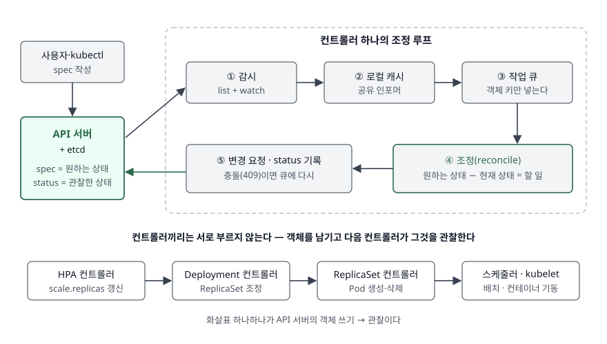

> **실행 검증 없음.** 쿠버네티스 공식 문서와 쿠버네티스 커뮤니티 저장소의 API 규약·컨트롤러 작성
> 지침만 근거로 정리했다. 클러스터를 띄워 확인한 출력은 싣지 않았다.

## 들어가며

쿠버네티스 문제는 컴포넌트 이름을 나열하는 것으로 끝나기 쉽다. 그런데 컴포넌트를 묶는 원리는
하나뿐이다. **원하는 상태를 적어 두면 독립된 컨트롤러들이 현재 상태를 그쪽으로 옮긴다.**
HPA·ReplicaSet·오퍼레이터를 묻는 문항도 결국 이 원리를 한 사례에 적용한 것이므로, 컨트롤러
패턴을 구조로 설명할 수 있으면 나머지는 사례로 붙일 수 있다.

## 정의

**컨트롤러는 클러스터의 상태를 관찰하다가, 현재 상태를 원하는 상태에 가깝게 만드는 변경을 직접
하거나 API 서버에 요청하는 종료되지 않는 제어 루프다**(쿠버네티스 문서 Controllers).
그 루프 한 바퀴, 즉 원하는 상태와 현재 상태를 비교해 차이를 줄이는 동작을 **조정(reconcile)**
이라 부른다.

원하는 상태와 현재 상태는 객체 안의 두 필드로 나뉜다. API 규약은 **`spec`을 원하는 상태,
`status`를 실제 상태에 대한 가장 최근의 관찰**로 정의하고, 사용자는 `spec`을, 컨트롤러는
`status`를 쓰도록 권한을 나누라고 적는다.

## 등장 배경

전통적인 배포 자동화는 **명령형 작업 흐름**이다. "서버 3대에 설치 → 로드밸런서 등록 → 상태 확인"을
순서대로 실행하고, 중간에 실패하면 어디까지 됐는지를 사람이 확인해 이어 붙인다. 순서가 정해진
흐름은 단계 하나가 빠지거나 멈추면 전체가 어긋난다.

쿠버네티스 문서는 자신을 단순한 오케스트레이션 시스템이 아니라고 설명한다. 정해진 순서를 실행하는
대신, 서로 독립된 제어 프로세스들이 각자 현재 상태를 원하는 상태로 옮긴다. 어떤 컴포넌트가 잠시
멈춰도 다시 돌기 시작하면 그 시점의 차이를 메우므로, **놓친 단계를 복구하는 절차가 따로 필요 없다.**
API 규약은 이것을 "**레벨 기반이지 에지 기반이 아니다**"라고 적는다. 상태 변화라는 사건(에지)이
아니라, 지금 어떤 상태인가(레벨)를 보고 판단한다는 뜻이다.

## 구성요소 — 조정 루프의 5단계

컨트롤러 작성 지침(Writing Controllers)이 제시하는 구조는 다음 5단계로 정리된다.

| 단계 | 하는 일 | 근거 |
|---|---|---|
| ① 감시 | API 서버에서 목록을 받고(list) 그 버전 이후의 변경을 구독한다(watch) | API Concepts — Efficient detection of changes |
| ② 로컬 캐시 | 공유 인포머가 객체를 메모리에 두고 추가·수정·삭제 이벤트를 알린다. 여러 컨트롤러가 캐시 하나를 공유한다 | Writing Controllers 지침 4 |
| ③ 작업 큐 | 이벤트 내용이 아니라 **객체 키**만 넣는다. 같은 키는 한 번에 한 작업자만 처리한다 | 지침 1 |
| ④ 조정 | 키로 캐시에서 **현재의** `spec`과 실제 상태를 다시 읽어 차이를 계산한다 | 지침 3 |
| ⑤ 반영·기록 | 차이만큼 객체를 만들거나 지우고, 판단 결과를 `status`에 기록한다. 실패하면 큐에 다시 넣는다 | 지침 9, API 규약 |

③과 ④가 레벨 기반을 구현하는 곳이다. 큐에 사건이 아니라 키만 넣으므로, 같은 객체에 변경이 열 번
있어도 조정은 마지막 상태를 보고 한 번 하면 된다. API 규약도 시스템이 가장 최근의 `spec`을 향해
움직이며 **중간 값에 반응할 필요가 없다**고 적는다.

## 도식

> **출처**: [Kubernetes v1.37 — Controllers §Controller pattern·§Control via API server](https://kubernetes.io/docs/concepts/architecture/controller/) · [kubernetes/community — Writing Controllers §Guidelines·§Rough Structure](https://github.com/kubernetes/community/blob/master/contributors/devel/sig-api-machinery/controllers.md) · [Horizontal Pod Autoscaling](https://kubernetes.io/docs/tasks/run-application/horizontal-pod-autoscale/)

아래 줄이 컨트롤러 패턴의 두 번째 특징이다. **컨트롤러는 다른 컨트롤러를 호출하지 않는다.**
HPA는 지표를 읽어 `desiredReplicas = ceil(currentReplicas × 현재값 / 목표값)`을 계산하고, 대상
Deployment의 `scale` 하위 자원만 고친다(기본 15초 주기, 허용 오차 0.1). Deployment 컨트롤러는
바뀐 `replicas`를 보고 ReplicaSet을 조정하고, ReplicaSet 컨트롤러는 파드가 모자라면
`.spec.template`으로 만들고 남으면 지운다. 스케줄러와 kubelet은 다시 그 파드 객체를 관찰한다.
문서는 이렇게 **한 컨트롤러가 한 측면만 맡는 작은 컨트롤러 여럿**을 택한 이유로, 하나가 실패해도
다른 컨트롤러가 이어서 동작한다는 점을 든다.

## 상태를 안전하게 쓰는 장치 — 3가지

| 장치 | 내용 | 막는 문제 |
|---|---|---|
| ① `resourceVersion` | 객체가 바뀔 때마다 바뀌는 버전. 읽은 버전을 실어 쓰면 그 사이 다른 쓰기가 있을 때 **409 Conflict**로 거절된다 | 두 컨트롤러가 같은 객체를 덮어쓰는 갱신 손실 (낙관적 동시성 제어) |
| ② `generation`·`observedGeneration` | `spec`이 바뀔 때 오르는 번호와, 컨트롤러가 마지막으로 처리한 번호 | 사용자가 "반영됐는가"를 `status`만 보고 판단하는 착오 |
| ③ `ownerReferences` | 파드가 자기를 만든 ReplicaSet을 가리킨다. 소유자를 지우면 가비지 컬렉터가 종속 객체를 지운다 | 컨트롤러가 남의 객체를 건드리거나 고아 객체가 쌓이는 문제 |

## 비교

| 구분 | 레벨 기반 조정 (컨트롤러) | 에지 기반 처리 (이벤트 핸들러) |
|---|---|---|
| 판단 근거 | 지금의 `spec`과 실제 상태 | 받은 사건 하나하나 |
| 사건을 놓치면 | 다음 조정 때 차이로 드러나 메워진다 | 그 사건의 처리가 영영 빠진다 |
| 같은 사건이 두 번 오면 | 차이가 없으므로 아무 일도 하지 않는다(멱등) | 두 번 처리될 수 있다 |
| 재시작 후 | 전체 목록을 다시 받아 조정하면 된다 | 마지막으로 처리한 사건 위치를 따로 보관해야 한다 |
| 비용 | 주기적 재동기화로 같은 객체를 반복해 본다 | 사건이 올 때만 일한다 |

| 구분 | 컨트롤러 패턴 | 명령형 워크플로 |
|---|---|---|
| 입력 | 도달할 상태 | 실행할 단계 순서 |
| 조정 주체 | 독립된 컨트롤러 여럿 | 중앙 실행기 하나 |
| 부분 실패 | 다른 루프는 계속 돌고, 멈춘 루프는 재기동 후 따라잡는다 | 실패 지점부터 사람이 재개 |
| 확장 | 사용자 정의 자원 + 컨트롤러 = 오퍼레이터 | 새 단계를 흐름에 끼워 넣는다 |

## 적용 시 고려사항

**첫째, 조정 함수는 멱등이어야 한다.** 작성 지침은 인포머가 주기적으로 재동기화해 모든 객체를 다시
큐에 넣을 수 있다고 적는다. 같은 키로 몇 번 불려도 결과가 같아야 하므로, "파드 하나 추가"가 아니라
"파드를 `replicas`개로 맞춘다"로 써야 한다.

**둘째, 순서와 단독 실행을 가정하지 않는다.** 서로 다른 자원 사이의 이벤트 순서는 보장되지 않고,
현재 상태는 다른 주체가 언제든 바꿀 수 있다. 리더 선출로 복제본 중 하나만 돌게 해도 드물게 두
복제본이 동시에 활동할 수 있다고 지침은 경고한다. 그래서 쓰기는 `resourceVersion` 충돌을 전제로
하고, 충돌이면 다시 읽어 재시도한다.

**셋째, 판단 결과를 `status`에 남긴다.** 레벨 기반이라는 것은 과거 사건을 기억하지 않는다는 뜻이다.
컨트롤러가 재기동했을 때 무엇을 이미 결정했는지 알려면 그 결정이 객체에 기록돼 있어야 한다.
`observedGeneration`과 Conditions를 갱신하면 사용자도 반영 여부를 판단할 수 있다.

**넷째, 캐시가 채워진 뒤에 조정을 시작한다.** 시작 직후 캐시가 비어 있으면 "파드가 0개"로 보고
불필요한 파드를 만든다. 지침은 보조 캐시의 동기화를 기다린 다음 작업자를 띄우라고 한다.

## 정리

- **정의**: 관찰 → 비교 → 변경을 끝없이 반복해 `status`를 `spec`에 맞추는 제어 루프
- **원리 2가지**: 레벨 기반(사건이 아니라 상태를 본다) · 컨트롤러끼리는 API 서버만 사이에 둔다
- **루프 5단계**: 감시 · 캐시 · 작업 큐 · 조정 · 반영과 기록 — "감캐큐조기"
- **안전 장치 3가지**: `resourceVersion`(409 충돌) · `observedGeneration` · `ownerReferences`
- **연쇄 사례**: HPA → Deployment → ReplicaSet → 스케줄러·kubelet, 각 화살표가 객체 쓰기와 관찰

> 기출 답안: [기출문제 — 쿠버네티스의 개념·주요 컴포넌트와 HPA](../../exam/2026-11-17-kubernetes-components-hpa/index.md)

## 참고 자료

- [Kubernetes v1.37 문서 — Controllers](https://kubernetes.io/docs/concepts/architecture/controller/) — 제어 루프 정의, Controller pattern, Control via API server, Direct control, Design(작은 컨트롤러 여럿)
- [Kubernetes v1.37 문서 — Overview §What Kubernetes is not](https://kubernetes.io/docs/concepts/overview/#what-kubernetes-is-not) — 정해진 작업 흐름이 아니라 독립된 제어 프로세스들의 집합
- [Kubernetes v1.37 문서 — Objects In Kubernetes](https://kubernetes.io/docs/concepts/overview/working-with-objects/) — `spec`과 `status`
- [kubernetes/community — API Conventions](https://github.com/kubernetes/community/blob/master/contributors/devel/sig-architecture/api-conventions.md) — Spec and Status(레벨 기반, 권한 분리, `/status` 하위 자원), Typical status properties(`observedGeneration`, Conditions), Concurrency Control and Consistency(`resourceVersion`, 409 Conflict)
- [kubernetes/community — Writing Controllers](https://github.com/kubernetes/community/blob/master/contributors/devel/sig-api-machinery/controllers.md) — 작성 지침(한 번에 한 항목, 레벨 기반, 공유 인포머, 캐시 동기화 대기, 재동기화, 소유자 참조)과 기본 골격
- [Kubernetes v1.37 문서 — API Concepts §Efficient detection of changes](https://kubernetes.io/docs/reference/using-api/api-concepts/#efficient-detection-of-changes) — list·watch와 `resourceVersion`
- [Kubernetes v1.37 문서 — ReplicaSet](https://kubernetes.io/docs/concepts/workloads/controllers/replicaset/) — `ownerReferences`, 복제 수 맞추기
- [Kubernetes v1.37 문서 — Horizontal Pod Autoscaling](https://kubernetes.io/docs/tasks/run-application/horizontal-pod-autoscale/) — 15초 주기, 복제 수 계산식, 허용 오차 0.1, `scale` 하위 자원
- [Kubernetes v1.37 문서 — Garbage Collection](https://kubernetes.io/docs/concepts/architecture/garbage-collection/) — 소유자 참조와 연쇄 삭제
- [Kubernetes v1.37 문서 — Operator pattern](https://kubernetes.io/docs/concepts/extend-kubernetes/operator/) — 사용자 정의 자원의 컨트롤러로서의 오퍼레이터
