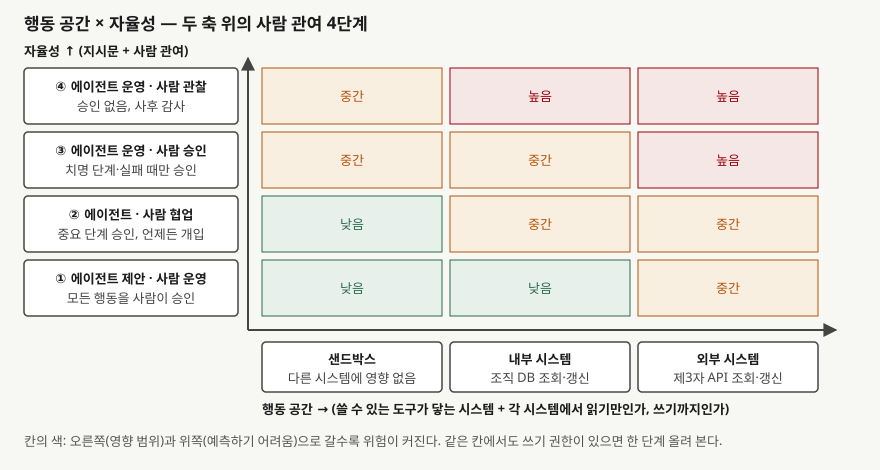
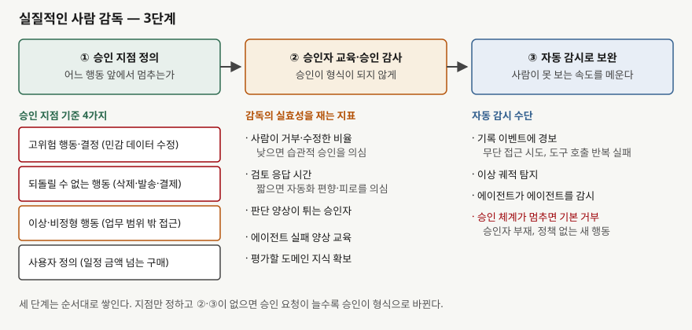

> **실행 검증 없음.** 싱가포르 정보통신미디어개발청(IMDA)이 발간한 에이전틱 AI 거버넌스
> 프레임워크 원문을 근거로 정리했다. 단계 이름과 기준 이름은 원문의 영문 표현을 옮겼고,
> 도식의 위험 색 구분은 같은 문서의 위험 요인을 두 축에 겹쳐 본 것이다.

## 들어가며

에이전틱 AI를 묻는 문제에서 "사람이 감독한다"는 문장은 거의 모든 답안에 들어간다. 점수가 갈리는
것은 그다음이다. **무엇을 줄여서 위험을 줄이는가, 사람은 어느 행동 앞에서 멈추게 하는가, 그 승인이
형식이 되지 않게 무엇을 재는가.** 실무에서도 같다. 승인 창을 모든 행동 앞에 띄우면 승인자는 몇십 번째부터
읽지 않고 누르고, 아예 안 띄우면 운영 데이터가 지워진 뒤에야 안다. 이 글은 그 사이를 설계하는 두 축과
승인 지점의 기준을 정리한다.

## 정의

> **행동 공간(action-space)은 에이전트가 쓸 수 있는 도구와 그 도구에 걸린 권한으로 정해지는, 에이전트가
> 실행할 수 있는 행동의 범위이고, 자율성(autonomy)은 지시문의 상세도와 사람의 관여 수준으로 정해지는,
> 목표를 향해 어떻게 행동할지를 에이전트가 스스로 정하는 정도다.**

IMDA 프레임워크의 에이전트 설계 절(§1.1.3)이 두 개념을 이렇게 나눈다. 원문은 행동 공간을 권한·능력
(authority, capabilities)으로, 자율성을 의사결정(decision-making)으로도 부른다. 한 줄로 줄이면
**행동 공간은 "무엇을 할 수 있는가", 자율성은 "누가 정하는가"** 다. 둘을 나누는 이유는 통제 수단이
다르기 때문이다. 행동 공간은 권한 설정으로 줄이고, 자율성은 지시문과 승인 절차로 줄인다.

## 등장 배경

생성형 AI는 글을 만들 뿐이라, 잘못된 출력이 피해가 되려면 사람이 그것을 옮겨 실행해야 했다. 사람이
마지막 관문이었다. 에이전트는 도구를 직접 호출해 외부 시스템의 상태를 바꾸므로 이 관문이 사라진다.
IMDA가 드는 위험 유형 다섯 가지(잘못된 행동, 권한 밖 행동, 편향된 행동, 데이터 유출·변조, 연결 시스템
장애)가 전부 **행동**에서 나온다.

그렇다고 모든 행동에 사람을 세울 수는 없다. 프레임워크 요약문은 모든 흐름을 사람이 계속 감독하는 것은
규모가 커지면 비현실적이라고 적고, 위험 절(§1.2.3)은 에이전트의 결정 속도 때문에 실시간 차단이 어렵고
승인자에게 계속 감독을 맡기면 **자동화 편향(automation bias, 기계의 판단을 검토 없이 따르는 경향)** 과
경보 피로가 생긴다고 적는다. "사람이 승인한다 / 안 한다"의 이분법으로는 이 문제가 풀리지 않는다.
그래서 **관여를 단계로 나누고, 단계를 행동의 위험에 맞춰 고르는** 설계가 나왔다.

## 구성요소 — 네 묶음

### 가. 행동 공간을 정하는 요인 2가지

| 요인 | 갈래 | 내용 |
|---|---|---|
| ① 접근 가능한 시스템 | 3단계 | **샌드박스**(코드 실행·분석 도구, 다른 시스템에 영향 없음) → **내부 시스템**(조직의 DB 조회·갱신) → **외부 시스템**(제3자 API 조회·갱신) |
| ② 그 시스템에서의 행동 | 2가지 | **읽기**만 하는가, **쓰기**까지 하는가 |

원문은 화면과 브라우저를 직접 조작하는 **컴퓨터 사용 에이전트**를 따로 짚는다. 정해진 도구와 API에
기대지 않고 사람이 컴퓨터로 할 수 있는 모든 행동을 할 수 있으므로, 행동 공간이 도구 목록으로 제한되지
않는다.

### 나. 자율성을 정하는 요인 2가지와 사람 관여 4단계

첫 요인은 **지시문**이다. 상세한 표준 절차서(SOP)를 따르라고 지시받은 에이전트는 단계마다 고를 여지가
적고, 스스로 판단하라고 지시받은 에이전트는 계획과 흐름을 직접 정한다. 둘째 요인이 **사람의 관여 수준**이며
**4단계**로 나뉜다.

| 단계 | 원문 이름 | 승인 위치 | 원문의 예 |
|---|---|---|---|
| ① | Agent proposes, human operates | 모든 행동 | 사람이 에이전트의 행동을 하나하나 검토·승인 |
| ② | Agent and human collaborate | 중요 단계 | DB 쓰기·결제 전 승인, 사람은 언제든 작업을 넘겨받거나 멈출 수 있다 |
| ③ | Agent operates, human approves | 치명 단계·실패 | DB 삭제, 정한 금액을 넘는 결제 |
| ④ | Agent operates, human observes | 없음 | 승인 없이 수행하고 사후에 감사 |

원문은 기업 배포 대부분이 결정적 규칙과 일부 자율성을 섞은 **혼합형**이라고 적는다. 한 시스템 안에서도
작업마다 단계가 다를 수 있다는 뜻이다.

### 다. 승인 지점 기준 4가지

사람 감독 설계 절(§2.2.2)은 사람의 승인이 필요한 지점, 곧 **행동 경계**를 정하라고 하고 기준 **네 가지**를
든다. ① **고위험 행동·결정**(민감 데이터 수정, 의료·법률 같은 고위험 영역의 최종 결정, 법적 책임을 부를
행동), ② **되돌릴 수 없는 행동**(데이터 영구 삭제, 통신 발송, 결제), ③ **이상·비정형 행동**(업무 범위
밖의 시스템 접근, 중앙값의 두 배인 배송 경로 선택), ④ **사용자 정의**(사용자가 정한 금액을 넘는 구매)다.

승인을 **어떤 형태로** 받을지도 설계 대상이다. 요청은 긴 로그 대신 짧고 맥락 있게 만들되 위험과 신뢰도는
드러낸다. 입력 형태는 행동에 따라 다르다. 단순 접근은 승인·거부, 계획 검토는 사람이 계획을 고친 뒤 진행,
고위험 행동은 **서면 사유**를 요구한다.

### 라. 감독의 실효성 — 감사 지표와 자동 감시

승인 지점을 정해도 사람은 피로와 자동화 편향에 노출된다. 프레임워크는 감독 자체를 정기적으로 감사하라고
하고 지표를 든다. **사람이 거부·수정한 비율**이 낮으면 습관적 승인을, **검토 응답 시간**이 짧으면 자동화
편향이나 피로를 의심한다. 판단 양상이 다른 사람과 크게 다른 승인자를 데이터 분석으로 찾는다. 여기에 승인자
교육(에이전트의 흔한 실패 양상)과 도메인 지식 확보를 더한다. 원문은 에이전트가 내놓는 추론 과정이 실제
행동의 충실한 설명이 아닐 수 있다는 점도 교육 항목으로 적는다.

사람의 감독은 **자동 감시**로 보완한다. 기록된 이벤트(무단 접근 시도, 도구 호출 반복 실패)에 경보를 걸고,
이상 궤적을 탐지하고, 에이전트로 에이전트를 감시한다. 마지막 수단이 중요하다. **승인 체계가 동작하지 않을 때는
기본 거부한다.** 승인자에게 연락이 안 되거나 승인 정책이 없는 새 행동을 시도하면 실행하지 않는다.

## 도식

> **출처**: [IMDA, Model AI Governance Framework for Agentic AI v1.5 §1.1.3 How agent design affects the limits and capabilities of each agent, §2.1.1 Determine suitable use cases for agent deployment](https://www.imda.gov.sg/assets/d1e45a56-d898-4b9f-972e-8ae94be1a5a5.pdf)

가로축은 영향의 범위, 세로축은 예측하기 어려움이다. 위험 평가 절(§2.1.1)은 위험을 **가능성 × 영향**으로
보고, 영향 쪽 요인으로 영역의 오류 허용도, 민감 데이터 접근, 외부 시스템 접근, 행동 범위(읽기·쓰기, 도구 수),
되돌릴 수 있는지 **다섯 가지**를, 가능성 쪽 요인으로 자율성 수준·과업 복잡도·외부 노출 등을 든다. 칸의 색은
이 두 묶음을 축에 겹친 것이다. 답안지에는 4행 3열 격자와 축 이름 두 개면 된다.

> **출처**: [IMDA, Model AI Governance Framework for Agentic AI v1.5 §2.2.2 Design for meaningful human oversight](https://www.imda.gov.sg/assets/d1e45a56-d898-4b9f-972e-8ae94be1a5a5.pdf)

## 비교

### 관여 단계 — IMDA 4단계와 원 분류 5단계

IMDA는 관여 단계의 근거로 컬럼비아대 나이트 연구소의 자율성 단계 논문을 단다. 그 논문은 **사용자가 맡는
역할**로 다섯 단계를 나눈다. 아래 대응은 두 문서의 단계 설명을 나란히 놓아 맞춘 것이다.

| 원 분류 (Feng 외, 2025) | 사용자 역할 | IMDA 4단계 |
|---|---|---|
| L1 운영자 | 사용자가 지시하고 결정, 에이전트는 실행 | ① 에이전트 제안 · 사람 운영 |
| L2 협업자 | 함께 계획·위임·실행 | ② 협업 |
| L3 자문자 | 에이전트가 주도하되 전문성·선호를 사용자에게 묻는다 | (두지 않음) |
| L4 승인자 | 위험하거나 미리 정한 상황에서만 관여 | ③ 에이전트 운영 · 사람 승인 |
| L5 관찰자 | 완전 자율, 사용자는 감시 | ④ 에이전트 운영 · 사람 관찰 |

빠진 L3이 차이를 보여 준다. 자문은 판단을 돕는 관여이고 승인은 행동을 막는 관여다. 통제를 다루는 IMDA는
**행동 앞에서 멈추는 관여**만 남겼다.

### 위험을 줄이는 세 수단

| 구분 | 행동 공간 축소 | 자율성 축소 | 승인 지점 |
|---|---|---|---|
| 무엇을 바꾸나 | 도구 목록·권한 | 지시문 상세도 | 특정 행동 앞의 정지 |
| 언제 작동 | 설계 시점 | 계획 수립 시점 | 실행 직전 |
| 비용 | 할 수 있는 일이 줄어든다 | 낯선 상황 대응력이 준다 | 사람 시간, 피로 |
| 잘 맞는 위험 | 영향 범위가 넓은 위험 | 예측 불가능성 | 되돌릴 수 없는 행동 |

세 수단은 대체 관계가 아니다. **먼저 행동 공간을 줄이고, 남은 행동 중 되돌릴 수 없는 것에만 승인 지점을
둔다.** 행동 공간을 그대로 두고 승인만 늘리면 승인 요청이 많아져 결국 자동화 편향으로 돌아간다.

## 적용 시 고려사항

**① 에이전트의 권한은 승인한 사람의 권한을 넘지 않는다.** 원문의 권한 부여 항목은 에이전트 권한을 범위가
정해지고, 시간·세션에 묶이고, 넘겨줄 수 없고, 최소 권한을 기본으로 하라고 하며, 사람이 자기 권한보다 큰
권한을 에이전트에 줄 수 없고 그 위임을 기록하라고 적는다. 승인 지점을 아무리 잘 둬도 권한이 넓으면 승인 밖의
행동이 남는다.

**② 승인 강도를 일률적으로 두지 않는다.** IMDA가 실은 코딩 에이전트 사례는 파일 읽기는 승인 없이, 파일 수정은
세션 단위 승인, 셸 실행은 프로젝트·명령 단위 승인으로 나누고, 운영 자격 증명이 없는 저위험 프로젝트는 느슨하게,
비밀·운영 인프라·배포 파이프라인에 닿는 프로젝트는 엄격하게 둔다. 이미 허용한 명령 패턴이라도 수상한 변형이
붙으면 다시 승인을 받는다.

**③ 승인 체계의 장애를 설계에 넣는다.** 승인자가 부재하거나 정책에 없는 행동이 나오면 실행하지 않는 **기본
거부**가 없으면, 승인 지점은 승인자가 있을 때만 동작하는 장치가 된다.

**④ 거부·수정 비율과 응답 시간을 운영 지표로 둔다.** 둘 다 기록이 있어야 잴 수 있으므로 승인 요청·결과·소요
시간을 로그로 남기는 것이 전제다. 비율이 낮다고 에이전트가 정확하다는 뜻은 아니라는 점을 함께 해석한다.

**⑤ 남는 위험을 받아들일지 판단한다.** 원문은 통제를 다 걸어도 잔여 위험은 남으므로 그것이 감당할 수준인지
조직이 결정하라고 적는다. 받아들일 수 없으면 에이전트가 아니라 결정적 워크플로가 맞는 업무다.

## 정리

- **두 축 — 행동 공간(무엇을 할 수 있나) × 자율성(누가 정하나).** 앞은 권한으로, 뒤는 지시문과 승인으로 줄인다
- **행동 공간 2요인 — 시스템 3단계(샌드박스·내부·외부) + 읽기/쓰기**
- **사람 관여 4단계 — 제안·협업·승인·관찰.** 승인 위치가 모든 행동 → 중요 단계 → 치명 단계 → 없음으로 옮겨 간다
- **승인 지점 4기준 — 고위험 · 비가역 · 비정형 · 사용자 정의**
- **감독 3단계 — 지점 정의 → 승인자 교육·감사 → 자동 감시.** 감사 지표는 거부·수정 비율과 응답 시간, 마지막 안전장치는 기본 거부
- **순서 한 줄** — 행동 공간을 먼저 줄이고, 남은 비가역 행동에만 승인 지점을 둔다

> 기출 답안: [기출문제 — 에이전틱 AI(Agentic AI)](../../exam/2026-11-19-agentic-ai-components-autonomy-governance/index.md)

## 참고 자료

- [IMDA, Model AI Governance Framework for Agentic AI, Version 1.5 (2026-05-20 발행, 2026-06-05 갱신)](https://www.imda.gov.sg/assets/d1e45a56-d898-4b9f-972e-8ae94be1a5a5.pdf) — 행동 공간과 자율성의 정의(§1.1.3), 사람 관여 4단계, 위험 유형과 체계적 위험(§1.2), 위험 평가 요인(§2.1.1), 권한 부여 원칙, 승인 지점 기준과 감독 실효성 측정(§2.2.2), 코딩 에이전트 사례
- [Feng·McDonald·Zhang, Levels of Autonomy for AI Agents (Knight First Amendment Institute, 2025-07-28)](https://knightcolumbia.org/content/levels-of-autonomy-for-ai-agents-1) — 사용자 역할로 나눈 자율성 5단계. [arXiv 2506.12469](https://arxiv.org/abs/2506.12469)에도 실렸다
