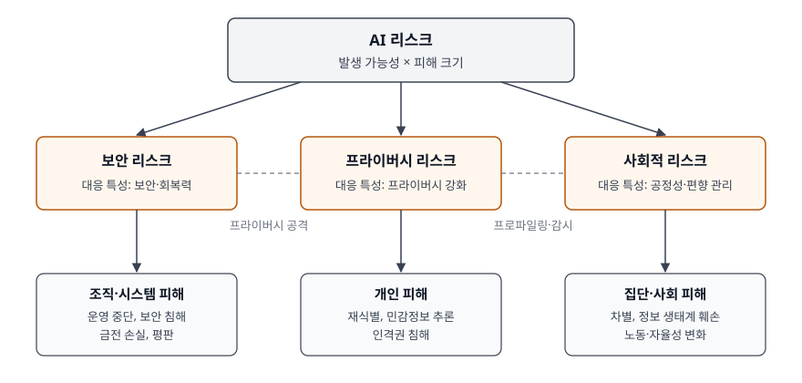
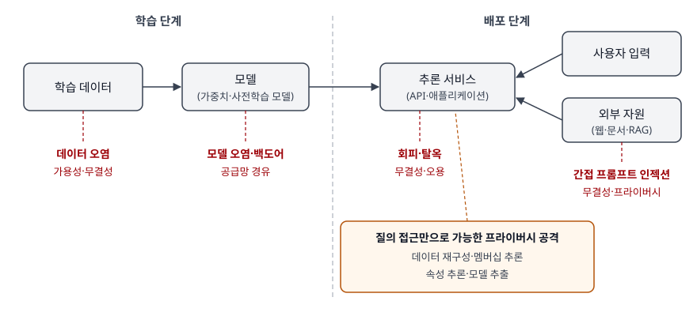

기출문제에서 AI 리스크를 네 갈래로 나눠 묻는다. 먼저 AI 리스크가 무엇인지 정의하고, 이어서 보안·프라이버시·사회
세 영역의 리스크를 각각 설명하라는 것이다. 세 영역을 사례 나열로 채우면 서로 겹치는 내용이 반복되는 답안이
된다. 점수는 (가)에서 **리스크를 측정 가능한 개념으로 세우고**, (나)~(라)를 **피해를 입는 대상과 공격·발생 지점**이라는
같은 축으로 정리하는 데서 난다. 보안 리스크는 시스템이 공격받아 조직이 피해를 입는 것이고, 프라이버시 리스크는
데이터 처리와 추론으로 개인이 피해를 입는 것이며, 사회적 리스크는 개별 사고가 아니라 누적된 사용으로 집단과
사회가 피해를 입는 것이다.

> 실행 검증 없음. 개념 문제이므로 NIST의 AI 위험관리 프레임워크·적대적 머신러닝 분류·생성형 AI 프로파일,
> 개인정보보호위원회의 AI 프라이버시 리스크 관리 모델, 국제 AI 안전 보고서 2026 원문 근거로 정리했다.
> 개인정보위 모델의 리스크 유형 표는 원문 PDF를 직접 열지 못해 법무법인 뉴스레터에 옮겨 적힌 표로 확인했다.

---

## Ⅰ. 개요

### 가. AI 리스크의 구조

NIST AI 위험관리 프레임워크(AI RMF 1.0)는 AI 리스크를 **사건이 일어날 가능성과 그 결과의 크기를 합친 척도**로
정의한다. 같은 프레임워크는 피해를 받는 쪽을 **사람·조직·생태계** 3가지로 나누고, 리스크를 줄이는 방향을
신뢰할 수 있는 AI의 특성 7가지로 제시한다. 문항의 세 영역은 이 특성 중 셋에 대응한다.

> **출처**: [NIST AI 100-1 AI RMF 1.0 §1.1 Understanding and Addressing Risks, Impacts, and Harms · Fig. 1 · §3.3 Secure and Resilient · §3.6 Privacy-Enhanced · §3.7 Fair – with Harmful Bias Managed](https://nvlpubs.nist.gov/nistpubs/ai/NIST.AI.100-1.pdf)

### 나. 세 리스크 영역의 관계

세 영역은 서로 겹친다. 모델에서 학습 데이터를 뽑아내는 공격은 **보안 공격이면서 프라이버시 침해**다. 추천
시스템의 프로파일링은 **개인의 프라이버시 문제이면서 사회의 감시·양극화 문제**다. 그래서 답안에서는 각 영역을
"무엇이 다치는가"로 가르고, 겹치는 지점은 따로 표시한다.

## Ⅱ. AI 리스크 개념

### 가. 정의

| 출처 | 정의 |
|---|---|
| NIST AI RMF 1.0 리스크 정의 절(§1.1) | 사건이 발생할 **확률**과 그 사건이 낳는 **결과의 크기**를 합친 척도. 결과는 긍정·부정 모두일 수 있다(ISO 31000:2018을 고쳐 씀) |
| 같은 절, 부정적 영향 기준 | 사건이 일어났을 때의 **피해 크기**와 **발생 가능성**의 함수(OMB Circular A-130을 고쳐 씀) |
| ISO 31000:2018 | 리스크 관리는 리스크에 대해 조직을 지휘·통제하는 **조정된 활동** (AI RMF가 그대로 인용) |

AI 리스크 관리를 다루는 국제 표준 ISO/IEC 23894:2023도 ISO 31000의 틀을 AI에 맞춰 적용한 것이다. 따라서
답안의 정의는 "AI 시스템의 개발·배포·사용에서 생기는 사건의 발생 가능성과 피해 크기의 결합"으로 쓰면
두 계열 모두와 맞는다.

### 나. 전통적 소프트웨어 리스크와 다른 점

AI RMF 부록 B는 AI에서 새로 생기거나 커지는 리스크를 14가지로 든다. 정보시스템 관점에서 묶으면 4가지다.

| 묶음 | 내용 | 영향을 받는 영역 |
|---|---|---|
| ① 데이터 의존 | 학습 데이터가 실제 사용 맥락을 대표하지 못하거나 시간이 지나 낡는다. 정답(ground truth)이 없을 수도 있다 | 사회(편향), 보안(오염) |
| ② 학습이 동작을 바꿈 | 학습 중의 의도적·비의도적 변경이 성능을 근본적으로 바꾼다. 데이터·모델·개념 드리프트로 유지보수가 잦다 | 보안(오염·백도어) |
| ③ 불투명성 | 규모와 복잡도가 커 실패 양상을 예측하기 어렵고, 재현성과 시험 기준이 미비하다 | 전 영역 (검증이 어렵다) |
| ④ 데이터 집적 능력 | AI의 데이터 결합 능력이 커져 프라이버시 리스크가 늘어난다 | 프라이버시 |

같은 부록은 기존 보안·프라이버시 프레임워크가 **회피·모델 추출·멤버십 추론 같은 머신러닝 공격**과 **편향**을
다루지 못한다고 적는다. 그래서 AI 리스크는 기존 정보보호 관리체계에 얹되 별도 항목으로 관리해야 한다.

### 다. 피해 대상 3가지

| 대상 | 예 (AI RMF 피해 예시 그림 기준) |
|---|---|
| ① 사람 | 개인의 자유·권리·안전·경제적 기회 침해, 특정 집단 차별, 민주적 참여·교육 접근 같은 사회적 피해 |
| ② 조직 | 업무 운영 중단, 보안 침해와 금전 손실, 평판 손상 |
| ③ 생태계 | 금융 시스템·공급망 같은 상호 연결된 체계, 자연 자원과 환경 |

### 라. 관리 체계 — 4가지 기능

AI RMF는 리스크 관리 활동을 **거버넌스(Govern)·맵(Map)·측정(Measure)·관리(Manage)** 4가지 기능으로 묶는다.
거버넌스는 나머지 셋에 걸쳐 작동하는 기능이다. 맵에서 사용 맥락과 리스크를 식별하고, 측정에서 리스크를
정량·정성으로 평가하고, 관리에서 우선순위를 정해 대응한다. 이후 Ⅲ~Ⅴ의 대응 방안은 이 순서로 놓인다.

## Ⅲ. AI 보안 리스크

### 가. 정의와 공격 목표 4가지

AI RMF는 보안·회복력 특성(§3.3)에서 AI 보안의 대표 우려로 **적대적 예제, 데이터 오염, 엔드포인트를 통한 모델·학습
데이터 유출**을 든다. NIST의 적대적 머신러닝 분류(NIST AI 100-2 E2025)는 공격자가 노리는 목표로 공격을 나눈다.

| 목표 | 뜻 | 대상 |
|---|---|---|
| ① 가용성 붕괴 (Availability breakdown) | 다른 사용자·프로세스가 제때 서비스를 받지 못하게 한다 | 예측형·생성형 |
| ② 무결성 침해 (Integrity violation) | 모델이 의도와 다르게, **공격자의 목적에 맞는 출력**을 내게 한다 | 예측형·생성형 |
| ③ 프라이버시 침해 (Privacy compromise) | 학습 데이터·가중치·구조, RAG 지식베이스 같은 제한된 정보를 빼낸다 | 예측형·생성형 |
| ④ 오용 허용 (Misuse enablement) | 소유자가 출력에 건 **기술적 제한(안전 정렬·시스템 프롬프트)을 우회**한다 | 생성형에 추가 |

④가 생성형 AI에서 새로 생긴 목표다. 전통 보안의 기밀성·무결성·가용성(CIA)에 **"모델이 하지 않기로 한 일을
하게 만드는 것"** 이 더해진 셈이다.

### 나. 공격이 들어오는 지점

> **출처**: [NIST AI 100-2 E2025 Adversarial Machine Learning — §2.1 Attack Classification (Figure 1), §3.1 Attack Classification (Figure 2), §3.2 Supply Chain Attacks, §3.3 Direct Prompting Attacks, §3.4 Indirect Prompt Injection Attacks](https://nvlpubs.nist.gov/nistpubs/ai/NIST.AI.100-2e2025.pdf)

| 단계 | 공격 | 공격자에게 필요한 능력 | 목표 |
|---|---|---|---|
| 학습 | ① 데이터 오염 — 학습 데이터 일부를 넣거나 고친다 | 학습 데이터 통제 | 가용성·무결성 |
| 학습 | ② 모델 오염·백도어 — 공개 사전학습 모델이나 가중치에 숨은 동작을 심는다 | 모델 통제 (공급망) | 무결성 |
| 배포 | ③ 회피 — 입력을 살짝 바꿔 오분류를 유도한다 | 질의 접근 | 무결성 |
| 배포 | ④ 직접 프롬프트 공격·탈옥 — 사용자 입력으로 거절 동작을 우회한다 | 질의 접근 | 오용·프라이버시 |
| 배포 | ⑤ 간접 프롬프트 인젝션 — 모델이 읽는 웹·문서·RAG 자료에 지시를 심는다 | 자원 통제 | 무결성·가용성·프라이버시 |

⑤가 에이전트와 RAG를 붙인 정보시스템에서 가장 커지는 리스크다. 공격자가 사용자도 아니고 시스템에 접근 권한도
없는데, **모델이 읽게 될 자료에 글을 남기는 것만으로** 공격이 성립한다. 같은 분류는 이 방식으로 사용자의 대화 내용을
제3자에게 빼내는 경우를 프라이버시 침해로 든다.

### 다. 대응 방안

| 영역 | 조치 | 막는 공격 |
|---|---|---|
| ① 데이터·모델 공급망 | 학습 데이터 출처·이력 관리, 사전학습 모델의 출처 검증과 무결성 확인(AI-BOM) | ①② |
| ② 입력·출력 통제 | 입력 필터링, 출력 검사, 외부 자료와 사용자 지시를 분리해 다루기 | ④⑤ |
| ③ 권한 최소화 | 에이전트의 도구·자격증명을 업무 범위로 제한하고 되돌릴 수 없는 행동은 사람 승인 | ⑤의 피해 확대 |
| ④ 적대적 시험 | 배포 전 레드팀, 적대적 학습으로 견고성 확보 | ③④ |
| ⑤ 감시 | 질의 패턴 감시로 추출·탈옥 시도 탐지, 이상 질의량 제한 | ③④, 모델 추출 |

NIST 분류는 공격 유형마다 완화책과 함께 **일반적인 완화 전략을 설계하는 데 남은 미해결 문제**를 따로 적는다.
하나의 장치로 막을 수 있는 공격이 드물다는 뜻이므로, 장치를 겹겹이 두는 다층 방어가 기본이다.

## Ⅳ. AI 프라이버시 리스크

### 가. 정의 — 무엇이 전통적 개인정보 리스크와 다른가

AI RMF의 프라이버시 강화 특성(§3.6)은 프라이버시를 **인간의 자율·정체성·존엄을 지키는 규범과 관행**으로 보고,
AI가 **추론을 통해 개인을 식별하거나 공개되지 않은 정보를 알아낼 수 있다**는 점을 새 리스크로 든다. 전통적 개인정보
리스크가 "저장된 데이터가 새는 것"이라면, AI 프라이버시 리스크에는 **저장하지 않은 정보가 모델의 추론으로 생기는 것**이
더해진다.

### 나. 모델을 통한 프라이버시 공격 4가지

NIST 적대적 머신러닝 분류의 프라이버시 공격 절(§2.4)이 드는 유형이다. 모두 **질의 접근만으로** 가능하다는 점이
중요하다. 데이터베이스를 지켜도 모델 API가 열려 있으면 공격 경로가 남는다.

| 유형 | 공격자가 알아내는 것 |
|---|---|
| ① 데이터 재구성 (Data reconstruction) | 공개된 집계·모델에서 개인의 원 데이터. 생성형 모델은 학습 문장을 그대로 내놓는 **암기**로 이어진다 |
| ② 멤버십 추론 (Membership inference) | 특정 개인의 데이터가 학습에 **쓰였는지** 여부. 희귀 질환 환자 연구처럼 포함 사실만으로 민감정보가 된다 |
| ③ 속성 추론 (Property inference) | 학습 데이터 분포의 전역 정보. 예를 들어 민감 속성을 가진 사람의 비율 |
| ④ 모델 추출 (Model extraction) | 모델의 구조·파라미터. 개인정보는 아니지만 이후 다른 공격의 발판이 된다 |

### 다. 생애주기별 리스크 유형 — 개인정보위 관리 모델

개인정보보호위원회는 2024년 12월 「AI 프라이버시 리스크 관리 모델」을 공개했다. 법적 구속력은 없는 자율 참고
안내서이며, 생애주기를 **기획·개발**과 **서비스 제공**으로 나누고 서비스 제공은 생성 AI와 판별 AI로 다시 나눈다.

| 단계 | 프라이버시 리스크 |
|---|---|
| 기획·개발 | ① 적법하지 않은 학습데이터 수집·이용 ② 학습데이터의 부적절한 보관·관리 ③ AI 가치망이 다양해지면서 데이터 흐름과 정보주체 권리 보장 책임이 복잡해짐 |
| 서비스 제공 — 생성 AI | ④ 학습데이터 암기와 개인정보 유·노출 ⑤ 악의적 AI 합성 콘텐츠로 인한 정보주체 권리 침해 |
| 서비스 제공 — 판별 AI | ⑥ 자동화된 결정으로 인한 정보주체 권리 약화(사람의 평가·분류) ⑦ 대중 감시와 민감정보 추론 위협(추천 시스템) |

④는 Ⅳ-나의 데이터 재구성 공격이 정책 문서에 들어온 형태이고, ⑦은 Ⅴ의 사회적 리스크와 겹치는 지점이다.

### 라. 대응 방안

같은 모델은 4단계 관리 절차(**AI 유형·용례 파악 → 리스크 식별 → 리스크 측정 → 경감 방안 검토·도입**)와 관리적·기술적
안전조치를 제시한다. 정보시스템에 내려 쓰면 다음과 같다.

| 구분 | 조치 | 대응 리스크 |
|---|---|---|
| 기술적 | 학습데이터 전처리 — 최소화, 가명·익명 처리, 중복 제거 | ①④ (중복 문장은 암기되기 쉽다) |
| 기술적 | 차분 프라이버시, 합성데이터 사용 | ④, 멤버십 추론 |
| 기술적 | 입력·출력 필터링, 미세조정으로 안전장치 추가 | ④⑤ |
| 기술적 | 출처 데이터 추적, 합성 콘텐츠 탐지 | ⑤ |
| 관리적 | 학습데이터 출처·이력 관리, 안전한 보관·파기 | ①② |
| 관리적 | 가치망 참여자 간 역할 명확화(처리위탁·국외이전) | ③ |
| 관리적 | 자동화된 결정에 대한 거부·설명·검토 요구권 보장, 개인정보 영향평가 | ⑥ |
| 관리적 | AI 프라이버시 레드팀 운영, 정보주체 신고 창구 | 전 유형 |

AI RMF는 프라이버시 강화 기법이 데이터가 희소한 조건에서 **정확도를 떨어뜨려 공정성 판단에 영향을 줄 수 있다**고 적는다.
프라이버시 대책과 사회적 리스크 대책이 서로 맞물린다는 뜻이다.

## Ⅴ. AI 사회적 리스크

### 가. 정의 — 개별 사고가 아니라 누적되는 피해

사회적 리스크는 특정 시스템 하나의 고장이나 공격으로 생기지 않는다. 많은 사람이 AI를 쓰면서 **집단·사회 수준에서
서서히 쌓이는** 피해다. 국제 AI 안전 보고서 2026은 범용 AI 리스크를 악용·오작동·시스템적 리스크로 나누고, 시스템적
리스크로 **노동시장 영향**과 **인간 자율성에 대한 리스크**를 든다. NIST 생성형 AI 프로파일(NIST AI 600-1)의 리스크
12가지 가운데 사회 수준의 피해를 다루는 항목을 합쳐 5가지로 정리한다.

| 유형 | 내용 | 근거 |
|---|---|---|
| ① 편향·동질화 | 역사적·사회적 편향을 증폭하고, 집단·언어 간 성능 격차로 차별을 낳는다. 출력이 한쪽으로 쏠리는 동질화도 포함한다 | NIST AI 600-1 유해한 편향·동질화 |
| ② 정보 무결성 훼손 | 사실과 의견을 구분하지 않는 콘텐츠를 쉽게 만들고, 대규모 허위정보 활동에 쓰인다 | NIST AI 600-1 정보 무결성 |
| ③ 인간-AI 관계 왜곡 | 의인화, 자동화 편향(AI 출력을 검토 없이 믿음), 과의존, 정서적 얽힘 | NIST AI 600-1 인간-AI 구성, IASR 인간 자율성 절(§2.3.2) |
| ④ 노동시장 변화 | 쉽게 대체되는 작업의 수요가 줄고 보완 기술의 수요가 는다. 노출도가 높은 직무의 초년생 고용이 줄었다는 연구가 있다 | IASR 노동시장 절(§2.3.1) |
| ⑤ 환경 영향 | 학습·운영의 높은 연산 자원 사용이 생태계에 미치는 영향 | NIST AI 600-1 환경 영향, AI RMF 부록 B |

③의 근거로 국제 AI 안전 보고서는 인지 작업을 AI에 계속 맡기면 비판적 사고와 기억이 약해질 수 있고(인지적 오프로딩),
AI 보조로 진단하던 의료진이 보조 없이 진단할 때 탐지율이 떨어졌다는 연구를 든다. 다만 보고서 스스로 이 분야의
연구가 **초기 단계**이고 장기 연구가 적다고 밝힌다. ④도 전체 고용에 유의한 영향이 없다는 연구와 초년생 고용 감소를
보인 연구가 함께 인용된다. 답안에서는 **현재 증거가 엇갈린다**는 사실까지 쓴다.

### 나. 정보시스템 관점에서 본 발생 지점

사회적 리스크도 정보시스템 안에 원인이 있다. ①은 **학습 데이터의 대표성**에서, ②는 **생성 콘텐츠의 출처 표시 부재**에서,
③은 **사람 검토 단계를 빼는 업무 설계**에서 생긴다. 그래서 사회적 리스크의 대응도 결국 데이터·출력·업무 흐름의 설계로
내려온다.

### 다. 대응 방안

| 영역 | 조치 | 대응 유형 |
|---|---|---|
| ① 데이터·평가 | 학습 데이터의 집단별 대표성 점검, 집단별 성능 격차 측정을 출시 기준에 넣는다 | ① |
| ② 출처 표시 | 생성물 표시·워터마크, 콘텐츠 출처 정보 부착 | ② |
| ③ 사람 감독 설계 | 고위험 결정에 사람 검토 단계를 두고, 검토자가 AI 출력을 반박할 수 있게 근거를 함께 보여 준다 | ③ |
| ④ 영향평가 | 배포 전 기본권·사회 영향평가, 이해관계자 의견 수렴 | ①③④ |
| ⑤ 제도 | 인공지능 기본법은 생성형 AI의 생성 사실 표시(제31조), 고영향 AI 사업자의 안전성·신뢰성 확보 조치(제34조)와 영향평가 노력(제35조)을 둔다 | ①②③ |

## Ⅵ. 결론

### 가. 세 리스크 영역 비교

| 비교 축 | 보안 리스크 | 프라이버시 리스크 | 사회적 리스크 |
|---|---|---|---|
| 주로 다치는 대상 | 조직·시스템 | 개인(정보주체) | 집단·사회 |
| 발생 원인 | 의도적 공격 | 공격 + 정상 처리의 부작용(암기·추론) | 대부분 비의도적, 누적된 사용 |
| 발생 지점 | 학습 데이터, 모델 공급망, 추론 API, 외부 자원 | 학습데이터 수집·보관, 모델 출력, 자동화된 결정 | 학습 데이터 대표성, 생성 콘텐츠 유통, 업무 설계 |
| 대표 근거 | NIST AI 100-2 공격 목표 4가지 | NIST 프라이버시 공격 4가지, 개인정보위 생애주기 7가지 | NIST AI 600-1, IASR 시스템적 리스크 |
| 측정 단위 | 공격 성공률, 견고성 | 재식별·멤버십 추론 가능성 | 집단별 성능 격차, 사회 지표 |
| 시간 축 | 사고 단위로 즉시 | 유출 시점 이후 회복 어려움 | 수년에 걸쳐 서서히 |
| 1차 책임 | 개발·운영 조직의 보안 | 개인정보처리자(CPO) | 개발·배포 조직 + 제도 |

### 나. 맺음

AI 리스크는 발생 가능성과 피해 크기의 결합이라는 점에서 전통적 리스크와 같지만, 데이터가 동작을 정하고
모델이 추론으로 새 정보를 만든다는 점에서 기존 정보보호 체계가 다루지 못한 영역이 생긴다. 보안 리스크는
**오용 허용**이라는 새 공격 목표와 **간접 프롬프트 인젝션**이라는 새 진입로를, 프라이버시 리스크는 **질의만으로
가능한 추론 공격**을, 사회적 리스크는 **개별 사고가 아닌 누적 피해**를 핵심으로 쓴다. 세 영역은 학습 데이터,
모델 출력, 사람 감독 단계에서 겹치므로 따로 관리하지 않고, 거버넌스 아래에서 맵·측정·관리를 한 번에 돌리는
통합 관리 체계로 묶는 것이 정보시스템 조직의 과제다.

> 관련 답안: [기출문제 — AI 보안: 사이버 공격 지원 위협과 자율성에 따른 통제 상실](../2026-10-01-ai-security-cyber-offense-loss-of-control/index.md)

> 관련 답안: [기출문제 — 인공지능 기본법의 고영향 인공지능](../2026-10-05-high-impact-ai-basic-act/index.md)

> 개념 정리: [차분 프라이버시(Differential Privacy) — 프라이버시 손실 매개변수 ε과 누적 손실](../../security/2026-10-03-differential-privacy-epsilon-composition/index.md)

> 개념 정리: [AI 시스템 영향평가 — ISO/IEC 42005와 기본권 영향평가](../../it-management/2026-10-05-ai-system-impact-assessment-iso-42005/index.md)

> 개념 정리: [적대적 머신러닝 공격 분류 — 회피·오염·프라이버시·오용 허용](../../security/2026-10-13-adversarial-ml-attack-taxonomy/index.md)

> 개념 정리: [멤버십 추론 공격과 학습 데이터 암기 — 모델 질의만으로 생기는 프라이버시 리스크](../../security/2026-10-13-membership-inference-memorization/index.md)

끝

## 답안 작성 메모

- **먼저 쓸 것**: Ⅰ의 모식도와 Ⅵ-가 비교표. "다치는 대상(조직·개인·사회)"이라는 한 축으로 (나)(다)(라)를
  가르면 세 영역이 서로 반복되지 않는다. 모식도는 상자 7개라 3분이면 옮긴다.
- **(가)에서 점수가 갈리는 지점**: "AI가 위험하다"가 아니라 **가능성 × 피해 크기**의 정의와 출처(NIST AI RMF,
  ISO 31000)를 쓰는지, 그리고 전통 SW 리스크와 다른 점(데이터 의존, 학습이 동작을 바꿈, 불투명성, 데이터 집적)을
  드는지.
- **(나)**: CIA에 **오용 허용**이 더해진 4가지 목표, 그리고 **간접 프롬프트 인젝션**을 반드시 쓴다. 회피·오염만
  쓰면 몇 년 전 답안이다.
- **(다)**: 개인정보 "유출"만 쓰면 평이하다. **저장하지 않은 정보가 추론으로 생긴다**는 한 줄과 멤버십 추론을
  쓰면 차이가 난다. 개인정보위 모델의 단계 구분(기획·개발 / 생성 AI / 판별 AI)을 쓰면 국내 기준도 챙긴다.
- **(라)**: 증거가 엇갈리는 부분(노동시장, 인지 능력 저하)은 단정하지 않는다. "연구가 초기 단계"라고 쓰는 편이
  안전하다. 퍼센트 수치는 쓰지 않았다 — 보고서 안에서도 측정 기간 표기가 엇갈린 값이 있어 답안에 옮길 만큼 단단하지 않다.
- **시간이 모자라면**: Ⅱ-라 4가지 기능은 한 줄로 줄이고, Ⅲ-다·Ⅳ-라·Ⅴ-다의 대응 표를 영역마다 3줄로 줄인다.
  비교표는 버리지 않는다.
- 개인정보위 모델의 리스크 유형은 **원문 PDF를 직접 열지 못해** 법무법인 뉴스레터(2024-12-27)가 옮겨 적은
  표로 확인했다. 답안에 쓸 때는 단계 구분과 대표 유형 2~3개만 써도 충분하다.

## 참고 자료

- [NIST AI 100-1, Artificial Intelligence Risk Management Framework (AI RMF 1.0), 2023-01 — §1.1, Fig. 1, §3.3, §3.6, §3.7, §5, Appendix B](https://nvlpubs.nist.gov/nistpubs/ai/NIST.AI.100-1.pdf)
- [NIST AI 100-2 E2025, Adversarial Machine Learning: A Taxonomy and Terminology of Attacks and Mitigations, 2025-03 — §2.1, §2.4 Privacy Attacks, §3.1.2 Attacker Goals and Objectives, §3.2~§3.4](https://nvlpubs.nist.gov/nistpubs/ai/NIST.AI.100-2e2025.pdf)
- [NIST AI 600-1, Artificial Intelligence Risk Management Framework: Generative Artificial Intelligence Profile, 2024-07 — §2 Overview of Risks Unique to or Exacerbated by GAI](https://nvlpubs.nist.gov/nistpubs/ai/NIST.AI.600-1.pdf)
- [개인정보보호위원회, 안전한 인공지능(AI)·데이터 활용을 위한 AI 프라이버시 리스크 관리 모델 (2024-12-19 공개, 2025-02-21 안내서 게시)](https://www.pipc.go.kr/np/cop/bbs/selectBoardArticle.do?bbsId=BS217&mCode=G010030000&nttId=11014)
- [법무법인 세종, 개인정보보호위원회 「AI 프라이버시 리스크 관리모델」 공개 (뉴스레터, 2024-12-27) — 리스크 유형·경감 방안 표 확인용](https://www.shinkim.com/kor/media/newsletter/2663)
- [International AI Safety Report 2026 (2026-02-03) — §2.3 Systemic risks, §2.3.1 Labour market impacts, §2.3.2 Risks to human autonomy](https://internationalaisafetyreport.org/publication/international-ai-safety-report-2026)
- [국가법령정보센터, 인공지능 발전과 신뢰 기반 조성 등에 관한 기본법 (법률 제21311호) — 제31조, 제34조, 제35조](https://www.law.go.kr/법령/인공지능발전과신뢰기반조성등에관한기본법)
