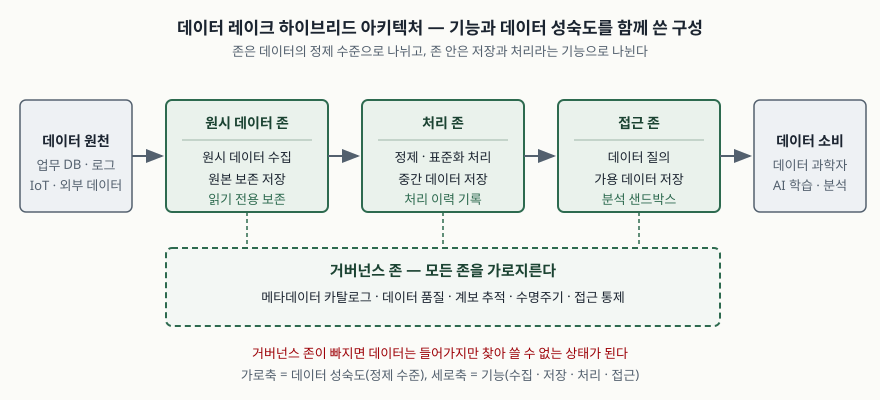
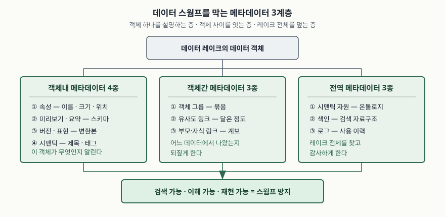

기출문제에서 AI 분석 대상 데이터를 담는 대규모 저장소로 데이터 레이크 기반 통합 데이터 플랫폼을 도입한다는
상황을 주고, 그 아키텍처와 데이터 스웜프 문제를 묻는다. 아키텍처를 "수집-저장-처리-분석" 네 상자로만 그리면
어떤 데이터 플랫폼에도 들어맞는 그림이 되어 변별이 되지 않는다. 점수는 **무엇을 기준으로 구성요소를 나눴는지**를
밝히는 데서 난다. 데이터 레이크의 구성요소는 기능으로도 나뉘고 데이터의 정제 수준으로도 나뉘며, 두 기준을
같이 쓰는 것이 현재 문헌이 권하는 방향이다. (나)는 (가)에서 거버넌스 축을 빼면 무슨 일이 생기는지를 묻는
문항이므로, 원인과 방지 방안을 (가)의 구성요소에 대응시켜 쓰면 두 소문항이 한 답안으로 묶인다.

> 실행 검증 없음. 개념 문제이므로 데이터 레이크 아키텍처·메타데이터 관리 설문 논문(Journal of Intelligent
> Information Systems, 2021), NIST 빅데이터 참조 아키텍처(SP 1500-6r2), 데이터 거버넌스 국제표준
> ISO/IEC 38505-1:2017의 적용 범위, 용어를 처음 쓴 James Dixon의 원 게시글을 근거로 정리했다.
> ISO/IEC 38505-1과 ISO/IEC 20547-3은 유료 표준이라 본문을 직접 열지 못했고, ISO 카탈로그가 공개하는
> 적용 범위 기술만 근거로 썼다. 두 표준의 세부 조항 내용은 답안에 쓰지 않았다.

---

## Ⅰ. 개요

### 가. 데이터 레이크의 정의

데이터 레이크는 2010년 James Dixon이 데이터 마트의 한계를 지적하며 제시한 개념이다. 데이터 마트는 미리 고른
속성만 집계해 두므로 **정해진 질문에만 답하고 하위 수준의 상세 데이터를 잃는다.** 데이터 레이크는 원본을 그대로
남겨 아직 나오지 않은 질문에도 답할 수 있게 한다. AI 분석이 데이터 레이크를 요구하는 이유가 여기에 있다. 학습에
쓸 특징을 사전에 확정할 수 없으므로 원본 보존이 전제가 된다.

학술 정의는 Sawadogo와 Darmont가 Madera·Laurent의 정의를 보완해 제시한 것을 쓴다. 데이터 레이크는
**모든 유형의 데이터를 원본 형식 그대로 보관하고, 데이터 전문가가 지식 추출에 쓰는 확장 가능한 저장·분석
시스템**이며, 갖춰야 할 특성은 다음 6가지다.

| 번호 | 특성 | 답안에서 쓸 한 줄 |
|---|---|---|
| ① | 데이터 품질을 강제하는 **메타데이터 카탈로그** | 품질은 카탈로그로 보장된다 |
| ② | **데이터 거버넌스** 정책과 도구 | 정책 없이 쌓기만 하면 레이크가 아니다 |
| ③ | 다양한 사용자 계층의 **접근성** | 분석 계층을 통해 업무 사용자도 쓴다 |
| ④ | 모든 유형 데이터의 **통합** | 정형·반정형·비정형 |
| ⑤ | **논리적·물리적 조직** | 존 구분이 여기 해당한다 |
| ⑥ | 저장과 처리의 **확장성** | 빅데이터 규모를 전제한다 |

①과 ②가 정의 안에 들어 있다는 점이 (나)와 이어진다. 메타데이터와 거버넌스가 빠진 저장소는 데이터 레이크의
정의를 만족하지 않는다. 데이터 스웜프는 운영 중에 생긴 사고가 아니라 **정의 요건을 빠뜨린 결과**다.

### 나. 데이터 웨어하우스와 갈리는 지점

데이터 웨어하우스는 적재 시점에 스키마를 정한다(schema-on-write). 데이터 레이크는 질의 시점까지 스키마와
데이터 요건을 확정하지 않는다(schema-on-read, 지연 바인딩). 적재가 빨라지는 대신 **적재 시점에 구조를
강제하는 장치가 사라진다.** 이 교환이 (나)의 출발점이다.

## Ⅱ. 데이터 레이크의 아키텍처

### 가. 아키텍처 유형 3가지

기존 문헌은 데이터 레이크 아키텍처를 폰드(pond)형과 존(zone)형으로 나눴지만, 두 구분은 서로 겹친다. 폰드형도
데이터의 정제 수준에 따라 위치가 정해지므로 존형의 변형으로 볼 수 있고, 반대로 원시 데이터와 정제 데이터를 한
저장 영역에 함께 두는 존형 사례도 있다. Sawadogo와 Darmont는 **구성요소를 나누는 기준이 무엇인가**로
다시 묶어 3유형을 제시한다.

| 유형 | 구성요소를 나누는 기준 | 대표 사례 | 장점 | 한계 |
|---|---|---|---|---|
| **기능형** | 데이터 레이크가 수행하는 기능 | Quix·Hai, Mehmood 외, John·Misra의 람다 아키텍처 | 구현할 기능과 기술을 바로 대응시킨다 | 데이터 생애주기 계획이 드러나지 않는다 |
| **데이터 성숙도형** | 데이터의 정제 수준 | Zaloni 6존 아키텍처 | 데이터 생애주기를 계획·조직하기 좋다 | 어떤 기술이 필요한지 보이지 않는다 |
| **하이브리드** | 기능과 정제 수준을 함께 | Inmon의 폰드 구조, Ravat·Zhao 구조 | 두 관점을 모두 담는다 | 기존 제안마다 빠진 부분이 있다 |

두 관점 중 하나만 쓰면 보이지 않는 것이 생기므로, 설문 논문은 **하이브리드 접근을 권한다.** 답안에서는 이 세
유형을 먼저 세우고 각각의 대표 구성을 설명하는 순서가 안전하다.

### 나. 기능형 — 데이터 레이크의 기본 기능 4가지

| 번호 | 기능 | 하는 일 |
|---|---|---|
| ① | **데이터 수집** | 데이터 원천과 연결해 받아들인다 |
| ② | **데이터 저장** | 원시 데이터와 정제 데이터를 모두 보관한다 |
| ③ | **데이터 처리** | 정제·변환·전처리를 수행한다 |
| ④ | **데이터 접근** | 원시·정제 데이터를 질의할 수 있게 한다 |

람다 아키텍처는 ③을 **대용량 배치 처리**와 **실시간 처리** 두 갈래로 나눈 기능형 구성이다. IoT처럼 빠르게
들어오는 데이터와 대량 적재 데이터를 각각에 맞게 다룰 수 있다. 다만 두 갈래가 서로 다른 처리 모형을 쓰므로,
교차 분석을 하려는 데이터 과학자가 두 가지 논리를 함께 다뤄야 한다는 부담이 생긴다.

### 다. 데이터 성숙도형 — 존 구성

존 구성은 데이터를 **정제 정도에 따라** 존에 배치한다. 자주 인용되는 Zaloni의 구성은 6개 존을 둔다.

| 번호 | 존 | 하는 일 |
|---|---|---|
| ① | 전이 적재 존 | 수집 중인 데이터를 받고 기초 품질 검사를 한다 |
| ② | 원시 데이터 존 | 전이 존에서 넘어온 거의 원본 상태의 데이터를 둔다 |
| ③ | 신뢰 존 | 표준화·정제를 마친 데이터를 둔다 |
| ④ | 탐색 샌드박스 | 데이터 과학자가 데이터 랭글링·탐색을 수행한다 |
| ⑤ | 소비 존 | 업무 사용자가 대시보드로 가정 분석을 수행한다 |
| ⑥ | 거버넌스 존 | 메타데이터·품질·데이터 카탈로그·보안을 관리하고 감시한다 |

존의 개수와 성격은 제안마다 다르다. 전이 존을 두는 구성도 있고 두지 않는 구성도 있다. 중요한 것은 개수가 아니라
**정제 수준이 올라갈수록 신뢰 수준과 접근 허용 범위가 함께 올라간다**는 배치 원리다. 이 구성의 약점은 데이터가
여섯 영역을 거치면서 사본이 여러 벌 생기고, 그에 따라 **데이터 계보 통제가 어려워진다**는 점이다. 이 약점이
(나)의 원인 중 하나로 그대로 이어진다.

Inmon의 폰드 구조는 데이터 유형별로 5개의 폰드를 둔다. 원시 데이터 폰드는 메타데이터 체계가 없는 통과
영역이고, 여기서 조건화를 거쳐 아날로그 폰드(고빈도 측정값), 애플리케이션 폰드(정형 데이터, Inmon은 이것을
데이터 웨어하우스로 본다), 텍스트 폰드(비정형 텍스트)로 넘어간다. 활발히 쓰지 않는 데이터는 보관 폰드로
옮긴다. 다만 **다른 폰드로 옮길 때 원시 데이터를 삭제하므로 데이터 손실이 생기고**, 이는 원본을 남긴다는
데이터 레이크의 취지와 어긋난다.

### 라. 하이브리드 — 두 기준을 같이 쓴 구성

Ravat와 Zhao의 구성은 존을 정제 수준으로 나누되(원시 데이터 존 · 처리 존 · 접근 존), 각 존 안은 저장과 처리라는
기능으로 다시 나눈다. 거버넌스 존은 세 존을 가로지른다.

> **출처**: [Sawadogo, Darmont, *On Data Lake Architectures and Metadata Management*, Journal of Intelligent Information Systems 56(1):97–120, 2021 — §3.1.1 Zone Architectures, §3.1.2 Functional × Maturity Architectures (Fig. 5 Ravat and Zhao's hybrid architecture)](https://arxiv.org/abs/2107.11152)

이 구성의 한계도 밝혀져 있다. 접근이 정제 데이터에만 열려 있어, 원시 데이터를 직접 보려는 분석 요구를 받지
못한다. 답안에서는 "하이브리드가 권장되지만 완성된 제안은 아직 없다"까지 적어야 문헌을 따라간 답안이 된다.

### 마. 참조 아키텍처와의 대응

데이터 레이크는 빅데이터 시스템의 한 구현이므로, 답안의 뼈대를 공신력 있는 참조 아키텍처에 걸어 두면 설득력이
올라간다. NIST 빅데이터 참조 아키텍처(NBDRA)는 시스템을 **5개 역할**과 **2개 패브릭**으로 나눈다. 역할은 시스템
오케스트레이터 · 데이터 제공자 · 빅데이터 애플리케이션 제공자 · 빅데이터 프레임워크 제공자 · 데이터 소비자이고,
패브릭은 보안·프라이버시 패브릭과 관리 패브릭이다. **패브릭은 특정 계층이 아니라 모든 구성요소를 가로지른다.**

관리 패브릭은 두 묶음의 활동을 포함한다. 하나는 프로비저닝·구성·패키지·소프트웨어·백업·자원·성능 관리 같은
**시스템 관리**이고, 다른 하나는 수집 · 준비/큐레이션 · 분석 · 시각화 · 접근으로 이어지는 **빅데이터 생애주기
관리(BDLM)** 다. 데이터 레이크의 거버넌스 존이 NBDRA의 관리 패브릭에 대응하고, 기능형의 4기능이 BDLM의
생애주기 단계에 대응한다. 두 모델이 같은 구조를 다른 이름으로 부르고 있음을 밝히면 (가)의 답안이 닫힌다.

> **출처**: [NIST SP 1500-6r2, *NIST Big Data Interoperability Framework: Volume 6, Reference Architecture* (2019-10) §3.6 Management Fabric of the NBDRA, §4.1 Activities View](https://doi.org/10.6028/NIST.SP.1500-6r2)

## Ⅲ. 데이터 스웜프의 발생 원인

### 가. 데이터 스웜프의 정의

적절한 메타데이터 관리가 없어 **운용 불가능해진 데이터 레이크**를 데이터 스웜프라고 부른다. 문헌에서는 데이터
덤프(data dump), 일방향 데이터 레이크(one-way data lake)로도 부르지만 데이터 스웜프가 가장 널리 쓰인다.
이 상태의 특징은 한 문장으로 정리된다. **데이터는 적재되지만 다시 꺼낼 수 없다.** 꺼낼 수 없으므로 어떤 분석도
보장하지 못한다. AI 학습 데이터 저장소라면 학습에 쓸 데이터셋을 특정할 수 없다는 뜻이고, 이는 저장소가 있으나
없느니만 못한 상태다.

주의할 점은 **데이터 스웜프를 재는 객관적 척도가 아직 없다**는 것이다. 메타데이터 체계의 효율을 측정하거나
비교하는 방법이 알려져 있지 않다고 설문 논문이 명시한다. 답안에서 "스웜프 비율 n%" 같은 수치를 쓰면 근거를
댈 수 없다. 원인과 방지 방안을 구조로 쓰는 편이 안전하다.

### 나. 발생 원인 5가지

| 번호 | 원인 | 어느 구성요소에서 비롯되는가 |
|---|---|---|
| ① | **스키마-온-리드와 메타데이터 부재의 결합** | 적재 데이터에 명시적 스키마가 없는데 메타데이터 체계가 없으면, 무엇이 들어왔는지 기술하는 정보가 어디에도 남지 않는다 |
| ② | **부적절한 메타데이터 구현 방식** | 체계를 두더라도 맞지 않는 방법·기술로 만들면 결과는 같다. 문제는 메타데이터를 두느냐가 아니라 **어떻게 만드느냐**다 |
| ③ | **존 이동에 따른 사본 증가와 계보 단절** | 여섯 존을 거치며 사본이 여러 벌 생기면 어느 사본이 어디서 나왔는지 통제하기 어려워진다 |
| ④ | **원시 데이터 삭제** | 폰드 구조처럼 정제 후 원시 데이터를 지우면 되돌릴 수 없고, 재현도 재처리도 막힌다 |
| ⑤ | **거버넌스가 사후 과제로 밀림** | 데이터 품질·보안·수명주기·메타데이터 계보가 "먼저 설계할 대상"이 아니라 "나중에 관리할 위험"으로 다뤄진다. 거버넌스 원칙이 실제 해법으로 옮겨진 사례가 드물다고 설문 논문이 지적한다 |

①과 ②는 메타데이터 축, ③과 ④는 아키텍처 축, ⑤는 거버넌스 축이다. 세 축으로 묶어 두면 Ⅳ의 방지 방안을 같은
축으로 대응시킬 수 있다. 축을 맞추지 않고 원인과 대책을 따로 나열하면 채점자가 대응 관계를 읽어 줘야 하므로
점수가 깎인다.

## Ⅳ. 데이터 스웜프 방지 방안

### 가. 메타데이터 체계 — 3계층으로 빠짐없이 둔다

메타데이터를 분류하는 방식은 두 가지가 알려져 있다. Oram의 **기능적 분류**는 수집 방식을 기준으로 업무
메타데이터 · 운영 메타데이터 · 기술 메타데이터 3가지로 나눈다. 산업계에서 가장 많이 인용되는데, 데이터
웨어하우스의 분류를 가져온 것이라 익숙하기 때문이다. 다만 세 범주가 서로 겹친다는 점이 지적돼 있다. 데이터
필드는 업무 사용자가 스키마에 정의하므로 업무이면서 기술이고, 데이터 포맷은 기술이면서 운영이다.

Sawadogo 외의 **구조적 분류**는 메타데이터가 어떤 객체에 걸리는지를 기준으로 3계층으로 나눈다. 설문 논문은
이쪽이 기능적 분류를 포함하면서 데이터 연결과 사용자 상호작용까지 담으므로 더 낫다고 본다. 답안에는 이 분류를
쓰고, 기능적 분류는 비교로 언급한다.

> **출처**: [Sawadogo, Darmont, *On Data Lake Architectures and Metadata Management*, Journal of Intelligent Information Systems 56(1):97–120, 2021 — §4.1.2 Structural Metadata](https://arxiv.org/abs/2107.11152)

| 계층 | 하위 종류 | 막아 주는 원인 |
|---|---|---|
| **객체내** 메타데이터 4종 | 속성(이름·크기·위치·수정일), 미리보기·요약(스키마·워드클라우드), 버전·표현(갱신본·변환본), 시맨틱(제목·설명·분류·태그) | 원인 ① — 무엇이 들어왔는지 기술된다 |
| **객체간** 메타데이터 3종 | 객체 그룹(컬렉션), 유사도 링크, 부모·자식 링크(계보) | 원인 ③ — 조인·파생 때 계보가 자동 기록된다 |
| **전역** 메타데이터 3종 | 시맨틱 자원(온톨로지·분류체계·시소러스), 색인(역색인 포함), 로그(접속·작업 수행 이력) | 원인 ① ⑤ — 레이크 전체를 검색하고 감사한다 |

두 분류를 비교하면 구조적 분류가 더 넓다는 점이 드러난다.

| 담는 정보 | 기능적 분류 | 구조적 분류 |
|---|---|---|
| 데이터의 기본 특성(크기·포맷) | 담는다 | 담는다 |
| 데이터 의미(태그·설명) | 담는다 | 담는다 |
| 데이터 이력 | 담는다 | 담는다 |
| 데이터 간 연결 | 담지 않는다 | 담는다 |
| 사용자 상호작용 | 담지 않는다 | 담는다 |

### 나. 메타데이터 시스템이 갖출 기능 6가지

원인 ②, 곧 "메타데이터를 어떻게 만드느냐"에 답하는 항목이다. 완전한 메타데이터 시스템이 갖춰야 할 기능으로
6가지가 제시돼 있다.

| 번호 | 기능 | 하는 일 |
|---|---|---|
| ① | **시맨틱 보강** | 제목·태그·설명을 붙여 데이터를 이해 가능하게 만든다. 온톨로지 같은 지식 베이스를 쓴다 |
| ② | **데이터 색인** | 키워드 검색과 패턴 질의로 객체를 빠르게 찾게 한다. 정형·반정형·비정형 모두에 필요하다 |
| ③ | **링크 생성** | 객체 사이의 연결을 원천에서 가져오거나 새로 탐지한다. 유사 데이터 추천과 군집 탐지의 근거가 된다 |
| ④ | **데이터 다형성** | 한 객체의 여러 표현(예: 텍스트 문서의 단어 빈도 벡터)을 함께 관리해 같은 변환을 반복하지 않게 한다 |
| ⑤ | **데이터 버전 관리** | 갱신해도 이전 상태를 남겨 처리 재현과 불일치 교정을 가능하게 한다 |
| ⑥ | **사용 추적** | 생성·읽기·갱신 상호작용을 기록한다. 불일치 설명과 침입 탐지에도 쓰인다 |

④와 ⑤는 구현 난도가 높아 가장 완성도 높은 시스템에서만 발견된다고 보고돼 있다. 도입 계획을 쓰라는 문항이면
①②③⑥을 1단계, ④⑤를 2단계로 나누는 식으로 적는다. ⑤와 ⑥은 서로 관련되지만 별개 기능이므로 따로 센다.

실무 구현으로는 Apache Atlas가 널리 쓰인다. 훅(hook)이라는 네이티브·커스텀 스크립트가 로그를 근거로
메타데이터를 생성하며, **계보 메타데이터를 자동 추출하고 태그를 파생 데이터 전체로 전파한다.** 원인 ③에 대한
직접적인 대응이다.

### 다. 거버넌스 — 설계 단계에서 축으로 세운다

원인 ⑤에 대한 대응이다. 데이터 거버넌스는 조직 거버넌스의 하위 영역인 IT 거버넌스의 다시 하위 영역이며,
국제표준 ISO/IEC 38505-1:2017이 이를 다룬다. 이 표준은 ISO/IEC 38500의 거버넌스 원칙과 모형을 데이터
거버넌스에 적용하고, **IT 시스템이 생성·수집·저장·통제하는 데이터의 현재와 미래 사용**을 거버넌스 대상으로
규정한다. 적용 대상은 이사회뿐 아니라 경영진·기술 전문가·서비스 제공자·감사인까지 포함한다. 데이터 레이크
도입을 기술 과제가 아니라 **의사결정 체계의 문제로 올려야 하는 근거**로 쓸 수 있다.

> ISO/IEC 38505-1:2017은 2판이 개발 중이며 ISO 카탈로그에 개정 예정으로 올라 있다. 답안에 판·연도를 적을
> 때는 2017년판 기준임을 밝힌다.

NBDRA의 관리 패브릭과 보안·프라이버시 패브릭이 모든 구성요소를 가로지르는 것과 같은 이유로, 데이터 레이크의
거버넌스 존도 특정 존에 붙는 부속이 아니라 모든 존을 가로지르는 축으로 배치한다. (가)의 도식에서 거버넌스 존을
가로로 깐 것이 바로 이 뜻이다.

### 라. 아키텍처 선택 — 원시 데이터를 지우지 않는다

원인 ③④에 대한 대응이다. 세 가지를 설계 결정으로 적는다.

| 번호 | 결정 | 근거 |
|---|---|---|
| ① | 원시 데이터 존을 **읽기 전용 영구 보존**으로 두고 정제 후에도 삭제하지 않는다 | 폰드 구조의 원시 데이터 삭제가 데이터 레이크의 취지와 어긋난다는 지적 |
| ② | 존 개수를 늘릴수록 사본과 계보 부담이 커지므로 **필요한 존만 둔다** | 6존 구성의 사본 증가·계보 통제 난점 |
| ③ | **하이브리드 구성**을 택하되 원시 데이터에도 접근 경로를 연다 | 기능·성숙도 한쪽만 보는 구성의 한계, Ravat·Zhao 구성의 접근 제약 |

### 마. 원인과 방지 방안의 대응

| 원인 | 방지 방안 | 축 |
|---|---|---|
| ① 스키마-온-리드 + 메타데이터 부재 | 객체내·전역 메타데이터 확보, 시맨틱 보강·색인 | 메타데이터 |
| ② 부적절한 메타데이터 구현 | 메타데이터 시스템 6기능 기준으로 설계·평가 | 메타데이터 |
| ③ 사본 증가와 계보 단절 | 객체간 메타데이터(부모·자식 링크), 계보 자동 추출, 존 수 최소화 | 아키텍처 |
| ④ 원시 데이터 삭제 | 원시 데이터 존 영구 보존, 버전 관리 기능 | 아키텍처 |
| ⑤ 거버넌스의 사후 처리 | 거버넌스 존을 가로축으로 배치, ISO/IEC 38505-1 기반 책임 체계, 사용 추적 | 거버넌스 |

## Ⅴ. 결론

데이터 레이크의 아키텍처는 **기능**과 **데이터 성숙도**라는 두 기준으로 나뉘며, 두 기준을 함께 쓰는 하이브리드
구성이 현재 권장되는 방향이다. 다만 완성된 하이브리드 제안은 아직 없고, 기존 제안마다 원시 데이터 손실이나
접근 제약 같은 빠진 부분이 남아 있다.

데이터 스웜프는 운영 사고가 아니라 **데이터 레이크의 정의 요건 가운데 메타데이터 카탈로그와 거버넌스를 빠뜨린
결과**다. 따라서 방지 방안도 사후 정리가 아니라 설계 결정이어야 한다. 메타데이터는 객체내·객체간·전역 3계층으로
빠짐없이 두고, 메타데이터 시스템은 6가지 기능을 기준으로 설계하며, 거버넌스는 모든 존을 가로지르는 축으로
배치한다.

AI 분석용 통합 플랫폼이라는 조건에서는 두 가지가 특히 무겁다. 하나는 **계보**다. 학습에 쓴 데이터셋이 어느
원본에서 어떤 처리를 거쳐 나왔는지 되짚을 수 없으면 모델 결과를 설명할 수 없다. 다른 하나는 **버전 관리**다.
원본이 갱신돼도 이전 상태가 남아야 학습을 재현할 수 있다. 이 둘은 메타데이터 시스템의 기능 가운데 구현 난도가
높은 쪽에 속하므로, 도입 계획에 단계와 일정을 따로 잡아 적는다.

> 개념 정리: [데이터 웨어하우스·데이터 레이크·레이크하우스](../../database/2026-10-06-dw-lake-lakehouse-schema-timing/index.md)
>
> 개념 정리: [데이터 거버넌스와 데이터 품질 관리 체계](../../database/2026-10-06-data-governance-quality-dimensions-roles/index.md)

끝

---

## 답안 작성 메모

**먼저 쓸 것.** (가)에서 "구성요소를 무엇으로 나눴는가"를 첫 문단에 박는다. 기능형·성숙도형·하이브리드 3유형
표가 이 답안의 뼈대다. 이 표가 있으면 뒤의 존 나열이 근거를 갖고, 없으면 존 이름을 외워 적은 답안이 된다.

**시간이 모자라면 버릴 것.** 버리는 순서는 ① Ⅱ-마의 NBDRA 대응, ② Inmon 폰드 구조 설명, ③ 기능적 분류와
구조적 분류의 비교표다. NBDRA는 있으면 설득력이 오르지만 없어도 (가)가 성립한다. 반대로 **끝까지 지킬 것은
Ⅳ-마의 원인·방지 대응표**다. 이 표 한 장이 (나)의 두 요구를 동시에 닫는다.

**점수가 갈리는 지점은 세 곳이다.**

1. **정의 요건에서 (나)를 끌어내는가.** 데이터 레이크 정의 6가지 특성에 메타데이터 카탈로그와 거버넌스가 이미
   들어 있다는 점을 Ⅰ에서 짚으면, Ⅲ의 원인이 "운영 중 사고"가 아니라 "요건 누락"으로 정리된다. 두 소문항이
   하나로 묶이는 지점이다.
2. **원인과 대책의 축을 맞추는가.** 원인 5가지를 메타데이터·아키텍처·거버넌스 3축으로 묶고, 대책을 같은 축으로
   배치한다. 원인 7개와 대책 9개를 축 없이 나열한 답안보다 항목 수가 적어도 점수가 높다.
3. **모르는 것을 모른다고 쓰는가.** 데이터 스웜프를 재는 객관적 척도가 없다는 점, 완성된 하이브리드 아키텍처
   제안이 아직 없다는 점은 문헌이 명시하는 한계다. 이것을 적으면 읽은 답안이 되고, 여기에 수치를 지어 넣으면
   근거를 묻는 질문에 막힌다.

**모식도는 두 장 다 그리지 말고 한 장만 고른다.** 문항이 (가)에 무게를 두면 하이브리드 아키텍처 도식을, (나)에
무게를 두면 메타데이터 3계층 도식을 그린다. 둘 다 상자 6~8개라 5분 안에 옮길 수 있지만, 두 장을 다 그리면
논술형 세 장 분량에서 본문 쓸 시간이 모자란다.

**쓰지 말 것.** 특정 벤더의 제품 구성을 아키텍처로 제시하지 않는다. 존 이름이 제품마다 다르므로(브론즈·실버·골드
같은 이름도 그중 하나다) 일반 명칭으로 쓰고, 제품명은 구현 예시로만 한 줄 붙인다.

## 참고 자료

- Sawadogo, P., Darmont, J., [*On Data Lake Architectures and Metadata Management*](https://arxiv.org/abs/2107.11152), Journal of Intelligent Information Systems 56(1):97–120, 2021. DOI 10.1007/s10844-020-00608-7 — 데이터 레이크 정의, 아키텍처 유형론, 메타데이터 분류와 시스템 기능, 데이터 스웜프
- NIST, [*NIST Big Data Interoperability Framework: Volume 6, Reference Architecture* (SP 1500-6r2)](https://doi.org/10.6028/NIST.SP.1500-6r2), 2019-10 — NBDRA 5역할·2패브릭, §3.6 Management Fabric, §4.1 Activities View
- ISO, [ISO/IEC 38505-1:2017 *Information technology — Governance of IT — Governance of data — Part 1: Application of ISO/IEC 38500 to the governance of data*](https://www.iso.org/standard/56639.html) — 데이터 거버넌스 적용 범위와 위치 (유료 표준, 공개 적용 범위 기술만 참조)
- ISO, [ISO/IEC 20547-3:2020 *Information technology — Big data reference architecture — Part 3: Reference architecture*](https://www.iso.org/standard/71277.html), 2020-03 — 빅데이터 참조 아키텍처의 사용자 관점·기능 관점 (유료 표준, 공개 초록만 참조)
- Dixon, J., [*Pentaho, Hadoop, and Data Lakes*](https://jamesdixon.wordpress.com/2010/10/14/pentaho-hadoop-and-data-lakes/), 2010-10-14 — 데이터 레이크 용어의 원 출처, 데이터 마트와의 대비
- The Apache Software Foundation, [Apache Atlas — Data Governance and Metadata framework for Hadoop](https://atlas.apache.org/) — 훅 기반 계보 메타데이터 자동 추출과 태그 전파
