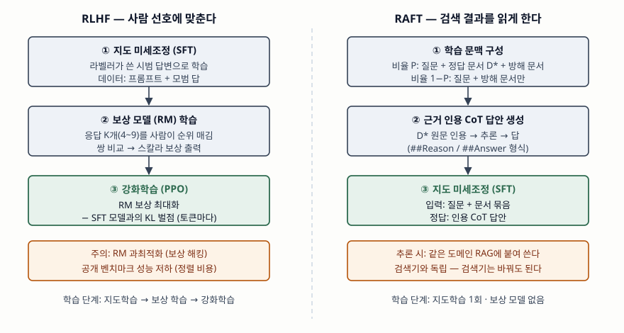

기출문제에서 기업이 AI 전환을 위해 LLM 기반 시스템을 구축한다는 상황을 주고, 두 가지를
묻는다. 하나는 파인튜닝과 RAG가 각각 무엇이고 어떤 역할을 하는지, 다른 하나는 LLM을
학습시키는 두 파이프라인 — 사람 피드백 강화학습(RLHF)과 검색 증강 미세조정(RAFT) — 의
비교다. 네 용어 모두 표준 기구가 아니라 **원 논문이 정의한 것**이므로 정의는 논문을
근거로 쓴다. 정보관리기술사 답안이므로 축은 학습 이론이 아니라 **기업이 어떤 데이터를
준비하고 어떤 시스템을 운영해야 하는가**에 둔다.

> 실행 검증 없음. RAG 제안 논문, InstructGPT 논문, RAFT 논문, LoRA 논문의 정의와
> 절차만으로 정리했다. 논문에 실린 성능 수치는 싣지 않는다.

---

## Ⅰ. 개요

사전학습된 LLM은 공개 데이터로 학습되어 **기업 내부 지식을 모르고, 학습 시점 이후의
사실을 모르며, 기업이 원하는 응답 방식을 따른다는 보장이 없다.** 이 세 가지 간극을
메우는 수단이 갈린다. 지식을 **추론 시점에 밖에서 넣는 것**이 RAG이고, **가중치를 바꿔
모델 안에 넣는 것**이 파인튜닝이다. 파인튜닝 중에서도 무엇을 정답으로 삼느냐에 따라
사람의 선호를 정답으로 삼는 RLHF, 검색 문서를 읽고 인용하는 답을 정답으로 삼는 RAFT로
갈린다. AX(AI Transformation) 관점에서 이 선택은 모델 선택이 아니라 **데이터 파이프라인과
운영 체계의 선택**이다.

## Ⅱ. 파인튜닝과 RAG의 개념 및 역할

### 가. 개념

① **파인튜닝(Fine-Tuning)** — 사전학습 모델의 가중치를 **목적 과업의 데이터로 추가
학습해 갱신**하는 방법이다. 전체 가중치를 갱신하는 전체 미세조정과, 원 가중치는
고정하고 일부 추가 행렬만 학습하는 **매개변수 효율적 미세조정(PEFT)** 으로 나뉜다.
대표 PEFT인 LoRA는 사전학습 가중치를 고정하고 각 Transformer 층에 학습 가능한
**저랭크 분해 행렬**을 덧붙인다. 원 논문은 추가 행렬을 원 가중치에 합칠 수 있어
추론 지연이 늘지 않는다고 적는다.

② **RAG(Retrieval-Augmented Generation)** — 모델 가중치에 든 지식(**매개변수 메모리**)에,
외부 문서 색인을 검색기로 조회한 결과(**비매개변수 메모리**)를 더해 답을 생성하는
방법이다. Lewis 등이 2020년에 제안했으며, 원 논문은 해결 대상으로 **지식 접근의
정밀도, 답의 근거 제시, 지식 갱신**의 3가지를 든다.

### 나. 역할 — 무엇을 바꾸는가

| 구분 | 파인튜닝 | RAG |
|---|---|---|
| 바꾸는 대상 | 모델 가중치 | 프롬프트에 넣는 문맥 |
| 주된 역할 | **행동 양식** — 응답 형식, 어조, 도메인 용어, 과업 수행 방식 | **사실 지식** — 사내 문서, 최신 정보, 권한별 자료 |
| 지식 갱신 | 재학습 필요 | 색인만 갱신 |
| 근거 제시 | 불가 (출처가 가중치에 녹음) | 검색된 문서를 출처로 제시 |
| 접근 통제 | 학습된 지식은 사용자별로 가릴 수 없음 | 검색 단계에서 문서 권한 필터링 |
| 비용 구조 | 학습 비용이 앞에 몰림 | 질의마다 검색·긴 프롬프트 비용 |
| 실패 양상 | 학습 데이터 밖 질문에 환각 | 검색이 틀리면 생성도 틀림 |

두 방법은 대체 관계가 아니다. Ovadia 등의 비교 연구는 **새로운 사실 지식을 넣는 데는
비지도 파인튜닝보다 RAG가 일관되게 나았다**고 보고하고, LLM이 비지도 파인튜닝만으로는
새 사실을 익히기 어렵다고 결론짓는다. 따라서 기업 시스템에서는 **사실은 RAG로, 행동은
파인튜닝으로** 나누는 것이 기본 설계가 된다. RAFT는 이 둘을 결합한 지점에 있다.

## Ⅲ. RLHF 기반 학습 파이프라인과 RAFT 기반 학습 파이프라인 비교

> **출처**: [Ouyang et al., Training language models to follow instructions with human feedback §3.5 Models (arXiv:2203.02155, 2022-03)](https://arxiv.org/abs/2203.02155) · [Zhang et al., RAFT: Adapting Language Model to Domain Specific RAG §3 RAFT (arXiv:2403.10131v2, 2024-06)](https://arxiv.org/abs/2403.10131)

### 가. RLHF 기반 학습 파이프라인 — 3단계

InstructGPT 논문이 정리한 절차다. 목적은 **모델 출력을 사람의 의도와 선호에 맞추는
것(정렬)** 이다.

① **지도 미세조정(SFT)** — 라벨러가 직접 작성한 시범 답변으로 사전학습 모델을 지도학습한다.
② **보상 모델(RM) 학습** — 같은 프롬프트에 대한 응답 K개(4~9개)를 라벨러가 순위 매기면
K개 중 2개를 고른 모든 쌍이 비교 데이터가 된다. SFT 모델의 마지막 출력층을 떼고
프롬프트와 응답을 받아 **스칼라 보상**을 내도록 학습하며, 선호된 응답의 보상이 더 높도록
쌍 단위 손실을 쓴다.
③ **강화학습(PPO)** — 프롬프트를 주고 정책 모델이 응답을 생성하면 RM이 보상을 매기고,
PPO로 보상을 키우는 방향으로 정책을 갱신한다. 이때 **SFT 모델과의 KL 발산을 토큰마다
벌점으로 빼서** 보상 모델을 과하게 최적화하는 것을 막는다. 공개 벤치마크 성능이
떨어지는 현상(정렬 비용)을 줄이려고 사전학습 데이터의 손실을 섞는 변형(PPO-ptx)도 쓴다.

### 나. RAFT 기반 학습 파이프라인 — 3단계

Zhang 등이 제안한 절차다. 목적은 **특정 도메인 RAG에서 모델이 검색된 문서를 제대로
읽게 하는 것**이다. 논문은 이를 시험에 빗대어, 일반 RAG는 공부 없이 오픈북 시험을
보는 것이고 일반 파인튜닝은 책 없이 외우는 것이며, RAFT는 **책을 펴 놓고 공부하는
것**이라고 설명한다.

① **학습 문맥 구성** — 질문 Q마다 답이 든 **정답 문서 D\*** 와 답과 무관한 **방해 문서**를
준비한다. 전체 질문의 비율 P에는 D\*와 방해 문서를 함께 넣고, 나머지 1−P에는 **방해
문서만** 넣는다. 검색이 틀리는 상황을 학습에서 미리 겪게 하는 장치다.
② **근거 인용 CoT 답안 생성** — 정답 문서의 원문을 인용 표시로 감싸 그대로 옮기고, 그
인용에서 답까지 이어지는 추론을 쓴 답안을 정답으로 만든다.
③ **지도 미세조정(SFT)** — 질문과 문서 묶음을 입력, 인용 CoT 답안을 정답으로 학습한다.
학습된 모델은 같은 도메인의 RAG에 붙여 쓰며, 논문은 이 방식이 **검색기와 독립**이라고
적는다.

### 다. 비교

| 비교 항목 | RLHF | RAFT |
|---|---|---|
| 목적 | 정렬 — 유용·정직·무해한 응답 | 도메인 적응 — 검색 문서 활용 능력 |
| 정답 신호 | 사람의 선호 순위 → 보상 모델 | 정답 문서 기반 인용 CoT 답안 |
| 학습 방식 | 지도학습 + 강화학습(PPO) | 지도학습만 |
| 학습 단계 | 3단계, 모델 여럿(정책·보상·기준) | 3단계, 학습 대상 모델 하나 |
| 입력 형태 | 프롬프트 | 질문 + 정답·방해 문서 묶음 |
| 준비할 데이터 | 시범 답변, 응답 순위 라벨 | 도메인 문서, 질문, 문서-질문 대응 |
| 사람 투입 | 라벨러가 상시 필요 | 문서·질문 준비 중심 |
| 대표 위험 | 보상 해킹, 정렬 비용, 라벨러 편향 | 도메인 밖 일반화 저하, 방해 문서 설계 의존 |
| 운영 결합 | RAG와 무관하게 적용 | RAG와 함께 쓰는 것을 전제 |

두 파이프라인은 **경쟁 관계가 아니라 층이 다르다.** RLHF는 범용 모델이 사람의 지시를
따르고 해로운 응답을 피하게 만드는 단계이고, RAFT는 그렇게 정렬된 모델을 특정 기업의
문서 체계에 맞추는 단계다. 같은 기업 시스템 안에서 **정렬된 기반 모델 → RAFT 도메인
적응 → RAG 운영** 순으로 쌓일 수 있다.

한 가지 짚어 둘 점이 있다. 문항은 RAFT를 정렬 맥락에서 묻지만, 원 논문의 RAFT
(Retrieval Augmented Fine-Tuning)는 **선호 정렬이 아니라 도메인 RAG 적응**을 목적으로 한다.
같은 약어로 **보상 순위 미세조정(Reward rAnked FineTuning, Dong 등)** 이 있는데, 이쪽은
응답을 여러 개 생성해 보상 모델로 순위를 매기고 상위 응답으로 지도학습하는 **정렬 기법**이다.
답안에는 문항이 풀어 쓴 원어를 따르되, 동명이의 기법이 있다는 사실을 한 줄로 밝힌다.

## Ⅳ. 결론 — 기업 적용 시 고려사항 4가지

① **지식과 행동을 나눈다.** 자주 바뀌고 출처가 필요한 사실은 RAG의 색인으로, 응답 형식과
업무 절차는 파인튜닝으로 넣는다. 사내 규정을 가중치에 학습시키면 개정 때마다 재학습해야
하고 출처도 제시할 수 없다.
② **정렬은 사서 쓰고 적응은 직접 한다.** RLHF는 라벨러 조직, 보상 모델, 강화학습 인프라가
필요해 기업이 처음부터 수행하기 어렵다. 이미 정렬된 모델을 기반으로 두고, 기업 데이터로는
SFT·RAFT·LoRA 같은 지도학습 기반 적응을 우선 검토한다.
③ **RAFT 데이터는 검색 로그에서 만든다.** 방해 문서는 실제 검색기가 상위에 올린 오답 문서를
쓰는 편이 운영 환경과 같다. 질문-정답 문서 대응 데이터를 쌓는 체계가 곧 RAFT의 준비물이다.
④ **평가를 단계별로 나눈다.** 검색 재현율, 근거 인용의 정확성, 최종 답의 정확성을 따로 재야
성능이 떨어졌을 때 검색기·모델·데이터 중 무엇을 고칠지 정할 수 있다. 파인튜닝은 학습
데이터에 들어간 개인정보·영업비밀이 가중치에 남으므로 학습 전 데이터 비식별 처리도 함께 둔다.

> 관련 답안: [기출문제 — Advanced RAG와 Modular RAG 비교](../2026-10-08-advanced-rag-vs-modular-rag/index.md)

> 개념 정리: [Modular RAG — 모듈·연산자 3계층과 흐름 패턴](../../emerging-tech/2026-10-09-modular-rag-operators-flow-patterns/index.md)

끝

## 답안 작성 메모

- **먼저 쓸 것**: Ⅱ의 대비 한 줄 — "RAG는 문맥을 바꾸고 파인튜닝은 가중치를 바꾼다,
  사실은 RAG로 행동은 파인튜닝으로". 이어서 RLHF 3단계(SFT → RM → PPO)를 단계 이름과
  함께 적는다. 이 두 가지가 문항의 뼈대다.
- **점수가 갈리는 지점**: RLHF의 KL 벌점이 **왜** 들어가는지(보상 모델 과최적화 방지)와
  RAFT의 **방해 문서·정답 문서 제외 비율(1−P)** 이 왜 들어가는지(검색 실패 상황 학습)를
  쓰는가. 둘 다 "학습 환경과 실제 환경의 차이를 줄이려는 장치"라는 공통점으로 묶으면 좋다.
- **빠지기 쉬운 함정**: 문항은 RAFT를 "LLM 정렬을 위한" 파이프라인처럼 묶어 묻는다.
  풀어 쓴 원어(Retrieval Augmented Fine-Tuning)를 따르면 목적은 도메인 적응이다.
  같은 약어의 보상 순위 미세조정이 정렬 기법이므로, 둘을 섞어 쓰면 감점된다. 한 줄로
  구분해 두면 출제 의도가 어느 쪽이든 대응된다.
- **시간이 모자라면**: Ⅱ 역할 표를 4행(바꾸는 대상·역할·지식 갱신·근거 제시)으로 줄이고,
  Ⅳ 고려사항은 ①②만 남긴다. 모식도는 좌우 3칸씩 6개 박스만 그려도 대비가 선다.
- 개수를 붙인다 — RAG 해결 대상 3가지, RLHF 3단계, RAFT 3단계, 고려사항 4가지.

## 참고 자료

- [L. Ouyang et al., "Training language models to follow instructions with human feedback", arXiv:2203.02155 (2022-03)](https://arxiv.org/abs/2203.02155) — §3.5 SFT·RM·RL 3단계, KL 벌점과 PPO-ptx
- [T. Zhang et al., "RAFT: Adapting Language Model to Domain Specific RAG", arXiv:2403.10131v2 (2024-06)](https://arxiv.org/abs/2403.10131) — §3 학습 데이터 구성(정답·방해 문서, 비율 P)과 인용 CoT 답안
- [P. Lewis et al., "Retrieval-Augmented Generation for Knowledge-Intensive NLP Tasks", NeurIPS 2020 (arXiv:2005.11401)](https://arxiv.org/abs/2005.11401) — RAG 원 정의(매개변수·비매개변수 메모리)
- [E. J. Hu et al., "LoRA: Low-Rank Adaptation of Large Language Models", arXiv:2106.09685v2 (2021-10)](https://arxiv.org/abs/2106.09685) — 저랭크 분해 행렬 기반 매개변수 효율적 미세조정
- [O. Ovadia et al., "Fine-Tuning or Retrieval? Comparing Knowledge Injection in LLMs", arXiv:2312.05934v3 (2024-01)](https://arxiv.org/abs/2312.05934) — 지식 주입에서 비지도 파인튜닝과 RAG 비교
- [H. Dong et al., "RAFT: Reward rAnked FineTuning for Generative Foundation Model Alignment", TMLR (arXiv:2304.06767, 2023)](https://arxiv.org/abs/2304.06767) — 같은 약어의 정렬 기법
