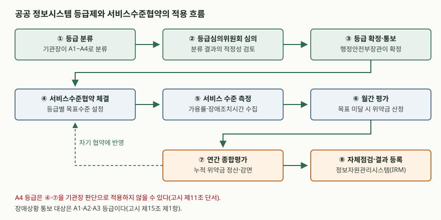

> 실행 검증 없음. 법령·고시 원문과 소관 부처 발간 자료를 근거로 정리했다.
> 서비스수준협약 표준안의 세부 수치는 확정 고시 원문으로 확인하지 못해 해당 절에 출처 등급을 따로 밝혔다.

행정·공공기관의 반복된 전산망 장애를 계기로 도입된 공공 서비스수준협약(SLA)을 묻는 문제다.
공공 SLA의 개념과 도입 필요성, 정보시스템 등급 분류 기준과 등급별 적용방식, 표준안의 주요 내용과
적용 시 고려사항의 세 갈래를 물었으므로 그 순서를 그대로 대항목으로 둔다.

---

## Ⅰ. 개요

행정·공공기관의 정보시스템은 장애가 나면 민원 창구와 인허가, 복지 급여가 함께 멈춘다.
그럼에도 공공부문에는 서비스 수준을 재는 공통 기준이 없어, 비슷한 규모의 시스템인데도
위탁 운영 계약마다 가용성 목표와 장애 대응 책임이 달랐다.

이 공백을 메우기 위해 정보시스템의 등급 관리와 장애관리 체계가 전자정부법에 신설되고
(법률 제20654호, 2025.1.7. 일부개정), 그 위임을 받아 「행정기관 및 공공기관 정보시스템 안정성 고시」
(행정안전부고시 제2026-23호)가 2026년 4월 13일 제정·시행되었다. **등급제가 시스템의 중요도를
정하고, 그 등급이 서비스수준협약의 목표치를 정하는 구조**다. 두 제도는 따로 작동하지 않는다.

---

## Ⅱ. 공공 SLA의 개념과 도입 필요성

### 가. 개념

안정성 고시의 용어 정의 조항(제2조 제6호)은 서비스수준협약을 **"정보시스템 서비스의 목표 수준
관리를 위하여 중앙행정기관등과 정보시스템 위탁 운영자가 서비스 대상 정보시스템, 서비스 수준 측정
및 평가, 위약사항 발생 시 조치방안 등에 관한 사항을 규정하여 체결하는 협약"** 으로 정의한다.

정의에서 읽어야 할 것은 세 가지다.

① **당사자가 발주기관과 위탁 운영자**다. 기관 내부의 목표 선언이 아니라 계약이다.
② **측정과 평가가 협약의 구성요소**다. 목표치만 적고 재지 않으면 협약이 아니다.
③ **위약 시 조치방안이 포함**된다. 미달을 확인하는 데서 끝나지 않고 금전적 효과로 이어진다.

### 나. 도입 필요성 — 4가지

| 구분 | 종전의 문제 | 공공 SLA가 바꾸는 것 |
|---|---|---|
| 기준의 부재 | 기관마다 가용성 목표가 제각각이고 협약 없이 운영되는 시스템도 존재 | 등급별 공통 목표수준을 제시 |
| 책임 소재 | 장애 시 발주기관·운영사·장비 공급사 간 책임 구분이 계약서에 없음 | 측정 대상과 위약 조치를 계약에 명문화 |
| 투자 우선순위 | 중요도 판단 근거가 없어 노후 장비 교체·이중화 예산이 후순위 | 등급이 투자와 재해복구 수준을 결정 |
| 장애 대응 속도 | 장애 판정 시점과 복구 목표가 합의되지 않아 보고가 지연 | 장애 시간 산정 기준과 조치 기한을 사전 합의 |

특히 **장애 시간의 시작점을 사전에 못 박은 것**이 실무에서 큰 변화다. 고시의 장애 판단 기준
조항(제13조 제2항)은 장애 발생일시를 시스템 로그에서 식별된 시점, 모니터링 도구가 감지한 시점,
장애신고 접수 또는 최초 인지 시점 **중 가장 빠른 시점**으로 정한다. 운영사가 인지한 때부터 세던
관행이 사라지고, 측정 가능한 로그와 모니터링 데이터가 기준이 된다.

---

## Ⅲ. 정보시스템 등급 분류 기준과 등급별 SLA 적용방식

### 가. 등급 분류 — 4등급

등급 관리 조항(제5조 제1항)은 소관 정보시스템을 다음 4등급으로 분류하도록 한다.

| 등급 | 정의 | 대표 성격 |
|---|---|---|
| **A1** | 국가 안보 및 국민의 생명·안전·재산 등에 밀접히 관련되어 가장 높은 중요도와 영향도를 가지는 시스템 | 국가 핵심 |
| **A2** | 대국민 서비스 중 국민이 많이 이용하고 상당히 높은 중요도·영향도를 가지는 시스템 | 대국민 필수 |
| **A3** | 내부 업무 시스템 중 다른 시스템과 연계가 많고 상당히 높은 중요도·영향도를 가지는 시스템 | 행정 중요 |
| **A4** | 일상적 편의 제공 또는 행정 업무 보조로 상대적으로 중요도·영향도가 낮은 시스템 | 일반 |

분류의 축이 **사용자 수에서 국민 영향도로 옮겨 간 것**이 종전 체계와의 핵심 차이다.
사용자 수를 가장 크게 보던 때에는 이용자가 적지만 멈추면 국민 생활이 직접 멈추는 시스템이
낮은 등급을 받아 복구 우선순위에서 밀리는 일이 생겼다. 세부 배점은 등급산정 기준(별표 1)에 있다.

### 나. 등급 산정과 확정 절차

등급은 기관이 스스로 매기고 끝나지 않는다. 기관장이 신규 시스템은 서비스 개시일부터 6개월 이내에
분류해 근거자료와 함께 제출하고, 행정안전부장관이 검토해 **변경·확정한 뒤 통보**한다
(제5조 제3항·제6항). 검토를 위해 위원장 1명을 포함한 30명 이내의 정보시스템 등급심의위원회를
구성·운영할 수 있고, 위원장은 공무원이 아닌 사람 중에서 지명한다(제6조 제3항·제5항).
제출과 등록은 정보자원관리시스템(IRM)을 통한다.



> **출처**: [행정기관 및 공공기관 정보시스템 안정성 고시 제5조·제6조·제11조·제15조](https://www.law.go.kr/admRulInfoP.do?admRulSeq=2100000277792) (행정안전부고시 제2026-23호, 2026.4.13.)

### 다. 등급별 SLA 적용방식

서비스수준협약 조항(제11조 제1항)은 기관장이 **등급에 맞는 서비스 목표수준을 설정하고 위탁
운영자와 협약을 체결**하도록 의무화한다. 목표수준의 기준은 서비스수준협약 관리지표(별표 4)다.
적용 방식은 등급에 따라 다음과 같이 갈린다.

| 구분 | A1 | A2 | A3 | A4 |
|---|---|---|---|---|
| 서비스수준협약 체결 | 의무 | 의무 | 의무 | 기관장 판단으로 미적용 가능 |
| 표준운영절차 마련 | 의무 | 의무 | 의무 | 기관장 판단으로 미적용 가능 |
| 장애상황 즉시 통보 | 대상 | 대상 | 대상 | 대상 아님 |
| 재해복구훈련 | 연 1회 이상 실전환 | 연 1회 이상 실전환 | 연 1회 이상 도상, 3년 1회 이상 모의 | 연 1회 이상 도상(원격지 소산 데이터 복구 포함) |

> 근거: 안정성 고시 제10조·제11조 단서, 제15조 제1항, 제20조 제1항.

적용 시점도 등급 확정에 연동된다. 부칙의 경과조치는 고시 발령일부터 **2개월 이내**에 등급을
재분류해 제출하도록 하고, 확정 통보 이후 절차서와 매뉴얼은 **3개월 이내**에 마련하며,
서비스수준협약은 **확정 이후 최초로 도래하는 위탁운영 계약부터** 적용하도록 정한다.
기존 계약을 소급해 뜯어고치지 않고 계약 갱신 주기에 태우는 방식이다.

---

## Ⅳ. 표준안의 주요 내용과 적용 시 고려사항

> 이 절의 수치는 소관 부처 보도자료를 인용한 업계 매체 보도에서 가져왔다(§10의 2차 자료).
> 표준안은 2025년 의견수렴 과정에서 가용률 요구치가 완화된 이력이 있고, 확정본의 수치를
> 공개 자료로 확인하지 못했다. **등급별 숫자는 제도의 구조를 보는 용도로만 읽어야 한다.**

### 가. 관리지표 — 가용률이 필수지표

표준안의 관리지표는 종합서비스 수준 관리지표와 개별서비스 수준 관리지표로 나뉘고,
종합서비스 수준의 **필수지표는 정보시스템 가용률 하나**다. 가용률은 다음과 같이 계산한다.

```text
가용률 = (월간 운영 시간 − 월간 장애 시간) ÷ 월간 운영 시간
```

필수지표가 종합평가에서 차지하는 비중은 30%이고, 나머지 70%는 가용성·장애관리·운영관리·
정보보안·성능·서비스 지원 분야에 걸친 **22개 선택지표 중 기관이 고르는** 구조로 보도되었다.
지표마다 목표수준과 최소 허용수준을 함께 두어, 목표 미달과 계약 위반을 구분한다.

### 나. 장애조치 시간

장애조치 최대 허용시간은 장애등급별로 차등을 둔다. 보도된 값은 1등급 120분, 2등급 180분,
3등급 300분, 4등급 480분이다. 이와 별개로 고시의 장애상황관리 조항(제15조 제4항)은 복구가
길어질 때의 보고 주기를 **1등급 장애는 매 2시간, 2등급 장애는 매 4시간마다** 경과 시점부터
1시간 이내에 통보하도록 정한다. 조치 기한과 보고 주기는 다른 의무다.

### 다. 위약금 체계

세 겹으로 쌓인다는 점이 특징이다.

① **월간 평가 위약금** — 월간 평가 등급이 미흡이면 해당 월 계약금액의 5%, 불량이면 10%.
② **연간 종합평가에 따른 정산** — 월별로 쌓인 위약금을 연간 등급에 따라 전액 면제부터 전액
부과까지 조정한다. 한 달의 사고가 그해 전체의 운영 성적으로 상쇄될 수 있는 구조다.
③ **장애조치 시간 초과 위약금** — `유지관리비(분) × 위약시간(분) × 등급별 가중치` 형태로 산정되며,
가중치가 등급이 높을수록 커진다. 고의·은폐·무단작업 같은 사람에 의한 장애에는 별도의 유형
가중치를 둔다.

### 라. 적용 시 고려사항 — 5가지

**① 측정 데이터의 신뢰성이 협약의 전제다.** 가용률은 장애 시간을 어떻게 세느냐로 결정되고,
장애 시작 시점은 로그·모니터링·신고 중 가장 빠른 것으로 정해진다. 따라서 **시각 동기화(NTP),
로그 보존 기간, 모니터링 수집 주기**가 맞지 않으면 같은 장애를 두 당사자가 다르게 계산한다.
협약 체결 전에 측정 지점과 산출 도구를 먼저 합의해야 한다.

**② 가용률 하나로 품질이 표현되지 않는다.** 응답 지연으로 사실상 쓰지 못하는 상태는 가용률에
잡히지 않을 수 있다. 성능·서비스 지원 계열의 선택지표를 함께 걸어야 하고, 지표 수를 늘리는 대신
**계약 기간 중 실제로 수집 가능한 지표인지**를 먼저 따져야 한다.

**③ 책임 경계를 계약 구조와 맞춰야 한다.** 클라우드 기반이나 다수 사업자가 얽힌 시스템은
장애 원인이 응용프로그램·기반 소프트웨어·인프라 중 어디인지에 따라 책임자가 달라진다.
공통 장비 장애로 여러 시스템이 함께 영향을 받으면 **가장 높은 등급을 기준으로 장애등급을 지정**
하므로(제14조 제1항), 공통 인프라를 공유하는 하위 등급 시스템의 운영사가 과한 책임을 지지 않도록
측정 범위를 나눠 적어야 한다.

**④ 위약금의 중복 적용을 점검해야 한다.** 유지관리 계약의 지체상금과 서비스수준협약 위약금이
같은 사건에 겹쳐 부과될 수 있다는 점이 업계가 제기한 쟁점이다. 과도한 위약 부담은 운영사가
장애를 축소 보고할 유인이 되어 제도의 목적과 반대로 작동할 수 있다.

**⑤ 등급 재산정 주기를 운영 절차에 넣어야 한다.** 사용량 변화나 시스템 변경으로 등급이 바뀌면
목표수준과 재해복구 요구가 함께 바뀐다(제5조 제4항). 등급 변경을 계약 변경과 예산 반영까지
잇는 절차가 없으면 협약 문서만 낡은 등급에 머문다.

---

## Ⅴ. 결론

공공 SLA는 위탁 운영 계약에 품질 기준을 넣는 장치이고, 등급제는 그 기준의 높이를 정하는 장치다.
두 제도가 묶이면서 공공 정보시스템 운영은 **"사고가 나면 대응한다"에서 "목표를 정하고 매월 재어
계약으로 확인한다"로 옮겨 간다.** 제도가 실제로 작동하려면 숫자를 정하는 일보다 그 숫자를 재는
체계 — 로그와 모니터링, 시각 동기화, 장애 기록 — 를 먼저 세워야 한다. 측정되지 않는 목표치는
협약서에만 남는다.

> 개념 정리: [SLA·SLO·SLI와 서비스수준관리(SLM) — 재는 것, 목표, 그리고 계약](../../it-management/2026-10-19-sla-slo-sli-service-level-management/index.md)

끝

---

## 답안 작성 메모

- **대항목 순서를 문항이 정해 준 문제다.** 가·나·다를 그대로 Ⅱ·Ⅲ·Ⅳ로 받으면 배점 누락이 없다.
  시간이 모자라면 Ⅳ의 고려사항을 5개에서 3개로 줄이되, Ⅱ·Ⅲ은 줄이지 않는다.
- **점수가 갈리는 곳은 Ⅲ의 "등급별 적용방식" 표다.** 등급 이름만 나열하면 누구나 쓰는 답이 되고,
  등급에 따라 **무엇이 의무이고 무엇이 선택인지**를 구분해야 제도를 아는 답이 된다.
  A4의 예외와 장애 통보 대상 범위는 반드시 적는다.
- **수치는 아는 것만 쓴다.** 가용률 목표치나 위약금 비율은 협의 과정에서 바뀌어 왔으므로,
  확신이 없으면 "등급별로 차등한다"까지만 쓰고 구조를 설명하는 편이 안전하다.
  틀린 숫자는 아는 척으로 보여 감점 폭이 크다.
- **IT 답안으로 끌어내리는 지점은 Ⅳ의 고려사항이다.** 제도 설명에서 멈추지 말고 장애 시점 산정,
  시각 동기화, 모니터링 수집 주기, 공통 인프라의 등급 전파처럼 **정보시스템이 실제로 무엇을
  갖춰야 하는지**로 내려가야 정보관리기술사의 답안이 된다.
- 모식도는 ①~⑧ 상자와 화살표만으로 3분 안에 그릴 수 있다. 등급 확정이 협약 체결보다
  앞에 온다는 순서가 이 그림의 요점이다.

---

## 참고 자료

- [행정기관 및 공공기관 정보시스템 안정성 고시](https://www.law.go.kr/admRulInfoP.do?admRulSeq=2100000277792) — 행정안전부고시 제2026-23호, 2026.4.13. 제정·시행. 국가법령정보센터
- [전자정부법](https://www.law.go.kr/LSW/lsRvsDocListP.do?lsId=009199&chrClsCd=010202&lsRvsGubun=all) — 제56조의2~제56조의5(정보시스템 장애관리·등급 관리·현황조사 및 점검·장애상황 및 사후관리), 법률 제20654호, 2025.1.7. 일부개정
- [정보시스템 가용률, 장애시간 표준안 등으로 디지털정부서비스 품질 높인다](https://www.mois.go.kr/frt/bbs/type010/commonSelectBoardArticle.do?bbsId=BBSMSTR_000000000008&nttId=120101) — 행정안전부 보도자료, 2025.8.28.
- [행정·공공기관 정보시스템 서비스수준협약 및 표준운영절차 가이드](https://www.mois.go.kr/frt/bbs/type001/commonSelectBoardArticle.do?bbsId=BBSMSTR_000000000045&nttId=127434) — 행정안전부, 2026.6.30.
- [공공 SLA 표준② 관리지표 및 위약금 차등 부과](https://www.itdaily.kr/news/articleView.html?idxno=232654) — 아이티데일리, 2025.5.2. (2차 자료, 표준안 단계의 수치)
- [행안부, 가용률·장애시간 등 표준 지표 마련](https://zdnet.co.kr/view/?no=20250828134555) — ZDNet Korea, 2025.8.28. (2차 자료)
