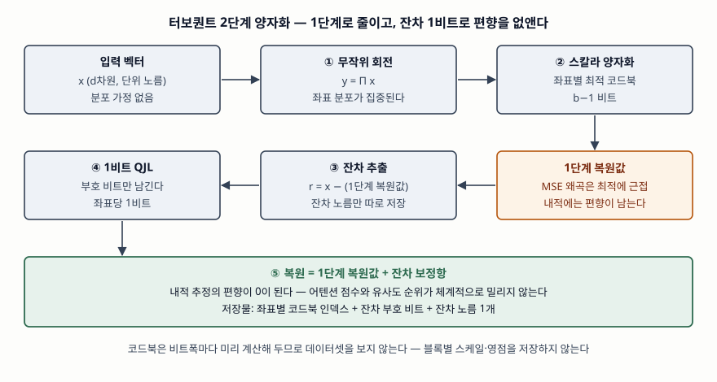

기출문제에서 터보퀀트(TurboQuant)를 주고 개념·특징·성능·기존 양자화 기술과의 차이점·기대
효과를 차례로 묻는다. 2025년에 공개된 원 논문과 2026년의 공식 연구 블로그가 있으므로 1차
자료로 쓸 수 있는 주제다. 정보관리기술사 답안이므로 축은 양자화 이론 자체가 아니라 **이
기법이 정보시스템의 메모리·처리량·색인 운영을 무엇으로 바꾸는가**에 둔다.

> 실행 검증 없음. 원 논문과 공식 연구 블로그에 실린 정의·알고리즘·측정값만으로 정리했다.
> 두 자료의 수치가 엇갈리는 부분은 그 사실을 함께 적었다.

---

## Ⅰ. 개요

LLM 서빙과 벡터 검색은 연산이 아니라 **메모리에서 먼저 막힌다.** 트랜스포머 추론은
이전 토큰의 키·값을 KV 캐시에 쌓아 두고 재사용하므로, 캐시 크기가 문맥 길이에 비례해
늘어난다. 문맥이 10만 토큰 단위로 길어지면 캐시가 모델 가중치보다 커지고, 배치 크기를
키울 수 없어 처리량이 주저앉는다. 벡터 검색도 같다. 임베딩 차원이 1,000을 넘는 색인을
32비트 실수로 들고 있으면 메모리가 먼저 동난다.

해법은 **더 적은 비트로 벡터를 저장하는 것**, 곧 벡터 양자화다. 그런데 기존 기법에는
세 가지 걸림돌이 있었다. ① 코드북을 데이터로 학습해야 해서 **색인 전처리가 오래 걸리고
분포가 바뀌면 다시 학습**해야 한다. ② 블록마다 스케일·영점 같은 **양자화 상수를 원래
정밀도로 저장**해야 해서, 값당 1~2비트가 그냥 사라진다. ③ 제곱오차를 줄이도록 맞춘
양자화기는 **내적 추정에 편향**을 남긴다. 어텐션 점수와 유사도 순위가 바로 내적이므로
이 편향은 품질 저하로 이어진다.

터보퀀트는 이 셋을 한꺼번에 겨냥한다. 2025년 4월 공개된 논문이 제안했고, 구글 리서치가
2026년 3월 공식 블로그로 소개했으며 ICLR 2026 발표가 예정돼 있다.

## Ⅱ. 터보퀀트의 개념

### 가. 정의

터보퀀트는 **입력 벡터를 무작위로 회전시킨 뒤 좌표마다 최적 스칼라 양자화기를 적용하고,
남은 잔차에 1비트 양자화 JL 변환을 덧붙여 제곱오차와 내적 왜곡을 동시에 이론적 하한
근처까지 낮추는, 데이터에 의존하지 않는 온라인 벡터 양자화 기법**이다.

정의 문장에 세 가지가 다 들어가야 한다. **무작위 회전**, **잔차에 대한 1비트 보정**,
그리고 **데이터 비의존(data-oblivious)** 이다. 앞의 둘이 방법이고 셋째가 운영상의 성질이다.

### 나. 2단계 구조

> **출처**: [Zandieh et al., TurboQuant §3.1 Algorithm 1 · §3.2 Algorithm 2 (arXiv:2504.19874v1, 2025-04-28)](https://arxiv.org/abs/2504.19874)

**1단계 — 제곱오차를 줄이는 양자화.** 가우시안 난수 행렬을 QR 분해해 얻은 직교행렬로
입력 벡터를 회전시킨다. 회전된 벡터의 좌표는 차원이 커질수록 평균 0, 분산 1/d인 정규분포에
가까워지고 좌표끼리 거의 독립이 된다. **분포를 알고 있으니 데이터를 보지 않고도 최적
코드북을 미리 만들 수 있다.** 논문은 1차원 연속 k-평균 문제를 맥스–로이드 알고리즘으로
풀어 비트폭별 코드북을 한 번만 계산해 둔다. 각 좌표는 가장 가까운 대표값의 인덱스로만
저장된다.

**2단계 — 내적 편향을 없애는 잔차 보정.** 1단계만 쓰면 제곱오차는 작아도 내적 추정이
한쪽으로 치우친다. 논문은 1비트에서 이 편향이 곱셈 상수 2/π만큼 생긴다고 적는다. 그래서
1단계를 **b−1 비트로 돌려 1비트를 남기고**, 원 벡터에서 1단계 복원값을 뺀 잔차에 양자화 JL
변환을 적용해 **부호 비트만** 저장한다. 잔차의 노름 하나만 따로 두면, 복원할 때 이 부호
비트로 만든 보정항을 더해 **편향이 0인 내적 추정**을 얻는다.

### 다. 무작위 회전이 하는 일

회전 자체는 길이와 내적을 보존하므로 정보를 잃지 않는다. 바뀌는 것은 **좌표값의 분포**다.
원래 벡터는 어느 좌표에 큰 값이 몰릴지 알 수 없어 데이터를 봐야 눈금을 정할 수 있지만,
회전 뒤에는 모든 좌표가 같은 분포를 따르므로 **눈금을 미리 정해 둘 수 있다.** 기존
양자화가 블록마다 저장하던 스케일·영점이 필요 없어지는 이유가 여기에 있다.

## Ⅲ. 터보퀀트의 특징 — 5가지

① **데이터 비의존·온라인.** 코드북이 비트폭에만 의존하므로 데이터셋을 미리 훑지 않는다.
벡터가 들어오는 즉시 양자화할 수 있고, 데이터 분포가 바뀌어도 다시 학습할 것이 없다.

② **두 왜곡을 동시에 다룬다.** 제곱오차와 내적 왜곡은 서로 다른 목표다. 제곱오차에
최적인 양자화기가 내적에서는 편향을 내므로, 터보퀀트는 **목표별로 단계를 나눠** 1단계가
크기를 줄이고 2단계가 편향을 지운다.

③ **양자화 상수를 저장하지 않는다.** 회전으로 분포를 맞춰 두었으므로 블록별 스케일·영점이
없다. 잔차 노름 하나만 추가로 들고 간다.

④ **이론적 최적성에 근거가 있다.** 논문은 어떤 양자화기도 넘을 수 없는 정보이론적 하한을
증명하고, 자신의 상한이 그 하한과 **작은 상수배**만큼만 떨어져 있음을 보인다. 경험적으로
좋다가 아니라 **최적과의 거리를 숫자로 제시**한다는 점이 이 기법의 성격을 결정한다.

⑤ **재학습이 필요 없고 혼합 정밀도로 쓸 수 있다.** 모델을 미세조정하지 않고 추론 경로에
그대로 끼워 넣는다. 크기가 큰 이상치 채널과 보통 채널을 나눠 서로 다른 비트폭을 주면
채널당 평균 비트를 소수점 단위로 조절할 수 있다.

## Ⅳ. 터보퀀트의 성능

### 가. 이론적 왜곡률

비트폭 b, 단위 노름 입력을 기준으로 논문이 제시한 값이다.

| 구분 | 제곱오차 왜곡 | 내적 왜곡 |
|---|---|---|
| 정보이론적 하한 | 4^(−b) | (1/d)·4^(−b) |
| 터보퀀트 상한 | (√3π/2)·4^(−b) ≈ 2.72·4^(−b) | 같은 4^(−b) 차수, 1/d 규모 |
| 하한과의 거리 | 약 2.7배 (1비트에서는 약 1.45배) | 상수배 |

비트폭별 제곱오차 상한은 1비트 약 0.36, 2비트 약 0.117, 3비트 약 0.030, 4비트 약 0.009다.
**비트를 하나 늘릴 때마다 왜곡이 네 배씩 줄어드는 구조**이므로, 품질 요구를 비트폭으로
직접 환산할 수 있다는 점이 운영에서 쓸모가 있다.

### 나. 실측 — KV 캐시

논문은 엔비디아 A100 한 장에서 측정했다. 장문맥 탐색 과제(Llama-3.1-8B-Instruct, 문맥
4k~104k 토큰, 메모리 비율 0.25)의 점수는 아래와 같다.

| 방식 | 점수 |
|---|---|
| 전정밀도(압축 없음) | 0.997 |
| 터보퀀트 | 0.997 |
| 비교 기법 중 최고 | 0.995 |
| 블록 스케일 2비트 방식 | 0.981 |
| 캐시 선별 삭제 방식 | 0.858 ~ 0.895 |

장문맥 종합 벤치마크에서는 전체 캐시 평균 50.06에 대해 터보퀀트 3.5비트가 50.06으로
같았고, 2.5비트에서 49.44로 떨어졌다. 다른 7B급 모델에서도 전체 캐시 49.89 대 2.5비트
49.62였다. **3.5비트는 사실상 품질 손실이 없고, 2.5비트에서 손실이 눈에 보이기 시작한다**는
것이 논문의 결론이다. 2.5비트는 128개 채널 중 이상치 32개에 3비트, 나머지 96개에 2비트를
주어 평균을 맞춘 설정이다.

공식 블로그는 같은 기법을 **3비트에서 정확도 손실 없이 KV 메모리를 최소 6배 줄였다**고
적고, 4비트 구현이 H100에서 32비트 비양자화 키 대비 어텐션 로짓 계산을 최대 8배 빠르게
한다고 적는다. 논문이 쓴 압축 배수(4~5배)와 블로그의 6배는 설정과 기준이 달라 생긴
차이이므로, **답안에서는 출처를 밝혀 둘 다 적는 편이 안전하다.**

### 다. 실측 — 벡터 검색

근사 최근접 이웃 탐색에서 4비트 색인을 만드는 데 걸린 시간이다. 단위는 초다.

| 차원 | 곱 양자화 | 비교 기법(RaBitQ) | 터보퀀트 |
|---|---|---|---|
| 200 | 37.04 | 597.25 | 0.0007 |
| 1,536 | 239.75 | 2,267.59 | 0.0013 |
| 3,072 | 494.42 | 3,957.19 | 0.0021 |

**차수가 다르다.** 코드북을 학습하지 않으므로 전처리가 사실상 없다. 논문은 그러면서도
재현율에서 곱 양자화와 비교 기법을 앞섰다고 보고한다.

## Ⅴ. 기존 양자화 기술과의 차이점

| 비교 항목 | 곱 양자화(PQ) | 블록 스케일 방식 | 터보퀀트 |
|---|---|---|---|
| 코드북 | 부분공간마다 k-평균 학습 | 없음(선형 눈금) | 비트폭별 사전 계산 |
| 데이터 의존 | 의존 | 블록 통계에 의존 | 비의존 |
| 추가 저장 | 코드북 | 블록마다 스케일·영점 | 잔차 노름 1개 |
| 전처리 비용 | 색인마다 학습 | 블록마다 계산 | 0에 가깝다 |
| 분포 변화 대응 | 재학습 | 블록 재계산 | 그대로 |
| 최적화 기준 | 유클리드 거리 | 제곱오차 | 제곱오차 + 내적 |
| 내적 추정 | 편향 있음 | 편향 있음 | 편향 없음 |
| 품질 보장 | 경험적 | 경험적 | 하한 대비 상수배 |
| 주 적용처 | 벡터 검색 색인 | LLM KV 캐시 | 둘 다 |

차이의 뿌리는 하나다. **기존 기법은 데이터의 분포를 알아내려 했고, 터보퀀트는 회전으로
분포를 만들어 버린다.** 분포를 알아내려면 데이터를 봐야 하고(전처리), 본 결과를 어딘가
적어 둬야 하며(양자화 상수), 데이터가 바뀌면 다시 봐야 한다(재학습). 분포를 만들어 놓으면
이 세 가지가 함께 사라진다. 곱 양자화가 벡터 검색에, 블록 스케일 방식이 KV 캐시에 따로
쓰이던 것과 달리 **터보퀀트가 양쪽에 같이 쓰이는 이유**도 데이터 비의존성에 있다.

다만 공짜는 아니다. 회전은 d차원 행렬 연산이므로 **양자화·복원 경로에 연산이 추가**된다.
논문이 쓴 것은 색인 시간이 0에 가깝다는 것이지 질의 연산이 없다는 뜻이 아니다.

## Ⅵ. 기대 효과

① **장문맥 서비스의 단가가 내려간다.** KV 캐시가 줄면 같은 GPU 메모리에 더 큰 배치를
올릴 수 있고, 처리량이 올라가면 토큰당 비용이 내려간다. 문서 요약·코드베이스 분석처럼
문맥이 긴 업무를 **모델을 바꾸지 않고** 감당할 수 있다.

② **벡터 DB 운영에서 색인 재구축 부담이 사라진다.** 데이터가 계속 들어오는 RAG 색인은
분포가 조금씩 바뀌는데, 학습된 코드북은 그때마다 낡는다. 코드북이 데이터와 무관하면
**증분 색인과 전체 색인의 품질이 같아진다.** 재색인 배치 작업을 일정에서 뺄 수 있다는
뜻이다.

③ **모델 공급망을 건드리지 않는다.** 재학습이나 미세조정이 없으므로 서빙 계층의 설정
변경으로 끝난다. 모델 재검증·재승인 절차를 다시 밟지 않아도 되는 것은 규제 산업에서
특히 크다.

④ **품질 목표를 비트폭으로 설계할 수 있다.** 왜곡 상한이 비트폭의 함수로 주어지므로,
서비스 수준 목표를 정해 두고 비트폭을 고르는 방식의 용량 산정이 가능해진다. 이상치
채널에만 비트를 더 주는 혼합 정밀도도 같은 틀에서 조절된다.

⑤ **온디바이스·엣지 추론의 문맥 한계가 늘어난다.** 메모리가 고정된 단말에서 가장 먼저
막히는 것이 KV 캐시이므로, 같은 메모리로 더 긴 대화를 유지할 수 있다.

## Ⅶ. 결론

터보퀀트의 기여는 압축률 자체가 아니라 **압축의 성질을 바꾼 데** 있다. 데이터를 학습해
눈금을 맞추던 양자화를, 회전으로 분포를 고정해 눈금을 미리 정하는 양자화로 바꿨다. 그
결과 전처리·양자화 상수·재학습이 한꺼번에 빠지고, 제곱오차와 내적이라는 서로 다른 두
목표를 단계를 나눠 모두 잡는다. 하한을 증명하고 상한과의 거리를 상수로 제시했다는 점에서
**"더 짜낼 여지가 얼마나 남았는가"에 답한 연구**이기도 하다.

도입을 검토한다면 세 가지를 본다. 첫째, 서비스 품질 기준을 정해 **비트폭을 먼저 고른다** —
3.5비트와 2.5비트 사이에 손실이 갈린다. 둘째, 회전·복원 연산이 추론 경로에 들어가므로
**메모리 이득과 연산 비용을 함께 잰다.** 셋째, 공개된 측정값은 특정 모델·데이터셋의
것이므로 **자사 질의 분포로 재현율과 품질을 다시 확인한다.**

> 관련 답안: [기출문제 — 어휘 검색과 의미 검색을 결합한 하이브리드 검색](../2026-09-22-hybrid-search-lexical-vector/index.md)

> 개념 정리: [근사 최근접 이웃 탐색과 HNSW 색인 — 정확한 답을 포기하고 얻는 것](../../database/2026-09-22-approximate-nearest-neighbor-hnsw/index.md)

> 개념 정리: [벡터 양자화와 율-왜곡 이론 — 비트를 줄이면 무엇을 잃는가](../../data-analysis/2026-10-19-vector-quantization-rate-distortion/index.md)

> 개념 정리: [KV 캐시 — 트랜스포머 추론의 메모리 병목](../../emerging-tech/2026-10-19-kv-cache-transformer-inference/index.md)

> 개념 정리: [존슨-린덴스트라우스 보조정리와 랜덤 투영 — 차원을 줄여도 거리가 남는 이유](../../data-analysis/2026-10-19-johnson-lindenstrauss-random-projection/index.md)

끝

## 답안 작성 메모

- **먼저 쓸 것**: 정의 한 문장에 **무작위 회전 · 잔차 1비트 보정 · 데이터 비의존** 세
  낱말을 모두 넣는다. 이 셋이 뒤의 특징·차이점·기대 효과를 전부 끌고 나오는 축이다.
  이어서 2단계 모식도를 그리고 "1단계가 크기를 줄이고 2단계가 편향을 지운다" 한 줄을 적는다.
- **점수가 갈리는 지점**: **왜 2단계가 필요한가**를 쓰는가. 제곱오차에 최적인 양자화기가
  내적에서 편향을 낸다는 사실, 그리고 어텐션 점수와 유사도가 곧 내적이라는 연결까지
  쓰면 "두 왜곡을 동시에"라는 제목이 설명된다. 여기를 건너뛰면 그냥 압축률 소개가 된다.
- **차이점은 표로 세운다.** 비교 대상을 **곱 양자화(벡터 검색 계열)** 와 **블록 스케일
  방식(KV 캐시 계열)** 둘로 나눠야 "양쪽에 같이 쓰인다"는 결론이 선다. 표 아래에
  "분포를 알아내느냐 만드느냐"로 한 줄 요약을 붙인다.
- **수치는 출처를 갈라 적는다.** 논문은 3.5비트 무손실·압축 4~5배, 공식 블로그는 3비트
  무손실·메모리 6배다. 하나만 외워 쓰면 다른 쪽 자료를 든 채점자에게 틀린 값이 된다.
  "출처에 따라 설정이 달라 배수가 다르다"로 적으면 둘 다 살릴 수 있다.
- **시간이 모자라면**: 왜곡률 표를 "하한 대비 약 2.7배" 한 줄로 줄이고, 실측은 색인
  시간 차수 비교만 남긴다. 기대 효과는 ①②③만 쓴다. 모식도는 박스 5개(입력 → 회전 →
  스칼라 양자화 → 잔차 1비트 → 복원)로 줄여도 구조가 선다.
- 개수를 붙인다 — 기존 양자화의 걸림돌 3가지, 특징 5가지, 기대 효과 5가지, 도입 검토
  3가지.

## 참고 자료

- [A. Zandieh, M. Daliri, M. Hadian, V. Mirrokni, "TurboQuant: Online Vector Quantization with Near-optimal Distortion Rate", arXiv:2504.19874v1 (2025-04-28)](https://arxiv.org/abs/2504.19874) — §3.1 Algorithm 1(무작위 회전·맥스–로이드 코드북), §3.2 Algorithm 2(잔차 1비트 QJL), §3.3 Theorem 3(정보이론적 하한), §4 실험
- [Google Research Blog, "TurboQuant: Redefining AI efficiency with extreme compression" (2026-03-24)](https://research.google/blog/turboquant-redefining-ai-efficiency-with-extreme-compression/) — 공식 소개, 3비트 설정과 H100 어텐션 로짓 가속 수치
- [ICLR 2026 Poster — TurboQuant (2026-04-25 발표 예정)](https://iclr.cc/virtual/2026/poster/10006985) — 발표 정보와 초록
- [A. Zandieh, M. Daliri, I. Han, "QJL: 1-Bit Quantized JL Transform for KV Cache Quantization with Zero Overhead", AAAI 2025 (arXiv:2406.03482, 2024-06)](https://arxiv.org/abs/2406.03482) — 2단계가 쓰는 1비트 양자화 JL 변환의 원 제안
- [H. Jégou, M. Douze, C. Schmid, "Product Quantization for Nearest Neighbor Search", IEEE TPAMI 33(1), pp.117–128, 2011](https://doi.org/10.1109/TPAMI.2010.57) — 부분공간별 코드북 학습 방식의 원 제안
- [Z. Liu et al., "KIVI: A Tuning-Free Asymmetric 2bit Quantization for KV Cache", ICML 2024 (arXiv:2402.02750)](https://arxiv.org/abs/2402.02750) — 블록 스케일 기반 KV 캐시 양자화 비교 대상
