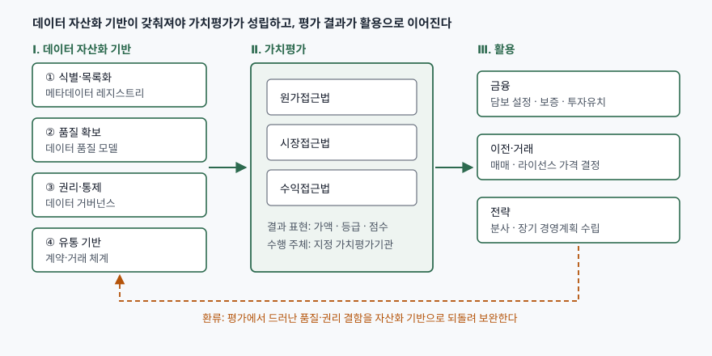

> 실행 검증 없음. 소관 부처·공공기관이 공표한 제도 자료와 국제표준 원문 미리보기를 근거로 정리했다.
> 데이터산업법 조문은 국가법령정보센터 본문을 열지 못해 조문 번호와 취지만 쓰고 문언은 인용하지 않았다.
> 개별 기업의 금융 지원 사례도 1차 자료를 확보하지 못해 금액을 적지 않았다. 해당 절에 그 사실을 밝혔다.

데이터 가치평가와 데이터 자산화를 묶어 묻는 문제다. 가치평가의 개념과 방법론, 자산화의 개념과
핵심요소, 두 제도의 활용사례를 세 갈래로 나눠 물었으므로 그 순서를 그대로 대항목으로 둔다.
도메인 이야기가 아니라 **정보시스템이 무엇을 갖춰야 데이터에 값이 매겨지는가**를 답안의 축으로 잡는다.

---

## Ⅰ. 개요

기업이 수년간 쌓은 로그와 거래 기록은 재무상태표에서 대체로 자산이 아니라 비용으로 남는다.
무형자산 기준서가 요구하는 식별가능성, 통제, 미래 경제적 효익, 원가의 신뢰성 있는 측정을
데이터가 좀처럼 입증하지 못하기 때문이다. 그런데 같은 데이터가 거래 시장에서는 값을 받고,
금융에서는 담보가 된다. 장부에 없는 것이 시장에서는 팔리는 이 간극을 메우려는 제도가
**데이터 가치평가**이고, 간극을 메울 수 있는 상태로 데이터를 만들어 두는 일이 **데이터 자산화**다.

둘은 순서가 있다. 무엇이 평가 대상인지 경계가 그어져 있지 않고, 누가 통제하는지가 정해져 있지
않고, 품질이 재어지지 않으면 평가자는 값을 매길 근거가 없다. **자산화가 선행 조건이고
가치평가가 그 결과를 수치로 확정한다.** 그래서 이 문제는 회계 문제가 아니라 데이터 거버넌스와
메타데이터 관리를 묻는 정보관리 문제로 읽어야 한다.

> **출처**: [한국데이터산업진흥원 데이터 가치평가 사업안내](https://www.kdata.or.kr/kr/contents/value01/view.do), [ISO/IEC 38505-1:2026 §6 Data accountability, §9.2 Value](https://www.iso.org/standard/87195.html)

---

## Ⅱ. 데이터 가치평가의 개념과 가치평가 방법론

### 가. 개념

데이터 가치평가는 **기업이 보유·활용하는 데이터의 경제적 가치를 공표된 평가 기법과 평가 체계에
따라 가액·등급·점수 등으로 산정하는 것**이다. 근거는 「데이터 산업진흥 및 이용촉진에 관한
기본법」(이하 데이터산업법)의 **데이터 가치평가 조항(제14조)**이며, 이 조항은 정부가 평가 기법과
체계를 공표하도록 하고, 이를 수행할 **가치평가기관을 지정**하도록 한다.

제도의 구조는 세 층이다.

① **공표된 평가 기법·체계** — 정부가 기준을 정해 평가자마다 결과가 달라지는 것을 줄인다.
② **지정 가치평가기관** — 2023년 3월 2일 기술보증기금, 나이스디앤비, 신용보증기금,
   한국과학기술정보연구원의 4개 법인이 지정되었다.
③ **평가 결과의 활용** — 금융·거래·전략 의사결정의 근거가 된다.

평가 대상에서 **공공데이터는 제외**된다. 무상 개방을 원칙으로 하는 데이터에는 거래가격을
전제한 평가를 적용하기 어렵다고 읽으면 된다. 이 한 줄이 평가 제도와 공공데이터 개방 정책을
가르는 경계다.

### 나. 가치평가 업무 절차 — 6단계

| 단계 | 내용 | 수행 주체 |
|---|---|---|
| ① 사전 협의·상담 | 평가 목적과 용도, 대상 데이터 범위 확인 | 신청인 ↔ 평가기관 |
| ② 서류 제출·계약 | 평가 계약 체결 | 신청인 ↔ 평가기관 |
| ③ 평가계획 수립·준비 | 제출 서류 검토, 미비 시 보완 요청 | 신청인 ↔ 평가기관 |
| ④ 가치평가 실시 | 서류 검토, 현장실사 | 평가기관 |
| ⑤ 결과보고서 작성 | 가정·제한조건·기법 선택 배경 명시 | 평가기관 |
| ⑥ 결과 통보 | 신청인에게 전달 | 평가기관 |

보고서에 **적용한 가정과 제한적인 조건, 평가기법을 고른 배경을 명시하는 것이 원칙**이다.
같은 데이터라도 목적과 용도가 달라지면 값이 달라지므로, 숫자만 남기면 다음 사람이 그 숫자를
어디까지 쓸 수 있는지 판단할 수 없다.

같은 흐름을 소관 부처 안내서는 **9단계**(의뢰·사전검토부터 사후관리까지)로 더 잘게 나눈다.
묶는 단위가 다를 뿐 내용은 같으므로, 답안에는 **출처를 밝히고 한쪽만 쓴다.**
단계 수를 틀리게 적는 것보다 어느 자료 기준인지 적는 편이 낫다.

### 다. 가치평가 방법론 — 3가지 접근법

| 구분 | 핵심 질문 | 산정 방식 | 적용 조건 | 한계 |
|---|---|---|---|---|
| **원가접근법** | 이 데이터를 만드는 데 얼마가 드는가 | 생산에 투입된 비용, 또는 동일한 효익을 가진 데이터를 생산·구입하는 데 드는 비용을 추정 | 거래 사례도 수익 추정도 어려운 초기 단계 | 비용이 가치와 비례하지 않는다. 비싸게 모았으나 쓸모없는 데이터도 값이 커진다 |
| **시장접근법** | 시장에서 유사한 데이터는 얼마에 거래되는가 | 동일·유사 데이터의 유통 시장 거래가치를 비교·분석해 상대가치 산정 | 비교 가능한 거래 사례가 축적된 경우 | 데이터는 동일한 것이 둘 있기 어렵다. 비교 대상 선정이 곧 결론을 좌우한다 |
| **수익접근법** | 이 데이터로 얼마를 더 버는가 | 경제적 수명기간 동안 발생할 미래 경제적 효익에 적정 할인율을 적용해 현재가치로 환산 | 사업화 완성도가 일정 수준 이상이라고 판단될 때 | 수명·할인율·효익 추정이 모두 가정이다. 가정이 결과를 지배한다 |

세 기법은 배타적이지 않다. **데이터의 유형, 특성, 활용 목적·용도에 따라 하나 또는 둘 이상을
함께 쓴다.** 수익접근법 안에서도 유사 데이터 거래의 경상로열티율을 참고할 수 있으면
로열티공제법 같은 기법을 적용할 수 있다.

### 라. 가치에 영향을 주는 요인 — 4가지

데이터 거버넌스 국제표준은 데이터의 가치 측면(§9.2 Value)을 네 항목으로 나눈다.
품질(Quality), 시의성(Timeliness), 맥락(Context), 규모(Volume)다.

- **품질** — 값이 틀린 데이터는 효익이 아니라 손실을 만든다. 품질 특성은 데이터 품질 모델
  (ISO/IEC 25012)이 고유(inherent) 관점과 시스템 의존(system-dependent) 관점으로 나눠
  **15가지 특성**으로 정의한다. 정확성, 완전성, 일관성, 신뢰성, 최신성이 고유 관점의 대표다.
- **시의성** — 실시간 수요예측 데이터는 하루가 지나면 값이 떨어진다. 수익접근법의 경제적
  수명기간을 정하는 변수다.
- **맥락** — 같은 데이터도 쓰는 산업이 바뀌면 값이 달라진다. 목적과 용도를 보고서에 명시해야
  하는 이유다.
- **규모** — 단순한 양이 아니라, 통계적으로 유의한 결론을 낼 만큼 모였는가를 본다.

---

## Ⅲ. 데이터 자산화의 개념과 핵심요소

### 가. 개념

데이터 자산화는 **조직이 보유한 데이터를 식별·통제·측정이 가능한 단위로 정리하고, 권리관계와
품질을 확보해 거래·담보·투자의 대상이 될 수 있는 상태로 만드는 일**이다. 회계상 무형자산으로
장부에 올리는 것(재무적 자산화)과, 관리 대상으로 목록화해 가치를 끌어내는 것(관리적 자산화)을
구분해야 한다. 기술사 답안에서 요구하는 쪽은 **후자가 선행하고 전자가 뒤따른다**는 순서다.

법적으로도 근거가 생겼다. 데이터산업법의 **데이터자산 보호 조항(제12조)**은 인적·물적으로
상당한 투자와 노력으로 생성한 경제적 가치를 가지는 데이터를 데이터자산으로 보고, 공정한
상거래 관행이나 경쟁질서에 반하는 무단 취득·사용·공개와 기술적 보호조치 무력화를 부정사용으로
금지한다. **통제할 수 없는 것은 자산이 아니므로, 권리 보호가 자산화의 전제가 된다.**

### 나. 핵심요소 — 5가지

| 핵심요소 | 무엇을 갖추는가 | 정보시스템 구현 수단 | 근거 |
|---|---|---|---|
| ① **식별·목록화** | 데이터의 경계를 긋고 이름·의미·구조를 등록 | 메타데이터 레지스트리, 데이터 카탈로그, 데이터 계보 추적 | ISO/IEC 11179-1:2023 |
| ② **품질 확보** | 품질 특성을 정의하고 주기적으로 측정 | 품질 규칙 엔진, 프로파일링, 품질 지표 대시보드 | ISO/IEC 25012:2008 |
| ③ **권리·통제** | 생성·수집 단계부터 소유와 책임을 지정 | 접근통제, 데이터 분류체계, 이력·감사로그 | ISO/IEC 38505-1:2026, 데이터산업법 제12조 |
| ④ **가치 측정** | 목적·용도를 정하고 평가 가능한 형태로 근거 축적 | 이용 실적·과금 이력·효익 지표의 수집 | 데이터산업법 제14조 |
| ⑤ **유통 기반** | 교환·거래할 수 있는 형식과 계약 | 표준 식별체계, 개방형 포맷·API, 거래 계약·라이선스 | 데이터 가치평가 안내서(2024) |

### 다. 생애주기 책임 — 6단계

데이터 거버넌스 국제표준의 **데이터 책임(Data accountability) 절(§6)** 은 책임 소재를 생애주기
여섯 단계로 나눈다. 수집(Collect) → 저장(Store) → 보고(Report) → 결정(Decide) →
배포(Distribute) → 폐기(Dispose)다. 각 단계마다 **누가 결정하고 누가 책임지는지**를 적어 둔 것이
데이터 책임 지도(data accountability map)이며, 표준은 이 지도의 적용을 별도 절(§10)로 다룬다.

이 여섯 단계가 자산화에서 갖는 뜻은 분명하다. 수집 단계에 동의와 출처를 남기지 않으면 뒤에서
아무리 품질을 올려도 **팔 수 없는 데이터**가 된다. 폐기 단계가 설계되지 않으면 보유 자체가
위험이 된다. 같은 표준은 데이터 거버넌스를 **IT 거버넌스의 하위 영역, IT 거버넌스를 조직
거버넌스의 하위 영역**으로 정의하므로, 자산화는 현업 부서의 과제가 아니라 경영 의사결정 체계에
걸리는 과제다.

> 이 표준은 2026년 8월 제2판으로 개정되었고, 2017년 제1판은 같은 달 폐지되었다.
> 답안에 연도를 적을 때 주의할 지점이다.

---

## Ⅳ. 데이터 가치평가 및 데이터 자산화의 활용사례

### 가. 금융 — 평가액을 한도로 쓰는 구조

평가 결과는 **데이터 담보권 설정, 투자유치, 보증서 발급**에 쓰인다. 지정 가치평가기관 가운데
정책금융기관이 둘 포함된 것이 이 구조를 보여준다. 평가기관이 산정한 가치금액이 보증 한도의
근거가 되고, 평가 비용의 일부는 정부 지원사업으로 보전된다.

> 평가기관의 구체적 보증상품명과 개별 기업의 지원 금액은 언론 보도로만 확인되고 기관 공식
> 자료를 확보하지 못해 금액은 적지 않는다. 보도마다 수치가 어긋나 교차 확인이 되지 않는다.

정보시스템 관점에서 이 구조가 요구하는 것은 **데이터의 존재와 규모를 제3자가 검증할 수 있는
증적**이다. 적재량 추이, 갱신 주기, 결측률 같은 수치가 운영 시스템에서 자동으로 뽑혀야 평가자가
현장실사에서 확인할 수 있다. 자산화의 식별·목록화와 품질 확보가 금융으로 바로 이어지는 지점이다.

### 나. 이전·거래 — 가격을 정하는 근거

**데이터 매매와 라이선스 가격 결정**에 쓰인다. 거래가 성립하려면 양측이 같은 대상을 보고 있어야
하므로, 거래 단위의 식별자와 스키마, 제공 범위와 갱신 주기를 계약 전에 확정해야 한다.
시장접근법이 작동하려면 이런 거래 사례가 축적되어야 하는데, **거래가 없어 비교 사례가 없고
비교 사례가 없어 값을 못 매기는 순환**이 이 영역의 현실적 제약이다. 거래소형 유통 기반과 표준
식별체계가 필요한 이유가 여기 있다.

### 다. 전략 — 기업가치와 조직 설계

**가치증권 발행, 분사(spin-off), 장기 전략적 경영계획 수립**에 쓰인다. 특정 데이터 자산을 떼어
별도 법인으로 세우려면 그 자산의 경계와 값이 먼저 확정되어야 한다. 자산화에서 그은 경계가
그대로 분할 단위가 된다.

### 라. 공공 — 평가 대상이 아닌 쪽의 자산화

공공데이터는 가치평가 대상에서 빠지지만 자산화 자체는 필요하다. 목록 등록, 표준 메타데이터,
품질 진단, 개방 포맷은 모두 자산화의 핵심요소와 같다. **값을 매겨 파는 것이 목적이 아니라
찾아 쓸 수 있게 하는 것이 목적**이라는 점만 다르다.

---

## Ⅴ. 결론

데이터 가치평가는 데이터의 경제적 가치를 가액·등급·점수로 산정하는 제도이고, 원가·시장·수익의
세 접근법을 데이터 특성과 용도에 따라 골라 쓴다. 데이터 자산화는 그 평가가 가능하도록
식별·품질·권리·측정·유통의 다섯 요소를 갖추는 일이다.

핵심은 **순서**다. 자산화 없이 평가만 서두르면 평가 근거가 없는 숫자가 장부에 올라간다.
평가 결과를 담보와 투자에 쓰는 구조에서는 그 숫자가 곧 신용으로 바뀌므로, 근거가 비면
자산이 아니라 위험이 쌓인다. 정보관리 측면에서 할 일은 분명하다. 메타데이터 레지스트리로
경계를 긋고, 품질 모델로 상태를 재고, 생애주기 여섯 단계에 책임을 배치하는 것이다.
**장부에 올릴 숫자를 만드는 것은 회계의 일이지만, 그 숫자가 가리킬 대상을 만드는 것은
정보시스템의 일이다.**

> 개념 정리: [데이터 가치평가 — 수익·원가·시장접근법과 데이터산업법 가치평가 제도](../../data-analysis/2026-10-05-data-valuation-income-cost-market-approach/index.md)
>
> 개념 정리: [데이터 거버넌스와 데이터 품질 관리 체계](../../database/2026-10-06-data-governance-quality-dimensions-roles/index.md)
>
> 개념 정리: [데이터 계보(Data Lineage)와 메타데이터 카탈로그](../../database/2026-10-14-data-lineage-metadata-catalog/index.md)
>
> 개념 정리: [데이터 자산화 — 관리적 자산화와 재무적 자산화](../../data-analysis/2026-10-20-data-assetization-managerial-vs-financial/index.md)
>
> 같은 제도를 평가 요인과 핵심변수 쪽에서 다룬 답안: [기출문제 — 데이터 가치평가의 평가 요인, 방법론, 객관성을 정하는 핵심변수](../2026-10-05-data-valuation-factors-methods/index.md)

끝

---

## 답안 작성 메모

**먼저 쓸 것.** 개요에서 "자산화가 선행, 가치평가가 후행"이라는 순서를 한 문장으로 못 박고
시작한다. 이 문제는 두 개념을 나열하면 점수가 안 나오고, **둘의 관계를 세운 답안**이 올라간다.
모식도를 개요 직후에 그려 그 관계를 먼저 보여주면 뒤의 대항목이 전부 그 그림의 설명이 된다.

**점수가 갈리는 지점은 셋이다.**

1. **세 접근법을 표로 대비했는가.** 이름만 나열하면 절반이다. 핵심 질문·적용 조건·한계까지
   채워야 한다. 특히 **한계**를 쓴 답안이 적다. 원가접근법은 비용과 가치가 비례하지 않고,
   시장접근법은 비교 대상 선정이 결론을 좌우하며, 수익접근법은 가정이 결과를 지배한다 —
   이 세 줄이 변별 지점이다.
2. **자산화 핵심요소에 정보시스템 구현 수단을 붙였는가.** "품질이 중요하다"로 끝내면
   도메인 답안이고, "ISO/IEC 25012의 15가지 특성을 품질 규칙으로 구현해 주기적으로 측정한다"로
   내려가야 정보관리기술사 답안이다.
3. **공공데이터가 평가 대상에서 빠진다는 사실을 알고 있는가.** 한 줄이지만 제도를 읽었는지
   아닌지가 드러난다.

**시간이 모자라면 버릴 것.** 가치평가 업무 절차 6단계 표를 줄여 두 줄 서술로 바꾼다.
절차는 외워 쓰기 쉬운 만큼 변별력이 낮다. 활용사례의 네 번째(공공)도 버릴 수 있다.
**버리면 안 되는 것은 모식도, 세 접근법 비교표, 자산화 핵심요소 표다.**

**숫자 주의.** 데이터 가치평가 누적 평가액이나 개별 기업 보증 금액 같은 수치는 보도마다
어긋난다. 확실하지 않은 수치는 적지 않고 구조만 쓴다. 대신 **확실한 숫자**는 적는다 —
가치평가기관 4개, 평가 절차 6단계, 접근법 3가지, 핵심요소 5가지, 생애주기 6단계,
품질 특성 15가지. 개수가 곧 점수다.

**버전 주의.** 데이터 거버넌스 표준은 2026년 8월에 제2판으로 바뀌었다. 연도를 적을 자신이
없으면 연도 없이 표준 번호만 쓴다. 틀린 연도는 안 쓴 것보다 나쁘다.

---

## 참고 자료

- [한국데이터산업진흥원 — 데이터 가치평가 사업안내](https://www.kdata.or.kr/kr/contents/value01/view.do) (평가 방법, 업무 절차 6단계, 지정 평가기관, 활용 분야)
- [국가법령정보센터 — 데이터 산업진흥 및 이용촉진에 관한 기본법](https://www.law.go.kr/법령/데이터산업진흥및이용촉진에관한기본법) (데이터자산 보호 제12조, 데이터 가치평가 제14조)
- [ISO/IEC 38505-1:2026, Information technology — Governance of data — Part 1](https://www.iso.org/standard/87195.html) (§1 Scope, §6 Data accountability, §9.2 Value, §10 Application of the data accountability map)
- [ISO/IEC 25012:2008, Software engineering — Software product Quality Requirements and Evaluation (SQuaRE) — Data quality model](https://www.iso.org/standard/35736.html) (고유·시스템 의존 관점의 15가지 데이터 품질 특성)
- [ISO/IEC 11179-1:2023, Information technology — Metadata registries (MDR) — Part 1: Framework](https://www.iso.org/standard/78914.html) (메타데이터 레지스트리 프레임워크, 제4판 2023-01)
- [한국회계기준원 — 기업회계기준서 제1038호 무형자산](https://www.kasb.or.kr/front/board/ingAccountingList.do) (무형자산의 정의와 인식요건, 내부창출 무형자산의 자산 인식 제한)
- [과기정통부, 데이터 가치평가 안내서 발간 (ZDNet Korea, 2024-07-04)](https://zdnet.co.kr/view/?no=20240704102407) (안내서 구성과 보고서 작성 원칙, 2차 자료)
