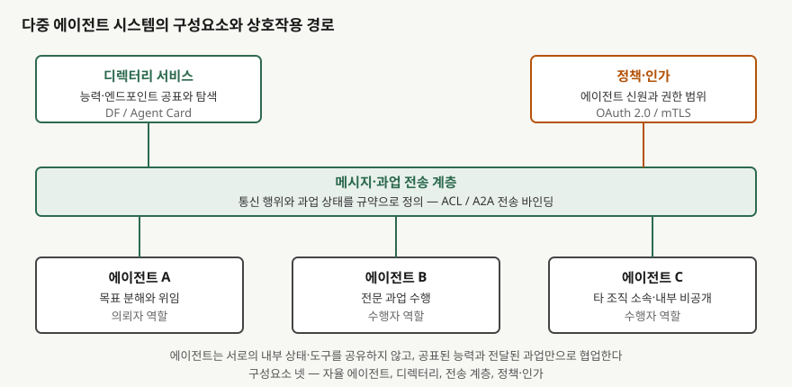
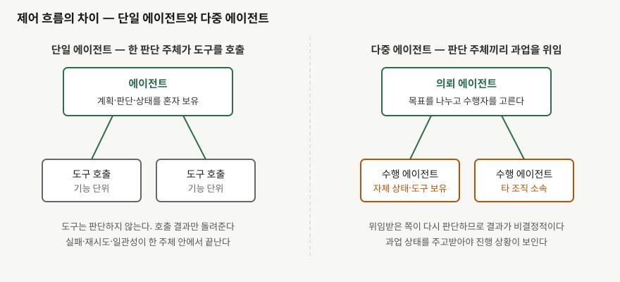

> 실행 검증 없음. 에이전트 상호운용 규격 원문과 공공기관이 공표한 통제 과제 문서를 근거로 정리했다.
> FIPA 규격은 발행처 사이트가 접근을 차단해 원문을 열지 못했으므로, 규격 번호·판·발행일과
> 참조 모델의 구성요소만 쓰고 규격 문언은 인용하지 않았다. 해당 절에 그 사실을 다시 밝혔다.

업무 구조를 바꾸는 기술로서 다중 에이전트 시스템을 묻는 문제다. 정의와 필요성, 단일 에이전트
시스템과의 비교, 효과와 고려사항을 세 갈래로 나눠 물었으므로 그 순서를 그대로 대항목으로 둔다.
조직론이 아니라 **판단 주체가 여럿일 때 정보시스템이 무엇을 더 갖춰야 하는가**를 답안의 축으로 잡는다.

---

## Ⅰ. 개요

업무 자동화는 오랫동안 사람이 짠 절차를 기계가 그대로 밟는 형태였다. 분기 조건과 예외 처리를
사람이 미리 적어 두었고, 적어 두지 않은 상황이 오면 작업은 사람에게 되돌아왔다. 판단을 모델이
맡기 시작하면서 이 전제가 달라졌다. 절차가 아니라 **목표**를 넘기면 모델이 수단을 고른다.

여기서 한 걸음 더 나아간 것이 다중 에이전트 시스템이다. 판단 주체가 하나일 때는 그 주체가
도구를 호출했지만, 판단 주체가 여럿이 되면 **한 주체가 다른 주체에게 과업을 위임**한다. 위임받은
쪽도 스스로 판단하므로, 시스템 설계의 문제가 "어떤 함수를 부를 것인가"에서 "누구에게 무엇을
맡기고 그 결과를 어떻게 믿을 것인가"로 옮겨 간다. 기업의 업무 구조가 바뀐다는 말은 이 위임
단위가 사람의 직무 단위와 겹치기 시작한다는 뜻이다.

> **출처**: [FIPA Agent Management Specification SC00023K](https://www.fipa.org/specs/fipa00023/index.html), [A2A Protocol Specification v1.0.0 — Agent Card, Transport](https://a2a-protocol.org/latest/specification/)

---

## Ⅱ. 다중 에이전트 시스템의 정의 및 필요성

### 가. 정의

다중 에이전트 시스템은 **자율적으로 판단하고 행동하는 복수의 에이전트가 공통 환경에서 규약화된
통신으로 상호작용하면서, 단일 주체가 감당하지 못하는 목표를 분업·위임·조정으로 달성하는 분산
시스템**이다.

정의에서 빠뜨리면 안 되는 말은 넷이다.

① **자율성** — 호출을 기다리는 도구와 달리 스스로 수단을 고른다.
② **복수 주체** — 판단하는 지점이 둘 이상이므로 결과가 한 곳에서 결정되지 않는다.
③ **규약화된 통신** — 메시지와 과업 상태의 형식이 미리 정해져 있어야 서로 다른 구현이 붙는다.
④ **공통 환경** — 에이전트가 함께 읽고 바꾸는 데이터·도구·상태가 있다.

구성요소는 **넷**으로 묶는다. **자율 에이전트**, 능력과 접점을 공표하고 찾게 하는 **디렉터리**,
메시지와 과업을 실어 나르는 **전송 계층**, 누가 무엇까지 할 수 있는지를 정하는 **정책·인가**다.
이 구조는 새로 생긴 것이 아니다. 에이전트 플랫폼 규격(FIPA Agent Management Specification,
SC00023K, 2004-03-18 표준)이 이미 플랫폼에 **생명주기·식별 관리**, **능력 기반 디렉터리**,
**메시지 전송 서비스**를 두도록 참조 모델을 세웠고, 오늘의 에이전트 상호운용 규격도 이름만
바뀌었을 뿐 같은 자리를 채운다. 다만 규격 원문은 발행처 사이트 접근이 막혀 열지 못했으므로,
여기서는 구성요소의 존재와 역할까지만 쓰고 규정 문언은 인용하지 않는다.

### 나. 필요성 — 다섯 가지

**① 문제의 분해 가능성.** 견적·심사·정산처럼 이미 직무로 나뉜 업무는 판단 단위도 나뉘어 있다.
하나의 거대한 지시문으로 묶는 것보다 단위별로 맡기는 편이 설계와 검증 모두 쉽다.

**② 맥락 용량의 한계.** 단일 주체는 모든 절차·규정·이력을 한 번에 들고 판단해야 한다. 위임하면
각 주체가 자기 몫의 맥락만 들면 된다.

**③ 조직 경계.** 거래처의 심사 로직이나 내부 단가표를 상대에게 넘길 수는 없다. 에이전트 간
상호운용 규격이 **내부 상태·메모리·도구를 공유하지 않는 불투명 실행**을 설계 원칙으로 못박은
이유가 여기에 있다. 공표된 능력과 주고받는 과업만으로 협업이 성립해야 조직을 넘어선 연계가 된다.

**④ 이질 시스템 통합.** 부서마다 다른 틀로 만든 에이전트를 하나로 묶으려면 공통 규약이 필요하다.
규약이 없으면 연결마다 전용 연동을 만들어야 하고, 연결 수는 주체 수의 제곱으로 늘어난다.

**⑤ 가용성과 확장.** 주체가 나뉘어 있으면 한쪽의 지연이나 실패가 전체 정지로 번지지 않게 막을
자리가 생긴다. 단일 주체에서는 이 경계를 둘 곳이 없다.

---

## Ⅲ. 단일 에이전트 시스템과 다중 에이전트 시스템 비교

> **출처**: [Model Context Protocol 사양 개정판 2026-07-28 — Overview, Tools](https://modelcontextprotocol.io/specification/latest), [A2A Protocol — What is A2A(설계 원칙)](https://a2a-protocol.org/latest/topics/what-is-a2a/)

두 방식의 갈림길은 **판단 지점이 몇 개인가** 하나다. 나머지 차이는 모두 거기서 따라 나온다.

| 비교 축 | 단일 에이전트 시스템 | 다중 에이전트 시스템 |
|---|---|---|
| 판단 주체 | 1개. 도구는 판단하지 않는다 | 2개 이상. 위임받은 쪽이 다시 판단한다 |
| 상호작용 대상 | 도구·데이터 접점 (MCP의 호스트–클라이언트–서버) | 다른 에이전트 (의뢰 에이전트 ↔ 수행 에이전트) |
| 상태 보관 | 한 주체가 전부 보유 | 주체별로 분산. 과업 상태로만 공유 |
| 맥락 공유 | 전면 공유 | 불투명 실행. 공표된 능력과 전달된 과업만 |
| 탐색 방식 | 설정에 적힌 도구 목록 | 디렉터리 등재 정보로 능력을 찾아 선택 |
| 실패 처리 | 주체 안에서 재시도·중단 | 과업 상태 전이로 전달. 거절·입력요구·인증요구가 별도 상태 |
| 결과의 재현성 | 상대적으로 높음 | 낮음. 판단 지점이 늘수록 분기가 곱해진다 |
| 식별·인가 | 사용자 자격증명 하나 | 에이전트마다 신원과 권한 범위가 따로 필요 |
| 관측·감사 | 단일 호출 로그 | 주체를 가로지르는 추적이 있어야 복원된다 |
| 적합한 업무 | 범위가 좁고 절차가 고정된 업무 | 직무 경계가 나뉘고 조직을 넘나드는 업무 |

표에서 특히 주의할 줄은 **실패 처리**다. 에이전트 간 규격이 과업 수명주기를 단순한 성공/실패가
아니라 **제출·수행 중 / 입력 필요·인증 필요 / 완료·실패·취소·거절**로 나눈 것은, 위임한 쪽이
"지금 상대가 사람의 추가 입력을 기다리는 중"과 "상대가 아예 거절했다"를 구분하지 못하면 다음
행동을 정할 수 없기 때문이다. 단일 주체 설계에서는 이 구분이 함수 반환값 안에 묻혀 있었다.

도구 연결과 에이전트 연결을 **대체 관계로 보지 않는다**. 모델–도구 연결 규격은 호스트·클라이언트·
서버를 두고 자원·프롬프트·도구를 노출하는 쪽을 다루고, 에이전트 간 규격은 판단 주체끼리 과업을
주고받는 쪽을 다룬다. 실제 구성에서는 한 에이전트가 아래로는 도구 규격을, 옆으로는 에이전트
규격을 함께 쓴다.

---

## Ⅳ. 다중 에이전트 시스템의 효과와 고려사항

### 가. 효과 — 네 가지

**① 업무 단위의 재편.** 위임 단위가 직무 단위와 겹치므로, 업무 재설계가 조직도를 건드리지 않고도
가능해진다. 사람이 하던 단위를 그대로 에이전트에 맡기고 결과만 검수하는 전환이 가능하다.

**② 조직 경계를 넘는 연계.** 공표된 능력 정보만으로 상대를 찾고 과업을 맡기므로, 상대의 구현을
알지 못해도 연계가 성립한다. 전용 연동을 조합마다 만들던 비용이 규약 준수 비용으로 바뀐다.

**③ 장애 격리와 점진 도입.** 주체 사이에 경계가 있으므로 한 영역을 먼저 바꾸고 나머지는 그대로
둘 수 있다. 전면 교체가 아니라 영역별 치환이 된다.

**④ 전문화에 따른 품질.** 좁은 범위에 맞춘 지시와 도구를 각 주체에 줄 수 있어, 하나의 거대한
지시문보다 각 단계의 품질을 올리기 쉽다.

### 나. 고려사항 — 여섯 가지

**① 식별과 인가의 단위가 바뀐다.** 사람 계정 하나로 권한을 주던 모델이 통하지 않는다. 에이전트
마다 신원이 있어야 하고, 능력 공표 문서가 위조되면 잘못된 상대에게 과업이 간다. 상호운용 규격이
능력 공표 문서에 **서명**을 더하고 인증 방식(API 키, HTTP 인증, OAuth 2.0, OpenID Connect,
상호 TLS)을 선언하도록 한 것은 이 때문이다. 자격증명이 없거나 잘못된 요청은 서버가 반드시
거절하도록 규정한다.

**② 통제 체계를 따로 세워야 한다.** 미국 표준기관의 AI 시스템 보안 통제 과제는 적용 대상을 다섯
가지로 나누면서 **에이전트 단일 구성과 다중 구성을 별도 항목으로 분리**했다. 같은 모델을 쓰더라도
주체가 여럿이면 위험이 달라진다고 본 것이다. 단일 구성에서 통과한 통제 목록을 그대로 다중 구성에
옮겨 쓰지 않는다.

**③ 관측성이 설계 단계의 요구사항이 된다.** 어느 주체가 어떤 근거로 무엇을 위임했는지 복원하지
못하면 사후 감사도 장애 분석도 성립하지 않는다. 과업 식별자를 축으로 주체를 가로지르는 추적을
처음부터 넣는다.

**④ 조정 비용과 발산.** 주체끼리 과업을 주고받다 서로를 호출하는 순환이 생기거나, 합의에 이르지
못하고 왕복만 반복할 수 있다. 위임 깊이 한계, 과업당 호출 상한, 종료 조건을 규약이 아니라
**설계로** 정해 둔다.

**⑤ 데이터 경계와 최소 권한.** 불투명 실행은 설계 원칙일 뿐 자동으로 보장되지 않는다. 과업에
실어 보내는 입력에 상대가 볼 이유가 없는 데이터가 섞이지 않는지 점검한다. 모델–도구 규격이
사용자 동의와 통제를 첫 번째 원칙으로 두고, 도구 설명조차 신뢰할 수 없는 입력으로 취급하라고
적은 것과 같은 맥락이다.

**⑥ 검증과 책임 소재.** 판단 지점이 늘면 같은 입력에 같은 결과가 나오지 않는다. 단위 테스트가
아니라 **결과의 허용 범위**를 정해 평가하는 방식으로 옮겨야 하고, 잘못된 결과의 책임을 어느
주체에 귀속시킬지 계약·내부 규정 단계에서 미리 정해야 한다.

---

## Ⅴ. 결론

다중 에이전트 시스템은 판단 주체를 늘려 업무의 위임 단위를 사람의 직무 단위에 맞추는 구조다.
얻는 것은 조직 경계를 넘는 연계와 영역별 점진 전환이고, 치르는 것은 **식별·인가, 관측성,
결과의 비결정성**이라는 분산 시스템의 비용이다.

도입 판단의 기준은 기술의 새로움이 아니라 업무의 모양이다. 범위가 좁고 절차가 고정된 업무는
단일 주체로 충분하며, 주체를 나누면 조정 비용만 는다. 반대로 직무가 이미 나뉘어 있고 조직
밖과 주고받아야 하는 업무라면, 규약 위에서 나누는 편이 전용 연동을 조합마다 만드는 것보다 싸다.
**나눌 이유가 업무에 있을 때만 나눈다.**

끝

---

## 답안 작성 메모

- **대항목 순서를 문항 그대로 둔다.** 정의·필요성 → 비교 → 효과·고려사항. 비교를 먼저 쓰고
  정의를 뒤로 미루면 채점자가 항목을 짝지어 세기 어렵다.
- **첫 장에서 점수가 갈리는 곳은 정의 한 문장이다.** 자율성·복수 주체·규약화된 통신·공통 환경
  네 요소가 한 문장에 다 들어가야 한다. 하나라도 빠지면 "여러 프로그램이 같이 도는 것"과
  구별되지 않는다.
- **비교표는 반드시 넣는다.** (나)가 비교를 명시적으로 물었으므로 표 없이 서술로 풀면 감점
  요인이다. 축은 10개를 다 쓰지 말고 **판단 주체·상태 보관·맥락 공유·실패 처리·식별과 인가**
  다섯만 남겨도 된다. 나머지는 이 다섯에서 파생된다.
- **시간이 모자라면** 효과 네 가지를 둘로 줄이고 고려사항을 지킨다. 이 유형은 "좋다"보다
  "무엇을 조심하는가"에 배점이 몰린다.
- **도메인으로 빠지지 않는다.** 업무 구조 변화를 조직론이나 인력 재배치로 풀면 정보관리기술사
  답안이 아니다. 답안에서 식별·인가, 과업 상태, 관측성 이야기를 걷어냈을 때 글이 무너져야 한다.
- 모식도는 둘 중 하나만 그려도 된다. 시간이 있으면 **구성요소 도식**을 먼저 그린다. (가)의
  구성요소 넷을 그림으로 한 번 더 세어 주기 때문이다.

---

## 참고 자료

- [FIPA Agent Management Specification SC00023K (표준, 2004-03-18)](https://www.fipa.org/specs/fipa00023/index.html) — 에이전트 플랫폼 참조 모델. 원문 접근 차단으로 규격 번호와 구성요소까지만 참조했다
- [FIPA Abstract Architecture Specification SC00001L (표준, 2002-12-06)](https://www.fipa.org/specs/fipa00001/index.html) — 에이전트 서비스와 상호운용의 추상 구조
- [A2A Protocol Specification v1.0.0](https://a2a-protocol.org/latest/specification/) — 능력 공표 문서, 과업 수명주기 상태, 전송 바인딩, 인증 요구사항
- [A2A Protocol — What is A2A](https://a2a-protocol.org/latest/topics/what-is-a2a/) — 설계 원칙 다섯 가지와 불투명 실행
- [Model Context Protocol 사양 개정판 2026-07-28](https://modelcontextprotocol.io/specification/latest) — 호스트·클라이언트·서버 구조, 자원·프롬프트·도구, 보안 원칙
- [NIST Control Overlays for Securing AI Systems (COSAiS)](https://csrc.nist.gov/projects/cosais) — 적용 대상 다섯 가지와 에이전트 단일·다중 구성의 분리 (개념 문서 2025-08-14, 페이지 갱신 2026-01-08)
