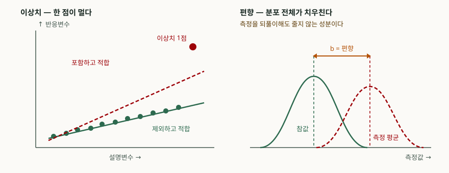
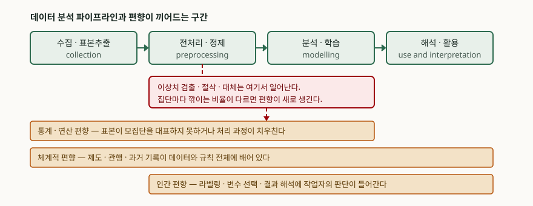

> Ⅲ절과 Ⅳ절에 실은 숫자는 전부 직접 계산해 확인했다. 데이터는 가상이고, 계산 코드와
> 실행 기록은 `code/` 아래에 있다. 정의와 분류는 공개된 1차 자료에서 가져왔다.
> 다만 ISO 16269-4와 ISO/IEC TR 24027은 유료 표준이라 **공표된 적용범위까지만** 확인했고
> 본문을 인용하지 않았다. 검출 절차의 수식과 임계값은 전문이 공개된
> NIST/SEMATECH *e-Handbook* 의 것을 썼다.

이상치와 편향을 묶어 묻는 문제다. 개념, 분석 결과에 미치는 영향, 처리 방안을 세 갈래로
나눠 물었으므로 그 순서를 그대로 대항목으로 둔다. 통계학 답안이 되지 않도록, 처리 방안은
**데이터 파이프라인의 어느 단계에 무슨 통제를 넣는가**로 내려 쓴다.

---

## Ⅰ. 개요

같은 데이터셋을 두 사람이 분석했는데 결론이 갈리는 일이 생긴다. 한쪽은 평균 응답시간이
394ms라 하고 다른 쪽은 194ms라 한다. 둘 다 계산을 틀리지 않았다. 재시도 타임아웃 한 건이
섞여 있었고, 한 사람만 그것을 뺐을 뿐이다.

데이터 분석의 오류는 대체로 이 두 갈래에서 나온다. **이상치**는 표본 안의 **개별 관측값**이
나머지와 동떨어진 것이고, **편향**은 추정값이 참값에서 **한 방향으로** 치우친 것이다. 전자는
표본을 더 모으거나 그 점을 빼면 영향이 줄지만, 후자는 **표본을 아무리 늘려도 줄지 않는다.**
둘을 가르는 기준이 이것이고, 처리 방안이 갈리는 이유도 이것이다.



> **출처**: [JCGM 200:2012, International vocabulary of metrology §2.17 systematic measurement error, §2.18 measurement bias, §2.19 random measurement error](https://www.bipm.org/documents/20126/2071204/JCGM_200_2012.pdf), [NIST/SEMATECH e-Handbook §1.3.5.17 Detection of Outliers](https://www.itl.nist.gov/div898/handbook/eda/section3/eda35h.htm)

---

## Ⅱ. 이상치와 편향의 개념

### 가. 이상치 (Outlier)

NIST/SEMATECH *e-Handbook* 의 **이상치 검출 항목(§1.3.5.17)** 은 이상치를 **"표본의 나머지
관측값에서 현저히 벗어난 것으로 보이는 관측값"** 으로 정의한다. 정의에 "보이는"이 들어가
있는 것이 중요하다. **이상치는 데이터만 보고 확정되는 것이 아니라 판정 기준을 정해야
비로소 정해진다.** 같은 점이 기준에 따라 이상치가 되기도 하고 안 되기도 한다.

발생 원인은 세 갈래다.

① **측정·기록 오류** — 센서 고장, 단위 혼동, 타임아웃 값이 실측값 자리에 들어간 경우.
② **모집단의 자연스러운 꼬리** — 드물지만 실제로 일어나는 값. 제거하면 정보를 잃는다.
③ **다른 모집단의 혼입** — 분석 대상이 아닌 집단의 데이터가 섞여 들어온 경우.

①만 제거 대상이고 ②는 남겨야 하며 ③은 집단을 나눠야 한다. **원인을 가르지 않고 기준값만으로
자르는 것이 이상치 처리에서 가장 흔한 잘못이다.**

판정 기준은 두 갈래로 쓴다.

| 기준 | 판정식 | 임계값 | 성질 |
|---|---|---|---|
| 사분위 울타리 | 안쪽 `Q1 − 1.5·IQ` ~ `Q3 + 1.5·IQ`, 바깥쪽 `±3·IQ` | 울타리 밖 | 분포 가정 없음 |
| 수정 Z 점수 | `0.6745·(xᵢ − 중앙값) / MAD` | 절댓값 3.5 초과 | 중앙값·MAD 기반이라 이상치에 덜 흔들림 |
| (참고) Z 점수 | `(xᵢ − 평균) / 표준편차` | 관행적으로 2~3 | 평균·표준편차가 이상치에 이미 오염됨 |

세 번째 줄이 함정이다. Z 점수는 평균과 표준편차로 계산하는데, 그 둘이 이상치 때문에 이미
부풀어 있다. *e-Handbook* 도 표본이 작을 때 Z 점수의 최댓값이 `(n−1)/√n` 으로 묶여 있어
오도할 수 있다고 적는다. **검출에 쓰는 통계량 자체가 오염되지 않아야 한다.**

### 나. 편향 (Bias)

국제 측정학 용어집(JCGM 200:2012)의 **편향 정의(§2.18)** 는 편향을 **"계통 측정오차의
추정값"** 으로 정의한다. 그 앞의 **계통오차 정의(§2.17)** 는 계통오차를 "되풀이 측정에서
일정하게 남거나 예측 가능한 방식으로 변하는 측정오차의 성분"으로, **우연오차 정의(§2.19)**
는 "예측할 수 없는 방식으로 변하는 성분"으로 가른다.

이 세 정의를 이어 읽으면 답안의 핵심 문장이 나온다. **편향은 되풀이해도 평균으로 상쇄되지
않는 성분이고, 그래서 표본 크기를 키우는 것으로는 줄지 않는다.** 우연오차는 평균을 내면
줄지만 계통오차는 평균을 내도 그대로 남는다.

AI·데이터 분석 맥락의 편향 분류는 NIST SP 1270(2022)을 쓴다. 이 보고서는 **AI 편향을 세
범주로 나눈다**(체계적·통계/연산·인간). 범주마다 하위 유형이 달려 있고, 그 유형들이
데이터 수집부터 해석까지 어느 단계에서 생기는지를 함께 보인다.

| 범주 | 무엇에서 오는가 | 대표 하위 유형 |
|---|---|---|
| 체계적 (systemic) | 기관의 절차·관행, 과거 기록 자체 | 역사적, 사회적, 제도적 편향 |
| 통계·연산 (statistical / computational) | 표본이 모집단을 대표하지 못하거나 처리가 치우침 | 선택·표집, 측정, 평가, 생존, 심슨의 역설 |
| 인간 (human) | 작업자·사용자의 인지와 판단 | 확증, 정박, 자동화 안주, 해석 편향 |

보고서가 이 분류를 세운 이유는 명확하다. 현재의 대응이 데이터셋 대표성과 알고리즘 공정성
같은 **연산 영역에만 쏠려 있고**, 제도와 사람에서 오는 편향은 다루지 못한다는 것이다.

### 다. 두 개념의 구분

| 구분 | 이상치 | 편향 |
|---|---|---|
| 대상 | 개별 관측값 | 추정량 전체 |
| 성질 | 주로 우연오차 또는 혼입 | 계통오차의 추정값 (§2.18) |
| 표본을 키우면 | 영향이 희석된다 | **줄지 않는다** |
| 눈으로 보이는가 | 산점도·상자그림에 드러난다 | 참값을 모르면 **데이터만 봐서는 안 보인다** |
| 검출 수단 | 울타리·수정 Z 점수 등 통계 검정 | 외부 기준값, 집단별 분해, 설계 검토 |
| 잘못 다루면 | 정보 손실 또는 왜곡 | 결론이 체계적으로 뒤집힘 |

네 번째 줄이 답안에서 점수가 붙는 지점이다. **이상치는 데이터 안에서 찾을 수 있지만, 편향은
데이터 밖의 기준이 있어야 찾을 수 있다.** 그래서 편향 대응은 통계 기법이 아니라 설계와
기록의 문제가 된다.

---

## Ⅲ. 분석 결과에 미치는 영향

### 가. 이상치 — 요약통계와 적합을 끌어당긴다

가상의 API 응답시간 20건(그중 한 건은 재시도 타임아웃이 섞인 4,200ms)으로 계산했다.
계산 코드는 [`code/outlier_bias.py`](code/outlier_bias.py), 실행 기록은
[`code/output.txt`](code/output.txt)에 있다. 아래 세 블록은 모두 그 기록에서 가져왔다.

```text
  전체           n=20  평균=  394.30  표준편차=  895.83  중앙값= 195.50  MAD=  9.00
  이상치 제외       n=19  평균=  194.00  표준편차=   11.06  중앙값= 195.00  MAD=  8.00

  Q1=185.50  Q3=204.50  IQ=19.00
  안쪽 울타리 (1.5*IQ): [157.00, 233.00]
  바깥쪽 울타리 (3*IQ): [128.50, 261.50]

  수정 Z 점수 절댓값 3.5 초과: 1건
    4200 ms  수정Z=300.12  바깥쪽 울타리 밖
```

세 가지가 읽힌다.

① **평균이 194ms에서 394ms로 움직였다.** 20건 중 한 건이 평균을 두 배로 만들었다.
   표준편차는 11.06에서 895.83으로, 약 81배가 되었다.
② **중앙값과 MAD는 거의 움직이지 않았다**(195.00→195.50, 8.00→9.00). 강건 통계량을
   함께 보면 이상치의 존재 자체가 드러난다. 두 쌍의 차이가 곧 신호다.
③ **그래서 검출에는 중앙값·MAD를 써야 한다.** 수정 Z 점수가 300.12로 임계값 3.5를
   압도적으로 넘겨 그 한 점을 지목했다. 같은 데이터에서 일반 Z 점수의 최댓값은
   `(20−1)/√20 ≈ 4.25` 를 넘을 수 없으므로 "얼마나 심한가"를 가리지 못한다.

회귀에서는 영향이 더 크다. 설명변수 쪽 끝에 있는 이상치 하나가 적합선의 기울기를 끌어당겨,
그 점을 뺐을 때와 결론이 달라진다(위 도식 왼쪽).

### 나. 편향 — 집단별 결론과 전체 결론을 뒤집는다

NIST SP 1270이 통계·연산 편향의 하위 유형으로 드는 **심슨의 역설**을 숫자로 만들었다.
두 처리 모듈의 요청 성공률이다.

```text
  모듈        요청유형     성공/시도      성공률
  신규 모듈       소형 요청        81/90          90.0%
  신규 모듈       대형 요청       192/310         61.9%
  신규 모듈       합계          273/400         68.2%
  기존 모듈       소형 요청       234/270         86.7%
  기존 모듈       대형 요청        16/30          53.3%
  기존 모듈       합계          250/300         83.3%

  소형 요청: 우세=신규 모듈, 이 유형에서 신규 모듈이 받은 비중 25.0%
  대형 요청: 우세=신규 모듈, 이 유형에서 신규 모듈이 받은 비중 91.2%
  합계: 우세=기존 모듈
```

**요청 유형별로는 두 경우 모두 신규 모듈이 앞서는데, 합치면 기존 모듈이 앞선다.** 계산은
어디에도 틀린 데가 없다. 신규 모듈이 성공률이 낮은 대형 요청을 91.2% 받았기 때문이다.
표본 구성이 치우친 결과이지 성능 차이가 아니다.

이 구조가 실무에서 위험한 이유는 **합계만 보고 신규 모듈을 걷어내는 판단이 완전히 합리적으로
보인다**는 데 있다. 집단을 쪼개 보지 않으면 편향은 보이지 않는다.

편향의 영향을 정리하면 세 갈래다.

① **추정값이 한 방향으로 치우친다** — 표본을 늘려도 수렴하는 값이 참값이 아니다.
② **집단 간 비교가 뒤집힌다** — 위의 심슨의 역설. 정책·투자 결정이 반대로 간다.
③ **모형이 편향을 학습해 되먹인다** — 치우친 데이터로 학습한 모형의 출력이 다시 데이터가
   되면서 치우침이 누적된다. SP 1270이 피드백 루프를 하위 유형으로 둔 이유다.

### 다. 둘이 겹치는 지점 — 이상치 처리가 편향을 만든다

가장 자주 간과되는 경로다. 두 고객군의 응답시간으로 확인했다.

```text
  두 고객군을 합쳐 계산한 안쪽 울타리: [6.00, 492.00]
  -> 두 모집단이 섞이면서 IQ 가 부풀어, 전역 울타리에 걸리는 점이 없다(은폐).

  집단별로 울타리를 따로 계산하면:
    소형 고객      울타리=[ 160.12,  217.12]  걸린 점 0건 []
    대형 고객      울타리=[ 139.12,  500.12]  걸린 점 0건 []
  -> 어느 기준으로도 이상치가 없다. 대형 고객의 긴 꼬리는 그 집단의 정상 범위다.

  그런데도 전체 표본의 95 퍼센타일을 상한으로 두고 자르면 (상한 428.55 ms)
  고객군      원표본  절삭후  절삭률   평균(원)  평균(절삭후)   변화
  소형 고객          20     20     0.0%    188.55       188.55    +0.00
  대형 고객          20     18    10.0%    322.15       308.78   -13.37
```

두 가지가 동시에 드러난다.

- **은폐(masking)** — 성질이 다른 두 모집단을 합치면 IQ가 부풀어 울타리가 넓어지고,
  어느 점도 걸리지 않는다. 전역 기준 하나로는 아무것도 못 잡는다.
- **차등 절삭** — 그런데도 "상위 5%는 꼬리니까 버린다"는 흔한 관행을 적용하면,
  **소형 고객은 한 건도 깎이지 않고 대형 고객만 10% 깎인다.** 대형 고객의 평균 응답시간이
  13.37ms 낮게 보고되고, 두 고객군의 격차가 실제보다 작아 보인다.

**이상치 기준으로는 이상치가 아닌 값이, 이상치 처리라는 이름으로 잘려 나가면서 편향이
된다.** 절삭률이 집단마다 다르다는 사실 자체가 경보다.

---

## Ⅳ. 처리 방안



> **출처**: [NIST SP 1270, Towards a Standard for Identifying and Managing Bias in Artificial Intelligence §2.1.2 Categories of AI bias, Fig. 2 (2022-03)](https://nvlpubs.nist.gov/nistpubs/SpecialPublications/NIST.SP.1270.pdf), [NIST/SEMATECH e-Handbook §7.1.6 What are outliers in the data?](https://www.itl.nist.gov/div898/handbook/prc/section1/prc16.htm)

### 가. 이상치 처리 — 4단계

**① 검출** — 분포 가정을 두지 않는 사분위 울타리와, 중앙값·MAD 기반 수정 Z 점수를 함께
쓴다. 정규성이 서면 Grubbs 검정(단일 이상치), 티첸–무어 검정(개수를 아는 다중 이상치),
일반화 ESD 검정(상한만 아는 다중 이상치)으로 올린다. 세 검정 모두 정규성을 전제하므로
**검정 전에 정규확률도로 분포부터 확인한다.**

**② 분류** — 측정 오류인지, 모집단의 꼬리인지, 다른 모집단이 섞인 것인지 가른다. 이 단계를
건너뛰면 아래 ③의 선택이 근거 없이 결정된다. *e-Handbook* 과 ISO 16269-4가 공통으로
**자동 삭제를 경계**하는 지점이다.

**③ 조치** — 원인에 따라 다르다.

| 원인 | 조치 | 주의 |
|---|---|---|
| 측정·기록 오류 | 원천에서 정정, 불가하면 결측 처리 | 삭제 사실과 근거를 기록으로 남긴다 |
| 모집단의 꼬리 | **제거하지 않는다.** 강건 추정으로 전환 | 중앙값·MAD·절사평균·강건 회귀 |
| 다른 모집단 혼입 | 집단을 나눠 따로 분석 | 합쳐서 울타리를 계산하지 않는다 |

**④ 기록** — 몇 건을 어떤 기준으로 어떻게 처리했는지, **집단별 절삭률과 함께** 남긴다.
Ⅲ-다의 결과가 보이는 곳이 이 기록이다.

### 나. 편향 처리 — 단계별로 다른 통제를 넣는다

| 파이프라인 단계 | 끼어드는 편향 | 통제 |
|---|---|---|
| 수집·표본추출 | 선택·표집, 생존, 제도적 | 포함확률 기반 설계, 모집단 대비 분포 비교, 수집 제외 조건 명문화 |
| 전처리·정제 | 처리·결측 보정, 차등 절삭 | 집단별 절삭률 점검, 결측 패턴이 집단별로 다른지 확인 |
| 분석·학습 | 평가, 증폭, 모형 선택 | 집단별로 쪼갠 성능 지표, 전체 지표만 보지 않기 |
| 해석·활용 | 확증, 자동화 안주, 해석 | 반대 가설 검토 절차, 사람의 재정 권한과 책임 명시 |

핵심은 **합계 지표 하나로 판단하지 않는 것**이다. Ⅲ-나의 역설은 집단별 분해 한 번으로
드러난다. 전체 정확도만 보고하는 대시보드는 편향을 숨기는 구조다.

### 다. 정보시스템이 갖춰야 할 것

여기까지는 분석 절차다. 그 절차가 **되풀이 가능하려면 시스템이 받쳐야 한다.** 답안에서
점수가 갈리는 부분이 여기다.

① **메타데이터와 데이터 리니지** — 어느 원천에서 어떤 변환을 거쳐 이 값이 되었는지
   추적되지 않으면, 편향이 어느 단계에서 들어왔는지 특정할 수 없다. 이상치 절삭도
   변환 이력의 한 줄로 남아야 한다.

② **품질 규칙의 코드화** — 울타리 기준과 절삭률 상한을 문서가 아니라 파이프라인의
   검사 단계로 둔다. 규칙 위반 시 적재를 멈추고 알린다. 문서로만 있는 기준은 지켜지지 않는다.

③ **집단별 지표의 상시 산출** — 전체 지표와 집단별 지표를 같은 주기로 뽑아 둔다.
   사후에 쪼개 보려면 원본이 남아 있어야 하므로 **집단 식별 속성을 버리지 않고 보관**하는
   설계가 선행한다.

④ **분포 변화 감시** — 수집 시점의 분포가 운영 중에 바뀌면 그때까지 맞던 울타리와 모형이
   함께 틀어진다. 입력 분포와 집단 구성비를 주기적으로 비교해 재학습·재설정 시점을 잡는다.

⑤ **처리 이력의 감사 가능성** — 누가 언제 어떤 기준으로 데이터를 뺐는지 남는다. 편향은
   한 번의 판단이 아니라 누적으로 생기므로, 되돌아볼 기록이 없으면 원인을 찾을 수 없다.

---

## Ⅴ. 결론

이상치와 편향은 둘 다 "데이터가 깨끗하지 않다"로 묶이지만 성질이 반대다. **이상치는 보이는
개별 값이라 찾기 쉽고 다루기 어렵고, 편향은 보이지 않는 전체의 치우침이라 찾기 어렵고
구조로만 막을 수 있다.** 표본을 늘려 해결되는 쪽과 그렇지 않은 쪽을 가르는 것이 첫 판단이다.

실무에서 가장 위험한 것은 둘을 같은 것으로 보고 이상치 제거로 데이터 품질을 확보했다고
여기는 태도다. 직접 계산해 보인 대로 **전역 기준 한 번의 절삭이 집단마다 다르게 작용하면,
품질 개선이라고 부른 작업이 그대로 편향이 된다.** 그래서 처리 방안은 기법 선택이 아니라
**어느 단계에 어떤 통제와 기록을 넣을 것인가**의 설계 문제로 내려가야 한다.

> 개념 정리: [표본추출 — 확률·비확률 표본설계와 포함확률·가중치](../../data-analysis/2026-10-06-sampling-design-inclusion-probability-weights/index.md)
>
> 개념 정리: [Isolation Forest — 고립에 필요한 분할 횟수로 이상치를 찾는 원리](../../data-analysis/2026-10-07-isolation-forest-path-length/index.md)
>
> 개념 정리: [데이터 거버넌스와 데이터 품질 관리 체계](../../database/2026-10-06-data-governance-quality-dimensions-roles/index.md)
>
> 개념 정리: [심슨의 역설 — 집단별 결론과 전체 결론이 뒤집히는 구조](../../data-analysis/2026-10-23-simpsons-paradox-confounder-collapsibility/index.md)
>
> 개념 정리: [강건 통계량 — 중앙값, MAD, 절사평균의 붕괴점](../../data-analysis/2026-10-23-robust-statistics-breakdown-point/index.md)
>
> 개념 정리: [AI 편향의 3가지 범주 — 체계적·계산통계적·인간인지적](../../ai/2026-10-29-nist-ai-bias-three-categories/index.md)

끝

---

## 답안 작성 메모

**무엇부터 쓰는가.** Ⅱ-다의 비교표를 가장 먼저 그린다. 이 문제는 "둘을 구분할 줄 아는가"를
묻는 것이고, 표 하나가 그 답이 된다. 특히 **표본을 키우면 이상치는 희석되고 편향은 줄지
않는다**는 한 줄이 출제 의도의 중심이다. 이 줄이 없으면 아래를 아무리 길게 써도 두 개념을
나눠 쓴 글이 되지 못한다.

**점수가 갈리는 지점.** Ⅲ-다 — 이상치 처리가 편향을 만든다는 연결이다. 대부분의 답안이
"이상치 → 제거", "편향 → 표본 재설계"로 평행하게 쓰고 끝낸다. 두 주제를 **한 문항에 묶어
낸 이유**가 여기에 있으므로, 전역 기준 절삭의 집단별 차등 효과를 한 단락이라도 반드시 쓴다.
숫자를 외우지 못해도 "절삭률이 집단마다 다르면 그 자체가 편향"이라는 문장은 쓸 수 있다.

**시간이 모자라면 무엇을 버리는가.** 버리는 순서는 ① Ⅲ-가의 수치 표(문장으로 "평균은
크게 움직이고 중앙값은 거의 안 움직인다"로 대체), ② Ⅳ-가의 검정 이름 나열(울타리와 수정
Z 점수만 남긴다), ③ Ⅱ-나의 NIST 세 범주 표(본문 한 줄로 줄인다)다. **절대 버리지 않는 것**은
Ⅱ-다의 비교표, Ⅲ-다, Ⅳ-다다. 이 셋이 빠지면 통계 교과서 요약이 되고, 정보관리기술사
답안이 되지 못한다.

**모식도 선택.** 두 개를 다 그릴 시간은 없다. 하나만 그린다면 **이상치 대 편향 대비도**(산점도
한 점 + 분포 평행이동)를 그린다. 선 몇 개와 점 몇 개로 끝나고, Ⅱ-다의 비교표를 그림으로
한 번 더 말해 주기 때문이다. 파이프라인 도식은 Ⅳ절에 시간이 남을 때만 그린다.

**쓰지 말아야 할 것.** 이상치를 "제거해야 할 노이즈"로 단정하는 문장. 모집단의 꼬리를
제거하면 그 자체가 선택 편향이 되므로, 답안 안에서 앞뒤가 맞지 않게 된다.

## 참고 자료

- [JCGM 200:2012, International vocabulary of metrology — Basic and general concepts and associated terms (VIM), 3rd edition](https://www.bipm.org/documents/20126/2071204/JCGM_200_2012.pdf) — §2.17 systematic measurement error, §2.18 measurement bias, §2.19 random measurement error
- [NIST/SEMATECH e-Handbook of Statistical Methods §1.3.5.17 Detection of Outliers](https://www.itl.nist.gov/div898/handbook/eda/section3/eda35h.htm) — 이상치 정의, Z 점수·수정 Z 점수, Grubbs·Tietjen-Moore·일반화 ESD 검정
- [NIST/SEMATECH e-Handbook of Statistical Methods §7.1.6 What are outliers in the data?](https://www.itl.nist.gov/div898/handbook/prc/section1/prc16.htm) — 사분위 울타리(안쪽 1.5·IQ, 바깥쪽 3·IQ)
- [NIST Special Publication 1270, Towards a Standard for Identifying and Managing Bias in Artificial Intelligence (2022-03)](https://nvlpubs.nist.gov/nistpubs/SpecialPublications/NIST.SP.1270.pdf) — §2.1.2 Categories of AI bias, Fig. 2
- [ISO 16269-4:2010, Statistical interpretation of data — Part 4: Detection and treatment of outliers](https://www.iso.org/standard/44396.html) — 적용범위만 확인 (유료 표준)
- [ISO/IEC TR 24027:2021, Bias in AI systems and AI aided decision making](https://www.iso.org/standard/77607.html) — 적용범위만 확인 (유료 표준)
