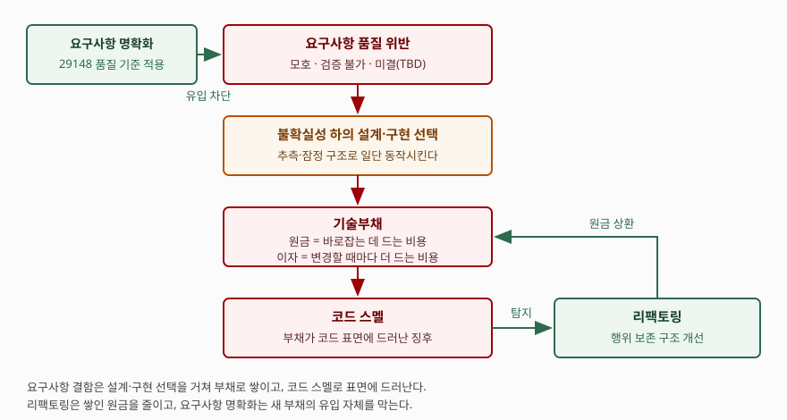
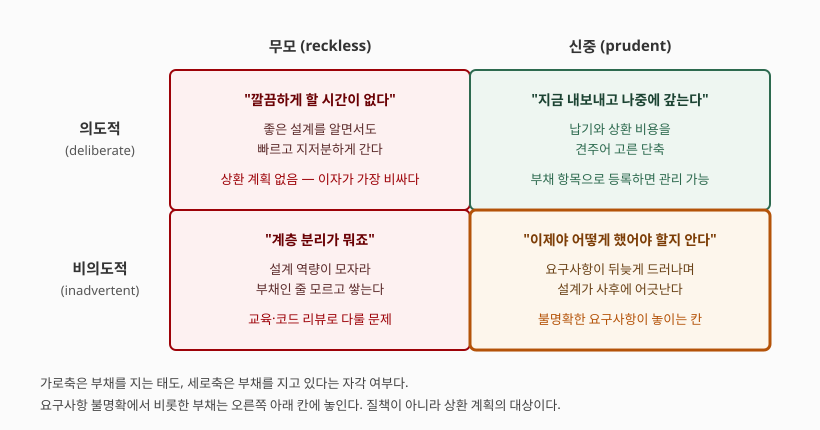

> 실행 검증 없음. 표준 원문과 1차 자료(원 저자 글·동료심사 논문·제품 공식 문서)를 근거로 정리했다.
> ISO 표준 본문은 유료이므로 공개된 요약·인용 범위에서만 인용하고, 해당 자리마다 판·연도를 밝혔다.

요구사항이 명확하지 않을 때 생기는 소프트웨어 품질저하를 **기술부채, 코드스멜, 리팩토링**의 세 관점에서
설명하라는 문제다. 세 개념을 각각 소개하라는 문제가 아니라 **하나의 인과 사슬 위에 놓고 설명하라는**
문제다. 요구사항 결함이 부채로 쌓이고(기술부채), 그 부채가 코드 표면에 징후로 드러나며(코드스멜),
그 징후를 근거로 구조를 바로잡는(리팩토링) 흐름을 답안의 축으로 삼는다.
문항이 가·나·다로 나눠 물었으므로 그 순서를 그대로 대항목으로 쓴다.

---

## Ⅰ. 개요 — 요구사항 결함이 품질저하로 번지는 경로

### 가. 불명확한 요구사항의 정의

요구사항이 "불명확하다"는 말은 느낌이 아니라 **규격으로 판정되는 상태**다.
요구사항 공학 표준인 ISO/IEC/IEEE 29148:2018은 개별 요구사항이 갖춰야 할 품질 특성을
**9가지**(적절성·완전성·준수성·정확성·실현가능성·필요성·단일성·비모호성·검증가능성)로,
요구사항 집합이 갖춰야 할 특성을 **5가지**로 규정한다. 불명확한 요구사항이란 이 가운데
**비모호성(unambiguous)·검증가능성(verifiable)·완전성(complete)·단일성(singular)** 을
어긴 요구사항이다.

실무에서 자주 보이는 형태는 다음 **4가지**다.

1. **주관적 표현** — "사용하기 쉬워야 한다", "효율적으로 유지보수되어야 한다"처럼 의미가
   객관적으로 정의되지 않은 낱말
2. **빠져나갈 구멍** — "가능한 한", "원칙적으로"처럼 어느 정도까지 지켜야 하는지가 열려 있는 한정어
3. **미결 항목** — 수치나 대상이 `TBD`로 남아 완전성을 어긴 상태
4. **검증 불가 표현** — "충분한 정확도", "최고 수준의 성능"처럼 합격선을 측정할 수 없는 표현

이들은 문서 품질의 문제로 끝나지 않는다. 연구 영역에서는 이런 표현을 코드 스멜 개념에서
빌려 와 **요구사항 스멜(Requirements Smell)** 로 정의하고, "결함으로 이어질 수 있는 품질 위반의
징후로서 **구체적인 위치**와 **구체적인 탐지 수단**을 갖는 것"이라고 규정한다
(Femmer 외, *Journal of Systems and Software*, 2017). 같은 표준의 언어 기준에서 도출한 스멜은
주관적 표현·모호한 부사와 형용사·빠져나갈 구멍·검증 불가 용어·최상급·비교급·부정 서술·
모호한 대명사·불완전한 참조로 정리된다.

### 나. 품질저하가 일어나는 경로

요구사항의 결함은 코드로 직접 건너뛰지 않는다. **설계·구현 단계의 선택**을 매개로 전달된다.
무엇을 만들어야 하는지가 확정되지 않은 상태에서도 개발은 진행되어야 하므로, 개발자는
추측에 기대 잠정적인 구조를 세운다. 이 선택이 나중에 드러난 요구사항과 어긋나면
그 차이를 메우는 비용이 남는데, 이것이 기술부채다.

> **출처**: [Ward Cunningham, "The WyCash Portfolio Management System" (OOPSLA '92 Experience Report)](https://c2.com/doc/oopsla92.html) · [Martin Fowler, "CodeSmell"](https://martinfowler.com/bliki/CodeSmell.html) · [Martin Fowler, "DefinitionOfRefactoring"](https://martinfowler.com/bliki/DefinitionOfRefactoring.html) · ISO/IEC/IEEE 29148:2018의 요구사항 품질 특성

품질 모델로 옮기면 이 경로가 깎아내리는 주특성은 **유지보수성**이다.
ISO/IEC 25010:2023은 유지보수성의 부특성을 **5가지**(모듈성·재사용성·분석가능성·수정가능성·
시험가능성)로 둔다. 요구사항이 흔들리면 모듈 경계가 요구사항의 경계와 어긋나 모듈성이 떨어지고,
합격선이 없으니 시험가능성이 먼저 무너진다. 뒤이어 한 변경이 여러 모듈을 건드리게 되어
수정가능성이 떨어진다.

---

## Ⅱ. (가) 기술부채 관점

### 가. 정의와 원금·이자 구조

기술부채는 1992년 Ward Cunningham이 OOPSLA 경험보고서에서 처음 쓴 말이다.
그는 완성되지 않은 코드를 내보내는 일을 빚을 지는 일에 견주면서, 빚을 빨리 갚는 한
개발이 빨라지지만 **갚지 않을 때 위험해진다**고 적었다. 그가 든 이자의 정의는
"제대로 되지 않은 코드에 쓰는 모든 시간"이다. 이 구조가 기술부채라는 개념의 핵심이고,
답안에서는 아래 두 항으로 끊어 쓴다.

- **원금(principal)** — 지금의 구조를 원래 의도했던 구조로 바로잡는 데 드는 일회성 비용
- **이자(interest)** — 바로잡지 않은 채 그 코드를 건드릴 때마다 추가로 드는 반복 비용

부채라는 이름을 쓰는 이유는 **상환 시점을 고를 수 있다**는 점 때문이다. 결함은 고치거나
남기거나 둘 중 하나지만, 부채는 "지금은 이자를 내고 나중에 원금을 갚는다"는 선택지가 있다.
다만 이자가 원금보다 커지는 지점이 오면 선택지가 사라진다. Cunningham은 통합되지 않은
구현의 부채 때문에 **조직 전체가 멈춰 설 수 있다**고 경고했다.

### 나. 불명확한 요구사항이 만드는 부채의 자리

Martin Fowler는 부채를 **태도(무모/신중)** 와 **자각(의도적/비의도적)** 의 두 축으로 나눈다.
불명확한 요구사항에서 비롯한 부채가 주로 놓이는 칸은 **신중하면서 비의도적인** 칸이다.
팀이 그 시점의 정보로는 최선의 설계를 했는데, 요구사항이 뒤늦게 구체화되면서
그 설계가 사후에 어긋나는 경우다. Fowler는 프로젝트를 1년쯤 해봐야 어떤 설계가
최선이었는지 알게 되는 일이 흔하므로 이 칸의 부채는 피할 수 없다고 본다.

> **출처**: [Martin Fowler, "TechnicalDebtQuadrant"](https://martinfowler.com/bliki/TechnicalDebtQuadrant.html)

이 구분이 답안에서 점수가 되는 이유는 **대응책이 칸마다 다르기** 때문이다.
무모·비의도적 칸은 교육과 코드 리뷰의 문제이고, 무모·의도적 칸은 일정 압박을 다루는
관리의 문제다. 반면 요구사항 불명확이 놓이는 신중·비의도적 칸은 **누구를 탓해서 줄지 않는다.**
줄이는 수단은 두 가지뿐이다. 요구사항을 조기에 구체화해 유입을 막거나(요구공학),
드러난 뒤에 구조를 고쳐 원금을 갚는 것(리팩토링)이다.

### 다. 부채의 가시화와 측정

부채는 보이지 않으면 관리되지 않으므로, 답안에서는 **측정 수단까지** 적어야 한다.
정적 분석 도구는 규칙 위반마다 수정에 드는 시간을 붙여 두고 그 합을 부채액으로 환산한다.
예를 들어 SonarQube Server는 유지보수성 이슈의 수정 비용 합계를 기술부채로 보고,
**기술부채 비율 = 기술부채 ÷ (한 줄을 개발하는 비용 × 전체 라인 수)** 로 밀도를 계산해
등급(A 0~5%, B 5~10%, C 10~20%, D 20~50%, E 50% 이상)을 매긴다.
한 줄당 개발 비용의 기본값은 30분이며 관리자가 바꿀 수 있다.

여기서 주의할 점은 이 수치가 **코드에 드러난 부채만** 센다는 것이다. 요구사항이
불명확해 생긴 부채 가운데 아키텍처 수준의 어긋남은 규칙 위반으로 잡히지 않는다.
따라서 도구 수치는 하한선으로만 읽고, 아키텍처 부채는 별도의 백로그 항목으로 등록해
관리해야 한다.

---

## Ⅲ. (나) 코드스멜 관점

### 가. 정의 — 문제가 아니라 징후

코드 스멜은 Kent Beck이 Fowler의 *Refactoring* 집필을 돕던 중에 만든 말이고,
Fowler의 정의는 **"시스템 내부의 더 깊은 문제에 대개 대응하는 표면적 징후"** 다.
답안에서 반드시 붙여야 할 단서가 둘 있다.

1. **빨리 눈에 띈다** — 측정이나 실행 없이 코드를 읽는 것만으로 식별된다
2. **그 자체가 문제는 아니다** — Fowler는 스멜이 본질적으로 나쁜 것은 아니며
   문제 자체라기보다 문제의 지표인 경우가 많다고 적는다. 긴 함수가 전부 잘못된 것은 아니므로
   더 들여다봐야 실제 문제인지 알 수 있다

즉 **기술부채가 비용의 언어라면 코드 스멜은 관측의 언어다.** 부채는 금액으로 말하고
스멜은 위치로 말한다. 이 대응을 답안에 한 줄로 적어 두면 세 개념이 겹치지 않고 갈린다.

### 나. 요구사항 결함과 코드 스멜의 대응

불명확한 요구사항은 아무 스멜이나 만들지 않는다. **특정한 스멜로 치우쳐 나타난다.**
Fowler의 *Refactoring* 2판 3장은 **24가지** 스멜을 정리하는데, 요구사항 결함과 맞닿는 것은
아래와 같다.

| 요구사항 쪽 결함 | 어긴 품질 특성(29148) | 코드에 드러나는 스멜 | 왜 그렇게 되는가 |
|---|---|---|---|
| 용어가 합의되지 않음 | 비모호성 | Mysterious Name(알 수 없는 이름) | 업무 용어가 없어 `data1`, `flag` 같은 임의 이름을 쓴다 |
| 범위가 확정되지 않음 | 완전성 | Speculative Generality(추측성 일반화) | 쓰이지 않을 확장점과 추상 계층을 미리 만든다 |
| 변경 축이 불명확 | 단일성 | Divergent Change(발산적 변경) | 성격이 다른 변경이 한 모듈에 몰린다 |
| 업무 개념이 식별되지 않음 | 완전성 | Primitive Obsession(기본형 집착) | 금액·기간을 전부 숫자·문자열로 다룬다 |
| 미결 항목(TBD) 잔존 | 완전성 | Temporary Field(임시 필드) | 결정될 때까지 쓰는 임시 상태가 그대로 남는다 |
| 합격 기준 부재 | 검증가능성 | Comments(변명하는 주석) | 테스트로 못 박지 못한 조건을 주석으로 적어 둔다 |

이 표가 답안에서 중요한 이유는 **스멜을 보고 요구사항 쪽을 되짚을 수 있다**는 역방향을 보여주기
때문이다. 추측성 일반화가 반복해서 나타나는 모듈이 있다면 그 모듈의 요구사항이 아직 확정되지
않았다는 뜻이고, 그때 필요한 것은 리팩토링이 아니라 요구사항 확정이다.

### 다. 탐지 수단과 한계

스멜 탐지는 **정적 분석으로 자동화되는 범위**와 **사람의 판단이 필요한 범위**로 갈린다.
중복 코드·긴 함수·과도한 매개변수처럼 구조적 지표로 셀 수 있는 것은 도구가 잡지만,
추측성 일반화나 발산적 변경은 요구사항의 변경 이력을 알아야 판정되므로 도구만으로는 부족하다.
요구사항 스멜 탐지를 평가한 연구에서도 자동 탐지의 정밀도와 재현율이 사례마다 크게 흔들렸고,
저자들은 자동 탐지를 리뷰의 대체가 아니라 **보완 수단**으로 규정했다
(Femmer 외, *Journal of Systems and Software*, 2017).

---

## Ⅳ. (다) 리팩토링 관점

### 가. 정의와 전제조건

Fowler의 정의는 명사와 동사 둘로 갈린다. 명사로는 **"소프트웨어를 이해하기 쉽고 수정 비용이
싸지도록 바꾸되 겉으로 드러나는 동작은 바꾸지 않는, 내부 구조에 대한 변경"** 이고,
동사로는 **"일련의 리팩토링을 적용해 겉으로 드러나는 동작을 바꾸지 않은 채 소프트웨어를
재구성하는 일"** 이다. 두 정의 모두에서 **동작 보존**이 리팩토링을 다른 코드 변경과 가르는 조건이다.

여기서 요구사항 품질과의 연결이 한 번 더 드러난다. 동작이 보존되었음을 증명하려면
**그 동작이 무엇인지 먼저 확정되어 있어야 한다.** 요구사항이 검증가능성을 어겨 합격 기준이
없으면 동작 보존을 판정할 수단 자체가 없다. 따라서 리팩토링의 전제조건은 다음 **3가지**다.

1. **동작의 정의** — 보존해야 할 겉보기 동작이 요구사항·인수 기준으로 적혀 있을 것
2. **회귀 안전망** — 그 동작을 자동으로 재확인하는 테스트가 있을 것
3. **작은 단위** — 한 번에 되돌릴 수 있는 크기로 쪼개 적용할 것

### 나. 적용 시점

리팩토링은 별도 일정을 잡아 몰아서 하는 활동이 아니라 **기능 개발과 같은 리듬으로** 끼워 넣는
활동이다. 적용 시점은 다음 **3가지**로 정리된다.

- **기능을 추가하기 직전** — 추가할 자리를 먼저 다듬으면 추가 자체가 작아진다
- **결함을 고치기 직전** — 원인을 찾기 어렵다는 것 자체가 분석가능성이 떨어졌다는 신호다
- **코드 리뷰 중** — 스멜이 가장 싸게 발견되는 자리다

반면 **적용하지 말아야 할 때**도 분명하다. 요구사항이 아직 확정되지 않은 모듈은
리팩토링 대상이 아니다. 목표 구조를 모르는 상태에서 구조를 바꾸면 상환이 아니라
**새 부채를 지는 일**이 된다. 앞의 사분면에서 "신중·비의도적" 칸이 다시 채워지는 경로가 여기다.

### 다. 불명확한 요구사항에 대한 리팩토링의 역할과 한계

리팩토링이 하는 일은 **이미 쌓인 원금을 줄이는 것**이지 **새 부채의 유입을 막는 것**이 아니다.
요구사항이 계속 모호한 상태로 들어오면 상환 속도보다 발생 속도가 빨라져 부채 총액은 늘어난다.
따라서 답안의 결론은 리팩토링 단독이 아니라 **요구공학과의 병행**으로 맺어야 한다.
유입을 막는 수단은 요구사항 품질 특성에 따른 검토, 인수 기준의 명문화, 미결 항목의 기한 관리다.

---

## Ⅴ. 결론

세 개념은 같은 현상을 서로 다른 층위에서 부른 이름이다. 아래 표로 갈라 두면 답안에서
개념이 섞이지 않는다.

| 구분 | 기술부채 | 코드스멜 | 리팩토링 |
|---|---|---|---|
| 성격 | 상태(누적된 비용) | 징후(표면 관측) | 활동(구조 변경) |
| 언어 | 비용·금액 | 위치·패턴 | 절차·단계 |
| 관측 수준 | 아키텍처~코드 | 주로 코드 | 코드 |
| 측정 | 수정 비용 합계, 부채 비율 | 스멜 건수·밀도 | 적용 건수, 테스트 통과 여부 |
| 요구사항과의 관계 | 불명확이 부채를 **발생**시킴 | 불명확이 특정 스멜로 **발현**됨 | 동작 정의가 있어야 **수행 가능** |
| 한계 | 아키텍처 부채는 도구로 안 잡힘 | 징후일 뿐 결함이 아님 | 유입은 못 막고 상환만 함 |

요구사항 불명확이 품질을 깎는 경로는 **요구사항 품질 위반 → 불확실성 하의 설계·구현 선택 →
기술부채 누적 → 코드 스멜 발현 → 유지보수성 저하**의 한 줄로 요약된다.
이 사슬을 끊는 지점은 둘이다. **앞단에서는 요구공학**이 유입을 막고,
**뒷단에서는 리팩토링**이 누적분을 상환한다. 둘 중 하나만 하면 부채 총액은 줄지 않는다.

관리 관점에서 덧붙일 것은 **부채를 숨기지 않고 등록하는 체계**다. 의도적으로 진 부채는
백로그에 상환 항목으로 올리고, 비의도적 부채는 정적 분석 지표와 코드 리뷰로 주기적으로 드러낸다.
측정되지 않는 부채는 관리되지 않고, 관리되지 않는 부채는 이자만 쌓인다.

> 개념 정리: [기술부채 — 측정 방법과 상환 전략](../../software-engineering/2026-10-03-technical-debt-measurement-repayment/index.md) ·
> [리팩토링 — 코드 스멜 분류와 적용 시점](../../software-engineering/2026-10-03-refactoring-code-smells-when-to-apply/index.md) ·
> [요구공학 — 도출부터 검증까지 4단계](../../software-engineering/2026-09-18-requirements-engineering-four-phases/index.md) ·
> [요구사항 스멜 — 언어 기준 9가지와 자동 탐지의 한계](../../software-engineering/2026-10-23-requirements-smells/index.md)

끝

---

## 답안 작성 메모

**무엇부터 쓰는가.** 개요에서 **인과 사슬 한 줄**을 먼저 못 박고 들어간다. 세 개념을
병렬로 소개하는 답안과 사슬로 엮는 답안은 첫 문단에서 갈린다. 문항이 가·나·다로 나눠
물었으니 대항목 순서는 바꾸지 않되, 개요에서 "이 셋은 발생–발현–상환의 관계"라고
선언해 두면 뒤의 세 항이 따로 놀지 않는다.

**점수가 갈리는 지점은 세 곳이다.**

1. **코드 스멜을 "나쁜 코드"로 쓰면 감점된다.** 스멜은 징후이지 결함이 아니라는 단서를
   반드시 붙인다. 원 저자가 "문제 자체라기보다 문제의 지표"라고 못 박은 부분이다
2. **요구사항 결함과 스멜의 대응표**가 이 문제의 변별 지점이다. 스멜 24가지를 나열하는 답안은
   많지만, 요구사항 쪽 결함과 짝지은 답안은 드물다. 표의 세 행만 써도 된다
3. **리팩토링의 전제조건**을 적어야 한다. 동작 보존이 정의의 핵심이고, 동작이 정의되지
   않으면 리팩토링 자체가 성립하지 않는다는 연결이 이 문제의 결론을 만든다

**시간이 모자라면 무엇을 버리는가.** 사분면 도식(기술부채 유형)을 먼저 버린다.
인과 경로 도식 하나는 반드시 남긴다. 측정 수치(부채 비율 공식과 등급 구간)도 버릴 수 있다 —
다만 "부채는 측정 가능하다"는 문장 한 줄은 남겨 둔다. 요구사항 스멜 연구 인용도
버려도 되는 항목이다.

**쓰지 말아야 할 것.** 특정 도구의 등급 구간을 일반 기준처럼 쓰면 안 된다.
A등급 0~5%는 그 제품의 기본값이고 관리자가 바꿀 수 있는 값이다. 근거 없이
"부채 비율 5% 이하가 건전하다"고 단정하지 않는다.

---

## 참고 자료

- [Ward Cunningham, "The WyCash Portfolio Management System", OOPSLA '92 Experience Report (1992)](https://c2.com/doc/oopsla92.html) — 기술부채 용어의 최초 출처. ACM SIGPLAN OOPS Messenger 4(2), 1992-12, pp.29–30에 재수록
- [Martin Fowler, "TechnicalDebtQuadrant" (2009-10-14)](https://martinfowler.com/bliki/TechnicalDebtQuadrant.html) — 부채의 2×2 분류
- [Martin Fowler, "CodeSmell" (2006-02-09)](https://martinfowler.com/bliki/CodeSmell.html) — 코드 스멜의 정의와 Kent Beck의 작명
- [Martin Fowler, "DefinitionOfRefactoring" (2004-09-01)](https://martinfowler.com/bliki/DefinitionOfRefactoring.html) — 리팩토링의 명사·동사 정의
- Martin Fowler, *Refactoring: Improving the Design of Existing Code*, 2nd ed., Addison-Wesley, 2018 — 3장 "Bad Smells in Code"의 24가지 스멜 목록
- [H. Femmer, D. Méndez Fernández, S. Wagner, S. Eder, "Rapid Quality Assurance with Requirements Smells", *Journal of Systems and Software* (2017)](https://doi.org/10.1016/j.jss.2016.02.047) — ISO/IEC/IEEE 29148 언어 기준에서 도출한 요구사항 스멜 정의와 탐지 평가. [arXiv 사전 인쇄본](https://arxiv.org/abs/1611.08847)
- P. Kruchten, R. L. Nord, I. Ozkaya, "Technical Debt: From Metaphor to Theory and Practice", *IEEE Software* 29(6), 2012, pp.18–21 — 부채 개념의 이론화 요구
- [ISO/IEC/IEEE 29148:2018, *Systems and software engineering — Life cycle processes — Requirements engineering*](https://www.iso.org/standard/72089.html) — 개별 요구사항 품질 특성 9가지, 집합 특성 5가지
- [ISO/IEC 25010:2023, *Systems and software quality models*](https://www.iso.org/standard/78176.html) — 제품 품질 주특성 9가지와 유지보수성 부특성 5가지
- [SonarQube Server — Metric definitions](https://docs.sonarsource.com/sonarqube-server/latest/user-guide/code-metrics/metrics-definition/) — 기술부채(수정 비용 합계), 기술부채 비율 산식, 유지보수성 등급 기본 구간
