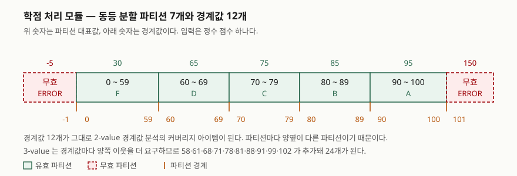
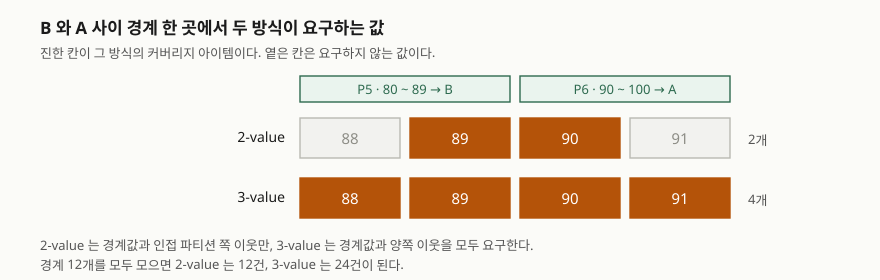

> (다)에서 도출한 테스트 케이스는 실제로 구현해 돌려 확인했다. 전체 소스와 실행 기록은 [`code/`](code/)에 있다.
> 원리와 기법 정의는 ISTQB CTFL Syllabus v4.0.1(2024-09-15)을, 기법 분류 체계는 ISO/IEC/IEEE 29119-4:2021을 근거로 삼았다.

소프트웨어 테스트를 세 갈래로 나눠 묻는 문제다. 테스트가 어떤 전제 위에 서 있는지(7대 원리),
테스트 케이스를 어디에서 끌어내는지(블랙박스·화이트박스), 주어진 명세 하나를 실제 케이스 집합으로
바꾸는 절차가 무엇인지(동등 분할·경계값 분석)를 차례로 요구한다.
문항이 가·나·다로 나눠 물었으므로 그 순서를 그대로 대항목으로 쓴다.

---

## Ⅰ. 개요 — 세 소문항을 잇는 축

테스트는 결함이 있음을 보일 수는 있어도 없음을 증명하지 못하고, 모든 입력을 다 넣어 보는 것도
불가능하다. 그래서 테스트 설계는 **적은 수의 케이스로 많은 입력을 대표하게 만드는 문제**가 된다.
7대 원리는 그 제약이 어디에서 오는지를 정리한 것이고, 블랙박스·화이트박스 분류는 케이스를
명세에서 끌어낼지 코드 구조에서 끌어낼지의 선택이며, 동등 분할과 경계값 분석은 명세 쪽에서
케이스를 실제로 뽑아내는 절차다. 세 소문항은 각각 **왜·어디서·어떻게**에 해당한다.

---

## Ⅱ. 가. 소프트웨어 테스트의 7대 원리 — 7가지

ISTQB CTFL Syllabus v4.0.1의 테스트 원리 항목(§1.3)이 드는 원리는 다음 **7가지**다.

| # | 원리 | 내용 | 설계에 주는 제약 |
|---|---|---|---|
| 1 | 결함의 존재를 보일 뿐 부재는 증명하지 못한다 | 테스트는 결함이 있음을 보일 수 있을 뿐, 결함이 없음을 증명하지 못한다 | 종료 기준을 "결함 0건"이 아니라 커버리지·리스크로 정한다 |
| 2 | 전수 테스트는 불가능하다 | 사소한 경우를 빼면 모든 입력 조합을 다 넣어 볼 수 없다 | 기법·우선순위·리스크 기반 테스팅으로 범위를 좁힌다 |
| 3 | 조기 테스트가 시간과 비용을 줄인다 | 앞 단계에서 제거한 결함은 뒤따르는 산출물의 결함으로 번지지 않는다 | 정적 테스트를 요구사항·설계 단계부터 건다 |
| 4 | 결함은 한곳에 몰린다 | 소수 컴포넌트가 결함 대부분을 차지한다(파레토 분포) | 결함 밀집 예측을 리스크 기반 테스팅의 입력으로 쓴다 |
| 5 | 같은 테스트는 효력이 떨어진다 | 같은 테스트를 반복하면 새 결함을 찾는 비율이 줄어든다 | 케이스·테스트 데이터를 주기적으로 갱신한다 |
| 6 | 테스트는 정황에 의존한다 | 모든 상황에 통하는 단일 접근법은 없다 | 도메인·리스크·생명주기에 맞춰 전략을 다시 고른다 |
| 7 | 결함 부재의 오류 | 명세를 다 만족시켜도 사용자의 필요를 채우지 못하는 시스템이 나올 수 있다 | 검증(verification)에 더해 확인(validation)을 함께 수행한다 |

7가지는 따로 노는 격언이 아니라 **하나의 사슬**로 읽어야 답안에서 점수가 붙는다.
1번과 2번이 한계를 정하고, 그 한계 때문에 3·4·5·6번이 "그러면 어디에 힘을 쓸 것인가"를 답한다.
조기에 걸고(3), 결함이 몰린 곳을 노리고(4), 같은 케이스를 재탕하지 않고(5), 정황에 맞게 고른다(6).
마지막 7번은 앞의 여섯을 다 지켜도 남는 구멍을 가리킨다. 명세대로 전부 통과해도 그 명세 자체가
사용자의 필요와 어긋나 있으면 시스템은 실패한다. 그래서 7번만 **검증이 아니라 확인**을 요구한다.

---

## Ⅲ. 나. 블랙박스 테스트와 화이트박스 테스트 — 개념 및 기법 비교

### 가) 개념

**블랙박스 테스트**(명세 기반)는 테스트 대상의 내부 구조를 참조하지 않고 **명세된 동작을 분석해**
케이스를 만든다. 케이스가 구현 방식과 무관하므로 구현이 바뀌어도 요구된 동작이 같으면 그대로 쓸 수 있다.
**화이트박스 테스트**(구조 기반)는 대상의 **내부 구조와 처리 흐름을 분석해** 케이스를 만든다.
케이스가 설계·구현에 매여 있으므로 설계나 구현이 나온 뒤에야 작성할 수 있다.

둘은 대립 관계가 아니라 **서로 다른 결함을 잡는 보완 관계**다. 화이트박스는 명세가 모호하거나
낡았을 때도 구현 전체를 훑어 결함을 찾아내지만, 구현되지 않은 요구사항에서 비롯된 누락 결함은
구조에 흔적이 없으므로 잡지 못한다. 반대로 블랙박스만 돌리면 실제 코드가 얼마나 실행됐는지를
측정할 길이 없어, 테스트가 부족한 자리를 객관적으로 지목할 수 없다.

### 나) 비교

| 구분 | 블랙박스 테스트 | 화이트박스 테스트 |
|---|---|---|
| 다른 이름 | 명세 기반(specification-based) | 구조 기반(structure-based) |
| 테스트 베이시스 | 요구사항·명세·사용자 스토리 | 소스코드·제어 흐름·설계 구조 |
| 작성 가능 시점 | 명세 확정 직후 | 설계·구현 이후 |
| 커버리지 측정 대상 | 파티션·경계값·결정 규칙·전이 | 문장·분기·조건·데이터 흐름 |
| 구현 변경 영향 | 동작이 같으면 케이스 유지 | 구조가 바뀌면 케이스 재작성 |
| 강점 | 요구사항 누락 결함 검출, 구현 독립 | 명세가 불완전해도 코드 전체를 훑음 |
| 약점 | 실제 코드 커버리지를 측정 못 함 | 미구현 요구사항의 누락 결함을 못 잡음 |
| 주 적용 레벨 | 시스템·인수 테스트 | 컴포넌트·통합 테스트 |

ISO/IEC/IEEE 29119-4:2021은 기법을 **명세 기반 12가지**(동등 분할, 분류 트리, 경계값 분석, 구문 테스팅,
조합 기법, 결정 테이블, 원인-결과 그래프, 상태 전이, 시나리오, 랜덤, 메타모픽, 요구사항 기반),
**구조 기반 7가지**(문장, 분기, 결정, 분기 조건, 분기 조건 조합, MC/DC, 데이터 흐름),
**경험 기반**으로 나눠 규정한다. 구조 기반 기법 사이에는 포함 관계가 있어서,
**분기 커버리지 100%는 문장 커버리지 100%를 보장하지만 그 역은 성립하지 않는다.**
답안에서 기법을 나열할 때는 이 포함 관계를 한 줄 덧붙여야 단순 암기와 구분된다.

---

## Ⅳ. 다. 학점 처리 모듈에 동등 분할·경계값 분석 적용

### 가) 대상 명세

정수 점수 하나를 입력받아 등급 문자를 돌려주는 모듈이다. 유효 입력은 0에서 100까지이고,
90 이상은 A, 80 이상 90 미만은 B, 70 이상 80 미만은 C, 60 이상 70 미만은 D, 60 미만은 F이며,
유효 범위를 벗어난 입력은 ERROR를 돌려준다.

### 나) 동등 분할 — 파티션 7개, 테스트 케이스 7건

동등 분할은 "같은 파티션에 속한 값은 대상이 같은 방식으로 처리한다"는 기대에 따라 입력 영역을 나누고,
파티션마다 값 하나씩만 테스트하는 기법이다. 파티션은 **서로 겹치지 않아야 하고 비어 있지 않아야 한다.**
이 명세에서는 출력이 달라지는 지점이 곧 파티션 경계이므로, 유효 파티션 5개와 무효 파티션 2개가 나온다.
무효 쪽을 아래·위 둘로 나누는 이유는 둘의 경계가 서로 다르기 때문이다.
하나로 묶으면 0 미만과 100 초과 중 한쪽만 찔러 보고 끝날 수 있다.

| TC | 파티션 | 범위 | 대표값 | 기대 출력 |
|---|---|---|---|---|
| TC-E1 | 무효(하한 밖) | ~ -1 | -5 | ERROR |
| TC-E2 | 유효 F | 0 ~ 59 | 30 | F |
| TC-E3 | 유효 D | 60 ~ 69 | 65 | D |
| TC-E4 | 유효 C | 70 ~ 79 | 75 | C |
| TC-E5 | 유효 B | 80 ~ 89 | 85 | B |
| TC-E6 | 유효 A | 90 ~ 100 | 95 | A |
| TC-E7 | 무효(상한 밖) | 101 ~ | 150 | ERROR |

커버리지 아이템은 파티션이고, 무효 파티션을 포함해 모든 파티션을 한 번 이상 실행하면 100%다.
여기서는 7건으로 100% 동등 분할 커버리지에 도달한다.



> **출처**: [ISTQB CTFL Syllabus v4.0.1 §4.2.1 Equivalence Partitioning](https://astqb.org/assets/documents/ISTQB_CTFL_Syllabus_v4.0.1.pdf)(p.39-40)

### 다) 경계값 분석 — 2-value 12건, 3-value 24건

경계값 분석은 파티션의 **최솟값과 최댓값**을 찌르는 기법이다. 순서가 있는 파티션에만 쓸 수 있고,
개발자가 비교 연산자를 잘못 쓰거나 경계를 한 칸 밀어 놓는 실수가 여기에서 드러난다.
ISTQB는 두 가지 방식을 구분한다. **2-value**는 경계값마다 그 값과 인접 파티션 쪽 최근접 이웃을,
**3-value**는 경계값과 양쪽 이웃을 모두 커버리지 아이템으로 요구한다.

이 명세의 경계값은 -1, 0, 59, 60, 69, 70, 79, 80, 89, 90, 100, 101의 **12개**다.
파티션마다 양옆이 다른 파티션이라 "경계값의 이웃"이 다시 경계값이 되므로,
2-value 커버리지 아이템도 같은 12개다. 3-value는 여기에 58·61·68·71·78·81·88·91·99·102와
-2를 더해 **24개**가 된다.



> **출처**: [ISTQB CTFL Syllabus v4.0.1 §4.2.2 Boundary Value Analysis](https://astqb.org/assets/documents/ISTQB_CTFL_Syllabus_v4.0.1.pdf)(p.40-41)

2-value 기준 테스트 케이스는 다음 12건이다.

| TC | 입력 | 기대 출력 | 겨냥한 경계 |
|---|---|---|---|
| TC-B1 | -1 | ERROR | 유효 범위 하한 바로 밖 |
| TC-B2 | 0 | F | 유효 범위 하한 |
| TC-B3 | 59 | F | F 상한 |
| TC-B4 | 60 | D | D 하한 |
| TC-B5 | 69 | D | D 상한 |
| TC-B6 | 70 | C | C 하한 |
| TC-B7 | 79 | C | C 상한 |
| TC-B8 | 80 | B | B 하한 |
| TC-B9 | 89 | B | B 상한 |
| TC-B10 | 90 | A | A 하한 |
| TC-B11 | 100 | A | 유효 범위 상한 |
| TC-B12 | 101 | ERROR | 유효 범위 상한 바로 밖 |

### 라) 도출한 케이스를 실제로 돌려 본 결과

케이스를 표로만 적으면 "그래서 이게 무엇을 잡는가"가 남지 않는다. 명세대로 만든 구현 하나와
결함을 하나씩 심은 구현 둘에 같은 케이스를 돌려 확인했다. 기대값은 구현이 아니라 명세에서
따로 계산했으므로, 구현이 틀려도 기대값은 흔들리지 않는다.

- **D1**: A의 하한을 `>= 90` 대신 `> 90`으로 써서 경계가 한 칸 밀린 구현
- **D2**: 상한 검사를 부등호 대신 등호로 써서 101 하나만 걸러내는 구현

```text
[실행] 기법별 결함 검출
  대상                    동등 분할       2-value BVA   3-value BVA
  정상 구현                 통과          통과            통과
  D1 경계 밀림(> 90)        통과          검출            검출
  D2 등호 검사(== 101)      검출          통과            검출

[실행] 어긋난 케이스
  D1 경계 밀림(> 90) / 2-value BVA: score=90 기대 A 실제 B
  D1 경계 밀림(> 90) / 3-value BVA: score=90 기대 A 실제 B
  D2 등호 검사(== 101) / 동등 분할: score=150 기대 ERROR 실제 A
  D2 등호 검사(== 101) / 3-value BVA: score=102 기대 ERROR 실제 A
```

위 출력은 [`code/output.txt`](code/output.txt)에 남긴 수행 기록에서 가져왔다.
읽을 것은 **빈칸의 위치**다. 동등 분할은 파티션 안쪽 값만 보므로 경계가 한 칸 밀린 D1을 통과시킨다.
2-value는 경계 바깥 한 칸을 보지 않으므로 101 밖에서 무너지는 D2를 통과시킨다.
어느 기법도 다른 기법을 포함하지 않으므로, 두 기법은 **함께 적용해야 하고 3-value까지 올리면
경계 바깥 한 칸이 메워진다.** 다만 3-value는 케이스 수가 12건에서 24건으로 두 배가 되므로,
안전필수 구간에만 올리고 나머지는 2-value로 두는 식의 선택이 따라온다.

---

## Ⅴ. 결론

7대 원리는 "테스트로 증명할 수 없는 것"과 "전수로 할 수 없는 것"을 먼저 못 박고, 나머지 원리가
한정된 노력을 어디에 쓸지를 정한다. 블랙박스와 화이트박스는 케이스를 명세에서 뽑을지 구조에서
뽑을지의 차이이며, 잡는 결함이 달라 함께 써야 한다. 동등 분할과 경계값 분석은 그 가운데
명세 기반 기법으로, 무한에 가까운 입력 영역을 파티션 7개와 경계값 12개로 줄여 준다.
실제로 돌려 보면 두 기법이 서로 다른 결함을 잡는 것이 확인되므로, 기법 선택은 취향이 아니라
**어떤 결함을 받아들일 수 없는가**의 문제로 다뤄야 한다.

> 개념 정리: [테스트 레벨과 테스트 기법 분류](../../software-engineering/2026-09-21-test-levels-and-techniques/index.md)
>
> 개념 정리: [결정 테이블 테스팅 — 조건 조합을 빠짐없이 케이스로 바꾸는 절차](../../software-engineering/2026-10-23-decision-table-testing/index.md)
>
> 개념 정리: [MC/DC — 조건마다 독립 영향을 보이는 커버리지와 안전필수 소프트웨어](../../software-engineering/2026-10-23-mcdc-modified-condition-decision-coverage/index.md)

끝

---

## 답안 작성 메모

- **(다)부터 손이 가는 문제다.** 가·나는 외워 둔 내용을 옮기면 되지만 다는 파티션을 잘못 나누면
  뒤가 전부 틀어진다. 답안지에서는 가·나·다 순서를 지키되, **머릿속에서는 다의 파티션 표를 먼저
  확정한 뒤** 가를 쓰기 시작하는 편이 안전하다.
- **점수가 갈리는 지점은 무효 파티션이다.** 유효 구간 5개만 적고 ERROR를 빠뜨리거나, 무효를 하나로
  묶어 101 쪽을 빠뜨린 답안이 많이 나온다. 파티션 개수를 "유효 5 + 무효 2 = 7"로 명시해 적는다.
- **경계값은 개수를 먼저 적고 나열한다.** "경계값 12개"를 쓰고 값을 늘어놓으면 채점자가 셀 필요가
  없다. 2-value와 3-value를 구분해 적는 답안은 드물어서 그 자체로 변별이 된다.
- **시간이 모자라면 버릴 것은 (나)의 기법 나열이다.** 명세 기반 12가지를 다 적는 것보다 개념 정의와
  비교표를 채우는 쪽이 배점이 크다. 기법은 대표 3~4개만 들고 넘어간다.
- 7대 원리는 표 대신 번호와 한 줄 요약으로 빠르게 쓰고, 마지막에 "1·2가 한계를 정하고 3~6이 배분을
  정하며 7이 확인의 필요를 남긴다"는 한 줄을 붙인다. 이 한 줄이 암기와 이해를 가른다.

## 참고 자료

- [ISTQB Certified Tester Foundation Level Syllabus v4.0.1 (2024-09-15)](https://astqb.org/assets/documents/ISTQB_CTFL_Syllabus_v4.0.1.pdf) — §1.3 테스트 원리, §4.1 기법 분류, §4.2.1 Equivalence Partitioning, §4.2.2 Boundary Value Analysis, §4.3 White-Box Test Techniques
- [ISO/IEC/IEEE 29119-4:2021 Software and systems engineering — Software testing — Part 4: Test techniques](https://www.iso.org/standard/79430.html) — 5.2 명세 기반 기법, 5.3 구조 기반 기법, 5.4 경험 기반 기법 (목차는 발행처 공개 미리보기로 확인, 본문은 유료)
- [테스트 레벨과 테스트 기법 분류](../../software-engineering/2026-09-21-test-levels-and-techniques/index.md) — 같은 표준을 근거로 한 개념 정리
- [결정 테이블 테스팅 — 조건 조합을 빠짐없이 케이스로 바꾸는 절차](../../software-engineering/2026-10-23-decision-table-testing/index.md) — (나)의 명세 기반 기법 가운데 조건 조합을 다루는 기법의 개념 정리
- [MC/DC — 조건마다 독립 영향을 보이는 커버리지와 안전필수 소프트웨어](../../software-engineering/2026-10-23-mcdc-modified-condition-decision-coverage/index.md) — (나)의 화이트박스 기법 가운데 가장 강한 커버리지 기준의 개념 정리
