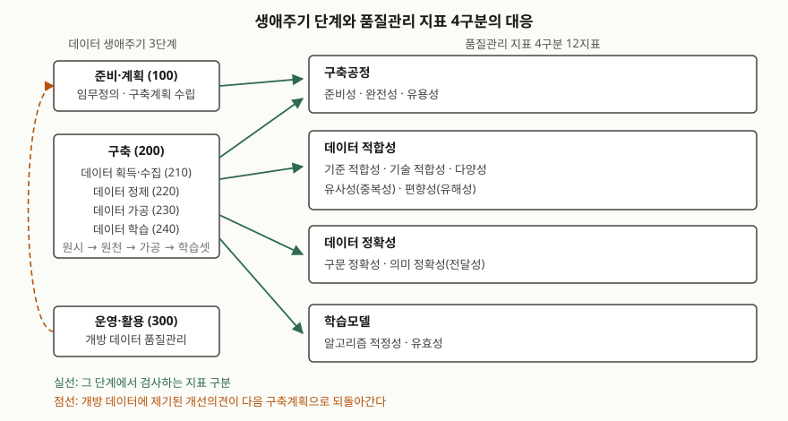

기출문제가 AI 학습용 데이터 품질관리를 특성·지표·활동 셋으로 끊어 묻는다. 셋 중 가운데인
**지표**가 답안의 무게중심이다. 특성은 지표가 왜 그렇게 생겼는지를 설명하는 전제이고,
활동은 그 지표를 언제 어디에 대고 재는지를 설명하는 운용이기 때문이다. 품질특성을
"정확성·완전성·일관성…"으로 나열하고 끝내면 일반 데이터 품질 답안과 구분되지 않는다.
점수는 **학습용 데이터라서 추가된 지표가 무엇인지**, 그 지표를 **어느 공정의 어느 데이터에
대고 재는지**를 적는 데서 난다.

> 실행 검증 없음. 개념 문제이므로 NIA 가이드라인과 ISO/IEC 표준 근거만으로 정리했다.
> NIA 가이드라인 v3.1은 제1권(공통)과 제2권(초거대 AI 데이터)으로 나뉜다. 제1권 원문은 파일이
> 커서 받지 못했고, **제1권의 지표 체계를 유지한다고 밝힌 제2권**에서 지표 구성·세부지표·
> 검사 방법·생애주기·검사 절차를 확인했다. 제2권이 초거대 AI용으로 덧붙인 설명은 그렇다고 적었다.

---

## Ⅰ. 개요

### 가. AI 학습용 데이터 품질관리의 정의

국제표준의 데이터 품질 측정 부문(ISO/IEC 5259-2:2024)은 적용 범위에서 자신이 정하는 것을
**데이터 품질 모델, 데이터 품질 측정, 데이터 품질 보고 지침** 셋으로 밝힌다. 여기서 데이터
품질 모델은 데이터 품질 주체, 데이터 품질특성, 데이터 품질 요구사항을 **데이터가 쓰이는
맥락에 맞춰 묶은 것**이고, 조직은 목표 품질 요구사항을 달성하도록 품질특성과 측정을 골라
모델을 정한다고 적는다.

따라서 AI 학습용 데이터 품질관리는 "좋은 데이터를 만드는 일"이 아니라 **쓰임새를 먼저 정하고
(임무정의) → 그 쓰임새에 맞는 지표를 고르고 → 공정마다 재고 → 미달분을 고치는** 관리 활동이다.
지표 없이는 관리할 수 없다는 것이 이 문제가 셋 중 지표를 가운데 둔 이유다.

### 나. 답안의 뼈대

이어지는 세 장은 문항이 물은 순서를 그대로 따른다. 특성(Ⅱ)이 지표(Ⅲ)의 선정 근거가 되고,
지표가 활동(Ⅳ)의 측정 대상이 된다.

## Ⅱ. AI 학습용 데이터 특성 — 6가지

NIA 가이드라인이 학습용 데이터를 설명하면서 드는 성질과, 지표를 그렇게 나눌 수밖에 없게 만든
조건을 6가지로 묶었다. 묶음 자체는 답안 작성용 정리다.

| # | 특성 | 내용 | 품질관리에 거는 조건 |
|---|---|---|---|
| ① | **대규모성** | 모델의 매개변수 규모에 맞춰 대규모 학습용 데이터가 필요하다 | 전수 육안 검수가 불가능하다. **표본 검사와 자동 측정**이 전제된다 |
| ② | **복합성** | 말뭉치 외에 이미지 캡션·음성 등 여러 유형이 섞인 복합 데이터셋이다. 소스도 도서·위키·웹 크롤링·기술문서로 갈린다 | 데이터 **종류별·소스별로 지표를 따로** 걸어야 한다 |
| ③ | **단계적 변환** | 원시데이터 → 원천데이터 → 가공(적응 학습) 데이터 → 학습데이터셋으로 형태가 바뀐다 | 같은 이름의 지표라도 **검사 대상 데이터가 공정마다 다르다** |
| ④ | **라벨 혼재** | 사전학습용 말뭉치는 라벨이 없고, 지도학습형 미세조정용 질의응답과 보상 모델용 리워드 데이터는 라벨이 있다 | 라벨 유무에 따라 **정확성 지표의 적용 대상**이 갈린다 |
| ⑤ | **반복 구축** | 적응 학습 데이터는 정제 데이터에 기반하되 필요에 따라 획득·수집과 정제를 다시 돈다 | 품질관리가 1회성 검수가 아니라 **공정마다 반복되는 통제**가 된다 |
| ⑥ | **평가셋 분리의 어려움** | 지도학습과 달리 학습·검증·테스트를 정해진 비율로 나눌 수 없거나, 목적에 맞는 별도 데이터를 쓴다 | 유효성 검증용 데이터를 **따로 설계**해야 한다. 라벨 없는 말뭉치는 검증 데이터가 아예 불필요하다 |

> **출처**: [NIA 인공지능 학습용 데이터 품질관리 가이드라인 v3.1 제2권, 제3장 초거대 AI 데이터 이해 — 데이터 특성 절](https://www.nia.or.kr/site/nia_kor/ex/bbs/View.do?cbIdx=26537&bcIdx=26624&parentSeq=26624)

여섯 중 ①③⑥이 일반 업무 데이터와 가장 크게 갈리는 지점이다. 업무 데이터는 완성된 상태를
검사하면 되지만, 학습용 데이터는 **완성된 상태라는 것이 공정마다 다르고** 최종 판정이
모델 성능으로만 내려진다. 지표 체계가 데이터 자체뿐 아니라 **구축공정과 학습모델까지** 포함하는
이유가 여기 있다.

## Ⅲ. AI 학습용 데이터 품질관리 지표

### 가. 지표 체계 — 4구분 12지표

NIA 가이드라인은 품질관리 지표를 **데이터 생애주기 분석, 데이터 구축 및 품질 관점의 일치성
분석, 데이터 품질관리 기준 분석**이라는 세 갈래 검토를 거쳐 구축·활용 관점을 반영한
**12가지**로 정했다고 밝힌다. 12지표는 네 구분으로 묶인다.

> **출처**: [NIA 인공지능 학습용 데이터 품질관리 가이드라인 v3.1 제2권, 표 Ⅱ-1(프레임워크 프로세스 정의)·표 Ⅲ-1(지표 구성)·표 Ⅲ-2(지표별 검사대상 및 검사 방법)](https://www.nia.or.kr/site/nia_kor/ex/bbs/View.do?cbIdx=26537&bcIdx=26624&parentSeq=26624)

| 구분 | 지표 | 무엇을 보는가 |
|---|---|---|
| **구축공정** | 준비성 | 정책·규정(저작권·초상권·개인정보보호·정보보호 검토 결과 포함)·조직·절차를 마련하고 최신으로 관리하는지 |
| | 완전성 | 물리적 구조를 갖추고, 정의한 데이터 형식과 입력값 범위에 맞게 저장되도록 설계·구축했는지 |
| | 유용성 | 발주기관(수요자) 요구사항이 충분히 반영됐는지, 임무정의에 맞는 범위와 상세화 정도를 채웠는지 |
| **데이터 적합성** | 기준 적합성 | 학습용으로 적합한지 판단할 기준을 세우기 위해 다양성·신뢰성·충분성·균일성·사실성 등을 측정 |
| | 기술 적합성 | 기술적으로 적합한지 보기 위해 파일포맷·문장길이·음질 등을 측정 |
| | 다양성 | 편향 방지를 위한 문어체/구어체, 수집처별 분포, 문장길이, 어휘 개수 등을 측정 |
| | 유사성(중복성) | 데이터의 중복과 내용적 유사도를 측정 |
| | 편향성(유해성) | 특정 성별·인종·나이 등에 대한 경향성과, 사회적으로 부정적 의미이거나 혐오표현에 해당하는 데이터의 포함 여부를 확인 |
| **데이터 정확성** | 구문 정확성 | 기본적인 데이터 구조(형식)와 입력값 범위의 일치성을 측정 |
| | 의미 정확성(전달성) | 구축 목적에 대한 의미 적정성과, 의미가 명료하고 표현이 자연스러운지를 측정 |
| **학습모델** | 알고리즘 적정성 | 학습모델의 과업(Task)이 적정한지 판단 |
| | 유효성 | 학습용 데이터로 훈련한 뒤 측정된 성능이 유효한지 측정 |

가이드라인은 초거대 AI 데이터의 특징을 반영해 **다양성·유사성·편향성·의미 전달성·유효성**
다섯을 수정했으나 기본 체계는 유지한다고 적는다. 구체적으로는 편향성에 환각 방지를 위한
사실성 검사를 넣었고, 의미 정확성에 질의/응답 적정성을 넣었으며, 유효성을 PPL·BLEU·ROUGE
같은 정량 지표와 사람이 판단하는 정성 지표로 나눴다.

### 나. 세부지표와 검사 방법

지표는 그 자체로 재지지 않는다. 각 지표 아래에 **세부지표**가 있고, 세부지표마다 어느 데이터
종류(말뭉치·질의응답·멀티모달)와 어느 구축공정에 걸리는지, 정량적 검사인지 정성적 검사인지가
표로 지정된다. 아래가 세부지표의 전체 모습이다.

| 지표 | 세부지표 |
|---|---|
| 준비성 | 계획 수립성(절차준비·조직준비·도구준비·위험관리), 체계 준수성(보안준수·법·제도 준수) |
| 완전성 | 수집완전성, 정제완전성, 가공완전성 |
| 유용성 | 사용편의성, 유연성 |
| 기준 적합성 | 다양성, 신뢰성, 충분성, 균일성, 사실성, 공평성 |
| 기술 적합성 | 파일포맷, 해상도, 문장길이, 어절/음절 수 |
| 다양성 | 구조적 다양성(문장 길이, 어휘 개수), 내용적 다양성(클래스 분포, 인스턴스 분포) |
| 유사성(중복성) | 내용 중복성, 도메인 유사성 |
| 편향성(유해성) | 경향성, 유해성 |
| 구문 정확성 | 데이터 구조, 입력값 범위, 데이터 형식 |
| 의미 정확성(전달성) | 원문 적정성, 내용 전달성, 질의 적정성, 답변 적정성 |
| 알고리즘 적정성 | 데이터 종류별 알고리즘 과업 분야 |
| 유효성 | 학습모델 유효성 |

여기서 답안에 꼭 적을 것이 둘이다. 첫째, 가이드라인은 **어떤 데이터에 대한 검사 지표인지
명확하게 구분해 정의해야 한다**고 못박는다. 적응 학습 방식 때문에 획득·수집, 정제, 가공, 학습을
반복하므로, "완전성 95%"만 적어서는 그 값이 원시데이터의 것인지 가공 데이터의 것인지 알 수 없다.
그래서 완전성이 수집·정제·가공 셋으로 쪼개져 있다.

둘째, **지표는 고정 목록이 아니라 선정 대상**이다. 가이드라인은 구축하려는 데이터의 목적에 따라
최적의 품질지표를 골라야 한다고 적고, 알고리즘 적정성에는 과업 목표에 따라 적합한 품질지표를
선정해야 한다는 단서를 붙인다. 12지표를 전부 거는 것이 아니라 **임무정의에서 고르는 것**이다.

### 다. 국제표준의 지표 체계 — 품질특성 4군 23가지

국제표준의 데이터 품질 측정 부문은 같은 일을 **품질특성(data quality characteristic)**으로 부르고
네 묶음, 모두 23가지로 나눈다. 묶음의 기준은 데이터 자체에 내재한 성질인지, 시스템에 달린
성질인지다.

| 묶음 | 품질특성 |
|---|---|
| 고유(inherent, 5) | 정확성, 완전성, 일관성, 신뢰성, 최신성 |
| 고유·시스템 의존 겸용(6) | 접근성, 준수성, 효율성, 정밀성, 추적성, 이해성 |
| 시스템 의존(3) | 가용성, 이식성, 복구성 |
| **추가(additional, 9)** | 감사가능성, 균형성, 다양성, 효과성, 식별가능성, 관련성, 대표성, 유사성, 적시성 |

> **출처**: [ISO/IEC 5259-2:2024, Contents — 6.2 Inherent / 6.3 Inherent and system-dependent / 6.4 System-dependent / 6.5 Additional data quality characteristics](https://standards.iteh.ai/catalog/standards/iso/a1df5595-1f27-4bcb-835f-3e7f1e5354b8/iso-iec-5259-2)

네 묶음 중 **추가 품질특성 9가지가 AI 때문에 붙은 것**이다. 앞의 14가지는 일반 데이터 품질
표준에서 이어진 것이고, 이 표준은 규정 참조(normative references)에 데이터 품질 측정 표준
ISO/IEC 25024를 올려 두고 그 측정을 가져다 쓴다. 균형성·다양성·대표성·유사성은 학습 데이터가
모집단을 어떻게 덮는지를 보는 지표이고, 감사가능성·식별가능성은 학습에 쓴 데이터를 나중에
되짚을 수 있는지를 본다.

### 라. 두 체계의 비교

| 구분 | NIA 품질관리 지표 | ISO/IEC 5259-2 품질특성 |
|---|---|---|
| 개수·묶음 | 12지표 / 4구분(구축공정·데이터 적합성·데이터 정확성·학습모델) | 23특성 / 4군(고유·겸용·시스템 의존·추가) |
| 묶는 기준 | **무엇을 검사하는가** — 공정, 데이터, 모델 | **품질이 어디에 달려 있는가** — 데이터 내재 성질인지 시스템인지 |
| 공정·조직 포함 | 포함한다. 준비성·완전성·유용성이 조직·절차·요구사항 반영을 본다 | 데이터 자체의 특성만 다룬다. 공정과 관리 요구사항은 같은 시리즈의 다른 부문이 맡는다 |
| 모델 성능 포함 | 포함한다. 알고리즘 적정성·유효성이 학습 결과를 지표로 되돌린다 | 효과성(effectiveness)이 가깝지만, 모델 성능 자체를 지표로 두지는 않는다 |
| 측정 규정 | 세부지표와 검사대상·검사 방법(정량/정성)을 표로 지정 | 특성마다 정량 측정을 규정하고, 측정 설계와 보고 틀까지 정한다 |
| 성격 | 국가 구축사업의 **발주·검수 기준** | 조직이 자기 목표에 맞게 **골라 쓰는 모델** |

핵심 차이는 **공정과 모델을 지표 안에 넣었는가**다. NIA 체계는 국가 구축사업의 검수를 전제로 해
"데이터가 좋은가"뿐 아니라 "제대로 된 조직과 절차로 만들었는가", "그래서 모델이 돌아가는가"까지
한 체계 안에서 묻는다. 국제표준은 데이터 품질만 떼어 정의하고, 관리 요구사항과 프로세스는
같은 시리즈의 다른 부문으로 나눠 둔다. 실무에서는 **국제표준으로 데이터 품질특성을 정의하고,
NIA 체계로 공정·검수 기준을 세우는** 조합이 가능하다.

## Ⅳ. AI 학습용 데이터 품질관리 활동

### 가. 생애주기 단계별 활동 — 3단계 6프로세스

품질관리 활동은 생애주기 프로세스 위에 올라간다. NIA의 품질관리 프레임워크는 3단계
6프로세스다.

| 단계 | 프로세스 | 품질관리 활동 | 산출 데이터 |
|---|---|---|---|
| 100. 준비·계획 | 110. 구축계획 수립 | 구축목적의 일치성·일관성을 확보할 구체적 계획 수립, 컨소시엄 간 업무·역할 정의, **품질지표와 목표·품질점검 기준 수립** | — |
| 200. 구축 | 210. 데이터 획득/수집 | 획득·수집 프로세스와 원시데이터 품질관리 | 원시데이터 |
| | 220. 데이터 정제 | 중복제거·비식별화 등 정제 작업과 원천데이터 품질관리 | 원천데이터(말뭉치 등) |
| | 230. 데이터 가공 | 적응 학습 데이터 구축 프로세스와 그 데이터의 품질관리 | 적응 학습 데이터 |
| | 240. 데이터 학습 | 학습데이터셋으로 학습시키고 모델 성능을 보정하는 단계의 품질관리 | 학습데이터셋·모델 |
| 300. 운영·활용 | 310. 데이터 운영·활용 | 개방된 학습용 데이터의 품질관리, 하자·유지보수 | 개방 데이터 |

주목할 것은 **품질지표와 목표를 세우는 자리가 맨 앞(110)**이라는 점이다. 지표를 뒤에 정하면
이미 만들어진 데이터에 맞춰 기준이 내려가므로, 가이드라인은 이를 구축계획 수립 단계의 산출로
못박는다.

### 나. 품질검사·개선 절차 — 5단계

각 공정 안에서 품질관리 담당자가 도는 절차는 다섯 단계다.

| # | 절차 | 수행 내용 |
|---|---|---|
| 1 | 검사대상 정의 | 원시데이터·원천데이터·라벨링데이터 등 검사대상을 선정하고, 요구 품질수준에 부합하는 상태인지 판단할 품질검사 계획을 세운다 |
| 2 | 품질검사 실시 | 준비성·완전성·유용성·적합성·다양성·유사성·유해성·정확성·유효성 등 지표에 체크리스트 같은 검사기법을 적용해 검사한다 |
| 3 | 검사결과 분석 | 주요 품질문제를 식별하고 근본 원인을 파악해 개선 기회를 도출한다 |
| 4 | 개선수행 | 개선계획·방안을 정의하고 우선순위를 정해, 데이터 보정·추가 작업 등 영역별 개선을 수행한다 |
| 5 | 품질통제 | 개선 결과를 확인·점검하고 품질 목표를 재설정해 재발을 막고 고품질을 유지한다 |

3단계에서 **근본 원인**을 짚는 것이 이 절차의 요지다. 라벨 오류율이 높게 나왔을 때 해당 라벨만
고치면 같은 오류가 다음 배치에서 또 나온다. 작업 지침이 모호했는지, 작업자 교육이 빠졌는지,
검수 표본이 작았는지까지 내려가야 5단계의 품질통제가 성립한다.

### 다. 품질관리 범위 — 3영역

활동이 미치는 범위도 셋으로 정의된다.

- **구축 프로세스 품질관리**: 획득·수집, 정제, 가공 등 구축과정에서 품질관리 활동을 수행하는지
  모니터링하고 발견된 문제점을 보완한다. 대상은 **공정**이다
- **구축 데이터 품질관리**: 원시·원천·가공 데이터 등 **데이터 자체**의 품질을 검사하고 오류를 개선한다
- **개방 데이터 품질관리**: 개방된 학습 데이터셋의 품질을 지속적으로 향상시키고, 품질에 개선의견이
  제기되면 적극적으로 대응·조치한다. 대상은 **배포 이후의 데이터**다

세 영역이 Ⅳ장 앞의 도식에서 점선으로 그린 되먹임을 만든다. 개방 뒤에 제기된 문제가 다음
구축계획의 품질지표와 목표로 되돌아가야 활동이 닫힌 고리가 된다.

### 라. 국제표준이 보는 활동 — 프로세스 프레임워크

국제표준 시리즈에서 활동에 해당하는 것은 **데이터 품질 프로세스 프레임워크 부문
(ISO/IEC 5259-4:2024)**이다. 이 부문은 조직의 유형·규모·성격과 무관하게 적용할 공통 접근을
세우고, 데이터 획득·구성, 데이터 준비, 데이터 라벨링, 평가, 데이터 활용에 걸쳐 적용된다.
또한 같은 시리즈의 품질관리 요구사항 부문이 정한 관리 요구사항을 **운영 차원에서 충족시키는
프레임워크**로 자리한다. 특정 서비스·플랫폼·도구를 규정하지는 않는다.

NIA의 3단계 6프로세스와 견주면 라벨링이 독립 단계로 서 있는 점이 다르고, 운영·활용 대신
**평가(evaluation)와 데이터 활용(data use)**으로 끊는다는 점이 다르다. 답안에서는
"국내 구축사업 기준(NIA)과 국제표준(5259 시리즈)이 같은 활동을 다른 단위로 끊는다"는 한 문장과
함께 쓰면 비교가 선다.

## Ⅴ. 결론

AI 학습용 데이터 품질관리의 요지는 세 문장으로 줄어든다.

첫째, 학습용 데이터는 **대규모·복합·단계적 변환**이라는 특성 때문에 완성품을 한 번 검사하는
방식이 성립하지 않는다. 지표를 공정마다, 데이터 종류마다 따로 걸어야 한다.

둘째, 그래서 지표 체계가 **데이터 자체를 넘어 구축공정과 학습모델까지** 포함한다. NIA는
4구분 12지표로, 국제표준은 4군 23품질특성으로 정리하되 후자는 AI 때문에 추가 9가지를 더 둔다.

셋째, 활동은 **구축계획 수립에서 지표와 목표를 먼저 정하고**, 공정마다 검사대상 정의부터
품질통제까지 5단계를 돌며, 개방 이후의 개선의견이 다음 구축계획으로 되돌아가는 고리를 이룬다.
지표를 뒤에 정하거나 되먹임을 끊으면 품질관리가 아니라 사후 검수에 그친다.

> 개념 정리: [ISO/IEC 5259 — 분석·머신러닝용 데이터 품질 표준 시리즈](../../data-analysis/2026-09-30-iso-iec-5259-data-quality-series/index.md)
>
> 같은 주제를 품질관리 원칙과 범위 중심으로 쓴 답안: [인공지능 학습용 데이터 품질관리](../2026-09-30-ai-training-data-quality-management/index.md)

끝

## 답안 작성 메모

**무엇부터 쓰나.** Ⅲ장의 4구분 12지표 표를 가장 먼저 그린다. 문항이 셋을 물었지만 특성과 활동은
지표를 설명하는 앞뒤이므로, 지표 표가 비면 나머지가 다 공중에 뜬다. 표의 왼쪽 열(구축공정·데이터
적합성·데이터 정확성·학습모델) 네 칸만 먼저 치고 지표 이름을 채워 넣으면 빠르다.

**시간이 모자라면 무엇을 버리나.** 버리는 순서는 Ⅲ-다(국제표준 23특성) → Ⅳ-라(국제표준
프로세스 프레임워크) → Ⅲ-나(세부지표 전체 표)다. Ⅲ-다를 통째로 버리기 아까우면 추가
품질특성 9가지만 한 줄로 적는다 — "AI 때문에 더해진 것은 균형성·다양성·대표성·유사성 등
9가지"가 비교의 핵심이다. 반대로 **Ⅳ-가의 3단계 6프로세스와 Ⅳ-나의 5절차는 끝까지 남긴다.**
개수를 묻는 항목이라 점수가 그대로 붙는다.

**점수가 갈리는 지점.** 셋이다.

- **지표를 공정·데이터와 묶어 쓰는가.** "완전성"만 쓰면 일반 데이터 품질 답안이다. "완전성은
  수집·정제·가공 셋으로 쪼개져 각 공정의 산출 데이터에 걸린다"까지 써야 학습용 데이터 답안이 된다
- **학습모델이 지표에 들어 있다는 점을 짚는가.** 알고리즘 적정성과 유효성은 데이터 품질 답안에서
  빠지기 쉬운데, 학습용 데이터의 품질은 결국 모델 성능으로만 최종 판정된다는 구조를 보여 주는
  자리다. PPL·BLEU·ROUGE 같은 정량 지표와 사람의 정성 판단이 함께 쓰인다는 점도 한 줄로 적는다
- **되먹임 고리를 그리는가.** 개방 데이터 품질관리가 다음 구축계획의 지표·목표로 돌아가는 점선을
  도식에 넣으면 "활동"을 절차 나열이 아니라 순환으로 이해했다는 표시가 된다

**쓰지 말 것.** 모델 매개변수 수나 토큰 규모 같은 수치는 출처마다 다르고 빠르게 낡으므로 적지
않는다. "데이터 품질이 모델 성능을 n% 올린다" 류의 수치도 근거 없이 쓰면 감점 요인이다.

## 참고 자료

- [NIA 인공지능 학습용 데이터 품질관리 가이드라인 v3.1 (제1권 품질관리 가이드라인 / 제2권 초거대 AI 데이터 품질관리 가이드라인 / 별권 주요 산출물 양식, 2024-01)](https://www.nia.or.kr/site/nia_kor/ex/bbs/View.do?cbIdx=26537&bcIdx=26624&parentSeq=26624) — 한국지능정보사회진흥원
- [AI 데이터 품질관리 가이드 v3.5 (제1권 품질관리 / 제2권 데이터 구축 / 제3권 생성형AI 데이터 품질관리 v2.0, 2025-05-23)](https://www.nia.or.kr/site/nia_kor/ex/bbs/View.do?cbIdx=26537&bcIdx=28106&parentSeq=28106) — 한국지능정보사회진흥원, v3.1의 후속판
- [ISO/IEC 5259-2:2024 Artificial intelligence — Data quality for analytics and machine learning (ML) — Part 2: Data quality measures](https://www.iso.org/standard/81860.html) — 적용 범위·목차·품질특성 4군은 [공개 미리보기](https://standards.iteh.ai/catalog/standards/iso/a1df5595-1f27-4bcb-835f-3e7f1e5354b8/iso-iec-5259-2)에서 확인
- [ISO/IEC 5259-4:2024 Artificial intelligence — Data quality for analytics and machine learning (ML) — Part 4: Data quality process framework](https://www.iso.org/standard/81093.html)
- [ISO/IEC 25024 Systems and software engineering — SQuaRE — Measurement of data quality](https://www.iso.org/standard/35749.html) — 5259-2가 규정 참조로 인용하는 데이터 품질 측정 표준
