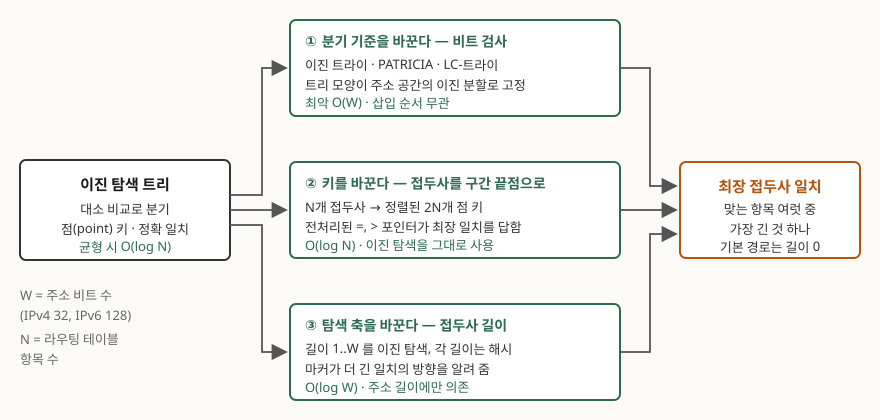
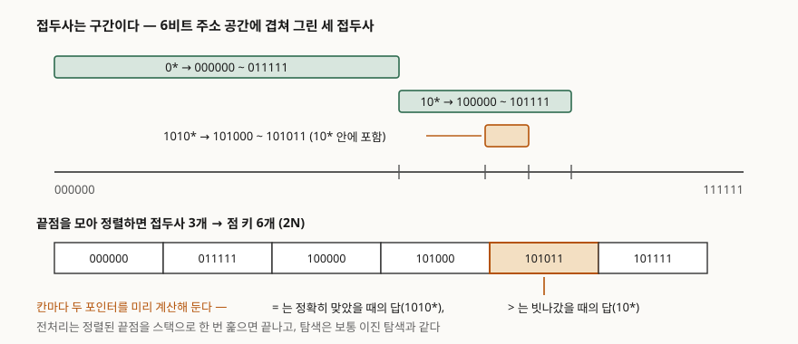

> 실행 검증 없음. 표준 문서(RFC)와 각 알고리즘의 원 논문을 근거로 정리했다. 복잡도 표기와
> 자료구조 동작은 원 논문이 제시한 값을 그대로 옮겼고, 측정값은 싣지 않았다.

자료구조 하나와 네트워크 장비의 탐색 알고리즘을 묶어 그 관계를 묻는 문제다. 항목을 나눠 묻지
않았으므로 **무엇이 같고, 어디서 갈라지며, 갈라진 자리를 무엇으로 메웠는가**의 순서로 대항목을
세운다. 라우팅 프로토콜이 경로를 어떻게 계산하는가는 다른 문제이므로 건드리지 않는다. 여기서
답할 것은 계산이 끝난 뒤 남은 **포워딩 테이블에서 한 주소의 다음 홉을 찾아내는 탐색**이다.

---

## Ⅰ. 개요

이진 탐색 트리와 라우팅 테이블 탐색은 **한 번의 판정으로 남은 후보를 일정 비율로 줄인다**는
같은 전략을 쓴다. 항목을 처음부터 훑으면 N개 항목에 N번 판정이 들어가지만, 판정마다 후보가
절반이면 log₂N번으로 끝난다. 포워딩은 패킷 하나마다 일어나므로 이 차이가 곧 장비의 처리량이
된다.

갈라지는 지점은 **키의 모양**이다. 이진 탐색 트리는 키가 하나의 값이고 질의가 그 값과 정확히
같은 것을 찾는 상황을 전제한다. 라우팅 테이블의 키는 값이 아니라 **주소 구간**이고, 질의는
그 구간들 중 **주소를 포함하는 가장 좁은 것**을 찾는다. 라우터 요구사항 표준은 다음 홉 주소를
정하는 절(RFC 1812 §5.2.4.3)에서 후보를 걸러내는 규칙을 순서대로 적용하라고 정하고, 목적지가
맞는 경로만 남기는 규칙(Basic Match) 다음에 남은 것 중 접두사 길이가 가장 큰 것만 남기는
규칙(Longest Match)을 둔다. 기본 경로는 접두사 길이가 0인 경로로 정의되므로 이 규칙 안에서
가장 나중에 선택된다.

즉 라우팅 테이블 탐색은 **정확 일치가 아니라 포함 관계 안에서의 최댓값 탐색**이다. 이진 탐색
트리를 그대로 가져다 쓸 수 없는 이유가 여기 있고, 지난 30년간 제안된 탐색 알고리즘은 이진
탐색의 분할 원리를 지키면서 이 간극을 메우는 세 가지 방식으로 정리된다.

> **출처**: [RFC 1812 §5.2.4.3 Next Hop Address](https://www.rfc-editor.org/rfc/rfc1812.txt), [Waldvogel et al., Scalable High Speed IP Routing Table Lookups, SIGCOMM '97](https://kops.uni-konstanz.de/entities/publication/e01040eb-0f15-421a-80b6-4b3281c7376e), [Lampson, Srinivasan, Varghese, IP Lookups using Multiway and Multicolumn Search](https://www.bwlampson.site/61-IPLookup/61-IPLookupAbstract.html)

---

## Ⅱ. 두 탐색의 전제 비교 — 어디까지 같고 어디서 갈라지는가

### 가. 이진 탐색 트리가 성립하는 전제 — 3가지

① **전순서(total order)** — 임의의 두 키에 대소가 정해져야 한다. 정해지지 않으면 어느 쪽으로
내려갈지 결정할 수 없다.
② **점(point) 키** — 한 노드가 값 하나를 가진다. 키끼리 겹치지 않으므로 질의에 맞는 항목은
많아야 하나다.
③ **판정 한 번에 절반** — 비교 결과가 "작다 / 같다 / 크다" 셋 중 하나로 나와, 맞지 않은 쪽
부분 트리 전체를 더 보지 않아도 된다.

이 세 전제 위에서 탐색 비용은 트리 높이에 비례한다. 균형이 유지되면 O(log N)이고, 정렬된
순서로 삽입되어 한쪽으로 치우치면 O(N)까지 늘어진다. 그래서 균형 이진 탐색 트리는 삽입·삭제
때마다 회전으로 높이를 되돌리는 비용을 함께 치른다.

### 나. 라우팅 테이블 탐색이 요구하는 것

클래스 없는 주소 지정(CIDR)이 도입되면서 접두사 길이가 고정 경계를 벗어나 1부터 W(IPv4는 32,
IPv6는 128)까지 가변이 되었다. 같은 표준은 라우터가 목적지와 맞는 경로 중 **가장 구체적인
것**, 곧 접두사가 가장 긴 것을 써야 한다고 정한다. 그 결과 테이블의 항목들은 서로 배타적이지
않고 **포함 관계로 겹친다**. 10.0.0.0/8과 10.1.0.0/16과 기본 경로가 한 테이블에 공존하고,
10.1.2.3이라는 주소 하나에 셋이 모두 맞는다.

### 다. 이진 탐색 트리를 그대로 쓸 수 없는 이유 — 3가지

① **키가 점이 아니라 구간이다.** 접두사는 값 하나가 아니라 주소 범위를 가리키므로 "같다"는
판정 자체가 성립하지 않는다.
② **맞는 항목이 여럿이다.** 전제 ②가 깨지므로 하나를 찾고 멈추는 탐색으로는 답이 나오지
않는다. 맞는 것을 모두 찾은 뒤 길이를 비교해야 한다.
③ **비교 결과가 길이 정보를 주지 않는다.** 접두사를 값으로 보고 정렬해 비교하면 "주소보다
작은 접두사" 중 어느 것이 주소를 포함하는지는 비교 결과만으로 알 수 없다. 10.1.0.0/16과
10.1.0.0/24는 값이 같고 길이만 다르다.

---

## Ⅲ. 상관관계 — 이진 탐색 트리가 라우팅 탐색으로 변형되는 세 갈래

세 방식은 이진 탐색 트리의 서로 다른 요소를 하나씩 바꾼다. **분기 기준**을 바꾸거나, **키**를
바꾸거나, **탐색 축**을 바꾼다. 바꾸지 않은 나머지는 그대로 남으므로, 셋 모두 이진 탐색의
변형으로 읽힌다.

### 가. 분기 기준을 바꾼다 — 비트 검사 (트라이 계열)

키끼리 비교하는 대신 **주소의 비트를 하나씩 본다.** 깊이 d인 노드에서 주소의 d번째 비트가
0이면 왼쪽, 1이면 오른쪽으로 내려간다. 그러면 루트에서 어떤 노드까지의 경로가 그 자체로
비트열, 곧 접두사가 된다. 접두사를 저장한다는 말과 경로를 따라간다는 말이 같아지는 것이다.

최장 접두사 일치는 자연스럽게 풀린다. 주소를 따라 내려가면서 **경로 위에서 만난 적중 노드를
계속 덮어쓰면**, 더 이상 내려갈 수 없을 때 마지막으로 기록된 것이 가장 긴 일치다. 포함 관계가
깊이 순서와 일치하므로 길이를 따로 비교할 필요가 없다.

대신 깊이가 W에 묶여 최악 O(W)가 되고, 자식이 하나뿐인 내부 노드가 길게 이어지는 낭비가
생긴다. 이를 줄이는 두 압축이 차례로 제안되었다.

- **경로 압축** — 자식이 하나뿐인 내부 노드를 없애고, 건너뛴 만큼 **검사할 비트 위치**를
  노드에 적어 둔다. 1968년 JACM에 실린 PATRICIA가 원형이고, 버클리 UNIX 4.3 Reno가
  포워딩 결정에 쓴 축약 radix 트리가 이 계열이다.
- **레벨 압축** — 꽉 찬 부분 트리를 차수가 큰 노드 하나로 접어 깊이를 줄인다. 두 압축을
  함께 적용한 것이 LC-트라이이고, 원 논문은 넓은 분포군에서 탐색 깊이가 Θ(log log n)으로
  늘어나며 노드 하나가 4바이트에 담긴다고 밝힌다. 리눅스 커널의 IPv4 포워딩 테이블
  구현(`net/ipv4/fib_trie.c`)이 이 논문을 근거 문헌으로 적고 있다.

이 갈래의 성질 하나를 짚어 둘 만하다. **트리의 모양이 삽입 순서와 무관하다.** 비교가 아니라
주소 공간의 이진 분할로 모양이 정해지므로 편향이 생기지 않고, 균형 유지 비용도 들지 않는다.
이진 탐색 트리가 치르던 비용 한 항목이 사라지는 대신 깊이가 데이터 양이 아니라 주소 길이에
묶이는 것이다.

### 나. 키를 바꾼다 — 접두사를 구간 끝점으로

세 갈래 중 상관관계가 가장 직접 드러나는 쪽이다. 자료구조를 바꾸는 대신 **문제를 이진 탐색이
풀 수 있는 모양으로 바꾼다.** 접두사를 주소 길이까지 채워 시작점과 끝점 두 값으로 펼치면,
구간 키가 점 키 둘로 바뀐다. 원 논문의 표현은 이렇다 — "we treat each prefix as a range and
encode it using the start and end of range."

> **출처**: [Lampson, Srinivasan, Varghese, IP Lookups using Multiway and Multicolumn Search](https://www.bwlampson.site/61-IPLookup/61-IPLookupOCR.htm)

접두사 N개는 정렬된 점 키 2N개가 되고, 탐색은 보통의 이진 탐색이다. 최장 일치는 탐색이 끝난
자리에서 **미리 계산해 둔 포인터**가 답한다. 각 칸은 두 포인터를 가진다. 정확히 그 칸에서
끝났을 때 쓰는 `=` 포인터는 그 끝점을 가진 접두사를 가리키고, 빗나가 그 칸보다 큰 쪽에서
끝났을 때 쓰는 `>` 포인터는 그 영역을 감싸는 가장 좁은 접두사를 가리킨다. 포인터 전처리는
정렬된 끝점을 스택으로 한 번 훑는 것으로 끝나 O(N)이다.

주소가 워드 하나에 들어가지 않을 때가 문제다. W비트 키를 M비트 워드 W/M개로 나눠 비교하면
비용이 (W/M)·log N으로 곱해진다. 원 논문은 워드를 열(column) 단위로 나눠 한 열씩 탐색하고
다음 열로 넘어갈 때 쓰는 보호 구간(guard range) 포인터를 두어, 이 항을 **곱이 아니라 합**으로
바꾼다. 비용은 log₂N + W/M, 곧 O(W + log N)이 된다. 여기에 상위 몇 비트로 바로 들어가는 초기
배열과 캐시 라인 폭에 맞춘 다분기 탐색이 더해진다.

### 다. 탐색 축을 바꾼다 — 접두사 길이에 대한 이진 탐색

주소 값이 아니라 **접두사 길이**를 이진 탐색한다. 길이 1부터 W까지 각각 해시 테이블을 두고,
가운데 길이부터 찾는다. 그 길이에서 맞는 항목이 있으면 더 긴 쪽에 답이 더 있을 수 있으므로
위쪽 절반으로, 없으면 아래쪽 절반으로 간다. 이진 탐색 트리의 좌·우 분기가 **더 짧은 쪽 / 더
긴 쪽**으로 바뀐 것이다.

그대로 두면 틀린다. 길이 16에서 맞지 않았다고 길이 24에 답이 없다고는 말할 수 없기 때문이다.
그래서 긴 접두사가 있을 때 짧은 길이 테이블에 **마커**를 함께 넣어, "이 방향으로 더 내려가면
답이 있다"는 사실을 길이 축의 판정에 실어 준다. 마커가 전제 ③, 곧 맞지 않은 쪽을 버려도
된다는 성질을 되살리는 장치다.

원 논문이 든 성질은 **테이블 크기와 무관하다**는 점이다. 해시 조회 횟수가 최악에도
log₂(주소 비트 수)이므로, 항목이 몇 개든 IPv4는 5회, IPv6는 7회로 묶인다. 논문은 탐색 중
얻은 정보로 다음에 볼 길이 범위를 좁히는 변형(Mutating Binary Search)을 더해 실제 백본
테이블에서 평균 해시 조회 횟수가 2회 미만으로 줄었다고 밝힌다.

### 라. 비교

| 구분 | 이진 탐색 트리(원형) | ① 트라이 계열 | ② 구간 끝점 이진 탐색 | ③ 접두사 길이 이진 탐색 |
|---|---|---|---|---|
| 바꾼 요소 | — | 분기 기준 | 키 표현 | 탐색 축 |
| 분기 판정 | 키 대소 비교 | 주소의 한 비트 | 키 대소 비교 | 길이별 해시 적중 여부 |
| 키 형태 | 점, 배타적 | 경로가 곧 접두사 | 점 2N개 | 길이별 접두사 + 마커 |
| 최장 일치 해결 | 해당 없음 | 경로 위 마지막 적중 | 전처리된 `=`·`>` 포인터 | 마커가 방향 제공 |
| 최악 탐색 비용 | O(log N), 균형 시 | O(W) | O(log N), 다중 워드는 O(W + log N) | O(log W) |
| 테이블 크기 의존 | 있음 | 없음 | 있음(로그) | 없음 |
| 모양의 결정 요인 | 삽입 순서 → 재균형 필요 | 키 집합만, 재균형 불필요 | 정렬 순서 | 길이 분포 |
| 갱신 비용 | 회전 | 지역 수정 | 포인터 재계산, 일괄 갱신 선호 | 마커 재계산 |

표에서 읽을 것은 **어느 하나가 우월하지 않다**는 점이다. ①은 주소가 짧고 갱신이 잦을 때,
②는 테이블이 작고 탐색이 캐시에 들어갈 때, ③은 주소가 길고 테이블이 클 때 유리하다. 셋은
같은 분할 탐색 원리를 서로 다른 축에 적용한 결과다.

---

## Ⅳ. 적용 시 고려사항 — 4가지

**① 지배 변수가 N인지 W인지 먼저 정한다.** 복잡도의 변수가 둘이므로 둘 중 무엇이 큰지에 따라
선택이 뒤집힌다. IPv6에서 W가 128로 늘면 O(W) 구조는 깊이가 네 배가 되지만 O(log W) 구조는
5회에서 7회로만 늘어난다. 반대로 테이블이 수천 건 규모이고 주소가 IPv4라면 O(W)의 상수가 더
작을 수 있다. 표기만 보고 고르지 않는다.

**② 갱신 빈도와 전처리 비용을 함께 본다.** 구간 끝점 방식과 길이 탐색 방식은 포인터·마커를
미리 계산해 두는 대가로 탐색을 줄인다. 경로 변동이 잦아 항목이 수시로 바뀌면 그 전처리가
탐색 이득을 상쇄한다. 원 논문도 삽입 비용이 커 갱신을 모아서 처리하는 쪽을 권한다. 반대로
트라이 계열은 바뀐 접두사 주변만 고치면 되어 갱신에 강하다.

**③ 복잡도보다 메모리 접근 횟수를 센다.** 포워딩은 비교 연산이 아니라 메모리 참조가 병목이다.
같은 O(log N)이라도 노드가 캐시 라인에 몇 개 들어가느냐에 따라 실제 지연이 갈린다. 노드를
작게 만들고(LC-트라이의 4바이트 노드) 분기 수를 캐시 라인 폭에 맞추는(다분기 탐색) 최적화가
논문마다 반복해 등장하는 이유다. 설계 검토에서는 트리 높이가 아니라 **예상 캐시 미스 횟수**를
근거로 든다.

**④ 소프트웨어 탐색의 경계를 정한다.** 위 구조는 모두 범용 프로세서의 메모리 계층을 전제로
한다. 전용 하드웨어로 모든 항목을 동시에 비교하는 방식은 탐색 횟수를 상수로 만드는 대신
용량·전력·갱신 절차에서 다른 제약을 가진다. 어느 쪽을 쓸지는 알고리즘이 아니라 장비 등급과
갱신 요구사항으로 결정되므로, 설계 문서에 그 전제를 적어 둔다.

---

## Ⅴ. 결론

이진 탐색 트리와 라우팅 테이블 탐색의 상관관계는 **원리는 공유하고 전제는 어긋나며, 그
어긋남을 메운 방법이 세 갈래로 남았다**로 정리된다. 공유하는 원리는 한 번의 판정으로 후보를
일정 비율로 줄여 선형 탐색을 로그로 낮추는 분할 탐색이다. 어긋나는 전제는 키가 점이 아니라
구간이고 맞는 항목이 여럿이라는 것, 곧 최장 접두사 일치라는 요구다.

메운 방법은 이진 탐색 트리의 어느 요소를 바꿨는가로 구분된다. 분기 기준을 비트 검사로 바꾸면
트라이 계열이 되어 경로 자체가 접두사가 되고, 키를 구간 끝점으로 펼치면 이진 탐색을 그대로
쓰면서 전처리 포인터가 최장 일치를 답하며, 탐색 축을 접두사 길이로 옮기면 비용이 테이블
크기에서 떨어져 나와 주소 길이에만 묶인다.

따라서 이 문제는 "자료구조를 어디에 응용하는가"가 아니라 **제약 조건이 자료구조를 어떻게
변형시키는가**를 묻는 문제로 읽는 것이 맞다. 설계에서 할 일도 같다. 요구사항이 정확 일치가
아닌 형태로 주어졌을 때, 자료구조를 통째로 버릴 것인지, 키 표현을 바꿔 쓰던 구조를 살릴
것인지, 탐색하는 축 자체를 옮길 것인지를 저울질하는 것이다.

끝

---

## 답안 작성 메모

**먼저 쓸 것은 Ⅱ-다의 세 가지 이유다.** 이 문제는 "둘 다 트리를 쓴다"로 시작하면 점수가 나오지
않는다. 채점자가 보려는 것은 **왜 이진 탐색 트리를 그대로 못 쓰는가**를 짚었는지이고, 그 자리에
최장 접두사 일치를 정확히 쓰면 뒤의 세 갈래가 전부 그 답으로 읽힌다. 개요에서 RFC 1812의 다음
홉 선정 규칙(Basic Match → Longest Match)을 한 줄로 걸어 두면 근거가 선다.

**점수가 갈리는 지점은 Ⅲ의 분류 축이다.** 트라이·LC-트라이·해시 기반을 나열만 하면 암기
답안이 된다. "분기 기준 / 키 / 탐색 축 중 무엇을 바꿨는가"로 묶으면 세 갈래가 모두 이진
탐색의 변형임이 드러나고, 문제가 물은 *상관관계*에 직접 답하게 된다. 도식 한 장이 이 분류를
그대로 담으므로 도식을 먼저 그리고 본문을 붙이는 편이 빠르다.

**시간이 모자라면 Ⅲ-나를 줄인다.** 구간 끝점 방식은 설명에 지면이 가장 많이 들지만, `=`·`>`
포인터를 미리 계산한다는 한 줄과 2N 항목이라는 수치만 남겨도 분류 축은 유지된다. 반대로
Ⅲ-다의 **마커**는 빼면 안 된다. 마커가 없으면 길이 이진 탐색이 왜 성립하는지가 설명되지 않아
답안이 틀린 것이 된다.

**복잡도는 변수를 밝혀 쓴다.** O(log N)과 O(W)와 O(log W)를 섞어 쓰면서 N과 W가 각각 무엇인지
적지 않으면 비교표가 무의미해진다. 표 바로 위나 도식 구석에 "W = 주소 비트 수, N = 항목 수"를
한 번 적어 둔다.

**Ⅳ는 세 개면 충분하지만 ③은 꼭 넣는다.** 복잡도가 아니라 메모리 접근 횟수로 판단한다는
항목이 실무 감각을 보여 주는 자리다. 여기까지 쓰면 결론은 두세 줄로 닫아도 된다.

---

## 참고 자료

- [RFC 1812, Requirements for IP Version 4 Routers (1995-06)](https://www.rfc-editor.org/rfc/rfc1812.txt) — §5.2.4.3 Next Hop Address의 경로 선별 규칙(Basic Match, Longest Match)과 접두사 길이 0인 기본 경로 정의, §2.2.5.2 CIDR의 최장 접두사 사용 요구
- [Marcel Waldvogel, George Varghese, Jon Turner, Bernhard Plattner, "Scalable High Speed IP Routing Table Lookups", ACM SIGCOMM '97, pp. 25–36](https://kops.uni-konstanz.de/entities/publication/e01040eb-0f15-421a-80b6-4b3281c7376e) — 접두사 길이별 해시 테이블에 대한 이진 탐색, 마커, 최악 log₂(주소 비트 수) 해시 조회, Mutating Binary Search
- [Butler Lampson, Venkatachary Srinivasan, George Varghese, "IP Lookups using Multiway and Multicolumn Search", IEEE INFOCOM 1998 / IEEE/ACM Transactions on Networking 1999](https://www.bwlampson.site/61-IPLookup/61-IPLookupAbstract.html) — 접두사를 구간 시작·끝 두 항목으로 encode, 2N 항목, `=`·`>` 포인터 전처리, 다중 열 탐색으로 O(W + log N)
- Stefan Nilsson, Gunnar Karlsson, "IP-Address Lookup Using LC-Tries", IEEE Journal on Selected Areas in Communications, Vol. 17, No. 6 (1999-06) — 경로 압축과 레벨 압축의 결합, 탐색 깊이 Θ(log log n), 4바이트 노드. 저자 소속 기관이 공개하던 원문 페이지는 폐쇄되어 열지 못했으므로 서지 정보와 리눅스 커널 머리말의 인용으로만 근거를 삼았다
- D. R. Morrison, "PATRICIA — Practical Algorithm To Retrieve Information Coded In Alphanumeric", Journal of the ACM, Vol. 15, No. 4 (1968-10) — 자식이 하나뿐인 내부 노드를 제거하고 검사 비트 위치를 노드에 저장하는 경로 압축의 원형
- Keith Sklower, "A Tree-Based Packet Routing Table for Berkeley Unix", USENIX Winter 1991 — 4.3 Reno가 포워딩 결정에 채택한 축약 radix 트리
- [Linux `net/ipv4/fib_trie.c`](https://git.kernel.org/pub/scm/linux/kernel/git/torvalds/linux.git/tree/net/ipv4/fib_trie.c) — IPv4 포워딩 테이블 구현. 파일 머리말이 Nilsson·Karlsson의 LC-트라이 논문과 Nilsson·Tikkanen의 LPC-trie 논문(Algorithmica, 2002)을 근거 문헌으로 적는다
- Donald E. Knuth, *The Art of Computer Programming, Volume 3: Sorting and Searching*, 2nd ed. — §6.2.2 이진 트리 탐색, §6.3 디지털 탐색(트라이와 PATRICIA)
