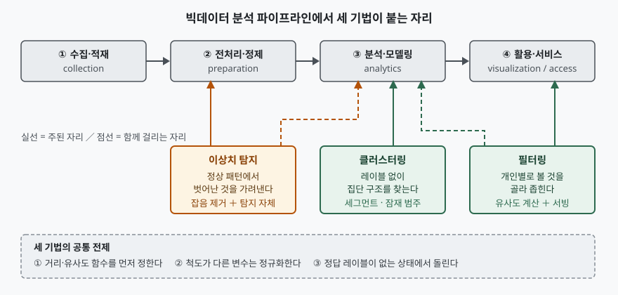

기출문제가 빅데이터 분석기법 셋을 나란히 놓고 설명하라고 묻는다. 셋을 각각 교과서식으로
정의하고 대표 알고리즘을 나열하면 분량은 차지만 점수는 안 난다. 세 기법이 **왜 한 문항에
묶여 나왔는지**를 먼저 잡아야 한다. 셋 다 정답 레이블 없이 거리·유사도만으로 데이터의 구조를
찾는 비지도 계열이고, 빅데이터 파이프라인에서 **서로 다른 공정에 붙는다.** 클러스터링은
구조를 묶고, 필터링은 그 구조를 써서 개인별로 좁히고, 이상치 탐지는 구조에서 벗어난 것을
골라낸다. 정보관리기술사 답안이므로 알고리즘 수식이 아니라 **그 기법이 시스템에 무엇을
요구하는가**가 뼈대다.

> 실행 검증 없음. 개념 문제이므로 원 논문·표준 문서 근거만으로 정리했다.
> 알고리즘의 동작·복잡도·파라미터 값은 전부 원 논문에서 확인한 것이고, 근거를 찾지 못한
> 성능 수치나 시장 통계는 적지 않았다.

---

## Ⅰ. 개요

### 가. 세 기법을 한 묶음으로 묻는 까닭

국제표준의 빅데이터 용어 문서(ISO/IEC 20546:2019)는 빅데이터 분야의 용어와 정의를 정하고
다른 빅데이터 표준이 올라설 용어 기반을 제공한다. 그 체계 안에서 분석기법은 **입력 데이터에
정답 레이블이 붙어 있는가**로 크게 갈린다. 분류·회귀는 레이블이 전제되지만, 이번 문항의 세
기법은 모두 **레이블 없이 돌아가는 쪽**에 모여 있다.

레이블이 없다는 말은 두 가지를 뜻한다. 첫째, 정답 대신 **거리 또는 유사도 함수**가 판단의
기준이 된다. 둘째, 결과가 맞았는지를 자동으로 채점할 수 없으므로 **사람의 해석과 운영 중
피드백**이 평가 절차에 들어와야 한다. 세 기법을 설계할 때 반복해서 돌아오는 쟁점이 전부 이
두 문장에서 파생된다.

### 나. 파이프라인에서 세 기법이 붙는 자리

> **출처**: [NIST SP 1500-6r2, NIST Big Data Interoperability Framework: Volume 6, Reference Architecture (2019-10)](https://nvlpubs.nist.gov/nistpubs/SpecialPublications/NIST.SP.1500-6r2.pdf) — Big Data Application Provider의 다섯 활동(collection, preparation, analytics, visualization, access) 중 뒤의 둘을 "활용·서비스"로 합쳐 네 단계로 줄였다. 기법을 각 단계에 배치한 것은 답안 작성용 정리다.

이상치 탐지만 **두 단계에 걸친다.** 전처리에서는 잡음을 걸러내는 수단이고, 분석에서는 탐지
자체가 목적이다. 같은 기법이라도 어느 공정에 놓이느냐에 따라 **오탐의 비용이 정반대로**
바뀐다는 점이 답안에서 짚을 자리다.

## Ⅱ. 클러스터링

### 가. 정의

클러스터링은 **정답 레이블 없이, 정의된 거리 함수 기준으로 서로 가까운 데이터 인스턴스를
같은 집단으로 묶어 데이터 안의 잠재 구조를 발견하는 비지도 분석기법**이다. 분류가 "이미
정해진 상자에 넣는 일"이라면 클러스터링은 **상자 자체를 데이터에서 만들어 내는 일**이다.

### 나. 알고리즘 계열 — 3가지

밀도 기반 군집화를 제안한 논문(Ester 외, KDD-96)은 자신의 방법을 설명하기에 앞서 기존 계열을
분할 방식과 계층 방식으로 정리한다. 여기에 그 논문이 더한 밀도 방식을 합쳐 3계열로 본다.

| 계열 | 대표 알고리즘 | 집단을 정하는 기준 | 입력 파라미터 | 한계 |
|---|---|---|---|---|
| **분할(partitioning)** | k-means, k-medoid(CLARANS) | 중심점까지의 거리 합을 최소화 | 군집 수 `k` | 군집 모양이 볼록(구형)으로 제한된다 |
| **계층(hierarchical)** | 응집형·분할형, 덴드로그램 | 가까운 군집부터 병합 또는 분할 | `k` 대신 **종료 조건** | 종료 조건(임계 거리)을 정하기 어렵다 |
| **밀도(density)** | DBSCAN | 반경 안의 점 개수가 임계 이상인 영역 | `Eps`, `MinPts` | 밀도가 크게 다른 군집이 섞이면 한 벌의 전역 파라미터로 분리되지 않는다 |

**① 분할 — k-means.** 군집 내 제곱합(WCSS)을 최소화하는 분할을 찾는 것이 목적이다. 이 최적화
문제 자체는 일반 유클리드 공간에서 계산적으로 어려워, 실무에서는 할당 단계와 중심 갱신 단계를
번갈아 수렴할 때까지 반복하는 **휴리스틱**을 쓴다. 이 반복 절차가 Lloyd 알고리즘이다. 전역
최적을 보장하지 않으므로 **초기 중심을 바꿔 여러 번 돌리고 가장 좋은 것을 고르는** 운영이
따라붙는다.

**② 밀도 — DBSCAN.** 군집 안쪽 점(핵심점)과 테두리 점(경계점)의 이웃 수가 애초에 다르다는
관찰에서 출발한다. 논문은 여섯 개의 정의로 군집을 쌓아 올린다 — 반경 `Eps` 안의 점 집합인
**Eps-이웃**(정의1), 그 이웃이 `MinPts` 이상인 점에서 뻗어 나가는 **직접 밀도 도달**(정의2),
그 연결을 사슬로 이은 **밀도 도달**(정의3), 어떤 점에서 양쪽이 모두 밀도 도달 가능한
**밀도 연결**(정의4), 밀도 도달에 대해 극대이면서 밀도 연결된 집합인 **군집**(정의5), 어떤
군집에도 속하지 않는 점인 **잡음**(정의6)이다.

여기서 답안에 꼭 넣을 것은 **잡음이 부산물이 아니라 정의로 들어가 있다**는 점이다. 분할 방식은
모든 점을 어느 중심엔가 배정하므로 이상치를 따로 낼 수 없다. 반면 DBSCAN은 군집을 정의하면서
잡음을 함께 정의하므로, **클러스터링과 이상치 탐지가 한 번의 수행으로 같이 나온다.** 이번
문항의 세 기법이 서로 무관하지 않다는 증거다.

파라미터는 `Eps`와 `MinPts` 둘이지만 논문은 실질적으로 하나로 줄인다. 점마다 k번째 최근접
이웃까지의 거리를 구해 내림차순으로 늘어놓은 **정렬 k-dist 그래프**를 그리고, 그 첫 골짜기에
해당하는 거리를 `Eps`로 삼는다. k를 4보다 키워도 그래프가 크게 달라지지 않는다는 실험 결과에
따라 **2차원 데이터에서는 `MinPts`를 4로 고정**한다고 적는다.

공간 색인(R\*-tree)으로 이웃 질의를 받치면 질의 한 번이 평균 O(log n)이고, 점마다 많아야 한
번씩 질의하므로 **DBSCAN의 평균 수행 복잡도는 O(n log n)**이다. 논문의 SEQUOIA 2000 벤치마크
실험에서 점 1,252개일 때 DBSCAN 3.1초 대 CLARANS 758초, 12,512개일 때 41.7초 대 80,638초로
**격차가 데이터가 커질수록 벌어진다.** 빅데이터 맥락에서 밀도 방식이 거론되는 이유가 이
증가 추세에 있다.

### 다. 시스템 관점 고려사항 — 4가지

- **① 거리 함수와 척도 정규화** — 결과가 거리 정의에 전적으로 달려 있다. 금액(원)과 횟수(건)를
  같은 공간에 두면 금액이 거리를 독점하므로 **정규화를 거치지 않은 클러스터링 결과는 해석할
  수 없다.** 범주형이 섞이면 거리 함수부터 다시 골라야 한다.
- **② 군집 수 결정** — 분할 방식은 `k`를 입력으로 요구하는데, 이 값은 데이터가 아니라 **업무가
  정한다.** 실루엣 계수 같은 지표로 후보를 좁히되 최종 선택은 업무 담당자가 해석 가능한 수로
  한다. 계층·밀도 방식은 `k`를 요구하지 않는 대신 각각 종료 조건과 밀도 임계를 요구한다.
- **③ 차원 수** — 변수가 많아지면 점 사이 거리가 고르게 커져 "가깝다"가 변별력을 잃는다.
  차원 축소를 앞단에 두거나 업무상 의미 있는 변수만 남긴다.
- **④ 재수행 주기와 안정성** — 데이터가 쌓이면 군집 경계가 움직인다. 매번 전체를 다시 돌릴지,
  점증적으로 갱신할지를 정해야 하고, **이전 회차와 군집 번호가 달라지는 문제**(레이블 치환)를
  서비스 쪽에서 흡수할 장치가 필요하다.

## Ⅲ. 필터링

### 가. 정의와 등장 배경

필터링은 **감당할 수 없는 양의 항목 가운데 각 사용자에게 보일 것만 골라 좁히는 기법**이다.
정보 과부하 대응에서 출발해 오늘날의 추천 시스템으로 이어졌다.

초기 시스템 Tapestry(Goldberg 외, CACM 1992)는 전자우편·뉴스와이어·넷뉴스가 섞여 들어오는
문서 흐름을 다루면서, 문서의 가치는 결국 **사람의 평가가 가장 믿을 만하다**고 보고 사용자가
남긴 주석을 걸러 내기의 근거로 삼았다. 이어 GroupLens(Resnick 외, CSCW 1994)는 평점을 모아
배포하는 평점 서버를 두고, **과거에 의견이 일치한 사람들은 앞으로도 일치할 가능성이 높다**는
가정으로 예측을 자동화했다. Tapestry가 사람이 쓴 주석을 질의로 거르는 쪽이었다면, GroupLens는
평점 행렬에서 예측을 계산해 내는 쪽이다. **필터링이 수작업 질의에서 통계적 예측으로 옮겨 간
지점**이 여기다.

### 나. 유형 — 3가지와 그 결합

| 유형 | 근거로 쓰는 것 | 강점 | 약점 |
|---|---|---|---|
| **내용 기반(content-based)** | 항목의 속성과 사용자가 과거에 선호한 속성 | 신규 항목도 속성만 있으면 추천 가능 | 사용자가 보던 범위 밖으로 넓히지 못한다 |
| **협업(collaborative)** | 사용자–항목 평점 행렬에 나타난 타인의 평가 | 속성을 모르는 항목도 다룬다 | 평점이 없으면 아무것도 못 한다 |
| **하이브리드** | 둘을 결합 | 서로의 약점을 가린다 | 구성요소가 늘어 운영·평가가 복잡해진다 |

협업 필터링은 다시 셋으로 나뉜다.

- **① 사용자 기반(메모리 기반)** — 대상 사용자와 취향이 비슷한 이웃 사용자를 찾아 그들의 평점을
  가중 평균한다. GroupLens의 방식이다. 참여자가 늘수록 계산량이 늘어난다는 확장성 문제가 있다.
- **② 아이템 기반** — 사용자가 아니라 **항목 사이의 관계를 먼저 계산**하고, 그 관계로 사용자별
  추천을 간접 산출한다(Sarwar 외, WWW10 2001). 같은 논문은 항목 유사도로 코사인·상관·조정
  코사인을 비교하는데, 사용자마다 평점을 후하게 또는 박하게 주는 성향이 코사인에 섞여 들어오는
  문제를 **사용자 평균을 빼서 보정한 조정 코사인**이 해결한다고 보고 이후 실험에 그것을 쓴다.
  항목 관계는 사용자 취향보다 천천히 변하므로 **미리 계산해 두고 재사용할 수 있다**는 것이
  운영상의 이점이다.
- **③ 모델 기반(잠재 요인)** — 평점 행렬을 사용자 행렬과 항목 행렬의 곱으로 분해해 잠재 요인을
  학습한다(Koren·Bell·Volinsky, IEEE Computer 2009). 같은 글은 행렬 분해가 전통적 최근접 이웃
  방식보다 나은 성능을 보였고, 암묵적 피드백·시간 효과·신뢰 수준 같은 **부가 정보를 모델에
  넣을 수 있다**는 점을 강점으로 든다.

### 다. 시스템 관점 고려사항 — 4가지

- **① 희소성(sparsity)** — 사용자가 전체 항목 중 극히 일부만 평가하므로 평점 행렬은 대부분
  비어 있다. 명시적 평점만 기다리지 말고 클릭·체류·구매 같은 **암묵적 피드백**을 신호로
  끌어들이는 설계가 사실상 전제다.
- **② 확장성과 응답 시간** — 추천은 사용자가 화면을 여는 순간 나와야 한다. 유사도·잠재 요인
  계산은 **오프라인 배치**로 돌려 두고, 요청 시점에는 미리 계산된 결과를 조회만 하는
  **오프라인·온라인 분리**가 표준 구성이다. 아이템 기반이 선호되는 실무적 이유도 여기에 있다.
- **③ 콜드 스타트** — 신규 사용자와 신규 항목은 협업할 이력이 없다. 내용 기반이나 인기도
  기반으로 **초기 구간을 메우고** 이력이 쌓이면 협업으로 넘기는 전환 규칙이 필요하다.
- **④ 피드백 루프와 편향** — 추천한 것만 소비되고 그 소비가 다시 학습 데이터가 되면 **노출
  편향이 스스로를 강화한다.** 일정 비율을 탐색(exploration)에 배정하거나, 노출 확률로 보정한
  평가 지표를 쓰는 등 **되먹임을 끊는 장치**를 설계에 넣어야 한다.

## Ⅳ. 이상치 탐지

### 가. 정의와 이상치의 3유형

이상치 탐지는 **기대되는 정상 행태에 부합하지 않는 데이터를 찾아내는 기법**이다. 이상치 탐지
분야의 대표 조사 논문(Chandola 외, ACM CSUR 2009)은 이상치를 세 유형으로 나눈다.

| 유형 | 내용 | 예 | 발생 조건 |
|---|---|---|---|
| **점 이상치(point)** | 개별 인스턴스 하나가 나머지 전체에 비추어 이상하다 | 평소의 수십 배인 단건 결제 | **어떤 데이터셋에서도** 나타날 수 있다 |
| **상황 이상치(contextual)** | 값 자체는 정상이나 **맥락 속에서** 이상하다 | 같은 기온 35°F가 겨울엔 정상, 여름엔 이상 | 맥락 속성(시간·위치 등)이 데이터에 **있어야** 성립한다 |
| **집단 이상치(collective)** | 개별 인스턴스는 정상인데 **함께 나타난 것**이 이상하다 | 개별적으로는 흔한 이벤트가 특정 순서로 이어진 침입 흔적 | 인스턴스 사이에 **관계가 있는** 데이터에서만 나타난다 |

같은 논문은 점 이상치나 집단 이상치도 **맥락 정보를 넣어 주면 상황 이상치 문제로 바꿀 수
있다**고 적는다. 유형이 데이터의 성질이 아니라 **분석을 거는 방식**에 따라 달라진다는 뜻이고,
답안에서 유형 구분을 쓸 때 이 단서를 함께 적으면 깊이가 드러난다.

### 나. 레이블 가용도에 따른 3가지 수행 모드

같은 논문은 레이블을 얻는 비용이 대개 감당하기 어렵고, 특히 **모든 이상 행태를 망라한 이상
레이블**을 얻기는 정상 레이블을 얻기보다 더 어렵다고 짚은 뒤, 레이블이 어디까지 있느냐에 따라
기법이 세 모드로 동작한다고 정리한다.

- **① 지도(supervised)** — 정상·이상 양쪽 레이블이 있다. 분류 문제로 풀지만 **클래스 불균형**이
  심하다.
- **② 준지도(semi-supervised)** — 정상 레이블만 있다. 정상 모델을 세우고 벗어남을 재는 쪽으로
  간다. **실무에서 가장 흔한 조건**이다.
- **③ 비지도(unsupervised)** — 레이블이 없다. 이상이 드물고 정상과 구별된다는 가정 위에서 돈다.

### 다. 탐지 방식 계열 — 4가지

- **① 통계 기반** — 분포를 가정하고 꼬리에 놓인 값을 이상으로 본다. 국제표준의 이상치 부문
  (ISO 16269-4:2010)이 측정 과정에서 얻은 데이터의 이상치를 찾는 통계적 검정 절차와 그래프
  방법, 그리고 이상치가 있을 때 쓰는 **로버스트 추정·검정 절차**를 다룬다. 다만 이 표준은
  **단변량 데이터가 주 대상**이고 다변량·회귀에 대해서는 제한적 지침만 준다.
- **② 거리·밀도 기반** — 이웃까지의 거리로 고립 정도를 잰다. LOF(Breunig 외, SIGMOD 2000)는
  이상 여부를 참·거짓으로 가르는 대신 **이상의 정도를 점수로 부여**하고, 그 정도를 주변 이웃
  대비 국소 밀도의 비로 정의한다. 밀도가 서로 다른 영역이 한 데이터셋에 섞여 있을 때 전역
  임계로는 잡히지 않던 이상치를 잡아낸다.
- **③ 고립 기반** — 무작위 분할을 반복해 한 점을 고립시키는 데 필요한 분할 횟수로 점수를 매긴다.
  이상치는 적은 횟수로 고립된다.
- **④ 재구성·분류 기반** — 정상 데이터로 학습한 모델이 입력을 복원하지 못하는 정도를 이상
  점수로 쓴다. 준지도 조건과 잘 맞는다.

### 라. 시스템 관점 고려사항 — 4가지

- **① 출력은 대개 점수다** — 대부분의 기법이 이진 판정이 아니라 **순위 매길 수 있는 점수**를
  낸다. 그래서 설계의 실질은 알고리즘 선택이 아니라 **임계값을 어디에 둘 것인가**이고, 그
  임계는 통계가 아니라 **오탐 한 건의 비용과 미탐 한 건의 비용**이 정한다.
- **② 공정에 따라 오탐 비용이 뒤집힌다** — 전처리 단계의 이상치 제거에서는 오탐이 **정상
  데이터의 손실**이지만, 탐지가 목적인 분석 단계에서는 오탐이 **불필요한 조사 비용**이다.
  같은 알고리즘이라도 임계를 따로 잡아야 한다.
- **③ 개념 변화(concept drift)** — 정상의 기준이 시간에 따라 움직인다. 모델을 고정해 두면
  오탐이 서서히 늘어나므로 **재학습 주기와 성능 감시**가 설계에 들어가야 한다.
- **④ 검증 데이터 확보** — 레이블이 없으므로 성능을 자동으로 잴 수 없다. 탐지 결과에 대한
  담당자의 판정을 **다시 수집해 레이블로 축적하는 경로**를 처음부터 만들어 둔다.

## Ⅴ. 세 기법의 대비와 공통 고려사항

### 가. 대비표

| 구분 | 클러스터링 | 필터링 | 이상치 탐지 |
|---|---|---|---|
| **목적** | 데이터 안의 집단 구조 발견 | 사용자별로 볼 항목 선별 | 정상에서 벗어난 것 식별 |
| **주 입력** | 특성 벡터 집합 | 사용자–항목 상호작용 행렬 | 특성 벡터 또는 시계열·시퀀스 |
| **출력** | 군집 배정(또는 잡음) | 항목별 선호 예측값·순위 | 이상 점수 또는 이상 여부 |
| **대표 기법** | k-means, DBSCAN, 계층형 | 내용 기반, 협업(사용자·아이템·행렬분해) | 통계, LOF, 고립 기반, 재구성 기반 |
| **붙는 공정** | 분석·모델링 | 분석(학습) + 활용(서빙) | 전처리 + 분석 |
| **핵심 파라미터** | `k` 또는 `Eps`·`MinPts` | 이웃 수·잠재 요인 수 | 이상 판정 임계값 |
| **가장 큰 운영 쟁점** | 군집 수 결정과 결과 해석 | 희소성·콜드 스타트·응답 시간 | 임계값 설정과 개념 변화 |
| **평가의 어려움** | 정답이 없어 해석에 의존 | 노출 편향으로 오프라인·온라인 지표가 어긋난다 | 이상 표본이 드물어 지표가 불안정하다 |

### 나. 셋에 공통으로 걸리는 것 — 3가지

- **① 거리·유사도의 정의가 결과를 정한다** — 세 기법 모두 "무엇이 비슷한가"를 외부에서 받아
  쓴다. 척도 정규화와 거리 함수 선택이 알고리즘 선택보다 결과에 크게 작용한다.
- **② 정답이 없어 평가가 설계의 일부가 된다** — 오프라인 지표만으로 끝나지 않고, 운영 중
  판정·클릭·조사 결과를 **되돌려 받는 경로**를 아키텍처에 넣어야 한다.
- **③ 재수행 전략이 필요하다** — 데이터가 계속 들어오므로 전량 재계산과 점증 갱신 중 무엇을
  쓸지, 갱신 주기를 얼마로 둘지가 비용과 품질을 동시에 가른다.

## Ⅵ. 결론

세 기법은 각각 독립된 도구가 아니라 **하나의 파이프라인 위에서 역할을 나눠 가진 비지도 분석
계열**이다. 밀도 기반 군집화가 군집과 잡음을 같은 정의 체계 안에서 함께 산출하는 데서 보이듯,
클러스터링과 이상치 탐지는 "무엇이 밀집인가"라는 같은 질문의 앞뒤이고, 필터링은 그 구조를
개인 단위로 좁혀 서비스에 내보내는 출구다.

따라서 기법 선택의 기준은 알고리즘의 우열이 아니라 **데이터에 레이블이 어디까지 있는가,
결과를 누가 어떤 비용으로 판정하는가, 재수행을 어느 주기로 감당할 수 있는가** 셋이다. 정보
시스템 관점의 답안이라면 알고리즘 설명보다 이 세 질문에 대한 설계 결정을 적는 쪽에서 점수가
난다.

> 개념 정리: [Isolation Forest — 고립에 필요한 분할 횟수로 이상치를 찾는 원리](../../data-analysis/2026-10-07-isolation-forest-path-length/index.md)
>
> 개념 정리: [DBSCAN — 군집과 잡음을 같은 정의에서 뽑아내는 여섯 단계](../../data-analysis/2026-10-25-dbscan-density-based-clustering-definitions/index.md)
>
> 개념 정리: [협업 필터링 — 사용자 기반·아이템 기반·행렬 분해가 먼저 계산하는 것](../../data-analysis/2026-10-25-collaborative-filtering-user-item-matrix-factorization/index.md)

끝

---

## 답안 작성 메모

**무엇을 먼저 쓰는가.** 개요에서 **"셋 다 레이블 없는 비지도 계열이고 파이프라인의 다른 공정에
붙는다"** 한 문장을 먼저 박는다. 이 문장이 없으면 답안이 세 개의 독립된 미니 답안으로 읽히고,
채점자 입장에서는 세 문제를 따로 푼 것과 구분되지 않는다. 모식도도 여기에 붙인다 — 세 기법의
관계를 한 장으로 보여주는 그림이라 Ⅰ에 두는 것이 효율이 좋다.

**점수가 갈리는 지점은 셋이다.**

- **DBSCAN이 잡음을 정의로 포함한다는 점.** 클러스터링과 이상치 탐지가 한 문항에 묶인 이유를
  알고리즘 수준에서 설명하는 유일한 고리다. 이 한 단락이 "세 기법을 아는 사람"과 "셋의 관계를
  아는 사람"을 가른다.
- **이상치 유형 3가지와 "맥락을 넣으면 상황 이상치로 바뀐다"는 단서.** 유형 나열은 누구나
  쓰므로 변별이 안 되고, 이 단서를 덧붙이면 원 논문을 읽은 것이 드러난다.
- **오탐 비용이 공정에 따라 뒤집힌다는 지적.** 전처리의 오탐은 데이터 손실, 분석의 오탐은 조사
  비용이다. 정보시스템 설계 답안다운 문장이라 가산이 붙는 자리다.

**시간이 모자라면 무엇을 버리는가.** 버리는 순서는 ① k-means의 최적화 난이도와 Lloyd 반복 설명,
② 필터링 3유형 표의 하이브리드 행, ③ Ⅴ-나의 공통 고려사항 셋이다. **절대 버리지 않을 것**은
각 장의 "시스템 관점 고려사항" 항목들과 Ⅴ-가의 대비표다. 논술형에서 비교표는 채점자가 가장
빨리 항목을 세는 자리이고, 고려사항은 정보관리기술사 답안인지 아닌지를 판별하는 자리다.

**빠지기 쉬운 함정.** 필터링을 "데이터 수집 단계에서 불필요한 데이터를 거르는 일"로 쓰면 문항이
묻는 **분석기법**에서 벗어난다. 분석기법으로서의 필터링은 정보 과부하 대응과 추천 계열을
가리킨다는 것을 정의에서 못 박고 들어간다. 반대로 추천 시스템 이야기만 길게 쓰고 희소성·콜드
스타트 같은 **시스템 조건**을 안 쓰면 이번엔 서비스 소개가 되어 버린다.

**수치는 꼭 필요한 것만.** DBSCAN의 O(n log n)과 2차원에서 `MinPts`=4는 원 논문에 적힌 값이라
그대로 써도 되지만, 추천 정확도나 이상 탐지 성능을 숫자로 적는 것은 근거 없이 쓰기 쉬우므로
피한다.

## 참고 자료

- [ISO/IEC 20546:2019, Information technology — Big data — Overview and vocabulary](https://www.iso.org/standard/68305.html)
- [NIST SP 1500-6r2, NIST Big Data Interoperability Framework: Volume 6, Reference Architecture (2019-10)](https://nvlpubs.nist.gov/nistpubs/SpecialPublications/NIST.SP.1500-6r2.pdf)
- [Ester, Kriegel, Sander & Xu, A Density-Based Algorithm for Discovering Clusters in Large Spatial Databases with Noise, KDD-96, pp. 226–231](https://cdn.aaai.org/KDD/1996/KDD96-037.pdf)
- [Chandola, Banerjee & Kumar, Anomaly Detection: A Survey, ACM Computing Surveys 41(3), Article 15, July 2009](https://doi.org/10.1145/1541880.1541882)
- [ISO 16269-4:2010, Statistical interpretation of data — Part 4: Detection and treatment of outliers](https://www.iso.org/standard/44396.html)
- [Breunig, Kriegel, Ng & Sander, LOF: Identifying Density-Based Local Outliers, ACM SIGMOD 2000](https://doi.org/10.1145/335191.335388)
- [Goldberg, Nichols, Oki & Terry, Using Collaborative Filtering to Weave an Information Tapestry, CACM 35(12), December 1992, pp. 61–70](https://doi.org/10.1145/138859.138867)
- [Resnick, Iacovou, Suchak, Bergstrom & Riedl, GroupLens: An Open Architecture for Collaborative Filtering of Netnews, ACM CSCW 1994, pp. 175–186](https://doi.org/10.1145/192844.192905)
- [Sarwar, Karypis, Konstan & Riedl, Item-Based Collaborative Filtering Recommendation Algorithms, WWW10, 2001, pp. 285–295](https://doi.org/10.1145/371920.372071)
- [Koren, Bell & Volinsky, Matrix Factorization Techniques for Recommender Systems, IEEE Computer 42(8), 2009, pp. 30–37](https://doi.org/10.1109/MC.2009.263)
- [Liu, Ting & Zhou, Isolation Forest, IEEE ICDM 2008](https://doi.org/10.1109/ICDM.2008.17)
