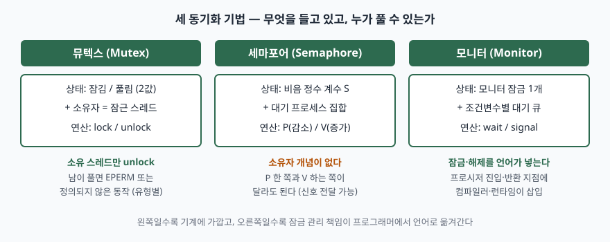
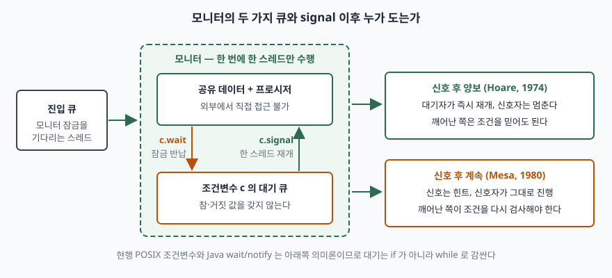

기출문제가 운영체제의 프로세스 동기화 기법 중 뮤텍스·세마포어·모니터를 설명하라고 묻는다.
셋을 각각 "상호배제를 위한 도구"로 정의하고 끝내면 세 문단이 서로 구분되지 않아 점수가 나지
않는다. 셋은 같은 문제를 **다른 추상화 수준에서** 푸는 도구이고, 갈라지는 축이 분명하다.
**소유권이 있는가, 계수를 세는가, 잠금을 누가 넣어 주는가**다. 이 세 축을 Ⅰ에서 먼저 세워
두고 각 장을 그 축 위에 올리면, 마지막 비교표가 앞 내용의 요약이 아니라 결론이 된다.

> 실행 검증 없음. 개념 문제이므로 표준 문서와 원 논문 근거만으로 정리했다.
> 연산의 의미, 뮤텍스 유형별 동작, 시그널 의미론은 전부 POSIX 규격과 원 논문에서 확인한
> 것이고, 근거를 찾지 못한 성능 수치나 오버헤드 배수는 적지 않았다.

---

## Ⅰ. 개요

### 가. 동기화가 필요한 까닭 — 임계구역 문제

둘 이상의 프로세스가 공유 데이터를 갱신할 때, 각자의 갱신이 여러 기계 명령으로 쪼개지면
그 사이에 문맥 교환이 끼어들 수 있다. 읽고-고치고-쓰는 세 동작 중간에 다른 프로세스가 같은
데이터를 읽으면 한쪽의 갱신이 사라진다. 결과가 **실행 순서에 따라 달라지는** 이 상태가 경쟁
상태이고, 그 원인이 되는 코드 구간이 임계구역이다.

임계구역 문제를 1965년에 처음 정식화한 Dijkstra의 원고는 해법이 갖춰야 할 조건을 못 박았다.
어느 한 프로세스가 임계구역에 있으면 다른 프로세스는 들어갈 수 없어야 하고(상호배제),
아무도 임계구역에 없는데 진입이 무한정 미뤄져서는 안 되며(진행), 상대의 수행 속도에 관한
가정을 두지 않아야 한다. 이어서 같은 원고가 그 해법의 도구로 **세마포어**를 내놓는다.

### 나. 세 기법이 갈라지는 축

> **출처**: 뮤텍스의 소유자 개념과 비소유 해제 동작은 [IEEE Std 1003.1-2017, `pthread_mutex_lock`](https://pubs.opengroup.org/onlinepubs/9699919799/functions/pthread_mutex_lock.html), 세마포어의 계수와 P/V 는 [Dijkstra, EWD123 §3.2·§4](https://www.cs.utexas.edu/~EWD/transcriptions/EWD01xx/EWD123.html), 모니터의 잠금 자동 삽입과 조건변수 큐는 [Hoare, Monitors: An Operating System Structuring Concept, CACM 17(10), 1974, pp.549–557](https://www.engineering.upenn.edu/~cis5050/hoare-monitors.pdf) 근거다.

세 기법은 역사적으로도 이 순서로 쌓였다. 세마포어가 먼저 나오고, 그것으로 상호배제를 짜는
일이 틀리기 쉽다는 경험에서 모니터가 나왔으며, 뮤텍스는 상호배제 용도만 남긴 세마포어에
**소유자**를 붙여 실수를 검출할 수 있게 만든 쪽이다.

## Ⅱ. 뮤텍스(Mutex)

### 가. 정의

뮤텍스는 **임계구역에 한 번에 한 스레드만 들어가도록 보장하는, 소유자를 기록하는 이진
잠금 객체**다. 잠금에 성공한 스레드가 그 뮤텍스의 소유자가 되고, 잠금을 푸는 권한은 원칙적으로
소유자에게만 있다. 이름 그대로 상호배제(mutual exclusion) 한 가지 목적에 특화돼 있다.

### 나. 동작 — 두 연산

POSIX 규격은 잠금 호출이 0을 돌려주고 끝나면 그 뮤텍스가 잠긴 상태가 되며 **호출한 스레드가
소유자**가 된다고 정한다. 이미 잠겨 있으면 호출한 스레드는 풀릴 때까지 블록되고, 해제는
소유자가 수행한다.

소유자를 기록한다는 설계 하나가 세마포어와의 차이를 거의 다 만든다. 잠근 쪽과 푸는 쪽이
같아야 한다는 제약 덕분에 **잘못된 해제를 런타임이 오류로 잡아낼 수 있고**, 소유자를 알고
있으니 뒤에 나올 우선순위 상속도 가능해진다.

### 다. 유형 — POSIX가 정한 4가지

같은 규격이 뮤텍스 유형 네 가지를 정하고, 유형별로 **자기가 잠근 것을 다시 잠글 때**와
**자기 것이 아닌 것을 풀 때**의 동작을 달리 규정한다. 답안에서 개수를 못 박을 자리다.

| 유형 | 소유자가 다시 잠글 때 | 소유자가 아닌데 풀 때 |
|---|---|---|
| `PTHREAD_MUTEX_NORMAL` | 교착 상태에 빠진다 | 정의되지 않음(robust면 오류) |
| `PTHREAD_MUTEX_ERRORCHECK` | 오류를 돌려준다 | 오류(`EPERM`)를 돌려준다 |
| `PTHREAD_MUTEX_RECURSIVE` | 잠금 횟수를 올리고 성공한다 | 오류(`EPERM`)를 돌려준다 |
| `PTHREAD_MUTEX_DEFAULT` | 정의되지 않음 | 정의되지 않음(robust면 오류) |

> **출처**: [IEEE Std 1003.1-2017, `pthread_mutex_lock` — Mutex Types 표](https://pubs.opengroup.org/onlinepubs/9699919799/functions/pthread_mutex_lock.html)

재귀 유형은 잠금 횟수를 유지하고, 그 횟수가 0이 될 때 비로소 뮤텍스가 풀린다. 유형을 따로
지정하지 않으면 `DEFAULT`이고 구현이 나머지 셋 중 하나처럼 동작할 수 있으므로, **이식성이
필요한 코드는 유형을 명시한다.**

### 라. 적용 시 고려사항 — 3가지

① **우선순위 역전.** 낮은 우선순위 스레드가 뮤텍스를 쥔 채 선점되면, 그 뮤텍스를 기다리는
높은 우선순위 스레드가 중간 우선순위 스레드들에게 계속 밀린다. 이 현상을 분석한 1990년 논문은
**기본 우선순위 상속 프로토콜**과 **우선순위 상한 프로토콜** 두 가지를 내놓았다. POSIX는 이것을
뮤텍스 속성으로 표준화해, `PTHREAD_PRIO_INHERIT`이면 소유자가 기다리는 쪽의 우선순위를 물려받고,
`PTHREAD_PRIO_PROTECT`면 소유한 뮤텍스들의 상한 중 가장 높은 값으로 올라간다. 기본값은 아무
조정도 하지 않는 `PTHREAD_PRIO_NONE`이다.

② **소유자의 비정상 종료.** 공유 메모리에 둔 뮤텍스를 쥔 프로세스가 죽으면 그 뮤텍스는 영영
풀리지 않는다. robust 속성을 주면 다음 잠금 시도가 `EOWNERDEAD`를 돌려주고 잠금 자체는
획득되지만, **보호하던 데이터는 일관되지 않은 상태로 표시된다.** 새 소유자가 그 상태를 복구할
책임을 진다.

③ **재귀 잠금은 증상을 가린다.** 같은 스레드가 다시 잠글 수 있게 만들면 당장의 자기 교착은
사라지지만, 잠금 구간이 어디서 시작해 어디서 끝나는지가 흐려진다. 불변식이 깨진 중간 상태에서
다시 진입하는 코드가 생기면 추적이 더 어려워진다.

## Ⅲ. 세마포어(Semaphore)

### 가. 정의

세마포어는 **비음 정수 값과 그 값을 불가분하게 증감시키는 두 연산(P·V)으로 구성된 동기화
도구**다. 원 정의에서 V 연산은 인자 세마포어의 값을 1 증가시키고, P 연산은 **그 결과가
비음이 되는 즉시** 값을 1 감소시킨다. 값이 0이면 P는 완료되지 못하고, 다른 프로세스가 같은
세마포어에 V를 수행해야 비로소 진행한다. 두 연산 모두 불가분 연산으로 규정된 것이 핵심이다.

### 나. 유형 — 2가지

| 구분 | 값의 범위 | 주 용도 |
|---|---|---|
| 이진 세마포어 | 0 또는 1 | 상호배제, 단일 자원 보호 |
| 계수(일반) 세마포어 | 0 이상의 정수 | 동일 자원 n개 관리, 생산자–소비자 |

원 논문이 일반 세마포어를 다루며 든 대표 응용이 **유한 버퍼**다. 빈 칸 수와 찬 칸 수를 각각
세마포어로 두면, 생산자는 빈 칸 쪽에 P를 걸고 소비자는 찬 칸 쪽에 P를 걸어 **흐름 제어와
상호배제가 같은 도구로** 표현된다.

### 다. 뮤텍스와 결정적으로 다른 점 — 3가지

① **소유자 개념이 없다.** P를 수행한 쪽과 V를 수행한 쪽이 달라도 된다. 그래서 세마포어는
상호배제뿐 아니라 **순서 강제와 신호 전달**에 쓸 수 있다. A가 끝나야 B가 시작해야 한다면
초깃값 0인 세마포어에 A가 V를, B가 P를 걸면 된다. 뮤텍스로는 이 패턴을 안전하게 표현할 수 없다.

② **계수로 n개를 허용한다.** 커넥션 풀처럼 동시 사용 가능 수가 1보다 큰 자원은 계수
세마포어가 자연스럽다.

③ **시그널 처리기 안에서 쓸 수 있다.** POSIX는 `sem_post`가 비동기 시그널 안전하며 시그널
처리 함수에서 호출될 수 있다고 명시한다. 뮤텍스 해제에는 이런 보장이 없다. 인터럽트·시그널
문맥에서 작업 스레드를 깨우는 통로로 세마포어가 쓰이는 이유다.

### 라. 깨어날 프로세스를 고르는 규칙

세마포어 자체는 "누구를 먼저 깨우는가"를 정하지 않는다. POSIX는 이 선택을 **스케줄링 정책에
위임**해, `SCHED_FIFO`·`SCHED_RR`에서는 대기 중인 가장 높은 우선순위 스레드가 깨어나고 같은
우선순위끼리는 가장 오래 기다린 쪽이 선택된다고 정한다. 프로세스 스케줄링 옵션을 지원하지
않는 구현에서는 **명시되지 않는다.** 답안에서는 "세마포어는 FIFO로 깨운다"고 단정하지 않는
것이 안전하다.

### 마. 적용 시 고려사항 — 3가지

① **P와 V의 짝이 코드상 멀리 떨어진다.** 상호배제에 쓸 때 V를 빠뜨리면 그 자원은 영구히
잠기고, 두 번 부르면 상호배제가 조용히 깨진다. 뮤텍스와 달리 **런타임이 잡아 주지 않는다.**

② **잠금 획득 순서가 어긋나면 교착이다.** 두 세마포어를 서로 반대 순서로 P하면 네 가지
교착 조건이 모두 성립한다. 자원마다 전역 순서를 정하고 그 순서대로만 P를 거는 것이 실무 해법이다.

③ **예외·조기 반환 경로.** 임계구역 중간에서 예외가 나가면 V가 실행되지 않는다. 언어가
제공하는 범위 기반 해제(RAII, `try…finally`)로 묶지 않으면 드물게 일어나는 경로에서 샌다.

## Ⅳ. 모니터(Monitor)

### 가. 정의

모니터는 **공유 데이터와 그 데이터에 접근하는 프로시저를 하나의 모듈로 묶고, 그 프로시저들이
한 번에 하나씩만 수행되도록 상호배제를 언어·런타임이 보장하는 동기화 구조**다. 1974년 논문은
모니터 안의 지역 변수가 모니터 바깥에서 접근 불가능해야 하며, 이 제약을 지키면 시간 의존적
코딩 오류의 상당 부분을 **프로그램 본문 검사만으로** 막을 수 있고 그 검사를 컴파일러가
자동화할 수 있다고 적는다. 잠금을 거는 책임이 프로그래머에서 **언어로 옮겨간** 것이 뮤텍스·
세마포어와의 근본 차이다.

### 나. 구성요소 — 4가지

| 구성요소 | 역할 |
|---|---|
| 공유 데이터 | 모니터 지역 변수. 외부 직접 접근 금지 |
| 진입 프로시저 | 공유 데이터에 접근하는 유일한 통로 |
| 진입 큐 | 모니터 잠금을 기다리는 프로세스의 대기 줄 |
| 조건변수 | 특정 조건이 성립하기를 기다리는 별도의 대기 줄 |

### 다. 조건변수 — wait와 signal

상호배제만으로는 "버퍼가 빌 때까지 기다린다" 같은 조건 대기를 표현할 수 없다. 모니터 잠금을
쥔 채 기다리면 아무도 조건을 바꿔 줄 수 없기 때문이다. 그래서 논문은 **대기 중 상호배제를
반납하는** wait 연산과, 대기 중인 프로세스 **정확히 하나**를 재개시키는 signal 연산을 도입한다.
기다리는 이유가 여럿이면 이유마다 조건변수를 따로 둔다.

여기서 시험에 자주 나오는 성질 두 가지가 나온다. **조건변수는 참도 거짓도 아니며 프로그램이
읽을 수 있는 값을 갖지 않는다.** 그리고 **대기자가 없을 때의 signal은 아무 효과도 없다.**
세마포어의 V가 값을 올려 기억해 두는 것과 정반대이므로, 조건변수에는 신호를 저장하는 기능이
없다는 점을 답안에 적어 두면 변별이 된다.

### 라. signal 이후 누가 도는가 — 2가지 의미론

> **출처**: 진입 큐·조건변수 큐와 신호 후 즉시 재개 규칙은 [Hoare, CACM 17(10), 1974](https://www.engineering.upenn.edu/~cis5050/hoare-monitors.pdf), 신호를 힌트로 보는 쪽과 `while` 재검사 규칙은 [Lampson & Redell, Experience with Processes and Monitors in Mesa, CACM 23(2), 1980, pp.105–117 §4](https://www.bennetyee.org/ucsd-pages/Courses/cse221.w01/lampson,redell.experiences_with_processes_and_monitors_in_mesa.pdf) 근거다.

원 논문은 signal 다음에 **곧바로** 대기 프로세스가 재개되며 그 사이에 제3의 프로세스가 모니터에
끼어들 수 없다고 못 박는다. 방금 반납된 자원을 제3자가 가로채지 못하게 하려는 설계다. 그 대신
신호를 보낸 쪽이 멈춰야 하므로 문맥 교환이 여러 번 더 든다.

1980년 Mesa 보고서는 반대로 간다. 신호는 조건이 성립했을 수 있다는 **힌트**이고, 깨어난
프로세스는 적당한 시점에 재개하며 그때 모니터 잠금을 다시 얻는다. 그 사이 다른 프로세스가
모니터에 들어갔을 수 있으므로 **깨어난 쪽은 매번 상황을 다시 판단해야 한다.** 그래서 대기는
`if`가 아니라 `while` 루프로 감싼다. 대기자 전원을 깨우는 broadcast, 시간 제한, 중단이라는
세 가지 변형도 이 보고서가 함께 정리했다.

현행 규격은 Mesa 쪽이다. POSIX 조건변수는 **가짜 깨어남이 일어날 수 있다**고 명시하고, 깨어난
뒤 술어를 다시 평가하라고, 근거 절에서는 조건 대기를 `while` 루프에 해당하는 형태로 감싸라고
권고한다.

### 마. 구현 사례 — 2가지

① **Java.** 언어 명세는 모든 객체에 모니터가 연결되어 있고 한 번에 한 스레드만 그 잠금을 쥘
수 있다고 정한다. `synchronized` 블록은 진입 시 잠금 동작을 수행하고, 본문이 정상 종료하든
예외로 빠져나가든 **해제 동작이 자동으로 수행된다.** 해제를 빠뜨릴 수 없다는 점이 세마포어
대비 이점이고, 조건 대기는 `wait`/`notify`가 맡는다.

② **POSIX.** 언어 차원의 모니터는 없지만 **뮤텍스 + 조건변수** 조합이 같은 역할을 한다. 조건
대기 호출은 호출 시점에 뮤텍스가 잠겨 있어야 하고, **뮤텍스 해제와 블록을 불가분하게** 수행한
뒤, 깨어날 때는 같은 뮤텍스를 다시 획득하고 돌아온다. 모니터의 wait를 그대로 옮긴 것이다.

### 바. 적용 시 고려사항 — 3가지

① **가짜 깨어남 대비는 선택이 아니다.** `while` 루프가 아니라 `if`로 대기하면 조건이 성립하지
않은 채 임계구역이 진행된다. 구현이 가짜 깨어남을 일으키지 않더라도, 신호와 재획득 사이에
다른 스레드가 조건을 되돌릴 수 있으므로 결과는 같다.

② **중첩 모니터 호출.** 모니터 안에서 다른 모니터의 프로시저를 부르고 거기서 대기하면, 안쪽
잠금은 반납되지만 바깥쪽 잠금은 쥔 채로 멈춘다. 서로를 부르는 모니터 쌍이 생기면 교착이다.
모니터 간 호출 순서에도 전역 순서를 정해야 한다.

③ **모니터 잠금으로 고수준 스케줄링을 하지 않는다.** Mesa 보고서는 모니터 잠금이 저수준
기구이며 "다음에 누가 프린터를 쓸 것인가" 같은 결정에 써서는 안 된다고 지적한다. 그런 결정은
요구사항을 기록해 두고 조건변수로 깨우는 **별도의 스케줄러**가 맡아야 한다.

## Ⅴ. 비교와 선택

### 가. 세 기법 대비표

| 비교 항목 | 뮤텍스 | 세마포어 | 모니터 |
|---|---|---|---|
| 추상화 수준 | 저수준 객체 | 저수준 객체 | 언어·런타임 구조 |
| 내부 상태 | 잠김/풀림 + 소유자 | 비음 정수 계수 | 모니터 잠금 + 조건변수 큐 |
| 소유권 | 있다 | 없다 | 모니터 잠금에 대해 있다 |
| 동시 진입 허용 수 | 1 | 초깃값 n | 1 |
| 해제 주체 | 소유 스레드 | 아무 프로세스나 | 프로시저 반환 시 자동 |
| 조건 대기 수단 | 없음(조건변수와 조합) | 계수 자체로 표현 | 조건변수 내장 |
| 신호의 기억 | 해당 없음 | 값으로 누적된다 | 누적되지 않는다 |
| 잘못 쓴 것의 검출 | 런타임 오류로 일부 검출 | 검출되지 않음 | 컴파일러·런타임이 대부분 차단 |
| 대표 구현 | POSIX 뮤텍스 | POSIX 세마포어 | Java `synchronized` |
| 전형 용도 | 짧은 임계구역 보호 | 자원 n개 관리, 순서 강제 | 조건이 얽힌 공유 객체 |

### 나. 선택 기준 — 3가지

① **지키려는 것이 한 덩어리의 코드면 뮤텍스.** 동시 사용 가능 수가 1이고 잠근 쪽이 바로 푸는
구조면 소유권 검사라는 안전망을 공짜로 얻는다.

② **세어야 할 것이 있거나 신호를 건너 보내야 하면 세마포어.** 자원 개수 제한, 작업 완료 통보,
시그널 처리기에서의 기상은 뮤텍스로 표현되지 않는다.

③ **조건 대기가 여럿 얽히면 모니터.** 대기 사유가 둘 이상이면 잠금과 조건변수를 손으로
조합하는 대신 언어가 보장하는 구조에 맡기는 편이 오류가 적다.

### 다. 셋에 공통으로 남는 위험 — 3가지

**교착**은 어느 기법을 써도 남는다. 상호배제·점유와 대기·비선점·환형 대기 네 조건이 그대로
성립하기 때문이고, 전역 잠금 순서를 정하는 것이 가장 현실적인 예방책이다. **우선순위 역전**도
남는다. 다만 소유자를 아는 뮤텍스는 상속 프로토콜로 완화할 수 있는 반면 소유자가 없는
세마포어에는 상속할 대상 자체가 없어, 실시간 시스템의 상호배제에는 세마포어를 쓰지 않는다.
마지막은 **잠금 범위 설계**다. 범위가 넓으면 동시성을 잃고, 좁히면 불변식이 깨진 중간 상태가
밖으로 보인다. 이 판단은 어떤 기법도 대신해 주지 않는다.

## Ⅵ. 결론

세 기법은 대체재가 아니라 **책임을 어디에 둘 것인가의 선택**이다. 세마포어는 모든 책임을
프로그래머에게 두는 대신 가장 넓게 쓰이고, 뮤텍스는 소유권을 기록해 잘못된 해제와 우선순위
역전을 다룰 수 있게 하며, 모니터는 잠금과 해제를 언어에 맡겨 **실수할 여지 자체를 없앤다.**
현행 POSIX와 Java의 조건변수가 모두 신호를 힌트로 보는 의미론이므로, 어느 기법을 쓰든 조건
대기는 반복 검사로 짜야 한다는 점이 세 장을 관통하는 실무 결론이다.

> 관련 개념 정리: [교착상태 4조건과 해결 기법](../../system/2026-10-12-deadlock-conditions-bankers-algorithm/index.md) · [프로세스와 스레드 — 문맥 교환 비용](../../system/2026-09-29-process-thread-context-switch-cost/index.md)

끝

## 답안 작성 메모

**무엇부터 쓰는가.** Ⅰ-나의 "세 축"(소유권·계수·언어 지원)을 첫 장에서 못 박고 들어간다.
이 축이 없으면 Ⅱ·Ⅲ·Ⅳ가 서로 비슷한 세 문단이 되어, 셋을 각각 외워 쓴 답안과 구분되지 않는다.
모식도도 Ⅰ에 붙인다. 뒤의 세 장이 전부 그 그림을 참조하게 된다.

**점수가 갈리는 지점은 셋이다.**

- **세마포어에 소유자가 없다는 성질과 그 귀결.** 소유자가 없으니 신호 전달과 순서 강제에
  쓸 수 있고, 동시에 우선순위 상속의 대상이 없어 실시간 상호배제에는 부적합하다. 한 가지
  성질에서 장점과 단점이 같이 나온다는 서술이 "외운 답안"과 "이해한 답안"을 가른다.
- **조건변수의 signal이 누적되지 않는다는 점.** 세마포어의 V와 정반대라는 대비로 쓰면
  두 기법을 같은 문장에서 변별하게 된다. 대기자가 없을 때 signal이 무효라는 원문 규정을
  근거로 붙인다.
- **Hoare 의미론과 Mesa 의미론의 구분, 그리고 현행 표준이 어느 쪽인가.** 여기까지 쓰면
  교과서 요약이 아니라 규격을 확인한 답안이 된다. `while` 루프로 감싸는 이유가 여기서 나온다.

**시간이 모자라면 무엇을 버리는가.** 버리는 순서는 ① 뮤텍스 유형 4가지 표(`NORMAL`과
`ERRORCHECK` 두 행만 남긴다), ② 세마포어의 기상 순서 규정, ③ Ⅴ-나 선택 기준이다.
**절대 버리지 않을 것**은 Ⅴ-가의 대비표와 각 장의 "고려사항" 항목들이다. 비교표는 채점자가
가장 빨리 항목을 세는 자리이고, 고려사항은 외운 지식인지 설계 판단인지를 가르는 자리다.

**빠지기 쉬운 함정.** "뮤텍스는 초깃값 1인 이진 세마포어와 같다"고 쓰면 감점 요인이다. 값의
범위만 같고 **소유권·비소유 해제 검출·우선순위 상속**이 전부 다르다. 반대로 모니터를
"객체지향 언어의 문법"으로만 설명하면 동기화 기법 설명이 아니라 언어 소개가 된다. 모니터의
핵심은 **진입 큐와 조건변수 큐가 분리돼 있다**는 구조에 있다.

**수치는 꼭 필요한 것만.** 뮤텍스 유형 4가지, 조건변수 의미론 2가지처럼 규격·원문에 적힌
개수는 그대로 쓴다. 반면 "세마포어가 모니터보다 몇 배 빠르다" 같은 비교 수치는 근거 없이
쓰기 쉬우므로 적지 않는다.

## 참고 자료

- [Dijkstra, Cooperating Sequential Processes (EWD123, 1965) — §3.2 세마포어와 P/V, §4 일반 세마포어](https://www.cs.utexas.edu/~EWD/transcriptions/EWD01xx/EWD123.html)
- [Hoare, Monitors: An Operating System Structuring Concept, CACM 17(10), October 1974, pp.549–557](https://www.engineering.upenn.edu/~cis5050/hoare-monitors.pdf)
- [Lampson & Redell, Experience with Processes and Monitors in Mesa, CACM 23(2), February 1980, pp.105–117](https://www.bennetyee.org/ucsd-pages/Courses/cse221.w01/lampson,redell.experiences_with_processes_and_monitors_in_mesa.pdf)
- [IEEE Std 1003.1-2017 (POSIX.1-2017), `pthread_mutex_lock` — 소유권과 뮤텍스 유형별 동작](https://pubs.opengroup.org/onlinepubs/9699919799/functions/pthread_mutex_lock.html)
- [IEEE Std 1003.1-2017, `pthread_mutexattr_getprotocol` — `PTHREAD_PRIO_INHERIT`·`PTHREAD_PRIO_PROTECT`](https://pubs.opengroup.org/onlinepubs/9699919799/functions/pthread_mutexattr_getprotocol.html)
- [IEEE Std 1003.1-2017, `pthread_cond_wait` — 불가분 해제·재획득과 가짜 깨어남](https://pubs.opengroup.org/onlinepubs/9699919799/functions/pthread_cond_wait.html)
- [IEEE Std 1003.1-2017, `sem_wait` — 세마포어 잠금 연산과 블록 조건](https://pubs.opengroup.org/onlinepubs/9699919799/functions/sem_wait.html)
- [IEEE Std 1003.1-2017, `sem_post` — 기상 대상 선택 규칙과 비동기 시그널 안전성](https://pubs.opengroup.org/onlinepubs/9699919799/functions/sem_post.html)
- [The Java Language Specification, Java SE 21 Edition §17.1 Synchronization](https://docs.oracle.com/javase/specs/jls/se21/html/jls-17.html)
- [Sha, Rajkumar & Lehoczky, Priority Inheritance Protocols: An Approach to Real-Time Synchronization, IEEE Transactions on Computers 39(9), September 1990, pp.1175–1185](https://doi.org/10.1109/12.57058)
