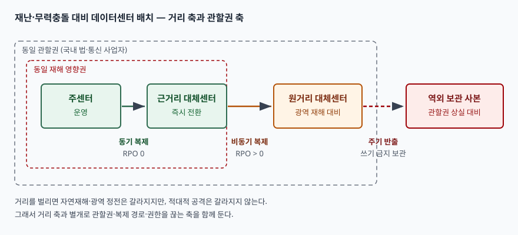

기출문제가 전쟁 같은 재난을 전제로 데이터센터의 지리적 위치를 어떻게 고르고 어떻게
대응할 것인지를 묻는다. 이 문항에서 가장 쉽게 빠지는 함정은 **입지 선정을 토목·건축
문제로 쓰는 것**이다. 지진대, 침수 이력, 고도, 인근 위험시설 같은 항목을 늘어놓으면
분량은 채워지지만 그건 건축사의 답안이지 정보관리기술사의 답안이 아니다.

정보기술 쪽에서 이 문항의 핵심은 하나다. **거리를 벌리면 위험은 갈라지지만 데이터는
못 따라간다.** 동기 복제는 커밋마다 왕복 지연을 물어야 해서 거리에 상한이 있고,
그 상한을 넘기면 RPO가 0이 아니게 된다. 그래서 위치 선정은 "얼마나 멀리"가 아니라
**"어느 거리 구간에 어떤 복구 수준을 배치할 것인가"** 의 문제가 된다. 여기에 전쟁이
들어오면 축이 하나 더 붙는다. 국토 전체가 영향권이면 거리로는 못 가르고, 관할권을
갈라야 한다.

> 실행 검증 없음. 표준 문서와 제조사 공식 문서 근거만으로 정리했다.

---

## Ⅰ. 개요

### 가. 문제 정의

데이터센터 입지는 **평상시 효율**(전력 단가, 네트워크 지연, 인력 접근성)과 **유사시
생존성**(동일 위험 비노출)이 정면으로 충돌하는 결정이다. 효율만 보면 수요지 가까이
모으는 것이 맞고, 생존성만 보면 멀리 흩는 것이 맞다. 전쟁·광역 재난은 이 충돌에서
생존성 쪽에 가중치를 몰아주는 조건이다.

### 나. 위협 유형 3가지와 분리 효과

| 위협 유형 | 영향 범위 | 거리 분리의 효과 |
|---|---|---|
| 국지 재난 (화재, 정전, 설비 고장) | 건물 단위 | 수 km로도 충분히 갈린다 |
| 광역 재난 (지진, 태풍, 홍수, 전력망 붕괴) | 수십~수백 km | 거리를 벌려야 갈린다 |
| 적대적 행위 (무력충돌, 사이버 공격) | 관할권·논리망 전체 | **거리로는 거의 안 갈린다** |

세 번째 줄이 이 문항의 출제 의도다. 미국 표준(NIST SP 800-53 Rev.5)은 대체 사이트
분리 항목(CP-7(1))의 해설에서, 충분한 분리 거리는 조직이 우려하는 위협 유형에 따라
정해지며 **적대적 공격 같은 위협에는 사이트 간 분리 정도가 덜 중요하다**고 적는다.
같은 문장이 대체 저장소 항목(CP-6(1))에도 그대로 있다. 즉 전쟁 문항에서 거리만
논하면 표준이 명시적으로 "그것으로는 부족하다"고 적어 둔 지점을 놓치는 셈이다.

---

## Ⅱ. 지리적 위치 선정

### 가. 선정 원칙 — 동일 위험 비노출

미국 표준(NIST SP 800-34 Rev.1)은 고정형 대체 사이트가 **주 사이트와 같은 재해에
부정적 영향을 받지 않을 지역**에 있어야 한다고 적는다. 같은 문서의 외부 보관시설
선정 기준(3.4.2절)은 다섯 항목을 든다.

1. **지리적 위치** — 주 사이트와의 거리, 그리고 같은 재해에 함께 당할 확률
2. **접근성** — 데이터를 회수하는 데 걸리는 시간과 시설 운영 시간
3. **보안** — 운송 수단·시설·인력의 보안 수준이 데이터 보안 요구를 만족하는가
4. **환경** — 온도·습도·화재 예방·전력 관리 등 시설의 구조·환경 조건
5. **비용** — 운송비, 운영비, 재해 대응·복구 서비스 비용

여기서 1번이 거리이고, 2번이 **거리의 반대급부**다. 둘은 같은 축의 양끝이라
한쪽을 키우면 다른 쪽이 깎인다. 입지 선정은 이 상충을 조정하는 일이다.

### 나. 평가 요인 5가지 — 정보시스템 관점

| 평가 요인 | 무엇을 보는가 | 왜 정보시스템 문제인가 |
|---|---|---|
| 자연위험 노출 | 지진대·침수·태풍 경로의 중첩 여부 | 두 센터가 같은 권역이면 복제본이 동시에 소실된다 |
| 전력 계통 독립성 | 서로 다른 변전·급전 계통에서 받는가 | 광역 정전은 복제 링크와 양쪽 센터를 한꺼번에 끊는다 |
| 통신 경로 다양성 | 사업자·관로·국제 관문이 겹치지 않는가 | 경로가 겹치면 복제 링크가 단일 장애점이 된다 |
| 복제 가능 거리 | 요구 RPO를 동기 복제로 맞출 수 있는 거리인가 | 거리가 곧 커밋 지연이고, 지연 한계가 곧 RPO 한계다 |
| 관할권 | 같은 법·같은 통제권 아래 있는가 | 무력충돌·행정 통제는 국경 단위로 작동한다 |

통신 경로 다양성은 표준에도 통제 항목으로 들어 있다. 대체 통신 서비스의 사업자
분리 항목(CP-8(3))은 주 사업자와 분리된 사업자에게서 대체 회선을 받되, **사업자 간
공용 설비를 최소화하고 서비스 간 충분한 지리적 분리를 확보**해 공통 취약점을 줄이라고
적는다. 회선 계약을 둘로 쪼개도 중간 관로가 하나면 분리가 아니라는 뜻이다.

### 다. 거리의 상한 — 동기 복제가 정하는 선

거리는 크면 클수록 좋은 값이 아니다. **동기 복제는 쓰기마다 원격 확인을 기다리므로
전파 지연이 그대로 응답 시간에 더해진다.** 제조사 문서가 이 한계를 숫자로 명시한다.
IBM은 동기 복제 방식인 Metro Mirror에 대해 **최대 300 km까지 지원**한다고 적고,
그보다 먼 거리는 비동기 방식인 Global Mirror 영역으로 넘긴다.

따라서 실무에서 거리는 단일 값이 아니라 구간으로 설계된다.

| 구간 | 복제 방식 | RPO | 막아내는 위협 | 막지 못하는 위협 |
|---|---|---|---|---|
| 근거리 (동기 복제 가능 거리) | 동기 | 0 | 건물 단위 재난, 설비 고장 | 광역 재해, 무력충돌 |
| 원거리 (동기 한계 초과) | 비동기 | 0 초과 | 광역 재해, 광역 정전 | 관할권 전체 상실 |
| 역외 (다른 관할권) | 주기 반출·오프라인 보관 | 반출 주기 | 관할권 상실, 파괴·탈취 | 즉시 전환 요구 |

한 구간만 고르면 반드시 못 막는 칸이 남는다. 그래서 둘 이상을 겹쳐 둔다.

> **출처**: [NIST SP 800-53 Rev.5 CP-6(1)·CP-7(1)·CP-8(3)](https://doi.org/10.6028/NIST.SP.800-53r5), [IBM DS8900F Documentation 9.4.0 — Metro Mirror / Metro-Global Mirror](https://www.ibm.com/docs/en/ds8900/9.4.0?topic=mirror-how-metroglobal-works)

3단 배치는 제조사 구현으로도 존재한다. IBM의 Metro/Global Mirror는 **로컬·중간·원격
세 곳의 저장장치**로 구성되며, 로컬에서 중간까지는 Metro Mirror로 동기 복제하고
중간에서 원격까지는 Global Copy로 비동기 복제한다. 로컬에 장애가 나면 중간 사이트에서
복구를 시작한다. 거리 구간을 쪼개는 설계가 표준뿐 아니라 제품에도 반영돼 있다는 뜻이다.

---

## Ⅲ. 대응전략

### 가. 대체 사이트 구성 — 소유 형태 3가지, 준비 수준 3단계

미국 표준(NIST SP 800-34 Rev.1 3.4.3절)은 대체 사이트를 두 갈래로 나눠 정리한다.

**소유 형태 3가지**: ① 조직이 직접 소유·운영하는 전용 사이트, ② 내·외부 주체와의
상호 지원 협정, ③ 상용 임차 시설.

**준비 수준 3단계와 변형 2가지**:

| 유형 | 설비 수준 | 통신 | 구축 시간 | 비용 |
|---|---|---|---|---|
| 콜드 사이트 | 공간·전력·환경설비만 | 없음 | 길다 | 낮음 |
| 웜 사이트 | 하드웨어·소프트웨어 일부 | 일부 또는 전부 | 중간 | 중간 |
| 핫 사이트 | 요구 사양을 갖추고 지원 인력까지 배치 | 전부 | 짧다 | 중간~높음 |
| 모바일 사이트 | 이동식 컨테이너형 | 장비에 포함 | 운송 시간에 좌우 | 상황별 |
| 미러 사이트 | 주 사이트와 기술적으로 동일 | 전부 | 즉시 | 가장 높음 |

표준은 같은 절에서 상용 임차의 함정도 짚는다. **여러 조직이 같은 대체 사이트를 두고
계약할 수 있어서, 재해가 그 고객들을 동시에 덮치면 시설이 전부를 수용하지 못한다.**
그래서 우선순위 조항을 계약에 넣어야 한다. 표준은 이를 별도 통제 항목(CP-7(3))으로도
둔다. 전쟁처럼 동시 다발 상황에서 특히 현실적인 위험이다.

### 나. 데이터 복제·백업 — 복구 가능한 사본을 남긴다

복제와 백업은 같은 말이 아니다. 복제는 주 사이트의 변경을 그대로 따라가므로
**삭제·암호화·훼손도 따라간다.** 전쟁 상황에서는 물리적 파괴와 함께 파괴형 악성코드가
들어오므로 복제만으로는 복구 지점을 남기지 못한다.

- **동기 복제**: 거리 상한 안쪽 구간에만 쓴다. RPO 0을 얻고 커밋 지연을 낸다
- **비동기 복제**: 거리 제약을 벗어나되 RPO가 0이 아니다. 지연 시간만큼의 손실을 받아들인다
- **시점 사본**: 복제본과 별도로 일정 시점을 고정해 둔다. 논리적 훼손은 여기서만 되돌린다
- **오프라인·쓰기 금지 보관**: 운영망에서 끊긴 사본. 표준은 중복 보조 시스템 항목(CP-9(6))에서,
  주 시스템과 같은 장소에 두지 않은 중복 시스템을 유지하면 그것이 백업 역할을 하며
  **지리적 분리가 충분하면 대체 처리 사이트로도 쓸 수 있다**고 적는다

접근성도 미리 따져 둬야 한다. 표준의 대체 저장소 접근성 항목(CP-6(3))은 광역 재난으로
대체 사이트에 접근하지 못할 상황을 식별하고 완화 조치를 명시하라고 요구하며, 그 예로
**또 다른 대체 저장소에 사본을 한 벌 더 두는 것**과 **전자적 접근이 끊겼을 때 물리적으로
회수하는 계획**을 든다. 전쟁 시나리오에서는 후자가 실제로 유일한 수단이 될 수 있다.

### 다. 전환과 복귀 — 절차를 문서가 아니라 훈련으로 검증한다

전환 설계만 하고 돌려보지 않으면 유사시에 작동하지 않는다. 표준은 훈련을 통제 항목으로
분리해 둔다.

- **대체 사이트에서의 훈련(CP-4(2))**: 대체 사이트 조건은 주 사이트와 크게 다를 수 있으므로,
  현지를 방문해 실제 가용 자원을 확인하는 과정에서 **취약점이 드러난다**고 적는다
- **완전 복구·재구성 훈련(CP-4(4))**: 알려진 상태로 되돌리는 전 과정을 훈련에 포함한다
- **자가 교란 훈련(CP-4(5))**: 시스템을 실제로 교란해 복원력을 평가한다. 표준은 이것이
  **예상치 못한 기능 의존성을 드러낸다**고 적는다
- **주 사이트 복귀 불가 대비(CP-7(6))**: 주 사이트로 돌아갈 수 없는 상황을 따로 계획한다.
  전쟁에서 주 사이트가 영구히 상실되는 경우가 여기에 해당한다

### 라. 제도적 요구 — 국내 기준

국내에는 데이터센터를 직접 겨냥한 행정규칙이 있다. 「집적정보 통신시설 보호지침」
(과학기술정보통신부고시 제2024-19호, 시행 2024. 6. 1.)이 데이터센터 사업자와 임차시설을
배타적으로 운영하는 사업자의 보호조치 기준을 정한다. 입지 자체를 규정하지는 않지만,
시설보호계획과 업무연속성계획을 두도록 하는 축이므로 답안에서 **국내 제도 근거**로
한 줄 인용할 가치가 있다.

---

## Ⅳ. 적용 시 고려사항

### 가. 거리로 안 갈리는 위협을 별도 축으로 설계한다

표준이 짚은 대로, 적대적 공격에는 거리의 효과가 작다. 복제 링크가 살아 있으면 공격도
따라 흐르고, 통합 인증이 하나면 두 센터의 권한이 한꺼번에 넘어간다. 따라서 거리 축과
별개로 **복제 경로를 끊을 수 있는 수단**, **센터별로 분리된 권한 체계**, **운영망에서
분리된 사본**을 함께 둔다. 거리는 자연재해용 수단이고 분리·격리는 공격용 수단이다.

### 나. 관할권과 데이터 국외 이전이 충돌한다

전쟁 대비에서 가장 강한 수단은 다른 관할권에 사본을 두는 것이지만, 개인정보·국가
핵심 데이터는 국외 이전에 법적 제약이 따른다. 따라서 데이터를 등급으로 나눠 **이전
가능한 범위만 역외로 보내고**, 나머지는 국내에서 거리로 분리하는 이원 설계가 현실적이다.
보관지의 법이 사본에 어떻게 미치는지(압수·공개 요구 등)도 선정 시 따져야 한다.

### 다. 비용은 거리가 아니라 준비 수준이 좌우한다

표준의 비교대로 미러 사이트가 가장 비싸고 콜드 사이트가 가장 싸다. 모든 업무를 같은
수준으로 올릴 수는 없으므로, 업무영향분석으로 **핵심 업무만 높은 준비 수준에 올리고**
나머지는 낮은 수준에 배치한다. 입지를 몇 군데 두느냐보다 어느 업무를 어느 구간에
배치하느냐가 비용을 결정한다.

### 라. 사람과 운영 체계도 함께 옮겨진다

대체 사이트가 가동되려면 운영 인력이 그곳에서 일할 수 있어야 한다. 표준은 고정형
사이트 선정 시 **인력·장비를 그곳으로 옮기는 데 드는 시간과 수단**을 고려하라고 적는다.
전쟁 상황에서는 이동 자체가 제한되므로, 원격 운영 가능성과 현지 상주 인력을 미리
설계에 넣어야 한다.

---

## Ⅴ. 결론

데이터센터 위치 선정은 거리 하나를 고르는 문제가 아니라 **거리 구간마다 다른 복구
수준을 배치하는 문제**다. 동기 복제의 거리 한계가 근거리 구간의 상한을 정하고, 광역
재해가 원거리 구간을 요구하며, 무력충돌이 관할권 축을 하나 더 세운다.

표준이 거듭 짚는 지점은 **같은 위험에 함께 노출되지 않을 것**이고, 동시에 **적대적
공격 앞에서는 거리의 효과가 작다는 것**이다. 두 문장이 함께 읽혀야 전쟁 대비 설계가
된다. 거리로 자연재해를 가르고, 관할권과 격리로 공격을 가르고, 훈련으로 그 둘이
실제로 작동하는지를 확인하는 것이 대응전략의 뼈대다.

> 개념 정리: [재해복구 전략 — RTO·RPO·MTD와 4가지 복구 방식](../../system/2026-10-02-disaster-recovery-mtd-rto-rpo-strategies/index.md)
>
> 개념 정리: [재해복구시스템 구축 수준 — 목표 시간을 백업 주기·복제 방식·훈련으로 옮기는 일](../../system/2026-10-20-dr-readiness-levels-backup-and-drills/index.md)
>
> 개념 정리: [불변 백업과 에어갭 — 복제가 따라가는 훼손을 끊는 사본](../../security/2026-10-26-immutable-backup-and-air-gap/index.md)
>
> 개념 정리: [데이터 주권과 국외 이전 — 역외 백업이 부딪히는 법적 제약](../../it-management/2026-10-27-data-sovereignty-and-cross-border-transfer/index.md)

끝

---

## 답안 작성 메모

**무엇부터 쓰는가.** Ⅰ-나의 위협 3분류 표를 가장 먼저 그린다. 이 표가 답안 전체의
설계도라서, 이것만 있으면 Ⅱ와 Ⅲ이 자동으로 채워진다. 국지·광역·적대적으로 나누고
세 번째 줄에 "거리로 안 갈린다"를 적어 두면, 채점자가 첫 장에서 이미 이 답안이
거리만 논하는 답안이 아님을 안다.

**점수가 갈리는 지점.** 세 군데다.

1. **동기 복제의 거리 상한을 숫자로 아는가.** 대부분의 답안이 "멀리 둔다"에서 멈춘다.
   300 km라는 제조사 명시 한계를 들고 "그래서 거리를 구간으로 나눈다"로 이으면
   입지 선정이 정보시스템 문제로 바뀐다. 이 한 줄이 토목 답안과 IT 답안을 가른다
2. **적대적 공격에 거리가 덜 듣는다는 점을 짚는가.** 문항이 "전쟁 등"이라고 쓴 이상
   여기를 안 짚으면 출제 의도를 비껴간다. 표준이 그 문장을 명시적으로 적어 뒀으므로
   근거까지 붙일 수 있다
3. **복제와 백업을 구분하는가.** 복제는 훼손도 따라간다는 한 문장이 Ⅲ-나 전체를 지탱한다.
   이걸 빼면 "3중화했으니 안전하다"는 틀린 결론이 된다

**시간이 모자라면 무엇을 버리는가.** Ⅲ-가의 소유 형태 3가지와 모바일·미러 변형은
줄여도 된다. 콜드·웜·핫 3단계 표만 남기고 변형은 한 줄로 언급한다. Ⅳ도 네 항목을
다 쓸 필요는 없고 가·나 둘만 남긴다. 반대로 **Ⅱ-다의 거리 구간 표와 모식도는 끝까지
남긴다** — 이 문항에서 가장 변별력이 큰 부분이다.

**모식도 그리는 순서.** 점선 사각형 둘(동일 재해 영향권, 동일 관할권)을 먼저 그리고
그 안팎에 박스 넷을 놓는다. 박스를 먼저 그리면 영역이 안 맞아 다시 그리게 된다.
화살표에는 복제 방식과 RPO만 적는다. 1분 안에 끝난다.

**쓰지 말아야 할 것.** 특정 지역명(어느 도시가 안전하다)과 근거 없는 거리 수치
(정부 권고 몇 km 같은 것)는 쓰지 않는다. 국내 법령에 데이터센터 간 최소 이격거리를
정한 조항은 확인되지 않았고, 틀린 숫자를 적으면 그 문장 하나로 신뢰를 잃는다.
숫자는 동기 복제 한계처럼 **출처가 분명한 것만** 쓴다.

---

## 참고 자료

- [NIST SP 800-34 Rev. 1, Contingency Planning Guide for Federal Information Systems](https://doi.org/10.6028/NIST.SP.800-34r1) (2010-05, 2010-11 갱신) — §3.4.2 외부 보관시설 선정 기준, §3.4.3 대체 사이트
- [NIST SP 800-53 Rev. 5, Security and Privacy Controls for Information Systems and Organizations](https://doi.org/10.6028/NIST.SP.800-53r5) (2020-09) — CP-6, CP-7, CP-8, CP-9 및 각 강화 항목
- [IBM DS8900F Documentation 9.4.0 — How Metro/Global Mirror works](https://www.ibm.com/docs/en/ds8900/9.4.0?topic=mirror-how-metroglobal-works) — 3사이트 구성, 동기·비동기 구간 분리
- [IBM DS8900F Documentation 9.4.0 — Metro Mirror](https://www.ibm.com/docs/en/ds8900/9.4.0?topic=copy-metro-mirror) — 동기 복제 최대 지원 거리 300 km
- [집적정보 통신시설 보호지침 (과학기술정보통신부고시 제2024-19호, 시행 2024. 6. 1.)](https://www.law.go.kr/LSW//admRulInfoP.do?admRulSeq=2100000241566&chrClsCd=010201) — 국가법령정보센터 행정규칙
