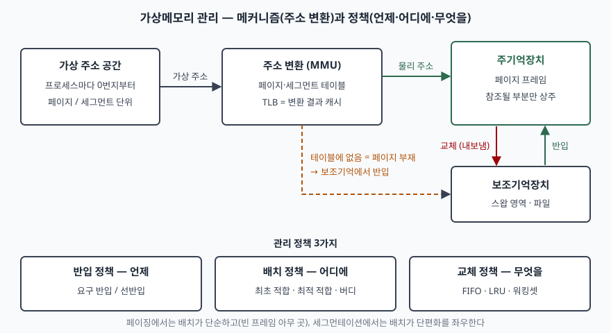
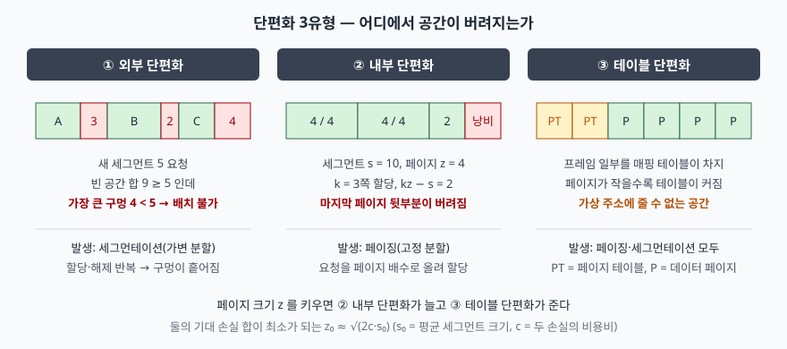

기출문제가 가상메모리에 대해 세 가지를 차례로 묻는다. 관리기법이 무엇인지, 단편화에는 어떤
유형이 있는지, 그 단편화를 줄이려면 어떻게 하는지다. 세 물음은 따로 떨어진 것이 아니다.
**관리기법을 무엇으로 고르느냐가 어떤 단편화가 생기는지를 정하고**, 단편화 유형이 정해지면
줄이는 방안도 유형마다 따로 나온다. 그래서 Ⅱ에서 기법을 "메커니즘"과 "정책"으로 갈라 두고,
Ⅲ에서 단편화 유형마다 **어느 기법에서 생기는지**를 붙이며, Ⅳ의 방안을 다시 그 유형에
대응시키면 세 장이 한 줄로 이어진다.

> 실행 검증 없음. 개념 문제이므로 원 논문과 Linux 커널 공식 문서 근거만으로 정리했다.
> 단편화 3유형과 정책 3분류, 최적 페이지 크기 식은 Denning(1970) 원문에서, 슬랩의 내부
> 단편화 상한은 Bonwick(1994) 원문에서, 압축·대형 페이지의 현행 동작은 커널 7.3.0 문서에서
> 확인했다. 다단계 페이지 테이블의 공간 절감은 OSTEP 교재 근거다. 근거를 찾지 못한 성능
> 배수는 적지 않았다.

---

## Ⅰ. 개요

### 가. 가상메모리의 정의

가상메모리는 **프로그램이 정보를 가리키는 주소와 기억장치가 물리 위치를 가리키는 주소를
분리하고, 프로그램이 낸 주소를 물리 주소로 자동 변환하는 기억장치 관리 방식**이다. Denning의
1970년 조사 논문은 이 두 주소 집합을 각각 **주소 공간**(address space)과 **기억 공간**(memory
space)으로 부르고, 둘을 구분하는 것이 가상메모리의 출발점이라고 정리한다. 1961년 Atlas의
단일 수준 기억장치(one-level store) 제안이 이 생각의 시초다.

### 나. 왜 필요했는가 — 오버레이의 한계

가상메모리 이전에는 프로그램이 주기억장치보다 크면 **프로그래머가 직접** 프로그램을 조각으로
나눠 서로 덮어쓰도록 순서를 짰다(오버레이). 고급 언어가 퍼지고 다중 프로그래밍으로 한
프로그램이 쓸 수 있는 메모리 크기를 미리 알 수 없게 되면서, 이 일을 사람이 하는 것은 비싸고
틀리기 쉬워졌다. 가상메모리는 **저장 공간 배정 문제를 프로그래머에게서 시스템으로 옮긴다.**
실제로 참조되는 부분만 주기억장치에 두므로 주기억장치보다 큰 프로그램을 돌릴 수 있고,
프로세스마다 독립된 주소 공간을 주므로 보호와 공유가 함께 해결된다.

### 다. 관리의 두 층 — 메커니즘과 정책

> **출처**: 주소 공간·기억 공간 구분과 반입·배치·교체 정책 3분류는 [Denning, Virtual Memory, ACM Computing Surveys 2(3), 1970 — Definition of Virtual Memory, Storage Utilization](https://dl.acm.org/doi/10.1145/356571.356573), 페이지 테이블·TLB 의 역할은 [Linux kernel 7.3.0 문서 — Concepts overview](https://docs.kernel.org/admin-guide/mm/concepts.html) 근거다.

Denning은 가상메모리를 **메커니즘**(주소를 어떻게 변환하는가)과 **정책**(그 메커니즘을 언제·
어디에·무엇을 기준으로 쓰는가)으로 나눠 다룬다. 이 구분이 Ⅱ의 뼈대다.

## Ⅱ. 가상메모리 관리기법

### 가. 메커니즘 — 주소 공간을 나누는 3가지 방식

| 기법 | 나누는 단위 | 주소 형태 | 강점 | 약점 |
|---|---|---|---|---|
| 페이징 | 고정 크기 페이지 | (페이지 번호, 변위) | 배치가 단순, 외부 단편화 없음 | 내부 단편화, 논리 단위와 무관 |
| 세그먼테이션 | 가변 크기 세그먼트(논리 단위) | (세그먼트 번호, 변위) | 모듈 단위 보호·공유 | 외부 단편화, 배치가 복잡 |
| 세그먼트-페이징 | 세그먼트를 다시 페이지로 | (세그먼트, 페이지, 변위) | 논리 단위 + 단순 배치 | 변환 단계가 하나 늘어남 |

① **페이징**은 주소 공간을 같은 크기의 페이지로, 주기억장치를 같은 크기의 프레임으로 자르고
페이지 테이블로 둘을 잇는다. 크기가 모두 같으므로 **빈 프레임이면 어디든** 넣을 수 있다.

② **세그먼테이션**은 코드·데이터·스택처럼 의미 있는 단위로 주소 공간을 자른다. 단위마다
길이가 다르므로 주기억장치에 **연속된 빈 공간**을 찾아 넣어야 하고, 변위가 세그먼트 길이를
넘는지 검사해 보호를 구현한다.

③ **세그먼트-페이징**은 두 방식을 겹친다. 논리 단위의 보호·공유는 세그먼트가, 물리 배치는
페이지가 맡는다. Denning의 페이징·비페이징 비교표는 페이징이 내부 단편화를 제외한 모든
항목에서 우월하다고 결론짓고, 그 근거로 **주기억장치를 같은 크기 블록의 집합으로 균일하게
다룰 수 있다**는 점을 든다. 오늘날 범용 운영체제가 사실상 모두 페이징 위에 서 있는 이유다.

### 나. 정책 — 3가지 결정

Denning은 정책을 세 종류로 나눈다.

| 정책 | 결정하는 것 | 대표 기법 |
|---|---|---|
| 반입(fetch) | **언제** 올릴 것인가 | 요구 반입(demand paging), 선반입(prepaging) |
| 배치(placement) | **어디에** 둘 것인가 | 최초 적합, 최적 적합, 버디 시스템 |
| 교체(replacement) | **무엇을** 내릴 것인가 | FIFO, LRU, OPT, 워킹셋 |

① **반입 정책.** 순수 요구 반입은 참조가 실패해 페이지 부재가 난 뒤에만 페이지를 올린다.
필요 없는 페이지를 올리지 않는 대신, 실행 초기에 작업 페이지가 **하나씩** 올라오는 비용을
치른다. 선반입은 곧 참조될 페이지를 미리 올려 이 비용을 줄이려는 것이다.

② **배치 정책.** 페이징에서는 빈 프레임 아무 곳에나 두면 되므로 사실상 문제가 되지 않는다.
세그먼테이션에서는 **구멍 목록에서 어느 구멍을 고르느냐**가 곧 단편화를 좌우한다. 최적
적합은 요청을 담을 수 있는 가장 작은 구멍을, 최초 적합은 주소 순으로 처음 맞는 구멍을
고른다. Denning이 인용한 Knuth의 모의실험에서는 최초 적합이 최적 적합을 포함한 넓은 범위의
알고리즘 가운데 가장 효율적이었다.

③ **교체 정책.** 빈 프레임이 없을 때 내보낼 페이지를 고른다. 이론적 최적(OPT)은 미래 참조를
알아야 하므로 구현할 수 없고, 실제로는 과거 참조로 미래를 추정하는 LRU 계열을 쓴다.

### 다. 다중 프로그래밍에서의 관리 — 워킹셋과 스래싱

여러 프로그램이 주기억장치를 나눠 쓸 때 교체 범위를 어떻게 잡느냐가 추가로 갈린다. 각
프로그램의 작업 공간 안에서만 교체하는 **지역 교체**와, 전체 프로그램을 한 덩어리로 보고
교체하는 **전역 교체**다. Denning은 전역 교체에서 메모리가 과다 할당되면 처리 효율이
무너지는 **스래싱**이 일어날 수 있다고 정리한다. 대책이 **워킹셋 모델**이다. 최근 일정
참조 구간(창) 안에서 참조된 페이지 집합을 그 프로그램의 워킹셋으로 본다. 워킹셋 원칙은
두 규칙으로 되어 있다. **워킹셋이 주기억장치에 있을 때만 프로그램을 실행하고**, 실행 중인
프로그램의 워킹셋에 속한 페이지는 내보내지 않는다. Denning은 이 원칙을 지역 정책의 한 형태로
분류한다.

### 라. 현대 구현이 덧붙인 2가지

① **TLB.** 페이징은 참조 한 번마다 페이지 테이블을 읽는 추가 접근을 부른다. TLB는 최근
변환 결과를 담아 두는 캐시로, Linux 커널 문서는 워킹셋이 큰 응용이 **TLB 부재로 성능
손실을 겪는다**고 적는다.

② **계층형 페이지 테이블과 대형 페이지.** 페이지 테이블을 여러 단계로 나누고, 더 큰 페이지를
**상위 단계 테이블에서 바로** 매핑할 수 있게 한다. 같은 문서는 대형 페이지를 쓰면 TLB 부담이
크게 준다고 적는다. 이 두 장치는 Ⅲ의 테이블 단편화, Ⅳ의 방안과 다시 이어진다.

## Ⅲ. 가상메모리 단편화 유형

### 가. 단편화의 정의

단편화는 **정보를 담아야 할 가상 주소에 물리 위치를 배정하지 못하게 되어 기억 공간이 버려지는
현상**이다. Denning은 이를 **3가지**로 나눈다. 외부·내부 두 가지만 쓰는 교과서가 많지만,
원문에는 매핑 테이블이 차지하는 공간까지 포함한 세 번째 유형이 있다.

> **출처**: [Denning, Virtual Memory, ACM Computing Surveys 2(3), 1970 — Storage Utilization: Fragmentation, Page Size (pp.168–169)](https://dl.acm.org/doi/10.1145/356571.356573), 외부·내부 단편화 용어는 [Randell, A Note on Storage Fragmentation and Program Segmentation, CACM 12(7), 1969](https://doi.org/10.1145/363156.363158) 근거다. 그림의 숫자는 설명용 예시다.

### 나. 3유형

**① 외부 단편화.** 비페이징(세그먼테이션) 기억장치에서 할당과 해제가 반복되면 세그먼트
사이에 구멍이 흩어진다. Denning은 이 모양을 바둑판(checkerboarding)이라 부르고, 이것이
심해져 **모든 구멍이 새 세그먼트보다 작아진 상태**를 외부 단편화로 정의한다. 빈 공간의
**합계는 충분한데** 연속된 공간이 없어 배치하지 못한다는 점이 핵심이다.

외부 단편화가 얼마나 생기는지는 Knuth의 **50% 규칙**이 알려준다. 평형 상태에서 구멍 수는
세그먼트 수의 약 절반이다. 세그먼트 하나의 오른쪽 이웃 영역에 일어나는 사건이 삽입과 삭제
반반이기 때문이다. 즉 구멍은 없앨 수 없는 정상 상태이고, 줄일 수 있을 뿐이다.

**② 내부 단편화.** 페이징 기억장치에서 요청은 페이지의 정수배로 올려 할당되므로 **마지막
페이지의 뒷부분이 버려진다.** 원문은 이를 식으로 적는다. 페이지 크기가 z, 세그먼트 크기가
s이면 s는 k쪽에 담기고((k−1)z < s ≤ kz), 마지막 페이지 안에서 **kz − s 만큼** 낭비된다.
할당된 영역 **안쪽**에서 버려진다는 점이 외부 단편화와 다르다.

**③ 테이블 단편화.** 페이지 테이블·세그먼트 테이블 같은 **매핑 테이블 자체가** 물리 공간을
차지해 그만큼을 가상 주소에 배정할 수 없는 현상이다. 페이징·비페이징 모두에서 생긴다.

### 다. 유형 비교

| 비교 항목 | 외부 단편화 | 내부 단편화 | 테이블 단편화 |
|---|---|---|---|
| 낭비 위치 | 할당 영역 **사이** | 할당 영역 **안** | 매핑 테이블 |
| 주로 생기는 기법 | 세그먼테이션(가변 분할) | 페이징(고정 분할) | 둘 다 |
| 원인 | 가변 크기 할당·해제 반복 | 요청을 단위 크기로 올림 | 변환 정보 저장 |
| 페이지가 커지면 | 해당 없음 | 늘어난다 | 줄어든다 |
| 대표 처방 | 압축, 배치 알고리즘, 페이징 | 페이지 크기 선택, 슬랩 | 대형 페이지, 계층형 테이블 |

### 라. 현대 시스템에서 다시 나타나는 외부 단편화

페이징이 가상 주소 수준의 외부 단편화를 없앴지만, **물리 프레임 수준에서는 같은 문제가 다시
생긴다.** 대형 페이지나 장치 버퍼처럼 **물리적으로 연속된 여러 프레임**이 필요한 할당이 있기
때문이다. Linux 커널 문서는 메모리 압축이 "단편화 문제"를 다루기 위한 장치라고 적고, 압축
여부를 정하는 기준으로 영역마다 **단편화 지수**를 계산한다. 답안에서 이 점을 짚으면 1970년대
이론이 지금도 살아 있는 문제라는 것을 보일 수 있다.

## Ⅳ. 가상메모리 단편화를 최소화하기 위한 방안

### 가. 외부 단편화를 줄이는 방안 — 4가지

① **페이징을 채택한다.** 가장 근본적인 처방이다. 모든 할당 단위를 같은 크기로 만들면
"구멍이 너무 작아 못 쓴다"는 상황 자체가 성립하지 않는다. Denning의 비교표는 페이징 기억장치의
외부 단편화를 **없음**으로 적는다. 대가는 내부 단편화다.

② **배치 알고리즘을 고른다.** 세그먼트를 써야 하면 구멍 선택 규칙이 단편화를 좌우한다.
Knuth의 결과를 인용한 Denning은 최초 적합이 효율적이고, 효율적인 운용을 위해서는 **주기억장치
크기가 평균 세그먼트 크기의 최소 10배**는 되어야 한다고 정리한다. 그는 또 큰 구멍을 유지하려면
그 대가로 메모리 일부를 비워 둬야 한다는 **미사용 메모리 규칙**도 함께 제시한다.

③ **버디 시스템으로 병합을 쉽게 만든다.** 블록 크기를 2의 거듭제곱으로 제한하고 크기별 빈
목록을 둔다. 큰 블록을 반으로 쪼개 요청을 맞추고, 해제할 때 짝(buddy)이 비어 있으면 즉시
합친다. 짝의 주소가 계산으로 정해지므로 **인접한 빈 블록을 찾는 비용이 작다.** Linux의
물리 페이지 할당기가 이 구조로, 2의 거듭제곱 크기(order)마다 빈 목록을 두고 쪼개기와 합치기를
수행한다.

④ **압축(compaction)한다.** 사용 중인 영역을 한쪽으로 옮겨 흩어진 구멍을 하나로 모은다.
Denning은 압축이 잘 정리된 구멍 목록을 검색하는 것보다 느려 **자주 쓰이지 않는다**고 평가했다.
현대 Linux는 이를 물리 프레임에 적용한다. 영역 아래쪽의 사용 중 페이지를 위쪽의 빈 페이지로
옮겨 연속 공간을 만들고, 백그라운드 스레드(`kcompactd`)나 할당 시점에서 동기적으로 수행한다.
`compaction_proactiveness`(기본 20)로 백그라운드 압축 강도를, `extfrag_threshold`(기본 500)로
단편화 지수가 얼마 이하면 압축 대신 회수를 택할지를 정한다.

### 나. 내부 단편화를 줄이는 방안 — 3가지

① **페이지 크기를 최적으로 고른다.** 페이지가 크면 마지막 페이지 낭비가 늘고, 작으면 테이블이
커진다. Denning은 평균 세그먼트 크기 s₀, 두 손실의 비용비 c에 대해 **둘의 기대 손실 합이 최소가
되는 페이지 크기 z₀ ≈ √(2c·s₀)** 를 유도했다. 기대 손실을 (s₀/z)·c₁ + (z/2)·c₂로 두고 z로
미분해 0이 되는 점을 구한 결과다. 단, 페이지 크기는 디스크 전송 효율도 함께 결정하므로 실제
값은 이 최적점보다 크게 잡히는 경향이 있다고 원문이 함께 지적한다.

② **두 가지 이상의 페이지 크기를 쓴다.** Randell이 제안한 분할 세그먼테이션은 세그먼트의 앞부분을
전송 효율이 좋은 **큰 페이지**로, 끝부분을 **작은 페이지**로 채워 내부 단편화를 마지막 작은
페이지 안으로 가둔다. 오늘날의 대형 페이지는 반대 방향의 선택이다. Linux THP 문서는 드문드문
접근하는 매핑에 4KB 대신 2MB 페이지가 쓰이면 **메모리가 낭비될 수 있다**고 적고, `madvise`
모드로 대형 페이지를 **요청한 영역에만** 쓰게 해 이 위험을 줄이라고 안내한다.

③ **객체 크기별 슬랩 할당기를 쓴다.** 커널은 페이지보다 훨씬 작은 객체를 자주 할당한다. 이것을
페이지 단위로 주면 내부 단편화가 크다. Bonwick의 슬랩 할당기는 한 장 이상의 페이지를 **같은
크기의 조각**으로 잘라 같은 크기 객체만 담는다. 슬랩 하나의 내부 단편화는 조각 수 n에 대해
1/n 이하이고, 원 구현은 이를 **12.5%(1/8)** 이내로 제한했다. 같은 크기끼리 모으므로 해제된
조각이 그대로 재사용되어 외부 단편화도 생기기 어렵고, 객체가 모두 비면 슬랩째 페이지를 반환한다.

### 다. 테이블 단편화를 줄이는 방안 — 2가지

① **계층형 페이지 테이블.** 선형 페이지 테이블은 힙과 스택 사이처럼 쓰지 않는 주소 구간에도
항목 자리를 잡아 둔다. 테이블을 페이지 크기로 잘라 상위 디렉터리로 묶으면, **유효한 항목이
하나도 없는 테이블 페이지는 아예 할당하지 않는다.** 그 결과 테이블 공간이 실제로 쓰는 주소
공간의 양에 비례하게 된다. 대가는 변환 시 메모리 접근이 단계 수만큼 늘어나는 것이고, 이것을
TLB가 가린다.

② **대형 페이지.** 상위 단계에서 바로 매핑하면 그 아래 단계 테이블이 필요 없고, TLB 항목 하나가
훨씬 넓은 범위를 덮는다. 내부 단편화가 늘어나는 대가를 나-②와 맞바꾸는 선택이다.

### 라. 방안별 대가 — 무엇을 얻고 무엇을 내주는가

| 방안 | 줄이는 단편화 | 대가 | 적용 수준 |
|---|---|---|---|
| 페이징 채택 | 외부 | 내부 단편화, 테이블 공간 | 가상 주소 |
| 최초 적합 등 배치 알고리즘 | 외부 | 구멍 목록 탐색 비용, 여유 메모리 | 세그먼트·힙 |
| 버디 시스템 | 외부 | 2의 거듭제곱 반올림에 따른 내부 단편화 | 물리 프레임 |
| 압축 | 외부 | 페이지 이동 비용, 할당 지연 | 물리 프레임 |
| 최적 페이지 크기 | 내부·테이블의 합 | 전송 효율과 상충 | 설계 시점 |
| 다중 페이지 크기 | 내부 | 변환 구조 복잡화 | 가상 주소 |
| 슬랩 할당기 | 내부·외부 | 크기별 캐시 관리, 유휴 객체 보유 | 커널 객체 |
| 대형 페이지 | 테이블·TLB 부재 | 내부 단편화, 압축 지연 | 가상·물리 |

이 표에서 읽어야 할 것은 **공짜인 방안이 하나도 없다**는 점이다. 외부 단편화를 없앤 페이징은
내부 단편화를 만들고, 버디 시스템은 병합을 쉽게 한 대가로 반올림 낭비를 만든다. 대형 페이지는
테이블 단편화와 TLB 부재를 줄이지만 내부 단편화와 압축 지연을 부른다. Linux THP 문서가
`defrag=always` 설정에서 할당이 **직접 회수와 압축을 하느라 멈출 수 있다**고 경고하는 것이
그 지연이다.

### 마. 운영 관점의 고려사항 — 3가지

① **워크로드에 맞춰 대형 페이지 정책을 고른다.** 메모리를 넓게 연속으로 쓰는 DB 버퍼 같은
워크로드는 대형 페이지의 이득이 크고, 드문드문 접근하는 워크로드는 낭비가 크다. 전역 `always`
보다 `madvise`로 영역을 지정하는 편이 안전하다.

② **장기 가동 시스템은 연속 할당 실패에 대비한다.** 물리 프레임의 외부 단편화는 가동 시간이
길수록 쌓인다. Linux hugetlbpage 문서는 대형 페이지를 부팅 시점에 할당하는 것이 메모리가
아직 단편화되지 않았으므로 **가장 확실한 방법**이라고 적고, 실행 중 할당은 그 순간 남은
연속 메모리 양에 따라 성패가 갈린다고 적는다. 연속 메모리가 꼭 필요하면 미리 예약한다.

③ **압축 통계를 감시한다.** 할당이 압축 때문에 멈춘 횟수(`compact_stall`)가 늘면 응답 지연의
원인이 단편화일 수 있다. 원인을 모르고 메모리를 늘리면 증상만 미뤄진다.

## Ⅴ. 결론

가상메모리는 주소와 위치를 분리해 저장 공간 배정을 시스템이 맡게 한 장치이고, 그 관리기법은
**메커니즘 3가지(페이징·세그먼테이션·세그먼트-페이징)** 와 **정책 3가지(반입·배치·교체)** 로
정리된다. 어떤 메커니즘을 고르느냐가 단편화의 종류를 정한다. 가변 분할은 **외부**, 고정 분할은
**내부**, 매핑 구조는 **테이블** 단편화를 만든다. 최소화 방안도 유형을 따라 갈리며, 어느 방안이든
한 유형을 줄이면서 다른 비용을 만든다. 따라서 단편화 관리는 제거가 아니라 **세 손실의 합을
워크로드에 맞춰 최소화하는 선택**이다. 페이징이 가상 주소 수준의 외부 단편화를 해결한 뒤에도
대형 페이지 시대에 물리 프레임 수준에서 같은 문제가 다시 나타난다는 점이 이 주제가 여전히
현역인 이유다.

> 관련 개념 정리: [페이지 교체 알고리즘과 벨레이디의 이상현상](../../system/2026-10-12-page-replacement-belady-anomaly/index.md)
>
> 개념 정리: [버디 시스템과 슬랩 할당기 — 단편화를 나눠 맡는 두 층](../../system/2026-10-27-buddy-system-and-slab-allocator/index.md)

끝

## 답안 작성 메모

**무엇부터 쓰는가.** Ⅰ-다의 "메커니즘과 정책" 구분을 먼저 세운다. "관리기법"을 페이징·
세그먼테이션만으로 쓰면 반입·배치·교체가 빠지고, 정책만 쓰면 단편화와 연결되지 않는다. 둘을
나눠 두면 Ⅲ에서 "어느 메커니즘에서 어느 단편화가 생기는가"를 바로 쓸 수 있다.

**점수가 갈리는 지점은 셋이다.**

- **단편화를 3유형으로 쓰는가.** 외부·내부 두 가지가 보통 답안이다. Denning의 **테이블
  단편화**를 더하고, 페이지 크기를 키우면 내부는 늘고 테이블은 준다는 상충을 쓰면 Ⅳ의 페이지
  크기 선택 방안이 근거를 얻는다.
- **방안을 유형에 대응시키는가.** 방안을 한 목록으로 나열하면 "어느 단편화를 줄이는지"가
  안 보인다. 유형별로 묶고, 각 방안이 **무엇을 대가로 치르는지**를 표로 붙이는 것이 핵심이다.
- **현대 시스템으로 내려오는가.** 물리 프레임 수준의 외부 단편화, 버디 할당기, 압축, 대형
  페이지의 내부 단편화까지 쓰면 교과서 요약이 아니라 현행 운영체제를 아는 답안이 된다.

**시간이 모자라면 무엇을 버리는가.** 버리는 순서는 ① Ⅱ-라 현대 구현 2가지, ② Ⅳ-마 운영
고려사항, ③ Ⅲ-라 물리 프레임 단편화다. **절대 버리지 않을 것**은 Ⅲ-다의 유형 비교표와
Ⅳ-라의 방안별 대가 표다. 채점자가 항목을 세는 자리다.

**빠지기 쉬운 함정.** "페이징은 단편화가 없다"고 쓰면 감점이다. 외부 단편화가 없을 뿐 내부
단편화는 있다. 반대로 "압축으로 모든 단편화를 해결한다"도 틀린다. 압축은 외부 단편화만
다루고, Denning이 지적했듯 비용 때문에 상시 수단이 되지 못한다.

**수치는 원문에 있는 것만.** 50% 규칙, 평균 세그먼트의 10배, 슬랩의 1/8, z₀ ≈ √(2c·s₀)는
모두 원문에서 확인한 값이다. "대형 페이지가 몇 배 빠르다" 같은 수치는 근거 없이 쓰기 쉬우므로
적지 않는다.

## 참고 자료

- [Denning, Virtual Memory, ACM Computing Surveys 2(3), September 1970, pp.153–189](https://dl.acm.org/doi/10.1145/356571.356573)
- [Randell, A Note on Storage Fragmentation and Program Segmentation, Communications of the ACM 12(7), July 1969, pp.365–369](https://doi.org/10.1145/363156.363158)
- [Bonwick, The Slab Allocator: An Object-Caching Kernel Memory Allocator, USENIX Summer 1994 Technical Conference — §3.2 Slabs, §3.4 Reclaiming Memory](https://www.usenix.org/legacy/publications/library/proceedings/bos94/bonwick.html)
- [Linux kernel 7.3.0 문서 — Concepts overview (Huge Pages, Compaction)](https://docs.kernel.org/admin-guide/mm/concepts.html)
- [Linux kernel 7.3.0 문서 — Documentation for /proc/sys/vm (compaction_proactiveness, extfrag_threshold)](https://docs.kernel.org/admin-guide/sysctl/vm.html)
- [Linux kernel 7.3.0 문서 — Transparent Hugepage Support](https://docs.kernel.org/admin-guide/mm/transhuge.html)
- [Linux kernel 7.3.0 문서 — Physical Memory (free_area, buddy allocator)](https://docs.kernel.org/mm/physical_memory.html)
- [Linux kernel 7.3.0 문서 — HugeTLB Pages (부팅 시 할당과 단편화)](https://docs.kernel.org/admin-guide/mm/hugetlbpage.html)
- [Arpaci-Dusseau, Operating Systems: Three Easy Pieces, Ch.20 Paging: Smaller Tables (다단계 페이지 테이블)](https://pages.cs.wisc.edu/~remzi/OSTEP/vm-smalltables.pdf)
